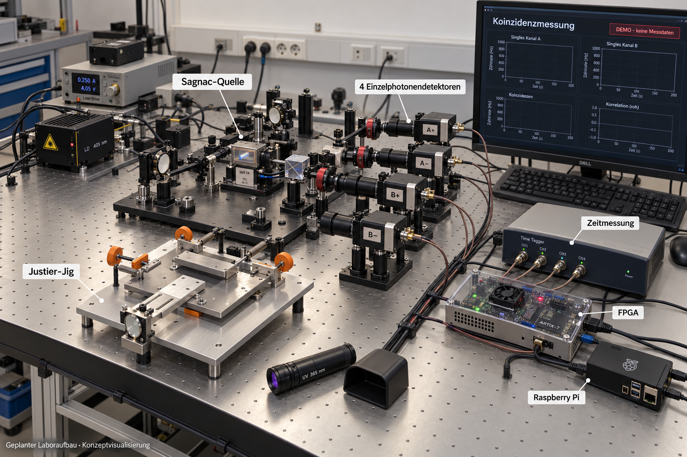

# X6 Spectral Astrolabium

**Eigenzeit: 99.810791015625% of the independent paired-motion square excluded.** [Complete new event coverage and remaining-region map](research/lorentz_local_dalembert/surface_tail/README.md) closes all 744 previously untested HOLD rectangles: 620 by marginal Poisson events and 124 by overlap-dependent count differences. **31 previously tested rectangles remain HOLD**, occupying 0.189208984375% of the chosen parameter area. The square remains partly unresolved; area is not probability and general stability remains open.

**Earlier Eigenzeit milestone (PR116): first independent two-support parameter square certified.** [Two-parameter cover and map](research/lorentz_local_dalembert/paired_surface/README.md) treats node-15/node-17 boosted-x displacements independently in [-0.1,0.1]^2. **95.269775390625% of this parameter area is excluded** as a strong close-law counterexample; **775 rectangles remained HOLD at that stage**; the tail pass above reduces this to 31. Exact bivariate operator bounds and overlap-aware Poisson tests preserve joint dependence. This area fraction is not a probability. The earlier 60 fixed paired directions remain excluded; the larger square and general stability remain open.

**Eigenzeit: all 60 frozen coordinated paired directions are now excluded continuously.** [Overlap-aware Poisson difference certificates](research/lorentz_local_dalembert/overlap_tails/README.md) close all 38 remaining cells with **TV >= 0.28571661749849482568 > 0.25**. All 30 fixed-base lines are covered for h in [-0.1,0.1]: no point simultaneously preserves order, has symmetric weight gap >20%, and full conditional count/overlap-law TV <=0.25. This settles the declared one-dimensional paired family; arbitrary paired and multi-support motion and general stability remain open.

**Earlier Eigenzeit milestone (PR114): 58 of 60 frozen paired directions excluded continuously.** [Exact Poisson-tail certificates](research/lorentz_local_dalembert/paired_tail/README.md) close 22 more directions and 536 of the 574 previously unresolved cells. At that stage two signed directions retained 38 explicitly archived HOLD cells; the overlap certificate above closes them. The strong-gap/close-law conjunction is excluded only on certified regions; general stability remains open.

**Earlier Eigenzeit milestone (PR113): 36 of 60 coordinated directions excluded.** [Paired-family certificate](research/lorentz_local_dalembert/paired_family/README.md) covers all remaining 58 signed rays with exact interval bounds and transported fixed-anchor count tests. It added 34 full-ray exclusions and retained 24 directions with HOLD intervals; the tail certificate above supersedes that coverage count. The strong-gap/close-law conjunction is excluded only on certified cells. General stability remains open.

**Eigenzeit: one coordinated pair is now covered continuously in both directions.** [Node-15/node-5 interval certificate](research/lorentz_local_dalembert/paired_continuous/README.md) excludes the strong-close-law conjunction for every h in [-0.1,0.1]. An exact rank-four operator bound and a correlation-preserving count-difference test close all 268 terminal cells. The 202 previously unresolved cells satisfy **TV >= 0.46181006724951309881**. This established the first two continuous signed-ray exclusions; the family expansion above supersedes its coverage count.

**Eigenzeit: first coordinated two-support family checked.** [420 coupled motions](research/lorentz_local_dalembert/coordinated_motions/README.md) yield no strong close-law pair. The last point has a 21.7147% operator-weight gap, but a certified joint Poisson event gives **TV >= 0.29903841735657376508 > 0.25**. An exact block argument explains why cancellation of a scalar count sum does not preserve the labeled count vector. This was a finite paired search; subsequent continuous certificates are listed above. General operator stability remains open.

**Eigenzeit: all 64 continuous fixed-base spatial rays excluded as strong close-law counterexamples.** [A joint Poisson event closes the last interval](research/lorentz_local_dalembert/joint_ray_obstruction/README.md): two geometrically disjoint observed counts prove **TV >= 0.26376136265637454647 > 0.25** throughout the remaining node-15 interval. Combined with the previous continuous cover, no step h in [0,0.1] on these rays satisfies unchanged order, weight gap >20% and TV <=0.25 simultaneously. Coordinated moves, other base geometries and global stability remain open.

**Eigenzeit: larger spatial moves, strong-pair question still open.** [512-candidate spatial search](research/lorentz_local_dalembert/spatial_search/README.md) certifies a **0.0434832%** operator gap at **TV <= 0.2118268**, an 11.9-fold gap gain. Of 18 admissible sampled candidates above 20% gap, a marginal-law certificate excludes three; 15 remain unresolved.

**Eigenzeit: common background certified; smoothing gain on hold.** [Common-background audit](research/lorentz_local_dalembert/background_smoothing/README.md) proves positive diagonal intensity for all 158 transfer labels. The additional smoothing bound remains weaker than coupling; best TV upper bound stays **0.01706315569576179848**.

**Eigenzeit: budgeted surface refinement certified.** [Targeted unresolved-cell refinement](research/lorentz_local_dalembert/adaptive_surface/README.md) retains all known certificates and lowers TV to **0.01706315569576179848** with 8,192 additional cell checks. Unresolved intensity upper bound falls by 49.73%; the operator gap is unchanged.

**Eigenzeit: actual-pair cancellation certified.** [Correlation-preserving surface tests](research/lorentz_local_dalembert/surface_correlations/README.md) certify 21 directed transfer patterns and positive cancellation on the unchanged pair. TV upper bound **0.01894939530593638801**; no improved reconstruction-accuracy claim.

**Eigenzeit: boundary localization certified.** [Moving-cone strip integration](research/lorentz_local_dalembert/boundary_transfers/README.md) lowers the unchanged pair's TV upper bound to **0.01981978079819577960**. All unresolved transfers are retained; additional cancellation remains **HOLD_FULL_PATTERN_LOCALIZATION**.

**Eigenzeit: sharper same-pair certificate.** [Paired membership transfers](research/lorentz_local_dalembert/paired_atoms/README.md) retain the exact Poisson void probability: TV upper bound **0.22119921517101921040**, down from 0.24999999774322784776. The operator gap is unchanged; transfer localization remains on hold.

**Eigenzeit joint-law resolution audit (22 October 2026):** [membership-atom bound and validated integration](research/lorentz_local_dalembert/joint_atoms/) — toy improvement verified; actual PR95 pair remains HOLD_VOLUME_RESOLUTION. Unresolved atom mass is retained; no improved actual-pair TV certificate yet.

**Eigenzeit coordinated-motion certificate (22 October 2026):** [uniform 48-dimensional budget exclusion](research/lorentz_local_dalembert/coordinated_budget/) — all fixed-base support motions passing the exponential slab coupling gate have symmetric weight gap <=2.083767%, below the >20% strong gate. This excludes this sufficient-certificate search, not global instability.

**Eigenzeit reference-point scan (22 October 2026):** [18 exact comparisons across nine conformal references](research/lorentz_local_dalembert/reference_scan/) — six admissible pairs; largest certified gap 0.22651% at TV <=0.248425. No strong pair in this finite search; no global stability claim.

**Eigenzeit continuous sensitivity certificate (22 October 2026):** [exact derivative and verified interval cover](research/lorentz_local_dalembert/conformal_sensitivity/) — the fixed-base symmetric gap is uniformly below 16.68% in the current certificate-covered flow range, excluding its >20% strong gate. This is not a global stability or actual-TV exclusion theorem.

**Eigenzeit conformal transport (22 October 2026):** [quadratic full-law bound and exact search](research/lorentz_local_dalembert/conformal_transport/) — 40 coordinated deformations preserve order; a same-pair TV bound improves from 1 to 0.24843, with 0.1575% weight separation. Inner landmarks move; no 10% impossibility or stability claim.

**Eigenzeit shape coupling (22 October 2026):** [fixed-anchor search and exact full-law bound](research/lorentz_local_dalembert/shape_coupling/) — 288 candidates, 252 geometry passes, no strong pair; 32 true order violations isolated from four margin-only rejections. This finite negative search does not prove stability.

**Eigenzeit full-law bound (22 October 2026):** [exact Poisson reduction and certificate](research/lorentz_local_dalembert/full_law_scaling/) — a close scaling pair gives a small statistical weight-error lower bound; a proved stopping rule excludes this family as a close-law 10% counterexample. All HOLDs retained.

**Eigenzeit held-out Poisson testing (22 October 2026):** [sealed test and full replay](research/lorentz_local_dalembert/poisson_testing/) — the existing witness pair is distinguishable: 76.95% empirical accuracy, conservative lower bound 65.83%; a TV lower bound, not a reconstruction guarantee. All HOLDs retained.

**Eigenzeit actual overlap audit (22 October 2026):** [volume checks and numerical risk](research/lorentz_local_dalembert/witness_overlap_volumes/) — both witness geometries satisfy all 8,177 pairwise-volume constraints, subject to explicitly probabilistic integration bounds; no statistical indistinguishability or 10% impossibility claim.

**Eigenzeit joint operator bound (22 October 2026):** [proof and controlled comparison](research/lorentz_local_dalembert/joint_operator_bounds/) — joint information improves all 19 contraction bounds, but 0/19 full-set accuracy certificates; all HOLDs retained.

**Eigenzeit joint-overlap audit (22 October 2026):** [proof, results and field target](research/lorentz_local_dalembert/joint_overlap_bounds/) — 21,868 pair-difference ranges tightened, but no marginal-box or full operator accuracy improvement; all HOLDs retained.

**Neu: das verständliche X6-Wiki · New: the plain-language X6 wiki**

**[Deutsch](https://thomasmgfeller.github.io/x6-spectral-astrolabium/wiki/de/)** · **[English](https://thomasmgfeller.github.io/x6-spectral-astrolabium/wiki/en/)**

Acht Kapitel je Sprache: Einstieg, Schnellstart, Signale, kausale Ordnungen, Evidenz, Forschungsbereiche, Glossar und FAQ. Eight chapters per language, with practical examples and links to the original evidence.

**Public Research Preview — independent validation requested. NOT a scientifically certified stable release.**

**Eigenzeit: Poisson-Abdeckung und endliche Fehlergrenze hergeleitet (22.10.2026) — HOLD.**
[Beweise, vollständige Auswertung und Reproduktion](research/lorentz_local_dalembert/finite_poisson_bounds/README.md):
Ein konservativer Bereich deckt unter dem festgelegten Poisson-Modell alle
1.736 Zählmittelwerte gleichzeitig mit mindestens 97,86 % ab, auch bei
überlappenden Intervallen. Eine obere Operatorfehlergrenze ist hergeleitet;
sie zertifiziert auf dem vollständigen Bereich jedoch in keinem der 19
berechenbaren Fälle höchstens 10 % Gewichtsfehler. Kleine lokale Bereiche sind
zertifiziert, haben aber keine statistische Abdeckungsgarantie.
**Keine neue Genauigkeitsfreigabe und kein Unmöglichkeitsbeweis.**

**Eigenzeit: endliche Zählgenauigkeit mathematisch geprüft (22.10.2026) — HOLD.**
[Herleitung, konkretes Geometriepaar und exaktes Zertifikat](research/lorentz_local_dalembert/stability_information/README.md):
Zwei Geometrien erfüllen dieselbe Ordnung auf 21 ausgewählten Punkten und
liegen nahe im festgelegten Zählfehlermodell; ihre Operatorgewichte unterscheiden
sich dennoch um 14,82 %. Daraus folgt für dieses Modell eine untere Grenze von
7,41 % für den schlimmsten relativen Gewichtsfehler. Die vorab festgelegte
25%-Schwelle wurde nicht erreicht; keiner der 76 Suchläufe konvergierte.
**Kein globaler Stabilitätsbeweis und keine statistische Unmöglichkeitsaussage
für das vollständige Poisson-Experiment.** Alle wissenschaftlichen HOLDs bleiben.

**Eigenzeit: Suchreihenfolge korrigiert und auf 32 neuen Wolken geprüft (22.10.2026) — HOLD.**
[Neue Paarprüfung, Code und vollständige Evidenz](research/lorentz_local_dalembert/eligibility_before_cap/README.md):
Eignung wird nun vor der 128er-Begrenzung geprüft. Die Auswahl steigt von
18/32 auf 20/32, ohne verlorene Altfälle; gefordert waren 26/32. Auf 180 neuen
Zählwolken bleibt der paarweise Operatorfehler praktisch gleich, nur 1/32
Hauptsysteme erfüllt die vollständige Kausalordnung. Zehn Ausfälle haben im
festen Suchbereich überhaupt keinen zählgeeigneten vierten Punkt, zwei scheitern
bereits am Basisaudit. Alle 60 verbliebenen Paarfehler betreffen Stützpunktpaare.
317 Gewichtssysteme und 761 zulässige Kandidatenrahmen intern gegengeprüft.
**Technische Korrektur belegt; praktische Freigabekriterien verfehlt.**

**Eigenzeit: Suchbegrenzung und Zählvarianz getrennt geprüft (22.10.2026) — HOLD.**
[Diagnose, neue Zählwolken und vollständige Evidenz](research/lorentz_local_dalembert/stability_followup/README.md):
Die vollständige Suche findet bei 9/13 alten Auswahlfehlern zulässige vierte
Landmarken außerhalb der vorgezogenen Begrenzung. 31.293 Kandidaten geprüft;
28/32 Auswahlen wären auf den bekannten Konfigurationen geometrisch möglich.
Ein neuer Kovarianz-Fit senkt auf 171 neuen bedingten Zählwolken die Varianz
gegenüber dem Poisson-Fit um 40,59 %, verfehlt aber die Operatorgenauigkeit
gegenüber direkter Inversion. **Keine Übernahme; wissenschaftlicher HOLD bleibt.**

**Eigenzeit: kausal eingeschränkten Rohzähl-Fit auf 32 neuen Wolken geprüft (22.10.2026) — HOLD.**
[Verfahren, vollständige Evidenz und Entscheidung](research/lorentz_local_dalembert/causal_count_fit/README.md):
19 Auswahlen, 171 Zählläufe; 18/32 statt 2/32 ordnungskonforme Hauptsysteme.
Auf 18 gemeinsamen berechenbaren Fällen sinkt der Operator-RMSE um 9,51 %
(gefordert 10 %), die Antwortvarianz über neue Zählwolken steigt auf das
2,215-Fache. **Ordnungskonsistenz verbessert; Verfügbarkeit und Stabilität
reichen nicht. Keine Übernahme, alle wissenschaftlichen HOLDs bleiben.**
[Technischer Abschluss](research/lorentz_local_dalembert/CAUSAL_FIT_CI_COMPLETION.json):
Alle fünf GitHub-Workflows zu PR #84 sind erfolgreich beendet, einschließlich
aller acht Lorentz-BD-Teiljobs. Der wissenschaftliche HOLD bleibt unverändert.

**Eigenzeit: Ursachen der Kausalitätsfehler isoliert (22.10.2026) — HOLD bleibt.**
[Diagnose, vollständige Daten, Code und Sechs-Punkte-Gegenbeispiel](research/lorentz_local_dalembert/causal_order_diagnosis/README.md):
Alle 39 verletzten Beziehungen der gültigen Hauptsysteme betreffen
rekonstruierte Stützpunktpaare. Exakte Landmarken- und Stützpunktabstände
stellen bei denselben 18 ausgewählten Konfigurationen die Ordnung wieder her;
das ist eine Diagnose mit wahrer Geometrie, keine einsatzfähige Korrektur.
162 archivierte Zählläufe, 1.296 Austauschtests und 216 neue bedingte Zählwolken
sind dokumentiert. 80/120-Dezimalstellen bestätigen alle 5.275 geprüften
Paarvorzeichen. **Keine neue wissenschaftliche Freigabe.**

**Eigenzeit: vier Landmarken auf neuen Wolken geprüft (21.10.2026) — HOLD.**
[Intrinsische Auswahl, vollständige Zählkovarianz, Daten und Sage-Prüfung](research/lorentz_local_dalembert/four_landmark_count_covariance/README.md):
32 neue Auswahlwolken, 18 erfolgreiche Auswahlen und 162 Zählwiederholungen;
nur **1/32 Hauptfälle geometrisch qualifiziert**. Auf 13 gemeinsam berechenbaren
Diagnosefällen steigt der Operator-RMSE von 2,007 auf 2,533. Die volle
Zählkovarianz beschreibt die beobachtete Varianz deutlich besser (4,46 vorhergesagt,
4,92 beobachtet; ohne Korrelationen 65,12), erreicht aber nur 13 statt der
geforderten 16 vollständigen Gruppen. **Rechenprüfung bestanden; keine
wissenschaftliche Freigabe. Bisherige HOLD-Gates bleiben.**

**Entwicklungsgeschichte der intrinsischen Eigenzeit-Korrektur ergänzt:**
[Ursprüngliches V1/V2-Paket mit Herleitung, Code, allen alten Fällen und Sage-Nachweisen](research/lorentz_local_dalembert/intrinsic_correction_development/README.md).
V1 wurde wegen schlechterer Operatorgenauigkeit verworfen; V2 war damals nur
für exakte Distanzen geprüft. Die spätere Prüfung auf neuen Wolken steht oben.
**Historische Evidenz unverändert; keine zusätzliche Freigabe.**

**Eigenzeit: unabhängige Sage-Prüfung veröffentlicht (21.10.2026).**
[Code, Daten, Ergebnisbericht und vollständiges Prüfpaket](research/lorentz_sage_reconstruction_audit/README.md):
SageMath 10.9 bestätigt 16 exakte Kontrollen und 2.104 Prüfaussagen auf 64
archivierten Wolken (58 vollständig, sechs Ausfälle erhalten). Im alten Testblock
reproduziert der Geometrieaustausch den Operator-RMSE **1,446311 → 0,063032**.
**Retrospektive unabhängige Rechenprüfung; neue Wolken, nutzbare Korrektur und
4D-Übertragung sind damit nicht bestätigt. Alle bisherigen HOLD-Gates bleiben.**
English scope and reproduction instructions are included in the linked report.

**Numerical audit (2026-10-15):** [a reproducible small-weight scaling defect](docs/numerics-v1/README.md)
was reproduced and repaired. Historical 25/27 FAIL evidence remains preserved;
the repaired solver passes 27/27 frozen cases, 23 regression checks, two exact Sage
checks and 37 browser checks. See the [repair report](docs/numerics-v1/repair/REPORT.md)
for source bindings and limits. [Check 4](docs/numerics-v1/extended/README.md)
extends qualification through 120 vertices and records the unresolved-gap limits.

This repository publishes the actual **X6 v4.2 RC** browser application, alongside the **v4.3 community audit kit**. The application combines experimental signal/Fourier analysis, a model-dependent signal-to-graph mapping, and exact rational lower bounds for finite weighted undirected graph Laplacians.

## New: RAX-CQG Causal-Set Benchmark 0.2.0

**[Open the Causal-Set Lab](https://thomasmgfeller.github.io/x6-spectral-astrolabium/app/rax-cqg-lab.html)** ·
[Download the approved package](docs/research/rax/cqg-benchmark-v0.2.0/RAX_CQG_Benchmark_v0_2_0.zip) ·
[Sources, checks and limitations](docs/research/rax/cqg-benchmark-v0.2.0/README.md)

Corrected finite-order operations, interval counts, actual graph spectra and 240
reproducible pilot runs. The approved package is preserved byte-for-byte, with
28 Python test methods, 28 Python/JavaScript parity cases and 16 UI logic checks.
**Research software prototype; no quantum-gravity, KR-suppression or continuum
claim.** The classical graph field and assumed quantum clock have separate scopes.
The architecture below remains a research programme with open physical questions.

## New: RAX-CQG research architecture v0.1

**[Read the 19-page architecture (PDF)](docs/research/rax/cqg-v0.1/RAX_CQG_Forschungsarchitektur_v0_1.pdf)** ·
[Markdown and sources](docs/research/rax/cqg-v0.1/ARCHITECTURE.md) ·
[Word document](docs/research/rax/cqg-v0.1/RAX_CQG_Forschungsarchitektur_v0_1.docx)

Relational axioms, causal histories, discrete curvature, predictive distillation
and stable reconstruction form a mathematical research architecture for emergent
quantum dynamics. **Research draft, not an established physical theory.**
CQG-01–08 are specified but have not been executed as a test campaign.
[Publication scope and checksums](docs/research/rax/cqg-v0.1/README.md).

[](experiments/photonic-two-qubit/README.md)

*Proposed photonic two-qubit setup: AI concept illustration, not a photograph
of an assembled experiment or experimental evidence for RAX-CQG.
[Design and schematic](experiments/photonic-two-qubit/README.md).*

## Start here — understand, try, verify

X6 is an open research hub for **signal validation, finite spectral graph
references and Lorentzian causal-order research**. It offers browser experiments,
executable reference calculations and research plans with explicit evidence limits.

**[Open Astrolabium](https://thomasmgfeller.github.io/x6-spectral-astrolabium/app/)** ·
**[Open Signal Validation Lab](https://thomasmgfeller.github.io/x6-spectral-astrolabium/app/signal-lab.html)**

**[Research portal](https://thomasmgfeller.github.io/x6-spectral-astrolabium/)** ·
**[Deutsch](https://thomasmgfeller.github.io/x6-spectral-astrolabium/de/)** ·
[All modules](https://thomasmgfeller.github.io/x6-spectral-astrolabium/modules/)

| Your goal | Start here |
| --- | --- |
| Understand the questions and scientific limits | [Plain-language guide](https://thomasmgfeller.github.io/x6-spectral-astrolabium/guide/#understand) |
| Explore signals, Fourier analysis and graph models | [Astrolabium browser application](https://thomasmgfeller.github.io/x6-spectral-astrolabium/app/) |
| Try a synthetic signal experiment | [Signal Validation Lab](https://thomasmgfeller.github.io/x6-spectral-astrolabium/app/signal-lab.html) |
| Reproduce a documented reference | [Pinned reference edition](https://thomasmgfeller.github.io/x6-spectral-astrolabium/modules/reference-edition.html) |
| Inspect sources, evidence and open acceptance gates | [Searchable module catalogue](https://thomasmgfeller.github.io/x6-spectral-astrolabium/modules/) |
| Use machine-readable navigation | [Authoritative register](MODULE_REGISTRY.json) · [Derived index](hub-index.json) · [Optional llms.txt](llms.txt) |

**Read scope with results:** source availability is not maturity; software checks,
exact finite calculations, simulations and physical measurements are distinct.
Independent external replication and physical device qualification remain open.
The catalogue renders the dated register without changing its claims or source pins.
Detailed research updates and reproduction instructions follow below.

**C2-Krümmungsintervalle abgeschlossen:** [Kontrollierte Geometrie und konservative Überdeckung](research/lorentz_de_sitter_c2/RESULTS.md) für die bekannte uniforme de-Sitter-Familie. Exakte rationale Restfehler und Monotonie; mindestens 95% Überdeckung bei unabhängigem, festem Wolkenbudget. **16.384 neue Wolken, keine 20%-Präzisionsfreigabe.** Vollständiger Replay bestanden; die unten verlinkte KL-Stufe schärft diese statistische Referenz. Keine allgemeine Uhr oder Dichteidentifikation. [Einfach erklärt (DE/EN)](wiki/de/causal-orders.html#de-sitter-c2).

**KL-Effizienzschritt abgeschlossen:** [Schärfere Intervalle mit gleicher endlicher Absicherung](research/lorentz_de_sitter_kl/RESULTS.md). Die hinreichenden Budgets sinken um **Faktor 2,71–2,77**. **77.824 neue Wolken vollständig reproduziert**; bei h=0,5 und M=16.384 erreichen vier von vier KL-Intervallen 20%-Präzision, gegenüber einem von vier mit Hoeffding. Bekannte uniforme Dichte und festes Budget bleiben erforderlich; externe Prüfung steht aus. [Einfach erklärt (DE/EN)](wiki/de/causal-orders.html#de-sitter-kl).

**Varianz-/Bennett-Schritt abgeschlossen:** [Analytische Wolkenvarianz und weitere Budgetsenkung](research/lorentz_de_sitter_variance/RESULTS.md): **Faktor 2,89–4,10 gegenüber KL**, bei gleicher modellbedingter 95%-Absicherung. **45.056 neue Wolken vollständig reproduziert**; getrennte geometrische Gegenrechnung und [Prüfpaket](research/lorentz_de_sitter_variance/REVIEW.md). Bei h=0,5, M=4.096 qualifizieren fünf von acht Intervallen, gegenüber null von acht mit KL. Ein breiteres kleines Gruppenintervall bleibt dokumentiert; Dichte- und Zeitskalenfehler sowie externe Prüfung bleiben offen. [Einfach erklärt (DE/EN)](wiki/de/causal-orders.html#de-sitter-variance).

**De-Sitter-Informationsplanung abgeschlossen:** [16.384 neue Punktwolken](research/lorentz_de_sitter_information/RESULTS.md) prüfen eine kovarianzbewusste Einparameter-Schätzung. Zusätzliche Ketten senken den RMSE im Hauptvergleich nur um **1,37%**; das vorab gesetzte **10%-Ziel wird verfehlt**. Vollständiger Replay bestanden. Datenbudgets bleiben approximativ; Krümmungsintervalle sind nicht qualifiziert. Der nächste Ansatz konzentriert sich auf Zweierketten und eine kontrollierte geometrische Vorwärtsrechnung. [Einfach erklärt (DE/EN)](wiki/de/causal-orders.html#de-sitter-information).

**BD-Poisson-Referenz geprüft:** [Geglätteter Benincasa–Dowker-Operator gegen C2](research/lorentz_bd_reference/RESULTS.md), 384 Entwicklungs- und 6.144 getrennte Testwolken; alle 6.528 Wolken vollständig wiederholt. Der vorab lokal fixierte Hauptvergleich verfehlt den Nutzen: **NO_GO für variable Krümmung in diesem Pilotbudget**. Bei kleinen Dichten bleiben einzelne Vorteile dokumentiert. Bekannte Dichte und Eigenzeit T=1; keine allgemeine Dominanz oder Uhrqualifikation. Der [Boguñá–Krioukov-Zweig](research/lorentz_local_dalembert/README.md) enthält jetzt die [Machbarkeitsdiagnose gemeinsamer Momente](research/lorentz_local_dalembert/moment_feasibility/RESULTS.md): 48 weitere frische Wolken; bei höchster Dichte 16/16 bisherige Kappen mit festen Zeitgewichten lösbar, mittlere minimale Gewichtssumme 0.845×Basis. **CAP_MOMENT_FEASIBILITY_SUPPORTED** ist eine koordinatengestützte Existenzdiagnose; angepasste Momente sind keine unabhängige Validierung. Weiterhin **HOLD_PHASE3**. Der anschließende [intrinsische Landmarkenversuch](research/lorentz_local_dalembert/intrinsic_moments/RESULTS.md) ist mit **INTRINSIC_MOMENT_HOLD** abgeschlossen: 48 neue Testwolken vollständig wiederholt, 42 verfügbare Nachbarschaften ohne zulässiges Landmarken-Triplett und sechs unverfügbar. Beide intrinsischen Arme übernehmen 0/48 neue Gewichtssätze; die Rückfallbasis bleibt unverändert. Der Rauschschutz wird nicht erreicht. Die koordinatengestützte Vergleichsrechnung verbessert unabhängige Felder, qualifiziert aber keine intrinsische Rekonstruktion. Die anschließende [Landmarken-Verfügbarkeitsdiagnose](research/lorentz_local_dalembert/landmark_availability/RESULTS.md) prüft dieselben 48 Wolken retrospektiv: auch ohne Kandidatengrenze 0/42 zulässige Tripletts; für 31/42 belegen exakte Zählschranken die Unmöglichkeit. Eine größere Suchliste allein löst den Engpass nicht. Vollständiger Replay bestanden; **HOLD_PHASE3** bleibt bestehen. Der neue [Vergleich größerer äußerer Diamanten](research/lorentz_local_dalembert/outer_diamond/RESULTS.md) umfasst 48 frische Wolken und 144 gepaarte Varianten: bei höchster Dichte steigt die unbeschränkte Triplett-Verfügbarkeit auf 16/16, aber nur 8/16 Bezugssysteme entstehen und 0/16 bestehen den unveränderten Rauschschutz. Alle 42 verfügbaren inneren Supports haben mindestens ein zu kleines Zählintervall, das äußere Erweiterungen nicht verändern. **OUTER_DIAMOND_HOLD; HOLD_PHASE3**.

**Gemeinsame BK-Machbarkeit geprüft:** [48 frische Wolken](research/lorentz_local_dalembert/joint_feasibility/RESULTS.md) prüfen adaptive zeitliche und weitere Supports sowie einzelne Bezugssysteme mit Landmarken aus Vergangenheit und Zukunft. Bei Dichten 2048/8192/32768 bestehen **0/16, 1/16 und 16/16** Fälle die unveränderten Zähl-/Stabilitätsgrenzen samt verborgener zweiter Farbaufteilung. Vollständiger Replay bestanden. **JOINT_FEASIBILITY_SUPPORTED** im hochdichten 2+1-Referenzmodell; veränderte Auflösung, keine Operator- oder Krümmungsfreigabe. Als Nächstes: Momentgewichte und Rauschverstärkung prüfen. **HOLD_PHASE3**.

## Lorentz: vollständige n=7-Prüfung

Die [vollständige exakte Studie](research/lorentz_n7_complete/README.md) widerlegt
H7-bidirectional-moments: Spektren, Endpunktzahlen und beide Gabelzählungen ergeben
**2.043 Klassen für 2.045 Ordnungen**. Zwei nichtisomorphe Paare bleiben; alle
[Gegenbeispiele](research/lorentz_n7_complete/COUNTEREXAMPLES.md) sind erhalten.
Ein getrennter Prüfer durchläuft alle 2.097.152 oberen Binärmatrizen und rechnet
7.350 Polynome für n≤7 exakt nach. Das vollständige Gradpaar-Multiset trennt n≤7,
ersetzt aber nicht die widerlegte skalare Hypothese. Keine physische Validierung.
Die [n=6-Vorgängerstudie](research/lorentz_n6_residuals/README.md) und die gemeinsame
Zehn-Berichte-Referenzsuite bleiben erhalten; n=7 besitzt einen eigenen Prüfweg.

Die [Abhängigkeitsprüfung aller 39 registrierten Module](research/lorentz_h7_dependency_audit/README.md)
fand keinen konkreten laufenden Rechenweg, der H7-Eindeutigkeit voraussetzt.
Gleiche Signaturen dürfen keine Isomorphie oder eindeutige Rekonstruktion begründen.
Quellenlücken, insbesondere fehlende NQK-Archive, bleiben ausdrücklich offen.

**Strukturelle Erklärung der H7-Gegenbeispiele:** [Exakte Zertifikate und Beweise](research/lorentz_h7_structure/README.md) erklären beide n=7-Paare durch reguläre orthogonale Ähnlichkeit. Eine explizite Konstruktion liefert zusammenhängende H7-Kollisionen für jedes n≥8. Sie zeigt außerdem eine präzise Grenze weiterer Matrixpolynom-Spektren. Nachträgliche Analyse, keine Neuheits- oder Physikbehauptung.

**Vorab festgelegter Merkmalsvergleich:** [Nachbarschaftsprofile und Einpunkt-Erweiterungen](research/lorentz_observable_comparison/README.md) wurden exakt verglichen. N1 und Q1 trennen alle sechs bekannten Kontrollpaare; N1 benötigt keine zusätzlichen Spektralpolynome. Die neue kleine Stichprobe enthält bereits unter H7 keine Kollision und belegt daher keinen Zusatznutzen. Empfehlung nur als Vorfilter mit vollständiger Isomorphieprüfung.

**Belastungstest gleicher N1-Profile:** [207 verschiedene reguläre Zweischichtenordnungen](research/lorentz_n1_stress/README.md) wurden exakt geprüft. Q1 trennt 24 von 25 nichtisomorphen H7+N1-Kollisionspaaren; ein Paar mit 16 Elementen bleibt auch unter Q1 gleich. 23.193 Polynome wurden getrennt gegengeprüft. Lokale Vorabfestlegung mit dokumentierter blockierter öffentlicher Vorabveröffentlichung; keine allgemeine Rekonstruktionsgarantie.

**Diagnose des Restpaars:** [Gerichtete Paarverfeinerung und exaktes Trennzeugnis](research/lorentz_residual_diagnosis/README.md) unterscheiden das H7+N1+Q1-Restpaar in Runde 2. R2 trennt alle 6.849 größeninternen Paare des vorhandenen Korpus; Zweier- und Dreier-Schnittprofile scheitern am Restpaar. Zwei getrennte Implementierungen, vollständige Rundenspuren und ein direktes Relationszertifikat sichern den Befund. Nachträgliche Diagnose bekannter Daten, keine allgemeine Eindeutigkeits- oder Physikbehauptung.

**Transfer und Grenze von R2:** [Vorab veröffentlichter Familientest](research/lorentz_relational_transfer/README.md) mit 72 neuen Ziehungen und zwei getrennten Strukturkontrollen. Q1 und R2 trennen jeweils die 539 nichtisomorphen Stichprobenpaare. Zwei Ordnungen mit je 32 Elementen bleiben jedoch auch unter H7+N1+Q1+R2 gleich; ein vollständiges Vierer-Schnittzertifikat beweist ihre Nichtisomorphie. Sämtliche 541 Paarentscheidungen und 6.294 Polynome je Rechenweg wurden getrennt gegengeprüft. Keine allgemeine Rekonstruktionsgarantie.

**Welche relationale Information erhalten bleiben muss:** [Schnittprofile und begrenzte Rekonstruktion](research/lorentz_relational_boundary/README.md) prüfen 217 Ordnungen und 7.088 Paare. Dreifache Schnitte trennen das 32er-Restpaar; dennoch scheitern selbst Histogramme aller Schnittordnungen allgemein. Eine explizite Gegenbeispielfamilie und ein eingeschränkter Rekonstruktionssatz erklären den Unterschied zwischen bloßen Häufigkeiten und zugeordneten Teilmengenwerten. 434 vollständige Rekonstruktionen sind exakt gegengeprüft; die beschriftete Darstellung ist kein universeller kompakter Fingerabdruck.

**Knoten-Zuordnung und erster Geometriepilot:** Die [Folgestudie nach PR #39](research/lorentz_matching_geometry/README.md) ergänzt explizite Knotenbijektionen: 7.088 Paarentscheidungen und 651 umbenannte Kopien bestehen. Ein Sechsknoten-Gegenbeispiel zeigt die Grenze getrennter Dreischicht-Rekonstruktion; ein begrenzter Satz mit gemeinsam indizierten Nachbarschaften ist bewiesen. Auf 720 neuen synthetischen Ordnungen liefern die getesteten P123-Schnittprofile keinen nachgewiesenen Zusatznutzen gegenüber Linkgraden, Intervallhäufigkeiten und Hasse-Laplace-Spektren. Der vorab definierte Hauptvergleich fällt negativ aus; keine geometrische oder physikalische Validierung.

**Exakter Dichte-/Höhenabgleich:** Die [neue Kontrollstudie](research/lorentz_matched_controls/README.md) prüft 24.576 frische Kandidaten. Fünf Vergleiche liefern genügend Paare mit identischen Knotenzahlen, Relationszahlen und Höhen; vier bleiben wegen unzureichender Überlappung ohne Leistungsbewertung. Die reine Dichte-/Höhenkontrolle erreicht exakt 50 %. Im primären Vergleich gegen gestörte Gitter bei 64 Knoten beträgt der Zusatznutzen von P123 −3,91 Prozentpunkte, mit 95%-Paar-Bootstrap-Intervall [−9,77;+1,56]: kein nachgewiesener Zusatznutzen. Vollständiger Auswahlledger, verwendete Rohdaten und getrennte Gegenprüfungen sind archiviert.

**Erste geometrische Schätzaufgabe abgeschlossen:** [Normierte Eigenzeit zwischen markierten Ereignissen](research/lorentz_proper_time/RESULTS.md). 6.912 Ordnungen und 27.648 Vorhersagen sind intern gegengeprüft. Die Intervallpunktzahl erfüllt im bekannten flachen 1+1-Modell die vorab festgelegten Hauptkriterien: RMSE 0,031614 gegenüber 0,177785 für die Dichte-/Höhenregression. Bei der größten exakt abgeglichenen Zusatzkontrolle reichen 63 statt 128 Paare nicht für eine Leistungsbewertung. Das ist eine begrenzte Schätzerqualifikation; externe Replikation und allgemeinere geometrische Aussagen bleiben offen.

**Eigenzeit mit expliziter Unsicherheit und Abbruchregeln:** Der [gemeinsame Einstieg](research/lorentz_proper_time_publication/README.md) verbindet die ursprüngliche Referenz mit dem [d-dimensionalen Gültigkeitsbereich](research/lorentz_proper_time_domain/README.md), [zeituniformem Nachbeproben und einmaliger Kettendiagnostik](research/lorentz_proper_time_sequential/README.md). Veröffentlicht sind 49.152 Punktwolken, vollständige sequenzielle Zählläufe, Rohdaten und Reproduktion. Die Stichprobenplanung erklärt den Unterschied zwischen festen Budgets und adaptivem Stoppen. Ketten warnen vor Modellabweichungen; Krümmungserkennung und eine Anwendung außerhalb des bekannten flachen Stichprobenmodells bleiben unqualifiziert. Die neuen Quellen wurden lokal vor den Ziehungen fixiert, nicht öffentlich präregistriert.

**Eigenzeit selbst erkunden:** [Interaktives Eigenzeit-Labor](https://thomasmgfeller.github.io/x6-spectral-astrolabium/app/proper-time.html) und [ausführbares Jupyter-Notebook](research/lorentz_proper_time_lab/eigenzeit.ipynb) zeigen Punktwolken, Schätzung, 95%-Intervalle, Ketten und Wiederholungen. Feste Stichprobe im bekannten flachen Modell; [Bedienung und Software-Gegenprüfung](research/lorentz_proper_time_lab/README.md).

**V1b-Technikabschluss (20.10.2026):** [Regel, Regression und Browser-/Exportnachweis](research/lorentz_proper_time_lab/v1b_boundary/README.md). Der U=0-Randfall wird durch begrenzte Kandidatenverwerfung behandelt; die 196.608 bisherigen nativen Referenzpunkte bleiben unverändert. **V1b insgesamt: NOT_PASSED**, weil die geerbte radiale 4D-Diagnostik weiterhin die festgelegte Grenze verfehlt. Der technische Browsernachweis ist bestanden (192 Matrixfälle, 196 Replay-Paare); [Originalberichte und Rohdaten](research/lorentz_proper_time_lab/v1b_boundary/results/) sind vollständig eingefroren. [Historische Portkorrektur und Originaldaten](research/lorentz_proper_time_lab/v1b_port_correction/README.md) bleiben erhalten.

**Krümmungsbenchmark abgeschlossen:** [Ergebnisse und vollständiger Replay](research/lorentz_curvature/RESULTS.md). 8.702 Ordnungen nach öffentlich fixiertem Vertrag; beide Empfindlichkeitskriterien verfehlt. Im stärksten primären de-Sitter-Fall melden C2/C3/C4 118/512 Fälle, die längste Kette 5/512. 3.072 konforme Dichtezwillinge zeigen dieselbe Ordnung trotz verschiedener Krümmung. Ein universeller Krümmungssensor aus der Ordnung allein ist bei unbeschränkt unbekannter Beprobungsdichte nicht identifizierbar. [Einfach erklärt (DE/EN)](wiki/de/causal-orders.html#curvature-test).

**RSS bei fester Punktzahl abgeschlossen:** [Herleitung, Ergebnisse und Replay](research/lorentz_rss_fixed_n/README.md). 24.576 unabhängige Wolken nach öffentlicher Quellenfixierung. Das gemeinsame ±5%-Präzisionsziel bleibt unerreicht; die unabhängige C2-Integration stützt die korrigierte Vorhersage. Die untersuchte Krümmungsinversion streut bei N=64/128 sehr stark. [Einfach erklärt (DE/EN)](wiki/de/causal-orders.html#rss-fixed-n).

**Eigenzeit v0.2 — Gültigkeitsbereich und Informationsbedarf:** Die [deterministische Gültigkeitskarte](research/lorentz_proper_time_validity/RESULTS.md) umfasst 1.176 Kombinationen. Alle 714 innerhalb ihrer deklarierten Modellklasse erreichen mindestens 95% Überdeckung; 192 erfüllen zusätzlich das Präzisionsziel. Selektive Beobachtungslücken können trotz vieler Daten falsche Präzision erzeugen. Extern begrenzte Dichtefehler lassen sich konservativ absichern, mit einer verbleibenden Genauigkeitsgrenze. Vollständige Daten, getrennte Integral-/CDF-Gegenprüfung und Replay sind veröffentlicht; keine allgemeine Krümmungsfreigabe.

**Freies Feld und Entropiereferenz:** Der [neue RAX-CQG-Baustein](research/free_field_entropy/RESULTS.md) definiert Zustand, Korrelationen, Rand und Nullmoden. 13 Gegenprüfungen einschließlich einer bekannten Oszillatorentropie bestehen; 64 neue Causal-Set-Ordnungen sind vollständig berechnet. Die Hauptsteigung 0,358 mit 95%-Intervall [0,260; 0,458] ist mit 1/3 vereinbar, erfüllt aber die vorab verlangte Präzision und Cutoff-Stabilität nicht: **REFERENCE_NOT_ESTABLISHED**. Geometrieantworten und zusätzlicher Nutzen gegenüber bisherigen Merkmalen bleiben offen.

## Frozen reference edition and validation hardening

The [QE reference edition](https://github.com/thomasmgfeller/x6-spectral-astrolabium/releases/tag/reference-2026.10.15-qe1)
extends the unchanged [first reference release](https://github.com/thomasmgfeller/x6-spectral-astrolabium/releases/tag/reference-2026.10.15).
It provides a [documented offline reproduction](docs/reference-qe-v0.1/EXTERNAL_REPRODUCTION.md),
ten finite reports, the [guarded declarative RAX runner](docs/validation-v1/README.md)
with 33 adversarial controls and [three preserved original agent artifacts](docs/agent-archive/2026-10-15/README.md).
Person-level external replication remains **NOT_PERFORMED**. The edition does not
qualify industrial performance, physical hardware or quantum memory.

## X6-QE: exact finite graph references

[X6-QE v0.1](research/x6_qe/README.md) checks a star, a primitive four-cycle and the
cospectral rook/Shrikhande pair. Equal full adjacency spectra and global Ihara zeta
functions coexist with different local K4 counts. These known references have
separate exact algebraic checks, twelve relabelings and 21 deliberate rejections.
The original spider geometry, billiards, transport and arithmetic-residue tests
remain [explicit future gates](research/x6_qe/ROADMAP.md). Lorentz remains the priority.

## Start here: actual module and evidence status

The [central module register](docs/MODULE_REGISTRY.md) lists **50 modules** with
their authoritative branch and commit, prerequisites, executable entry point,
expected result, available evidence and next acceptance gate. Its
[machine-readable source](MODULE_REGISTRY.json) is a dated snapshot, not a live
qualification badge. Concepts without an executable package are marked explicitly.

The integrated CLI, Signal Lab, Edge reference, Sagnac import, ACVM C1/0.2 and
published RAX/Wolfram packages, the original Industrial V1 assessor and a bounded
industrial data pilot are in **main**. The n=6 atlas generator, fingerprints,
Experiment Fabric, Neutral Discovery, NQK dossier and
Photonic Link still have separate research sources; use their pinned checkout
instructions in the register. A historical branch tip is not proof that its
features are absent from main.

## Industrial data contract and executed feasibility pilot

**Status: reproducible laboratory machine reference completed**
(Deutsch: **reproduzierbare Labor-Maschinenreferenz abgeschlossen**).
This label records the completed, bounded data-import, classical-analysis and
replay workflow for the 20 specified Paderborn laboratory bearings. It does not
establish new filter performance or industrial qualification.

The [Paderborn feasibility pilot](experiments/industrial-pilot/README.md) fixes
machine/sensor provenance, **CC BY-NC 4.0** data rights, labels, bearing-level splits,
three classical references and reproducible checks. Twenty real laboratory bearings
are included; the primary envelope reference detects 4/4 damaged evaluation bearings
and raises 1/2 healthy false alarms. These are small descriptive counts, not an
industrial performance qualification. No new filter was developed. The original
[V1 confirmation contract](experiments/industrial-v1/README.md) remains **NOT_READY**;
its gates are unchanged. The exact 368-unit zero-failure calculation and conditional
power planning are supplied separately from the pilot's limited claim.

## Run

**Experimental software.** Do not enter confidential data; this is not a production-hardened service. The browser's local qualification is not independent scientific certification.

Use the [unified local workflow](docs/INTEGRATION.md) from a checkout of **main**
(Python 3.12, Git and Node.js 22 or newer):

```sh
python3 x6.py setup --profile research
python3 x6.py doctor --profile research
python3 x6.py serve
```

Open the reported loopback URL for Astrolabium and Signal Validation Lab.
The same entry point runs `signal`, `spectral` and `rax`, verifies directories
or exported ZIPs, and imports native Signal Lab JSON without losing its format.
The [documented fresh-checkout procedure](docs/INTEGRATION.md#6-abnahme-aus-einem-frischen-checkout-wiederholen)
checks installation, execution, export and replay. Directly opening
`app/index.html` remains available for the existing browser-only application.

## Offline reference suite

From a fresh checkout with **Python 3.12 and Node.js 24** already available:

```sh
python3 -S -B x6.py reference qualify --output /tmp/x6-reference-evidence
```

The [common offline reference suite](docs/OFFLINE_REFERENCE.md) recomputes the
stored Wolfram packages, five rational graph cases and the n=6 causal-order atlas,
and checks the current Signal Lab core against the stored polarity reference.
No setup, package download or new Wolfram call is needed. Expected:
`PASS_OFFLINE_REFERENCE_REPLAY`, ten reports, 27 rejected bundle/domain controls plus 17 Lorentz-specific and 21 QE-specific controls.
Relevant changes run the fresh-checkout acceptance in CI with networking disabled.

## X6 Edge Reference — experimental development perspective

[Concept, roadmap and evidence status](docs/perspectives/edge-platform/README.md)
introduce X6 as one reference application for a proposed generic Edge Application
Platform. The [local Node.js adapter](experimental/edge_reference/README.md)
executes a bounded synthetic signal job, exports its evidence and verifies it by
computational replay. The existing Signal Lab kernel is reused unchanged.

The executable baseline is already in **main**. The historical
[`research/x6-edge-reference`](https://github.com/thomasmgfeller/x6-spectral-astrolabium/tree/research/x6-edge-reference)
branch is retained for provenance; use the register's main pin to reproduce it.
This is an experimental software baseline: hardware adapters, a generic scheduler,
cross-architecture qualification, measured savings and security profiles remain
open. Read the [executed checks](docs/perspectives/edge-platform/VALIDATION.md).

## Signal Validation Lab

[Executed Wolfram zero-failure/dependence countercheck](docs/signal-lab/wolfram-zero-failures-v0.1/README.md)
compares twenty independent trials with twenty copies of one trial. Twelve Wolfram
checks and seven Python comparisons verify exact confidence bounds and an explicit
coverage counterexample. This constructed model test does not audit project datasets.

[Executed Wolfram polarity-inversion countercheck](docs/signal-lab/wolfram-polarity-v0.1/README.md)
provides the unchanged reproduction package, four symbolic identities and twelve
numerical checks. X6 correctly rejects the inverted signal despite unchanged PSD
and unit magnitude-squared coherence. The documented scope is synthetic computation.

Open the [Signal Validation Lab](https://thomasmgfeller.github.io/x6-spectral-astrolabium/app/signal-lab.html)
or `app/signal-lab.html` locally. This isolated DE/EN/FR extension compares known
synthetic signals with identity, centered moving average, periodic FFT low-pass
and the original X6 phase-selection method. Noise, gain, phase, signed delay,
clipping and quantization are explicit, seeded and reproducible. The comparison
uses actual time-series errors, Welch spectra, cross-phase and coherence with
declared acceptance limits and explicit undefined/ambiguous results.

Eight adversarial cases expose false quality judgments, including polarity
inversion with unchanged PSD/coherence, periodic delay ambiguity and removal of
a clean signal by the X6 phase filter. JSON exports preserve all input/output
arrays, parameters, results, source hashes and optional counterexamples; import
checks the digest and actually recomputes the experiment. CSV exports contain
every sample from all four methods.

The app runs without external frontend dependencies or a backend. The existing
Astrolabium app, scheduled agents and their pinned research sources are unchanged.
The lab's own **X6 Signal Lab** CI checks numerical reference results and browser
behavior; it does not activate research agents or hardware.

Read [usage, exports and qualification](docs/SIGNAL_VALIDATION_LAB.md) and
[mathematical definitions and limitations](docs/SIGNAL_LAB_METHODS.md).
These are synthetic software experiments, not measured device performance or
physical/quantum qualification. A hash or a successful replay is not authenticity.

## Astrolabium Control and Validation Module — reference 0.2

[ACVM concept and evidence status](docs/acvm/README.md) describes a proposed
control and validation module for reproducible experiment sequences, FPGA
execution, independent acquisition and explicit acceptance criteria.
The German concept is available as readable Markdown and as the original Word
document. The original 0.1 concept is retained as a historical specification.
Current implementation and evidence are tracked in the following separate modules;
publication does not establish validated photonics or a quantum processor.

[ACVM 0.2 — optical/reference workflow](docs/acvm/optical-v0.2/README.md)
adds a complex-signal reference core, full-byte archives, ELL14 motor and legacy
PM100D adapters, calibrated QHQ phase mapping and bounded slow power feedback.
Run `python3 x6.py acvm qualify --output runs/acvm-v02`.
V01–V08 are exercised in software; V09/V10 and physical closed-loop/feed-forward
remain unperformed. Component choices and concrete laboratory acceptance steps
are documented; hardware adapters are not yet device-qualified.

[Crystal, Sagnac loop and oven specification 0.1](docs/acvm/sagnac-components-v0.1/README.md)
publishes the approved ten-page engineering document. It defines the type-II
ppKTP procurement profile, a shared triangular loop with 22.5° mirror incidence,
temperature requirements and twelve unperformed acceptance checks.
Supplier confirmation, fabrication approval and physical validation remain open.

[ACVM C1 — executable single-channel reference](docs/acvm/control-channel-v0.1/README.md)
adds a bounded host-to-device command protocol, sequence compiler, portable C++
sequencer, Pico/MCP4921 target source and independent software tests.
Run `python3 x6.py control qualify --output runs/c1-qualification`.
The native core and virtual serial path are tested. The
[RP2040 target build and E01 measurement preparation](docs/acvm/c1-e01-target-build/README.md)
now include a reproducible UF2 candidate. Flashing, electrical measurements and
optical actuation remain unperformed. This limited
implementation does not complete the full ACVM concept validation programme.

[ACVM Experiment Records — concept 0.1](docs/acvm/experiment-records/README.md)
specifies the proposed Run Archive data model, provenance and acceptance plan.
Its fourteen Records checks are NOT_RUN; implementation and adapter qualification
remain pending. The German Markdown and unchanged Word concept are included.

[ACVM Electrical & Thermal Test Fixture — concept 0.1](docs/acvm/electrical-thermal-fixture/README.md)
adds a proposed electrical/thermal bench fixture, its original Word concept,
two separate illustrative design images and the complete download package.
ETF-T01–ETF-T14 remain NOT_RUN. The separate Astrolabium QD-01 chip image is a
provisional research concept, not a fabricated device or demonstrated qubit.

## Experimental Sagnac integration preview 0.1

This experimental extension adds tab **07 · Sagnac**: validated SGNCv007 binary
capture import, an explicitly synthetic example, and a loopback-only Linux
UART receiver. Start `python3 device/sagnac_bridge.py` and open its URL.
All quantum/physical claims remain NOT_ASSESSED. This acquisition/import module
does not issue optical commands. Separate ACVM C1/0.2 command paths and adapter
tests are available above; their physical actuator qualification remains open.
Physical hardware
qualification remains open. No scheduled research agent is activated or modified.

The **X6 Validation** workflow checks the decoder, local bridge, Chromium UI,
mobile viewport and existing scientific modules. Consult the checks on the
specific commit; software success does not establish physical validity.

Read [Sagnac integration and test scope](docs/SAGNAC_INTEGRATION.md).

## Photonic two-qubit experiment — design preview

[Complete experimental design and supporting materials](experiments/photonic-two-qubit/README.md): Sagnac source concept, v0.7 RTL/host reference, fabrication CAD and corrected Jig manual, detector-development archives, source literature and staged laboratory protocol. The **Photonic Reference** workflow checks software and mechanical models. No physical measurements, demonstrated entanglement, quantum processor or hardware qualification are claimed.

## Reproduce existing scientific modules

```bash
python tests/python/independent_audit.py
julia tests/julia/reference.jl
python -m pip install -r requirements-test.txt
python -m playwright install chromium
python tests/browser/browser_test.py
```

Python tests exact rational bounds; Julia tests numerical eigenvalues (not a formal proof); browser automation tests the existing qualification gate (not all UI functionality). CI results must be interpreted within these scopes.

## Mathematical scope

[Executed Wolfram causal-order countercheck](docs/research/causal-order/wolfram-countercheck-v0.1/README.md)
provides an exact three-event example with equal spectra of S, A and their
commutator but no order-preserving isomorphism. Sixteen Wolfram assertions and an
independent integer-polynomial Python calculation verify this finite limitation
of the selected spectral fingerprint. No continuum or physical validation is claimed.

For a connected graph Laplacian L, n vertices, and J the all-ones matrix:

`M(b) = L + ((b+1)/n) J - b I` is positive definite exactly when `lambda_2(L) > b`.

This certifies the **rounded rational graph**, not unrounded signal values or a quantum-gravity theory. Disconnected graphs require special treatment. Read [scientific scope](docs/SCIENTIFIC_SCOPE.md).

## Automated public-data checks

**Current run window: 11–18 October 2026, including Sunday.** The exclusive
cutoff is **19 October 2026, 00:00:00 Europe/Zurich**
(`2026-10-18T22:00:00Z`). Four data jobs in two workflows and the bounded math
agent share this cutoff. Data/source workflows have no code-change triggers;
the math workflow also has guarded source-change qualification triggers.
Admission reserves the documented job budgets. A schedule is not evidence of
execution; the [register](docs/MODULE_REGISTRY.md#agentenfenster) links observed
runs and the authoritative configuration. Existing results keep the retention
periods below.

The [X6 Data Agent](docs/DATA_AGENT.md) downloads public NOAA GOES X-ray observations, drives the actual browser app, and separately checks its exported rational graph certificate in Python. The bounded daily workflow uploads inputs and evidence as Actions artifacts for 30 days. PASS means the named software checks passed; it does not establish denoising performance or physical validity.

Three additional [source agents](docs/SOURCE_AGENTS.md) check the complete NetworkX Graph Atlas and fixed experimental subsets from QuTech and NASA/IMS. They run daily as separate jobs, preserve original inputs and failure evidence for 14 days, and label archival measurements explicitly. They do not claim fresh quantum measurements, improved coherence or bearing-failure prediction.

## RAX — relational research programme v0.1

[Programme, work packages and evidence status](docs/research/rax/README.md)
introduce a staged investigation of predictive reductions, competing generators,
possible geometric representations and independent falsification tests.
The approved 14-page German research programme is available as a Word document.

**Executed synthetic control:** The [RAX-U1 countercheck v0.1](docs/research/rax/countercheck-v0.1/README.md)
publishes the approved four-page report and a complete reproducibility archive.
All 160 matrices and 3.2 million transitions were rechecked; the 40 decisions
remain 8 supported, 16 rejected and 16 inconclusive. The archive-loss incident
remains unresolved, and full acquisition qualification is not claimed.
This is internal, post-hoc checking, not external review or new physical evidence.
**Measurement-plan benchmark:** [RAX-B1 v0.1](docs/research/rax/benchmark-v0.1/README.md)
compares adaptive, optimized fixed and random plans at equal measurement budgets
with separate heldout data. All 67,584 test runs were independently replayed in
code. Adaptive plans have lower observed mean Brier scores; all eight prespecified
simultaneous superiority decisions remain inconclusive. The approved ten-page
report and complete raw-data/source archive are available. This is a finite
synthetic control, without external review or physical validation.

**Methods review:** [RAX-M1 v0.1](docs/research/rax/method-review-v0.1/README.md)
reproduces two validation defects: acceptance of a negative-index duplicate row
and an ineffective holdout-isolation unit test. It also documents callback-access
and freeze-attestation limits, with exact dependence and selection counterexamples.
The original data pass stricter coverage checks and full replay; all eight B1
primary conclusions remain inconclusive. The seven-page report, executable
examples and supplemental guards are published with the complete evidence package.
This is internal post-hoc review, without independent personnel or physical evidence.

**Exact Wolfram cross-check:** [RAX-W1 v0.1](docs/research/rax/wolfram-check-v0.1/README.md)
reconstructs 44 selected U1 matrices in Wolfram Language and matches their exact
hashes and properties against the published results and both historical Python
implementations. Ten valid reductions and 34 intended violations are identified;
symbolic conditions and explicit counterexamples are included. The approved
four-page report, all tool responses and complete offline verification package
are available. This is internal post-hoc checking with another computation
engine, without external personnel review or physical validation.

Open discovery (RAX-U2), geometry and singularity investigations remain planned.
Lorentzian and other structures remain competing candidates under the same rules.

## Open research agenda

**Current priority: Lorentzian spectral geometry.** The
[bounded research agent](docs/MATH_AGENT.md) reproduces exact small-causal-order
classification and compares independent 1+1-dimensional diamond samples with
the known causal-propagator spectrum. Signal/graph controls continue alongside.
See [definitions, literature and next research gates](docs/LORENTZ_RESEARCH.md).
Runs are attempted every six hours during the same pilot window, with a
90-second research budget and mandatory exclusive cutoff at **19 October 2026,
00:00:00 Europe/Zurich**. The separate n=6 atlas and later research modules are
located in the [module register](docs/MODULE_REGISTRY.md).
These are replication/calibration results; no new
theorem, general continuum limit or physical validation is claimed.

See the [X6 Working Paper v0.3](docs/X6_OPEN_RESEARCH_AGENDA_DRAFT.md) for falsifiable research questions and proposed industrial pilots in signal denoising, quantum readout analysis, and cryptographic graph verification. These are proposals, not validated product performance or physical claims.

## Help wanted

We invite independent Julia reproductions, exact certificate audits, browser/translation/accessibility tests, security reviews and counterexamples. Use the GitHub issue forms and [community guide](docs/COMMUNITY_VALIDATION.md). Report PASS, FAIL and NOT_EXECUTED distinctly.

## License status

**Apache License 2.0 — granted by the maintainer on 13 October 2026.**
Original project code, documentation, reports and original data are licensed
under [Apache-2.0](LICENSE), subject to the [licensing scope](LICENSE_SCOPE.md).
Copyright 2026 Thomas Gfeller. See [NOTICE](NOTICE).

Separately licensed components, including MIT Sagnac/photonic reference
packages, retain their own licenses. External datasets and third-party works
are not relicensed. In particular, included Paderborn measurement channels retain
[CC BY-NC 4.0](experiments/industrial-pilot/data/LICENSE.txt); commercial permission
is not asserted. This licensing decision is not scientific certification
or a completed independent rights audit. See the
[dated activation record](docs/LICENSE_ACTIVATION_2026-10-13.md).

See [provenance](docs/PROVENANCE.md), [release checklist](docs/RELEASE_CHECKLIST.md), and draft [citation metadata](CITATION.cff).


