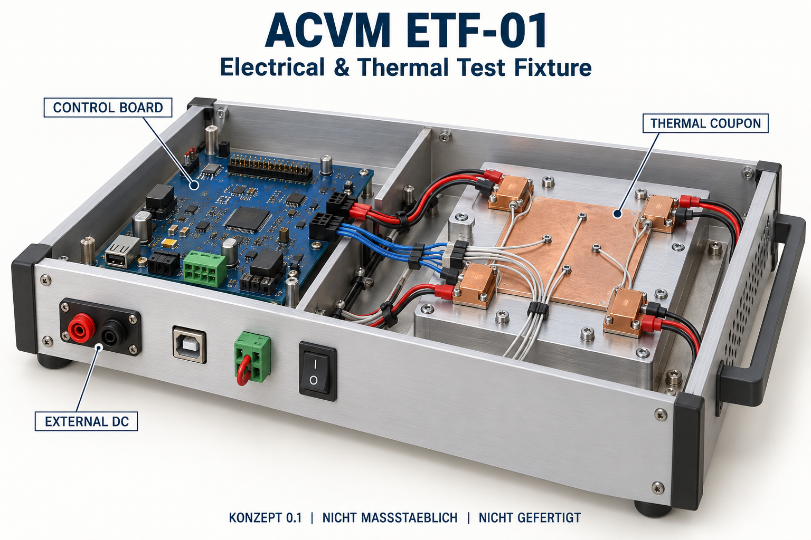
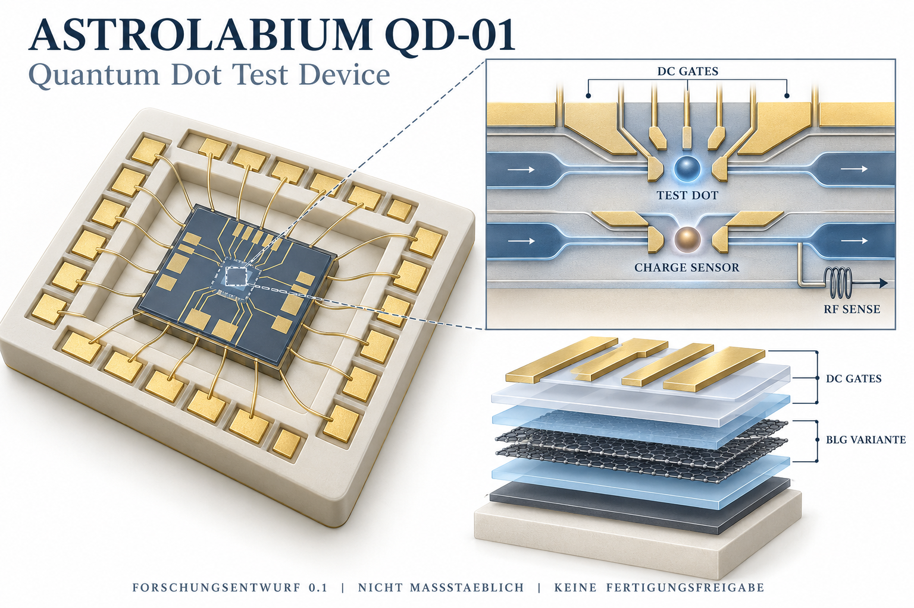

# ACVM Electrical & Thermal Test Fixture

**Konzept 0.1 · ACVM-ETF-01 · 13. Oktober 2026 · CONCEPT ONLY**

ACVM-ETF-01 beschreibt einen geplanten elektrischen und thermischen Prüfstand
für das [Astrolabium Control and Validation Module](../README.md).
Das Konzept verbindet begrenzte Versuchssequenzen, unabhängige Erfassung,
Abschaltfunktionen und vorab festgelegte Prüfkriterien mit den vorgeschlagenen
[ACVM Experiment Records](../experiment-records/README.md).

## Dokument und Downloads

- [Vollständiges Konzept als Word-Dokument, 13 Seiten](ACVM_ETF_01_Konzept_v0_1.docx)
- [Astrolabium QD-01: separates Chip-Konzeptbild](Astrolabium_QD_01_Chipkonzept_v0_1.png)
- [ACVM ETF-01: separate Prüfmodulansicht](ACVM_ETF_01_Konzeptansicht_v0_1.png)
- [Gesamtpaket mit Konzept, Bildern, Rechenannahmen und Bildvorgaben](ACVM_ETF_01_Konzeptpaket_v0_1.zip)
- [Rechenannahmen und Status der geplanten Prüfungen](notes/calculation_record.json)
- [Archivierte Bildvorgaben](notes/image_generation_record.json)
- [Veröffentlichungsmetadaten und SHA-256-Prüfsummen](manifest.json)

## Benennung und Abgrenzung

| Kennung | Gegenstand | Status |
| --- | --- | --- |
| ACVM-ETF-01 | Electrical & Thermal Test Fixture | Prüfstandskonzept |
| ACVM-ETF-01-CB1 | Control Board mit Standardbauteilen | Geplante Steuerplatine |
| ACVM-ETF-01-TC1 | Thermal Coupon | Geplante austauschbare thermische Prüfplatte |
| Astrolabium QD-01 | Quantum Dot Test Device | Eigenständiger Forschungsentwurf; vorläufige Bilayer-Graphen-Variante |

Der Prüfstand beginnt mit Standardbauteilen und einer langsamen MCU-Steuerung.
Ein FPGA ist eine spätere Option für zeitlich präzise Sequenzen und benötigt
eigene Qualifikation. Für diesen Prüfstand wird kein eigener ASIC vorausgesetzt.
Der Quantenpunkt-Entwurf ist ein separater Forschungsgegenstand.

## Umfang und Nachweisstatus

Das Word-Konzept enthält Architektur und ACVM-Schnittstellen, ein vorläufiges
Betriebsprofil, Leistungsannahmen, Messketten und Unsicherheit, getrennte Mess-
und Abschaltpfade, Zeitsemantik, ein begrenztes thermisches Modell sowie einen
Prüfplan mit 14 Fällen. Kalibrierung und Validierung sowie COMPLETE, SEALED und
PASS werden getrennt behandelt.

| Gegenstand | Nachweisstatus |
| --- | --- |
| Aufbau, Schaltplan, PCB und Firmware | Keine qualifizierte Umsetzung durch diese Veröffentlichung |
| Prüfungen ETF-T01 bis ETF-T14 | NOT_RUN |
| Rechenbeilage | Idealisierte Entwurfsrechnung, keine Messdaten |
| Mess- und Abschaltgrenzen | Vorläufige Planungswerte, keine Betriebsfreigabe |
| ACVM- und Records-Anbindung | Vorgeschlagene Schnittstellen, nicht implementiert oder qualifiziert |
| QD-01-Fertigung, Qubit-Kontrolle und Quantenleistung | Nicht nachgewiesen |
| Sicherheits-, Industrie- oder wissenschaftliche Zertifizierung | Nicht erteilt |

Die thermischen Versuche qualifizieren weder einen kryogenen Quantenpunktaufbau
noch einen Quantenprozessor. Messunsicherheit, Fehlerfälle und reale Abschaltzeiten
müssen am späteren Aufbau geprüft werden. Alle 14 Prüfungen bleiben offen.

## Konzeptansichten

Die beiden Bilder wurden mit dem integrierten KI-Bildgenerierungswerkzeug
erstellt. Sie sind **nicht maßstäbliche Konzeptvisualisierungen**, keine Fotos,
CAD-Daten, Netzlisten, Verdrahtungsanleitungen oder Fertigungsunterlagen.
Eine bitidentische Neugenerierung wird nicht zugesichert.

### Prüfmodul ACVM ETF-01

Dargestellte Anschlüsse, Brücken und Leitungen legen keine elektrische
Verdrahtung fest. Maßgeblich sind die Anforderungen und offenen Entwurfsschritte
im Konzeptdokument.

### Forschungsentwurf Astrolabium QD-01

Das Bild illustriert eine vorläufige Bilayer-Graphen-Variante mit einem
Testquantenpunkt und einem benachbarten Ladungssensor. Symbole, Schichtanordnung
und optionale RF-Darstellung sind keine festgelegte Geometrie oder zugesicherte
Bauteilfunktion. Maße, Prozess und Leistungsdaten sind offen.

## Herkunft und Integrität

Das Word-Dokument, die beiden PNG-Dateien und das ZIP sind bytegleich mit den
bereitgestellten Artefakten. Die beiden JSON-Beilagen wurden unverändert aus
dem ZIP entnommen. Das Archiv behält sein ursprüngliches internes Manifest;
das externe `manifest.json` erfasst zusätzlich die GitHub-Veröffentlichung.
Es dokumentiert Dateiintegrität, keine physikalische oder wissenschaftliche
Validierung. Diese Übersicht ergänzt die Ablage, ohne den Konzeptinhalt zu ändern.

Originale Projektbeiträge folgen der [Apache-2.0-Lizenz](../../../LICENSE)
im Rahmen des bestehenden [Lizenzumfangs](../../../LICENSE_SCOPE.md).
Externe Literatur und Herstellerunterlagen werden im Konzept verlinkt und
nicht als fremde Volltexte in dieses Paket aufgenommen.
