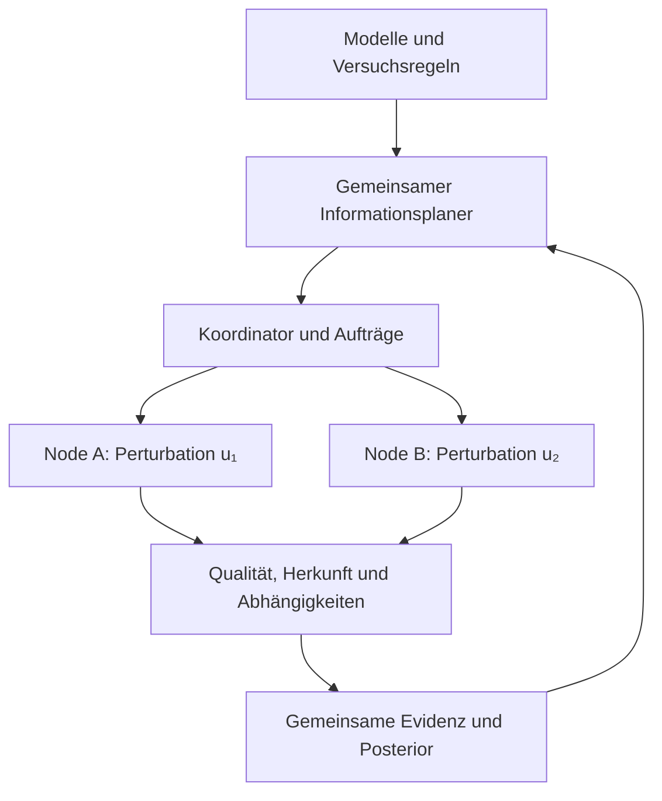

# X6 Experiment Fabric 0.1

**X6 plant kontrollierte Beobachtungen, die konkurrierende Modelle möglichst wirksam unterscheiden.** Mehrere Nodes können unterschiedliche Perturbationen oder gezielte Wiederholungen übernehmen. Gemeinsam verwertbar werden ihre Ergebnisse durch einen geteilten Definitionsraum, ein gemeinsames Unsicherheitsmodell und nachvollziehbare Evidenzzuordnung.

Diese Ausgabe enthält einen ausführbaren Informationsplaner, zwei parallele lokale Simulationsworker, eine Browserdemo, Nachrichtenverträge, Replay und eine unabhängige Python-Gegenprüfung. Ein Netzwerk aus realen Geräten ist noch nicht implementiert. Der physische Messplan und der [siebenstufige Fingerprint](../../research/fingerprint_v1/README.md) bleiben eigenständige Bausteine.

## 1. Wissenschaftliche Einordnung

Die passende Einordnung ist **adaptive bayessche Versuchsplanung zur Modellunterscheidung mit verteilter Ausführung**. Erwarteter Informationsgewinn ist ein etablierter Ansatz [1]. Verteilte autonome Labore wurden bereits experimentell demonstriert, etwa mit kooperierenden Robotern in Cambridge und Singapur [2]. Das allgemeine Prinzip wird hier nicht als Erfindung von X6 beansprucht.

Der untersuchbare X6-Beitrag ist die Verbindung von mehrschichtigen Fingerprints, günstigen modularen Nodes, browserzugänglicher Ausführung und überprüfbaren Trennungsereignissen. Ob diese Verbindung gegenüber vorhandenen Lösungen Zeit, Messungen oder Integrationsaufwand spart, muss ein Vergleich zeigen.

**„Grösste Information“ gilt relativ zu den registrierten Modellen, Prioren, Rauschannahmen, zulässigen Experimenten und Kosten.** Eine unerwartete Beobachtung kann die Unsicherheit erhöhen. Nur der erwartete Informationsgewinn ist unter dem angenommenen Modell nichtnegativ. Ein lokal bestes Messpaket ist nicht notwendig die beste mehrstufige Strategie.

## 2. Entscheidungskern

Seien M die Modellidentität, θ die modellspezifischen Parameter, η gemeinsame bzw. knotenspezifische Störgrössen und D die bisherige Evidenz. B ist ein zulässiges Paket von Experimenten mit kontrollierten Parametern u und zugewiesenen Nodes. X6 bewertet:

\[
\operatorname{EIG}(B)=I(M;Y_B\mid D,B)
=H(M\mid D)-\mathbb E_{Y_B\mid D,B}[H(M\mid D,Y_B,B)].
\]

Die Vorhersage integriert θ und η aus dem **aktuellen gemeinsamen Posterior**. Optimiert wird Information über M; hohe Präzision eines für die Modelltrennung irrelevanten Parameters ist kein Selbstzweck. In der begrenzten Referenz werden nur endliche Zustände und binäre Beobachtungen verwendet. Alle Outcomes eines Pakets werden enumeriert; die Berechnung erfolgt numerisch mit Gleitkommazahlen.

\[
B^*=\arg\max_{B\in\mathcal A}
\{\operatorname{EIG}(B)-\lambda C(B)\}.
\]

Die Zulässigkeitsmenge A berücksichtigt Fähigkeiten, verfügbare Nodes, Budget und exklusive Probenbelegung. Im Demonstrator: höchstens zwei Experimente, zwei Kostenpunkte je Paket, ein Kostenabzug λ=0,01 Bit/Kostenpunkt; Abbruch, wenn kein Paket einen positiven Nutzen erreicht. Dies ist eine Entwurfsentscheidung und keine universelle Nutzenfunktion. Reale Kampagnen ergänzen Messdauer, Umbau, Verschleiss, Energie und zulässige Eingriffsgrenzen; diese werden nicht ohne begründete Gewichte vermischt.

**Gemeinsame Planung statt Addition einzelner Informationswerte:**

- Zwei Experimente können dieselbe Modellunterscheidung wiederholen und sich stark überlappen.
- Eine Referenzmessung und eine eigentliche Messung können gemeinsam informieren, obwohl jede für sich unter einer Störgrössenunsicherheit uninformativ ist.
- Wiederholungen können trotzdem optimal sein, wenn unabhängiges Messrauschen reduziert werden muss. Verschiedene Perturbationen sind kein Selbstzweck.

Der Testkatalog enthält beide Extremfälle: redundante binäre Experimente liefern gemeinsam 1 statt vermeintlich 2 Bit; komplementäre Experimente liefern 2 Bit. In einem zweiten Beispiel ergeben zwei einzeln uninformative Messungen gemeinsam 1 Bit, weil sie eine gemeinsame Störgrösse auflösen.

## 3. Architektur und Verantwortlichkeiten



| Komponente | Verantwortung | Status 0.1 |
|---|---|---|
| Modellregister | Vorhersagen, Prioren, Parameter, Gültigkeitsbereich und Störgrössen | Endlicher versionierter Simulationskatalog |
| Experimentregister | Observable, kontrollierte Perturbation, Schwelle, Kosten und benötigte Fähigkeiten | Zwölf registrierte Experimente; keine frei ausführbaren Auftragsprogramme |
| Informationsplaner | Gemeinsame EIG aller zulässigen kleinen Pakete berechnen | Implementiert; maximal 16 Experimente, 64 latente Zustände, 4 Nodes, 100 000 enumerierte Zuweisungen |
| Koordinator | Zuordnung, Revisionen, Ausführungsversuche, Ablaufzeiten und einmalige Übernahme | Ein Koordinator im Speicher; vollständige Pakete werden gemeinsam übernommen |
| Node / lokaler Agent | Zugelassenen Rechenkern bzw. später einen qualifizierten Geräteadapter ausführen | Browser-Worker und Node.js-Worker führen nur Simulation aus |
| Evidenzablage | Rohbeobachtungen, Auftragsbindung, Qualitätsstatus und Ableitungen | Exportierbare akzeptierte Ereignisse mit Hashkette; keine transaktionale Datenbank oder Signatur |
| Modellbewertung | Gemeinsame Likelihood auswerten, Gewichte aktualisieren, Widersprüche erkennen | Endlicher Bayes-Update; Null-Vorhersage hält die Kampagne an |

Planung darf später föderiert sein. Zunächst ist **ein autoritativer Koordinator je Kampagne mit mehreren Ausführungsnodes** die prüfbarere Architektur. Verteilte Ausführung erfordert keine unkontrolliert konkurrierenden Posterior-Versionen. Ein Ausfall des Koordinators und ein Führungswechsel benötigen eine persistente Ereignisablage und einen definierten Wiederanlauf; beides ist nächste Ausbaustufe.

## 4. Browser, Agenten und Geräteknoten

Der Browser ist Oberfläche, wissenschaftlicher Rechenclient und möglicher Simulationsnode. Web Workers führen Aufgaben ausserhalb des Hauptthreads aus [4]. Sie machen aus einem Browser jedoch kein Echtzeit-Messsystem; Hintergrundseiten unterliegen unter anderem Timer-Drosselung [5].

Die Rollen im physischen Ausbau sind deshalb:

1. **Browser:** Kampagne ansehen, Modelle vergleichen, Messpläne nachvollziehen, Budget setzen, Evidenz exportieren.
2. **Forschungsagent:** Innerhalb eines vorab freigegebenen Katalogs Versuche vorschlagen, Informationswerte rechnen und Ausführung koordinieren. Ein Sprachmodell kann Rezepte entwerfen, liefert aber weder ungeprüfte Likelihoods noch unmittelbare Aktuatorbefehle.
3. **Lokaler Geräteagent:** Prüft Adapterversion, Kalibrierung, Einheiten, Zeitbasis, zulässige Parameter und Ressourcen; übersetzt ein registriertes Rezept in Geräteoperationen.
4. **DAQ / Mikrocontroller / FPGA:** Erfasst mit Gerätetakt und setzt lokale Eingriffsgrenzen, Watchdog sowie Stopplogik durch.

Eine freigegebene Kampagnenrichtlinie kann viele Messungen autonom zulassen; nicht jede Messung benötigt eine neue menschliche Bestätigung. Neue Eingriffsklassen oder Parameter ausserhalb der Richtlinie sind keine Fortsetzung derselben Freigabe. Diese Softwareausgabe besitzt überhaupt keinen physischen Aktuatorpfad.

## 5. Regeln für gemeinsame Evidenz

**Keine Abstimmung nach Anzahl der Nodes.** Ergebnisse werden anhand ihres Mess- und Abhängigkeitsmodells bewertet. Zwei Nodes können denselben Kalibrierfehler teilen. Auch unterschiedliche Fingerprint-Ebenen können aus denselben Rohdaten stammen und statistisch abhängig sein.

Bei gemeinsamem η gilt schematisch:

\[
p(y_A,y_B\mid M,D)=\int p(y_A\mid M,\eta,D)\,p(y_B\mid M,\eta,D)\,p(\eta\mid M,D)\,d\eta.
\]

Das ist im Allgemeinen **nicht** das Produkt separat marginalisierter Vorhersagen. Der Demonstrator hält den Posterior über (M,η) über alle Runden hinweg aufrecht. Er nimmt unabhängiges Beobachtungsrauschen nur bedingt auf diesen gemeinsamen Zustand an. Die gemeinsame Verstärkung ist während der gesamten Kampagne konstant; zeitabhängige Drift ist noch nicht modelliert.

Weitere Regeln:

- Jeder Auftrag bindet Kampagnenhash, Revision, Node, Probe, Experiment, Replikat, Versuch und Ablaufzeit. Ergebnisse werden nur auf passende Aufträge angenommen.
- Ein Replikat darf nur einmal in den Posterior eingehen. Duplikate, alte Versuche, unbekannte Nodes, veränderte Rohdaten und fehlgeschlagene Qualität werden zurückgewiesen. Die aktuelle Implementierung prüft Metadatenbindung; sie authentifiziert keine tatsächliche Geräteidentität.
- Eine Wiederholung desselben synthetischen Auftrags nach Timeout behält Replikat und Seed. Sie ist eine Zustell-/Rechenwiederholung, keine neue unabhängige Messung. Physische Eingriffe dürfen bei unklarem Ausführungsstatus nicht blind erneut ausgelöst werden.
- Zwei Perturbationen an derselben Probe werden nicht parallel eingeplant. Ein wirklich gleichzeitiger Mehrfachantrieb benötigt ein eigenes kombiniertes Experiment mit gemeinsamer Vorhersage. Verschiedene reale Proben benötigen ein Modell ihrer Unterschiede.
- Die Referenz aktualisiert erst nach einem vollständigen Paket. Asynchrone Teilaktualisierung mit laufenden Experimenten, Abbruch, persistenter Wiederherstellung und dynamischer Umplanung ist offen.
- Posterioren verschiedener Nodes dürfen nicht einfach multipliziert werden: Dabei können gemeinsame Prioren und bereits geteilte Daten doppelt zählen. Geteilt werden identifizierte Beobachtungen bzw. qualifizierte Likelihood-Beiträge mit Herkunft.
- Hashes erkennen Inkonsistenz gegenüber bekannten Hashes. Sie sind kein Beweis für Sensorursprung, unverfälschte Hardware oder vertrauenswürdige Teilnehmer.

## 6. Hypothesen eliminieren: klare Bedeutungen

| Befund | Bedeutung / Reaktion |
|---|---|
| Kleine Posteriorwahrscheinlichkeit | Unter dem registrierten Modell aktuell unplausibel; für Planung abwerten, nicht als physikalisch falsifiziert löschen |
| Exakt unmöglicher gültiger Befund | Widerspruch zu einer exakten Modellvorhersage; Voraussetzungen und Eingabegültigkeit prüfen |
| Alle Modelle sagen Wahrscheinlichkeit null voraus | `MODEL_SET_INADEQUATE`; Update verweigern und Kampagne anhalten |
| Statistisch unwahrscheinlicher Befund | Separater vorregistrierter Test mit Fehlerkontrolle und Bestätigungsdaten erforderlich |
| Wachsende Masse auf `OTHER` | Anlass für Modellkritik; keine Identifikation eines neuen physikalischen Modells |
| Niedrige Information aller zulässigen Experimente | Budget-/Auflösungsgrenze oder fehlende geeignete Observable; keine bewiesene physikalische Äquivalenz |

Im verrauschten mechanischen Beispiel haben die bekannten Kandidaten positive Likelihoods; es gibt keine harte physikalische Eliminierung. `OTHER` erzeugt unabhängige faire Binärbeobachtungen und ist nur ein begrenztes Abweichungsmodell. Es deckt nicht alle falschen Modellannahmen ab. Eine hohe Modellwahrscheinlichkeit kann bei unvollständigem Modellkatalog trotzdem irreführend sein; Versuchsplanung unter Modellfehlanpassung ist selbst ein Forschungsproblem [3].

Für belastbare Empirie folgen separate Bestätigungsdaten, Referenz-/Blindmessungen, Kalibrierkontrollen, Probenhierarchie, Modellkritik und gegebenenfalls sequenziell gültige Testverfahren. Posteriorgrenzen besitzen nicht automatisch eine vorgegebene frequentistische Fehlerrate.

## 7. Ausführbarer mechanischer Kontrollfall

Das Rechenmodell lautet m ẍ + c ẋ + k x = F. Vier Punkthypothesen kombinieren m=1 kg, k∈{100,144} N/m und c∈{1,3} Ns/m. Dies sind vier Kandidaten **innerhalb einer bekannten Modellfamilie**, keine vier bestätigten konkurrierenden physikalischen Theorien.

Beobachtet wird eine verrauschte Schätzung des Betrags der Accelerance:

\[
|H_a(\omega)|=\frac{\omega^2}{\sqrt{(k-m\omega^2)^2+(c\omega)^2}}.
\]

Sechs Kreisfrequenzen ω∈{7,9,10,11,12,14} rad/s und je zwei registrierte Auswerteschwellen ergeben zwölf Experimente. Die Anregungsamplitude 0,01 N ist ein deklarierter Entwurfswert; das lineare Frequenzmodell simuliert weder Aktuator noch Zeitreihen. Additives logistisches Rauschen wird anschliessend auf ein Bit „über/unter Schwelle“ verdichtet. Diese starke Verdichtung dient einer transparenten endlichen Referenz und beansprucht keine optimale Nutzung realer Rohsignale.

Gemeinsame Verstärkung η∈{0,92;1;1,08}; Prior je bekannter Punkthypothese 0,225, Prior OTHER 0,1. Bedingte Störgrössenprioren sind gleichverteilt. Beide simulierten Proben teilen dieselben Parameter und denselben Verstärkungsfehler; nur Beobachtungsrauschen wird unabhängig gezogen. Der Planer erhält die Kandidaten und Likelihoods, nicht die vom Simulationsadapter verwendeten wahren Parameter.

Im gelieferten Kontrolllauf ist k=144, c=3, η=1,08 als synthetische Wahrheit vorgegeben. Die erste Auswahl ist ω=10 und ω=12 rad/s mit den jeweils hohen Schwellen; erwarteter gemeinsamer Informationsgewinn **1,442780 Bit**. Danach wählt der Planer Wiederholungen bei ω=12 mit niedriger Schwelle. Nach vier Paketen/acht synthetischen Beobachtungen erreicht der passende Kandidat etwa **0,995949** relativen Posterioranteil. Weitere Versuche überschreiten den eingestellten Kostenabzug nicht. Dies ist ein einzelner reproduzierbarer Kontrollfall, keine geschätzte Erfolgsrate und kein Nachweis realer Messersparnis.

## 8. Ausführen und prüfen

Node.js 22 oder neuer; der Kern hat keine npm-Laufzeitabhängigkeiten. Vom Repository-Stamm:

```bash
node experimental/experiment_fabric/run.mjs run /tmp/x6-fabric-run
node experimental/experiment_fabric/run.mjs verify /tmp/x6-fabric-run/run.json
node --test experimental/experiment_fabric/tests/test_core.mjs
python -m pip install -r experiments/industrial-v1/requirements.txt
python experimental/experiment_fabric/verify_reference.py /tmp/x6-fabric-run/run.json
```

Das Zielverzeichnis muss neu sein. Ein Lauf erstellt `run.json` mit Aufträgen, Ergebnissen, Rohbeobachtungen, latenten Posterioren und Hashkette. Replay prüft den mitgelieferten Standardablauf. Retry-Negativtests sind separat; ein beliebiges verteiltes Fehlerjournal wird noch nicht replayt. Python berechnet 156 Likelihood-Einträge, EIG, zulässige optimale Zuweisungen und Posterioren unabhängig vom JavaScript-Code nach (Toleranz 10⁻¹⁰).

Für die Browserdemo einen lokalen Server im Repository starten:

```bash
python -m http.server 8000 --bind 127.0.0.1
```

Dann `http://127.0.0.1:8000/experimental/experiment_fabric/browser.html` öffnen. Browser und Node-Runner verwenden denselben Rechenkern. Zwei Worker in einem Browser bzw. auf einem Rechner sind kein Nachweis eines verteilten Hardware-Netzwerks. Die Browserprüfung benötigt Playwright und Chromium:

```bash
node experimental/experiment_fabric/tests/browser_test.cjs
```

[protocol.schema.json](protocol.schema.json) definiert die geschlossenen Simulationsnachrichten. Für physische Ergebnisse wird ein separater freizugebender Vertrag benötigt. Das bestehende Fingerprint-Schema wird nicht stillschweigend erweitert: Ein künftiger Adapter wird registrierte Messmerkmale und Fingerprint-Dateihashes verknüpfen. Der aktuelle Ein-Bit-Demonstrator erzeugt noch keinen vollständigen physikalischen Fingerprint.

## 9. Ausbau mit Abnahmekriterien

| Stufe | Nächstes Arbeitspaket | Nachweis vor nächster Stufe |
|---|---|---|
| A — Rechnerische Fabric | Informationsplaner, gemeinsamer Störgrössenposterior, parallele Worker, Replay | Diese Referenz: analytische Gegenbeispiele, unabhängige Numerik und Browser-/CLI-Prüfung |
| B — Zwei echte Rechennodes | Zwei Rechner, Broker, persistente Jobs/Ereignisse, authentifizierte Teilnehmer, Wiederanlauf | Verbindungsabbruch, doppelte/verspätete Zustellung und Koordinator-Neustart verändern den gültigen Evidenzbestand nicht |
| C — Ein kontrollierter Prüfstand | MODAL_2R1F-Adapter, Gerätekalibrierung, freigegebener Anregungskatalog, Fingerprint-Export | Referenzmessung und Eingriffsgrenzen geprüft; Prognosen gegen neue physische Daten testen |
| D — Zwei physische Nodes | Getrennte Proben/Prüfstände, gemeinsame Referenz, Proben- und Driftmodell | Gemeinsame und unabhängige Fehler auseinanderhalten; Nachweis inkrementellen Informationsgewinns |
| E — Nutzenvergleich | Adaptive Einzelmessung, naive parallele Auswahl, gemeinsamer Batchplaner, Zufalls-/Rasterplan | Gleiche Gesamtressourcen und Bestätigungskriterien; Messzahl, Zeit, Fehlentscheidung, Enthaltung und Kalibrierung ausweisen |
| F — Lorentz-Forschung | Modellregister für definierte Kausalordnungs-/Feldmodelle, geometrische und dynamische Observablen | Likelihoods/Ensembles und Gültigkeitsbereiche explizit; Trennung endlicher Modelle nicht als Nachweis einer Raumzeittheorie ausgeben |

Die wichtigste nächste technische Stufe ist B, die wichtigste wissenschaftliche Voraussetzung für C sind brauchbare Vorhersage- und Unsicherheitsmodelle. Zusätzliche Sensoren allein ersetzen diese Modelle nicht.

## Quellen

1. [Efficient Bayesian Experimentation Using an Expected Information Gain Lower Bound](https://epubs.siam.org/doi/10.1137/15M1043303), SIAM/ASA Journal on Uncertainty Quantification, 2017.
2. [A dynamic knowledge graph approach to distributed self-driving laboratories](https://www.nature.com/articles/s41467-023-44599-9), Nature Communications 15, 462 (2024).
3. Catanach und Das, [Metrics for Bayesian Optimal Experiment Design under Model Misspecification](https://arxiv.org/abs/2304.07949), 2023.
4. Mozilla, [Web Workers API](https://developer.mozilla.org/en-US/docs/Web/API/Web_Workers_API).
5. Chrome for Developers, [Heavy throttling of chained JS timers](https://developer.chrome.com/blog/timer-throttling-in-chrome-88/).

Projektbeiträge unter der bestehenden Apache-2.0-Lizenz gemäss Repository-Lizenzumfang. Copyright 2026 Thomas Gfeller.
