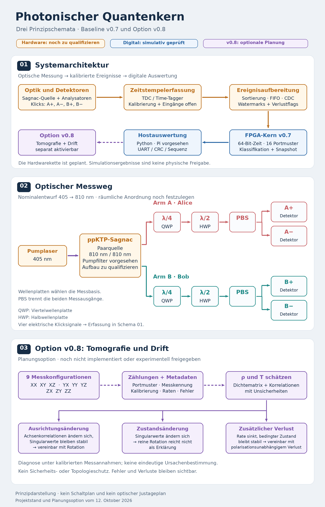

# Photonischer Zwei-Qubit-Versuchsaufbau

**Entwurf und digitale Referenz · Experimental preview · Dokumentationsstand 23.10.2026**

Geplant ist eine polarisationsverschränkte Photonenpaarquelle mit einem Typ-II-ppKTP-Sagnac-Interferometer, zwei lokalen Polarisationsanalysatoren und vier Detektorkanälen. Veröffentlicht werden die vorhandenen Entwurfsunterlagen, CAD-Dateien, Auswertungen und digitalen Referenzkerne. **Es liegen in diesem Paket keine Labormessungen des Gesamtaufbaus vor.**

**English abstract.** This is a proposed photonic two-qubit experiment with a software/RTL reference, not a demonstrated quantum processor. The Sagnac source architecture is supported by published quantum-optics literature. Included numerical results use synthetic data or mechanical models. No physical entanglement, Bell violation, timing accuracy, quantum advantage or hardware readiness is claimed for this implementation.

## Was die Veröffentlichung belegt

| Ebene | Verfügbar | Noch offen |
|---|---|---|
| Optik | Literaturgestützter Funktionsentwurf, Analysekonventionen | Konkrete Optikauswahl, Strahlführung, Aufbau, Charakterisierung |
| Digitalteil v0.7 | Vierkanal-Fensterklassifikation, UART-TX, Decoder, CHSH-Auswertung, Simulationstests | Qualifiziertes Detektor/TDC-Frontend, FPGA-Pinplan, Boardtests |
| Astrolabium | Bereits veröffentlichter SGNCv007-Import, lokale Bridge und synthetische Demo | Ende-zu-Ende-Prüfung mit realer Messkette |
| JIG-F1 | Fertigungsentwurf mit STEP, STL, DXF, Bauanleitung und Modellrechnungen | Fertigung, Wiederholbarkeit, Drift, Klebe- und Übergabeversuche |
| Tomografie v0.8 | Separat gekennzeichnete Planung | Protokollerweiterung, Implementierung, Unsicherheitsmodell und Messungen |

Die Bezeichnung „Zwei-Qubit“ beschreibt zwei geplante Polarisationsfreiheitsgrade, einen pro Photonenarm. Sie behauptet weder deterministische Qubit-Erzeugung noch programmierbare Zwei-Qubit-Gatter. Ältere Formulierungen wie „Quantenkern“ sind Projektbezeichnungen. Maßgeblich ist der Status in [SCIENTIFIC_STATUS.md](SCIENTIFIC_STATUS.md).

## Einstieg und Unterlagen

- **[Neu: erster Kaskoden-Schaltplan v0.1](hardware/cascode-schematic-v0.1/README.md)** — [PDF](manuals/Kaskoden_Schaltplan_v0_1.pdf), [KiCad-Paket](downloads/Kaskoden_Schaltplan_v0_1_KiCad.zip); vier Schaltplanblätter, Stückliste und geprüfte Pinverbindungen. Vereinfachter SPICE-Modelltest bestanden; keine Hardware- oder Fertigungsfreigabe.
- **[Kaskoden-Frontend / vierlagiger PCB-Entwurf v0.1](hardware/pcb-cascode-v0.1/README.md)** — [PDF direkt](manuals/PCB_Kaskoden_Frontend_Entwurf_v0_1.pdf); Startwerte und Abnahmeplan, alle Hardwareprüfungen NOT_RUN.
- [Wissenschaftlicher Status und Aussagegrenzen](SCIENTIFIC_STATUS.md)
- [Optischer Funktionsentwurf und offene Bauteilspezifikationen](OPTICAL_DESIGN.md)
- [Stufenweises Laborprotokoll](LAB_PROTOCOL.md)
- [Reproduktion der Software- und Modellprüfungen](REPRODUCE.md)
- [Literatur, Datenblätter und Quellenkritik](SOURCES.md)
- [Herkunft und Dateiprüfsummen](PROVENANCE.json) sowie [Lizenzumfang](LICENSES.md)
- [Astrolabium-Anbindung](../../docs/SAGNAC_INTEGRATION.md)

Astrolabium: [Research App](https://thomasmgfeller.github.io/x6-spectral-astrolabium/app/).

## Aktueller Entwicklungsstand zum Herunterladen

| Paket | Inhalt / Einordnung |
|---|---|
| [Sagnac v0.7 komplett](downloads/Sagnac_v0_7_UART_Host_und_Hardwareplan.zip) | RTL, Host, Tests, Hardwareplan, Metrologie, synthetische Beispiele und ursprüngliche Prüfprotokolle |
| [Sagnac v0.7 im Browser lesen](reference/sagnac_v0_7/README.md) | Unveränderte Quelltextauswahl; komplette historischen Logdateien im ZIP |
| [JIG-F1 Baupaket v0.1.1](downloads/JIG_F1_FabLab_Baupaket_v0_1_1.zip) | Vollständige CAD- und Fertigungsunterlagen; Dokumentationskorrektur, Geometrie v0.1 unverändert |
| [JIG-F1 Bauanleitung v0.1.1 (PDF)](manuals/JIG_F1_Bauanleitung_v0_1_1.pdf) | 14 Seiten; getrennte 1:1-Druckseiten für P02 und P03; Ausdruck am Kontrollmaß prüfen |
| [Einkanal-Messkette v0.2](downloads/Photonische_Messkette_v0_2_Einkanal.zip) | Separates SPAD/AQC-Entwicklungsprojekt mit Python-Auswertung; kein fertig qualifizierter Sagnac-Detektor |
| [Einkanal-Prüfbericht (PDF)](manuals/Photonische_Messkette_v0_2_Pruefbericht.pdf) | Ursprünglicher Bericht mit synthetischen Tests und offenen Hardwarefreigaben |
| [Kaskoden-Schaltplan v0.1 (PDF)](manuals/Kaskoden_Schaltplan_v0_1.pdf) | Vier Schaltplanblätter plus Auslegung/Prüfstand; Analogfrontend und separater CML-Empfängeradapter |
| [Kaskoden-Schaltplan v0.1 (KiCad-Paket)](downloads/Kaskoden_Schaltplan_v0_1_KiCad.zip) | Bearbeitbare Projekte, BOM, Netzlisten, Verbindungsprüfung und synthetischer SPICE-Modelltest; HV/Quench und Qualifikation offen |
| [Kaskoden-PCB-Entwurf v0.1 (PDF)](manuals/PCB_Kaskoden_Frontend_Entwurf_v0_1.pdf) | Vierlagiger Einzelkanal, Kaskoden-Startwerte, 50-Ω-Ausgänge und vorgeschlagene Abnahme; kein geroutetes PCB oder Fertigungsnachweis |
| [Optionale Tomografie v0.8](optional/Sagnac_v0_8_Optionaler_Weiterentwicklungsvektor.txt) | Planung, nicht implementiert oder aktiviert |

## Historische Entwicklungsstufen

Diese vollständigen Originale dienen der Nachvollziehbarkeit. Sie sind keine austauschbaren Komponenten der heutigen Messkette.

- [Sagnac v0.6](downloads/Sagnac_v0_6_Referenzkern_und_Pruefprotokoll.zip): Vorgänger des Vierdetektor-Referenzkerns.
- [Photonische Messkette v0.1 – Auswertung](downloads/Photonische_Messkette_v0_1_Auswertung.zip) und [Digitalkern](downloads/Photonische_Messkette_v0_1_Digitalkern.zip): früherer **H/A/B-Herald-Ansatz**, mit anderer Messgröße und Ereignisdefinition.
- [JIG-F1 Originalpaket v0.1](downloads/JIG_F1_FabLab_Baupaket_v0_1.zip) und [ursprüngliche separate Bauanleitung](archive/JIG_F1_Bauanleitung_original_v0_1.pdf): historische Fassungen; für Druckvorlagen v0.1.1 verwenden. Die beiden ursprünglichen PDFs haben denselben Text, aber unterschiedliche Renderfassungen.

## Abbildungen richtig lesen

Prinzipübersicht aus dem Entwurfsstand. Kein maßstäblicher Strahlplan; keine elektrische Verdrahtungsanweisung. „Quantenkern“ bezeichnet hier das geplante Experiment.

**KI-Konzeptvisualisierung, kein Foto eines aufgebauten Experiments.** Geräteformen, Beschriftungen, Leitungen und Anzeigen sind illustrativ. Insbesondere ist die abgebildete FPGA-Platine keine Festlegung gegenüber dem noch offenen Boardplan. Maßgeblich sind die schriftlichen Spezifikationen.

## Nutzen und Beiträge

Der unmittelbare Nutzen liegt in überprüfbaren Ereignisdefinitionen, nachvollziehbarer Auswertung, Testfällen für Fehlzustände und einem nachbaubaren mechanischen Entwurf. Community-Beiträge sind besonders für Optikreview, Timing/CDC, Kalibrierung, statistische Annahmen und unabhängige Reproduktion hilfreich. Messdaten bitte mit vollständigem Protokoll, Rohdaten und Unsicherheiten beitragen; Bilder oder einzelne Kennzahlen genügen nicht als Validierung.

Eine spätere lokale/„Edge“-Auswertung kann Datenübertragung und Reaktionszeiten reduzieren. Für das Gesamtsystem gibt es noch keine gemessenen Latenz-, Leistungsaufnahme- oder Kostenvorteile. Eine GF-651-Anbindung ist hier nicht spezifiziert; ohne belastbare Schnittstellen- und Chipunterlagen wird keine Kompatibilität behauptet.
