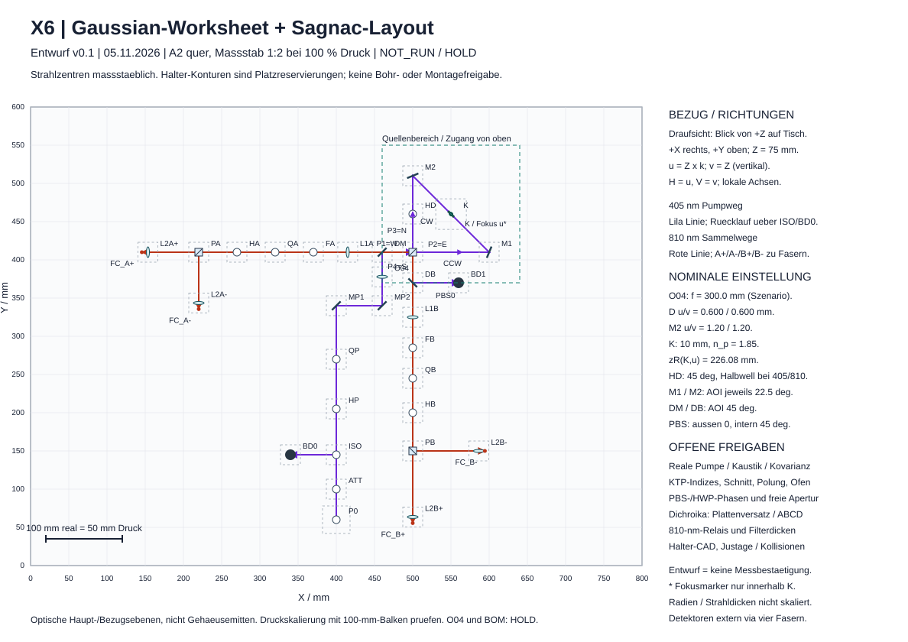

# Gaussian-Worksheet und maßstäblicher Sagnac-Layoutentwurf v0.1

**Entwicklungsentwurf vom 5. November 2026. Reale Messungen: NOT_RUN. O04, Fertigung und BOM: HOLD.**

Dieses Paket übersetzt das [Pump-Eingangsprofil v0.1](../pump-input-v0.1/README.md) in eine ausführbare zweite-Moment-Strahlrechnung und einen geometrisch konsistenten Layoutkandidaten. Es ergänzt den [Optikplan v0.2](../optikplan-v0.2/README.md). Die vorhandenen Abnahmeziele bleiben unverändert. Alle Zahlen des Referenzfalls sind **Szenarien**; Pumpmodell, tatsächliche Kaustik und Lieferdaten fehlen.

## Dateien

| Datei | Verwendung |
|---|---|
| [X6_Gaussian_Worksheet_v0_1.xlsx](X6_Gaussian_Worksheet_v0_1.xlsx) | Sechs Tabellenblätter; 18 editierbare Szenariowerte und 88 Formeln; getrennte leere Messwerttabelle |
| [X6_Gaussian_Worksheet.html](X6_Gaussian_Worksheet.html) | Ohne Server oder Internet nutzbares Worksheet; Berechnung, Kristallkaustik, Sweeps, aktualisierter Pumpplan, JSON/CSV/SVG-Export |
| [X6_Sagnac_Layout_A2_1zu2.svg](X6_Sagnac_Layout_A2_1zu2.svg) | Vektorzeichnung auf A2 quer, Maßstab 1:2 bei 100 % |
| [koordinaten.csv](koordinaten.csv) | 35 optische Bezugspunkte mit XYZ, Einfallswinkel, Richtung und Status |
| [eingaben.json](eingaben.json) / [referenz.json](referenz.json) | Vollständige Szenarioannahmen / reproduzierbare Ergebnisse |
| [ENTWURF.md](ENTWURF.md) | Rechenvertrag, Richtungen, Polarisation, Toleranzen und Freigabelücken |
| [X6_Gaussian_Layout_v0_1_Pruefpaket.zip](X6_Gaussian_Layout_v0_1_Pruefpaket.zip) | Zusammenhängendes Arbeitspaket einschließlich Quellcode und Tests |

Die HTML-Datei herunterladen und lokal öffnen. GitHub zeigt HTML im Repository als Quelltext. Ein Download des ZIP erhält alle zusammengehörigen Dateien. Keine externe Bibliothek, Telemetrie oder Geräteansteuerung.



## Ergebnis des Referenzszenarios

| Eingabe / Ergebnis | Wert | Evidenzart |
|---|---:|---|
| Vakuumwellenlänge | 405 nm | Entwurfsnominal |
| D4σ an P1, u und v | 0,600 mm | angenommen |
| M², u und v | 1,20 | angenommen |
| Wellenfront an P1 | eben, 1/R = 0 | angenommen |
| O04-Brennweite in Luft | 300 mm | Kandidat, kein Artikel |
| Kristalllänge / Pumpindex | 10 mm / 1,85 | angenommen |
| Gemeinsamer Weg O04–PBS-Mitte | 72,2123 mm | geometrisch hergeleitet |
| Reduzierter Weg O04–Kristallmitte, beide Richtungen | 236,9842 mm | gerechnet |
| Pump-Taillenradius u/v | 137,4945 µm | gerechnet |
| Rayleigh-Länge im angenommenen Kristallmedium | 226,0769 mm | gerechnet |
| Taillenlage beider Richtungen | Kristallmitte | geschlossen im Szenario |
| Kristallposition X/Y | 550,1255 / 459,8745 mm | optische Referenzkoordinate |
| Planungsfläche / Strahlhöhe | 800 × 600 / 75 mm | Layoutvorschlag |

Die ausgegebenen Nachkommastellen ermöglichen Reproduktion; sie sind **keine Montagegenauigkeit**. Die 300-mm-Linse bildet hier keine Taille in 300 mm Entfernung. Die konventionelle Näherung „Fokus bei f“ würde den Strahlplan falsch platzieren.

## Empfindlichkeit

Bei ansonsten festem Referenzlayout verändern D4σ,u = 0,570 / 0,630 mm den Taillenradius auf 141.389 / 133.456 µm und die extrapolierte Taillenlage auf -20.015 / 16.959 mm relativ zur Kristallmitte. Die Eingangsbreite alleine bestimmt die Linse nicht; Krümmung und M² müssen mitgeliefert werden.

Die 32 kombinierten Eckfälle ergeben am Kristallzentrum 117,157–158,570 µm Radius und extrapolierte Taillenlagen von −51,805 bis +55,842 mm. Diese Auswahl beweist weder globale Extrema noch eine Überdeckungswahrscheinlichkeit. Sie macht sichtbar, dass ein plausibler Radius allein noch keine geschlossene Fokusgeometrie bedeutet.

## Benutzung und Prüfung

1. Im Excel-Blatt `Eingang` ausschließlich Szenariowerte verändern. `Gaussian` berechnet u/v und CW/CCW. `Sensitivitaet` und `Layout` sind klar bezeichnete Referenzsnapshots; für neue Sweeps und Zeichnungen die HTML-Datei verwenden.
2. Gemessene Werte einschließlich Evidenz und Kovarianz separat erfassen. Die Felder im Blatt `Messwerte` sind absichtlich leer. Die vorhandene Pump-Messvorlage bleibt maßgeblich.
3. Druckdialog: A2 quer, tatsächliche Größe / 100 %, keine Anpassung an Papier. 100 mm im Aufbau müssen am Maßbalken 50 mm auf dem Ausdruck ergeben.
4. Rechenmodell, Tabellenformeln, optische Pfadlängen, Spiegel-/PBS-Normalen, reservierte Flächen und HTML-Zustandswechsel sind testbar. Reale Halter, Oberflächen, Ausrichtung oder Hardwareleistung sind dadurch nicht geprüft.

```sh
node --test test_model.cjs
python3 test_assets.py
node build_workbook.cjs
```

Die ersten beiden Befehle benötigen nur Node.js und Python-Standardbibliothek. Der dritte baut die Excel-Datei aus den versionierten Zellformeln erneut auf. Ein kleiner DOM-Ersatz prüft die HTML-Berechnung und Eingabezustände; er ist ausdrücklich keine Browser-Pixelprüfung.

Die mitgelieferten Prüfungen ersetzen weder eine ISO-11146-Prüfung noch Strahlprofil-, Apertur-, Kopplungs- oder Polarisationsmessungen. Die nächstzulässige Hardwareentscheidung bleibt von der realen P1-Kaustik und komponentengenauen Lieferdaten abhängig.

Lizenz: [Apache-2.0 des Repositorys](../../../../LICENSE). Die Quellen werden verlinkt; keine fremden Zeichnungen oder Artikelseiten sind eingebettet.
