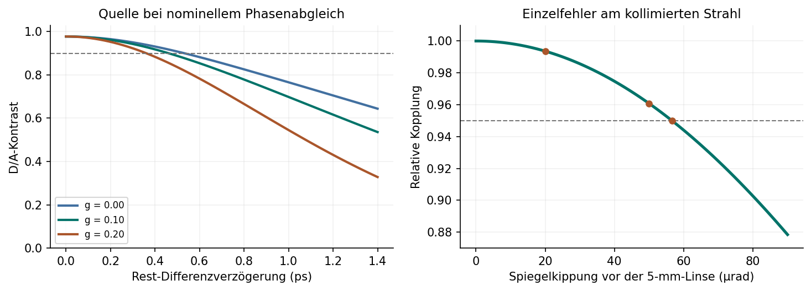

# Optikplan v0.2 · Quellenüberlappung und Messkette

**Photonischer Zwei-Qubit-Versuchsaufbau · 4. November 2026**  
**Entwurfsrechnung. Beschaffung/Fertigung HOLD. G3–G5 und physischer CHSH-Nachweis NOT_RUN.**

Der Zusatz zum [Optikplan v0.1](../optikplan-v0.1/README.md) verbindet die zwei Erzeugungsrichtungen der 405/810-nm-Quelle mit dem messbaren Polarisationskontrast, den Kopplungstoleranzen und der Zeitantwort der vier Detektorkanäle. Die Winkel, Paarregel, feste Fensterbreite und statistische Entscheidung des ursprünglichen CHSH-Protokolls gelten weiterhin. Die hier berechneten Werte stammen aus einem parametrisierten Entwicklungsmodell.

[PDF-Fassung](Optikplan_v0_2.pdf) · [Modellparameter](design_inputs.json) · [Rechenergebnisse](design_result.json) · [Abnahmeblatt](abnahme.json)

## 1. Zwei Alternativen am selben Ausgang

Als Referenz dient der kolliniare Typ-II-Prozess mit Ausbreitung längs der Kristall-X-Achse und Eigenpolarisationen y und z. A und B bezeichnen dieselben Laborports in beiden Rechenzweigen. Die konkrete Achsenabbildung ist vor der Bestellung anhand von Kristallzeichnung und PBS-Ports zu bestätigen. Für die im Modell gewählten Portnamen gilt folgende Zuordnung.

| Pumpe am PBS | Weg im Ring | Ausgang A | Ausgang B |
|---|---|---|---|
| Gegen Uhrzeigersinn (CCW) | Erzeugung, danach dreht die duale HWP beide Tochterpolarisationen | Signal, V | Idler, H |
| Im Uhrzeigersinn (CW) | Die HWP dreht die Pumpe vor der Erzeugung | Signal, H | Idler, V |

Für die Rechnung wird der Signalmodus in A der Kristall-y-Polarisation und der Idlermodus in B der Kristall-z-Polarisation vor der HWP-Drehung zugeordnet. Vorzeichenwechsel bei einer anderen Portkonvention müssen im gesamten Modell mitgeführt werden. Signal und Idler treffen in beiden Alternativen dieselben markierten Ports. Das Vertauschen der Frequenzargumente allein wegen der geänderten **Ausgangspolarisation** würde einen anderen optischen Aufbau modellieren. In der Referenz hängt die relative Phase am Zentrum unter anderem von den HWP-Phasen bei 405 und 810 nm ab. Für die Bewegung um die Zentralfrequenz zählen deren Ableitungen sowie die frequenz- und polarisationsabhängigen Phasen des PBS, der Filter und der übrigen Wege. Eine gemeinsame mechanische Ringlänge sichert die relative Gruppenlaufzeit nicht von selbst. [Kim, Fiorentino und Wong, Gl. (2)–(5)](https://doi.org/10.1103/PhysRevA.73.012316)

Für gefilterte Zweiphotonenamplituden $f_1,f_2$ in identischen Portkoordinaten ist $\gamma=\langle f_1|f_2\rangle/(\|f_1\|\,\|f_2\|)$. Mit Intensitätsverhältnis $r=I_2/I_1$ ist der Faktor für die Amplitudenbalance $2\sqrt r/(1+r)$. Im zweidimensionalen HV/VH-Modell ergibt sich der singulettorientierte D/A-Kontrast bei **fest eingestellter** Phase aus diesem Faktor, dem räumlichen Amplitudenüberlapp und $\mathrm{Re}(e^{i\delta\phi}\gamma)$. Der Betrag von $\gamma$ beschreibt den bestmöglichen Phasenabgleich. Eine H/V-Antikorrelation kann auch bei fehlender HV/VH-Kohärenz hoch bleiben. Beide Basen sind zu messen.

## 2. Phasenanpassung, Filter und Rest-Walk-off

Der Sollwert für die Quasiphasenanpassung erster Ordnung ist $\Delta k=k_p-k_y-k_z-2\pi/\Lambda(T)=0$, mit $k=2\pi n(\lambda,T)/\lambda$. Vorgesehen sind 10 mm Bulk-ppKTP, 405-nm-CW-Pumpe mit Ziel-Linienbreite höchstens 0,1 nm, je Arm Pumpunterdrückung OD mindestens 6 bei 405 nm und 810-nm-Bandpass mit 3 ± 0,5 nm FWHM. Die Polung um 10 µm ist ein Anfragewert. Bei 810 nm und 20 °C liefert das Dispersionsmodell $n_{g,y}=1{,}80372$ und $n_{g,z}=1{,}90888$. Die **volle** Kristalldifferenz ist $L(n_{g,z}-n_{g,y})/c=3{,}508$ ps. Entstehungsorte sind über die Kristalllänge verteilt. Die relative Restverzögerung der beiden Ausgangsalternativen ist gesondert zu bestimmen. [Kato und Takaoka](https://doi.org/10.1364/AO.41.005040) · [Gültigkeitsbereich der y-Koeffizienten](https://refractiveindex.info/?shelf=main&book=KTiOPO4&page=Kato-y)

**Rechenvorschrift.** $u=\delta\nu_A+\delta\nu_B$, $v=(\delta\nu_A-\delta\nu_B)/2$ in THz. Das linearisierte Argument der Phasenanpassung in Richtung $j$ ist

$$x_j=\tfrac L2\delta k_j+\pi L\,[g u+(n_{g,z}-n_{g,y})v]/c,\qquad g=n_{g,p}-(n_{g,y}+n_{g,z})/2.$$

Die Kristallmitte ist Phasenreferenz. Die reelle spektrale Amplitude enthält $\sin(x_j)/x_j$ mit Vorzeichen. Für die Überlappung integriert das Programm das Produkt beider Amplituden, das Gaussian-Pumpintensitätsspektrum, beide **Intensitäts**transmissionen und $\exp[2\pi i(u\tau_c+v\tau_d)]$. Dabei ist $\tau_c=(\delta\tau_A+\delta\tau_B)/2$ und $\tau_d=\delta\tau_A-\delta\tau_B$ für die richtungsabhängigen Ausgangsverzögerungen. Konstante Phase, lineare Dispersion und unterschiedliches Phasenmatching sind damit getrennt veränderbar. Die numerische Quadratur wird mit erweitertem Bereich und feinerem Raster gegengeprüft. Die 405-nm-Pumpe liegt außerhalb der verwendeten Materialanpassung. Der Rechenwert $g=0{,}10$ und der auf Degeneriertheit gesetzte Arbeitspunkt sind Szenarien.

| Änderung gegenüber dem Referenzpunkt | Betrag des Überlapps | Relative spektrale Paarausbeute |
|---|---:|---:|
| Gleiche Richtungen, kein Restversatz | 1,000 | 1,000 |
| Nur Restverzögerung 0,25 / 1,00 ps | 0,975 / 0,714 | 1,000 / 1,000 |
| Filter B um +1 nm verschoben, beide Richtungen gleich betroffen | 1,000 | 0,753 |
| Nur CCW im Betrag um 300 rad/m verstimmt¹ | 0,720 | 0,978 |

¹ Zweig 1 ist CW, Zweig 2 CCW und die Tabelle verwendet die markierten Laborports A und B. Bei 1 ps Restversatz ergibt der Test für $g=0$ bis $0{,}20$ an den drei Stützstellen Überlappbeträge von 0,783, 0,714 und 0,558. Höhere Dispersionsordnungen, Filterphase, Winkel-Frequenz-Kopplung und longitudinale Polungsfehler bedürfen gemessener oder lieferantenspezifischer Daten.

**Temperaturabgleich.** Bei fester, schmaler Pumpe beträgt die modellierte ungefilterte FWHM auf der Differenzachse $v$ 0,253 THz (am jeweiligen Tochterport etwa 0,55 nm). Die zentrale Intensität eines idealen 10-mm-Gitters halbiert sich bei $|\Delta k|=278{,}3$ rad/m. Mit gemessener Steigung $\kappa_T=\partial\Delta k/\partial T$ ergibt sich eine einseitige Halbwertstoleranz $278{,}3/|\kappa_T|$ in Kelvin. Für einen konkreten Kristall Polungszertifikat, Achsen, Pumpwellenlänge und Temperaturkurven beider Richtungen aufnehmen, $\kappa_T$, Temperaturgradient und Filterdurchlass im Einfallswinkel prüfen. Die Stabilitätsvorgabe ±0,05 °C allein ergibt noch keine zulässige Temperaturspanne. Ein transversaler Walk-off ist aus der konkreten Ausbreitungsrichtung und den Poynting-Vektoren zu bestimmen. Bei einem relativen Energiewinkel ρ wäre der seitliche Versatz näherungsweise L tan ρ. Dieser geht als Ortsfehler in den Modenüberlapp ein.

## 3. Vier Faserkopplungen und mechanische Toleranzen

Die vier Sammeloptiken sitzen hinter den beiden Analysator-PBS. Als durchrechenbarer Kandidat dient eine 810-nm-Singlemodefaser mit **angenommenem** Modenfelddurchmesser 5,0 µm. Pumpwaist 140 µm im Kristall (zulässiger Startbereich 100–180 µm), rückprojizierter Sammelradius 80 µm, Faserradius 2,5 µm. Alle Radien sind $1/e^2$-Intensitätsradien. Eine ideale 4f-Abbildung mit 160 und 5 mm Brennweite ergibt $|M|=1/32$ und einen kollimierten Radius von ungefähr 0,516 mm vor der letzten Linse. Das sind Startwerte der paraxialen Rechnung. Reale Haupt- und Bezugsebenen, Brechung am Kristallaustritt, Aperturen und PBS-Glas gehören in die mechanische Zeichnung.

Bei 80 µm Sammelradius ist die Rayleigh-Länge im Kristall für y etwa 43,6 mm. Im Modell konstanter, koaxialer Gaußmoden folgt aus dem transversalen Dreifeldintegral für einen seitlichen Pumpversatz $d$ die relative Paarleistung $\exp[-4d^2/(w_c^2+2w_p^2)]$. Im Beispiel kostet ein Versatz von 34,7 µm 10 %. Diese Näherung setzt Sammelmoden gleicher Größe und gleiche Lage der beiden Sammelachsen voraus. Für eine absolute Helligkeit und Heralding-Effizienz sind die longitudinale Erzeugung und tatsächlichen Verlustpfade zusätzlich nötig. [Bennink, collineare SPDC in Gaußmoden](https://doi.org/10.1103/PhysRevA.81.053805)

**An der Faserstirnfläche** berechnet das Programm das normierte komplexe Gauß-Überlappintegral mit Taille, Defokus, Verschiebung und Verkippung in beiden Querachsen. Für den passenden Waist $w_f$ in Luft ergeben sich isoliert die Leistungsverhältnisse $e^{-(d/w_f)^2}$, $e^{-(\pi w_f\theta/\lambda)^2}$ und $[1+(z/2z_R)^2]^{-1}$ mit $z_R=\pi w_f^2/\lambda$. Bei gleichzeitig auftretenden Fehlern wird das gemeinsame Integral ausgewertet. [St-Amant, Gariépy und Rancourt](https://doi.org/10.1364/AO.43.005691)

| Einzelfehler am gewählten Arbeitspunkt | Grenze für 95 % relative Kopplung |
|---|---:|
| Seitlicher Fokusversatz | 0,566 µm |
| Axialer Fokusversatz | 11,12 µm |
| Einfallswinkel direkt auf die Faserstirnfläche | 23,36 mrad |
| Einzelner Umlenkspiegel im kollimierten Strahl vor der 5-mm-Linse | 56,62 µrad mechanische Spiegelkippung |

Für den letzten Sonderfall gilt $d\simeq2 f\delta\theta$. 20 bzw. 50 µrad ergäben isoliert 99,36 % bzw. 96,08 % relative Kopplung. Die Werte der JIG-F1-Anleitung sind Screeningziele an einem Dummy. Für die Freigabe pro Kanal die reale Abbildung von Trägerversatz und -kippung auf die Faser messen. Dazu Position und Winkel an zwei Ebenen erfassen und Kopplung über x/y/z und Kippung kartieren. Wiederholung und Drift beim Festziehen, Lösen und Aushärten mit Unsicherheit durch diese Abbildung fortpflanzen. Einzelgrenzen dürfen nicht gleichzeitig ausgeschöpft werden. Im kombinierten Beispiel mit 0,35 µm Versatz, 5 µm Defokus und 5 mrad Kippung ergibt sich 96,68 % pro Arm. Die relative Fasereinkopplung und der CW/CCW-Feldüberlapp sind getrennte Größen.

## 4. Zeitantwort, Zufallspaare und Datenerfassung

Für die Referenzkette gelten vier Detektormodule und ein gemeinsamer Time-Tagger. Für das Kaskoden-Frontend ist eine eigene Kalibrierung erforderlich. Mit korrigierten Zeitmarken ist die relevante Größe $t'_B-t'_A$. Für die Varianz gilt $\sigma_{AB}^2=\sigma_A^2+\sigma_B^2-2\,\mathrm{Cov}(t_A,t_B)$ für die Timingfehler. Ein identischer gemeinsamer Zeitfehler fällt aus der Differenz heraus. Im Rechenbeispiel sind die übrigen Fehler unabhängig. Die Kanalvarianzen addieren Detektor-, Elektronik- und Quantisierungsbeiträge. Für zwei unkorrelierte Gleichverteilungen mit Tick $q$ ergibt sich zusammen $q^2/6$. RMS, FWHM und maximale Abweichung werden getrennt erfasst.

| Größe | Ergebnis für die vier A/B-Paare im Beispiel |
|---|---:|
| Elektronik inklusive Quantisierung, relatives RMS | 94–104 ps |
| Restoffset nach eingefrorener Kalibrierung | −70 bis +60 ps |
| FWHM des optischen Gaußkerns, einschließlich Detektoren | 554–632 ps |
| Erfasste Paare im festen Fenster ±1 ns | 99,980–99,998 % |
| Gleicher Kern, 5 % der Treffer zusätzlich um 1,5 ns verzögert | 95,06–95,11 % |

Die positive TTL-Flanke des Referenzmoduls und die CML-Flanke der Eigenentwicklung haben eigene Antworten. Für den Eigen-TDC sind Tickskalierung, kanalabhängige DNL/INL, Schwellenzeitgang, Temperaturdrift, Totzeit und Nachpulse zu messen. Vor CHSH mit elektrischem Vierkanal-Pulser und separater schwacher gepulster optischer Referenz kalibrieren. Der mitgelieferte Kalibrier-Replay liest pro unabhängiger Puls-ID die Kanäle und Rohzeitmarken ein, zieht vier vorab bestimmte Offsets ab und berichtet für jedes Paar Fensteranteil, Mittelwert, robuste Quantile und äußere Halbwertsbreite auf festem Raster. Die Zuordnung der Puls-ID erfolgt unabhängig vom 2-ns-Fenster. Verluste und fehlende Pulse sind anhand des separaten Triggerzählers zu bilanzieren. Bei Überlappung von Pulsen, Mehrfachtreffern oder fehlender synchroner Referenz ist der Lauf zu klären.

Für stationäre, unabhängige Singles bei geringer Fensterbelegung gilt je Portpaar $R_{\mathrm{acc}}\simeq R_A R_B W$ mit **voller** Breite $W=2$ ns. Bei 10.000 Singles/s pro Kanal ergibt das 0,2/s je Portpaar oder 0,8/s gesamt. Bei der v0.1-Lastgrenze 100.000/s je Kanal wären es 80/s gesamt. Die tatsächliche Hintergrundschätzung folgt den vier vorab verschobenen Fenstern und der eindeutigen Paarzuordnung des Optikplans. Der Primärwert verwendet rohe Zählungen. [Beziehung zwischen Singles und Zufallskoinzidenzen](https://pmc.ncbi.nlm.nih.gov/articles/PMC9547810/)

**Latenz und FPGA.** Feste Kanalverzögerungen sind per Offset korrigierbar. Nach der Zeitmarkenbildung verändert verlustfreie Transportlatenz bei korrekter Ordnung die Offline-Paarung nicht. Für einen späteren Streaming-Empfänger maximale Kanal-/Transportverspätung separat messen, nach Zeitmarke sortieren und eine Gruppe erst schließen, wenn keine gültige Zeitmarke innerhalb des Fensters am letzten Gruppenereignis mehr nachkommen kann. Verkettete mehrdeutige Gruppen können länger als ein Fenster sein. Bei Überschreiten der Speicher- oder Verlustgrenze gilt HOLD. Für 400.000 Ereignisse/s erfordern 24 Byte pro Ereignis 9,6 MB/s. Eine Auslesepause von 10 ms benötigt schon 4.000 Pufferplätze (96 kB Nutzdaten) bei gleichmäßigem Zufluss. Reserve für Bursts und die gemessene maximale Auslesepause sind hinzuzurechnen. Der elektrische 4-MHz-Lasttest ist separat nachzuweisen. SGNCv007 liefert aggregierte feste Fenster. Für OPTIK-CHSH-0.1 werden die 24-Byte-Einzelereignisse, deren Implementierung und ein unabhängiger Rohdaten-Replay benötigt.

## 5. Gemeinsames Budget und Laborentscheidung

Das Beispiel verknüpft die vier Teilrechnungen unter offengelegten Annahmen. Am nominellen Arbeitspunkt werden **1.000 Paare/s in den gewählten Sammelmoden nach Filterung, vor der Faserkopplung** angesetzt. Diese Rate muss später gemessen werden. Bei anderem spektralem Arbeitspunkt wird sie mit dem relativen Filter-/Phasenanpassungsintegral skaliert. Symmetrische Kanäle, 90 % sonstige Transmission je Arm, 40 % Detektion, die kombinierte Faserkopplung und die kleinste modellierte Fensterannahme ergeben nominell 121,1 echte Paare/s. Die Singles sind getrennte Szenarioeingaben. Für die D/A-Schätzung wird ein unmodulierter symmetrischer Hintergrund zugrunde gelegt. Kanalabhängige Analysatorverluste, Mehrpaarstatistik, Totzeit und ungleiche Fensterannahmen erfordern die vier realen Zähltabellen.

| Modellpunkt | Echte Paare/s | Roher singulettorientierter D/A-Kontrast |
|---|---:|---:|
| Abgeglichene Spektren, verschwindender Rest-Walk-off | 121,1 | 0,977 |
| Rest-Walk-off 0,25 ps, sonst nominell | 121,1 | 0,953 |
| Rest-Walk-off 1,00 ps, sonst nominell | 121,1 | 0,698 |
| Kombinierter Störfall² | 83,3 | 0,660 |

² Differenzverzögerung 0,50 ps, gemeinsamer Anteil 0,20 ps, CCW-Verstimmung +300 rad/m, Filter B um +1 nm. In allen Zeilen gelten eine angenommene räumliche Amplitudenüberlappung von 0,99, ein Richtungs-Leistungsverhältnis von nominal 0,90 und ein Restphasenfehler von 0,10 rad. Diese Größen sind einzeln zu charakterisieren. Am nominellen Punkt schneidet die D/A-Prognose den G4-Zielwert 0,90 bei etwa **0,461 ps** Rest-Differenzverzögerung. Der G3-Paarpeak im Bereich einiger hundert Pikosekunden allein kann diesen optischen Abgleich nicht beurteilen. Eine Kompensatorplatte erhält erst dann eine Achse, Dicke und Toleranz, wenn Vorzeichen und Betrag einer reproduzierbaren Restverzögerung nachgewiesen sind. Für eine Platte ist der zusätzliche Laufzeitunterschied in erster Ordnung $d\,\Delta n_g/c$ mit der zur Portzuordnung passenden Orientierung.

**Reihenfolge für die Freigabe.**

1. Vor Bestellung Lieferdaten für exakten Kristallschnitt, Polung, Temperatur-Tuningkurve und Beschichtung anfordern. Pump- und Filterkurven, HWP/PBS-Dispersion, Faserdaten, Linsen und freie Aperturen dem portmarkierten Strahlplan zuordnen. Der Lieferant muss die Degeneriertheit für die tatsächliche Pumpe innerhalb des nutzbaren TEC-Bereichs bestätigen.
2. In der Kalibrierung jede Pumprichtung getrennt charakterisieren. Spektren und Raten an A/B über Temperatur, Filterwinkel und Kopplungsposition messen. Die Integration mit gemessenen Kurven wiederholen. Intensitätsspektren allein liefern keine relative spektrale Phase. Über eine unabhängige kontrollierte Verzögerungs- und Phasenvariation oder eine äquivalente Interferenzmessung den prognostizierten D/A-Kontrast überprüfen. Einstellungen vor dem Hauptlauf einfrieren.
3. Vier Kopplungskennfelder und Jig-Übergabe mit Unsicherheit dokumentieren. Für G3 die v0.1-Ziele prüfen (Tick ≤100 ps, relativer Elektronikjitter ≤200 ps RMS, Restoffset ≤100 ps, optischer Paarpeak ≤1 ns FWHM). Zusätzlich Peak-Tails und feste Fensterannahme für alle Portpaare ausweisen.
4. G4 verlangt die gemessene rohe Sichtbarkeit ≥0,90 in H/V **und** D/A. Für G5 verzögerte Fenster, Dunkel- und Blockierkontrollen durchführen (v0.1-Ziel ≤1 % des Zentralpeaks). Für den Hauptlauf gelten alle übrigen v0.1-Tore einschließlich Negativkontrolle, mindestens 2.000 eindeutige Paare je Einstellung und der vorab festgelegten 99-%-Untergrenze über 2. Fehlende Daten führen zu HOLD vor Freigabe.

## Reproduktion



Aus diesem Verzeichnis mit Python 3.12, NumPy und SciPy. Die Tests vergleichen das veröffentlichte Ergebnis numerisch, prüfen die Gitterkonvergenz, eine direkte zweidimensionale Feldintegration und vier Kanäle synthetischer quantisierter Zeitmarken. Die Versionen der Referenzumgebung stehen in requirements.txt.

```sh
python -m pip install -r requirements.txt
python model.py > /tmp/optikplan_v02_result.json
python -m unittest -v test_model
python timing_calibration.py hits.csv --offsets-ps 0 0 0 0 --bin-ps 50
```

Mit `python spectral_calibration.py grid.csv` lässt sich ein gemeinsames, vollständig belegtes zweidimensionales Frequenzraster beider Richtungen auswerten. CSV-Felder sind `u_THz,v_THz,cw_density,ccw_density` und optional `relative_phase_rad`. Einheiten der richtungsweise aufgenommenen Dichten müssen übereinstimmen, einschließlich Normierung auf Messdauer, tatsächliche Pumpleistung und spektrale Binbreite. Es sind bereits gefilterte bzw. in die Sammelmoden projizierte Dichten auf identischen Laborports gemeint. Bei gleichen Versuchseinstellungen enthalten diese bereits ihre Kopplungsverluste. Das Programm integriert mit Trapezgewichten auf einem auch ungleichmäßigen Raster. Liegen nur Intensitäten vor, gibt es eine obere Schranke für den spektralen Überlapp aus. Für den komplexen Phasenterm braucht jede Zelle eine unabhängige relative Phase (Singulett-Sollphase abgezogen). Außerhalb des erfassten Bandes fehlendes Gewicht, Geräteauflösung und Dunkelkorrektur sind mit eigener Unsicherheit zu bilanzieren.

Der letzte Befehl ist ein Formatbeispiel für eigene Kalibrierdaten (CSV-Kopf `pulse_id,channel,raw_ps`). Vier Nullen sind ausschließlich für bereits offsetfreie Testdaten geeignet. Reale Messwerte und Unsicherheiten werden über das Abnahmeblatt mit den Rohdaten verknüpft. Der statistische CHSH-Prüfer und das vollständige Primärprotokoll stehen in [Optikplan v0.1](../optikplan-v0.1/README.md).
