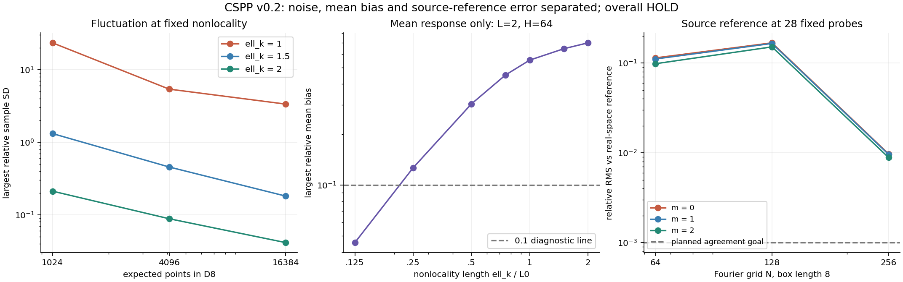

# CSPP: Skalen-, Rand- und Quellenkalibrierung v0.2

**Nächste Schritte ausgeführt; G1 bleibt HOLD.** Die neuen Rechnungen trennen
für eine feste Kalibrierfamilie Sprinkling-Streuung, endlichen Rand und
Nichtlokalitätsbias. Eine unabhängige Ortsraumreferenz prüft zusätzlich
unverändert die kompakte Quelle des E4-Vertrags.

## Konkrete Ergebnisse

**48 neue Poisson-Wolken mit 344.413 Punkten**, drei Dichten, drei gepaarte
Randgebiete und drei bei Dichteänderung festgehaltene Nichtlokalitätsskalen.
Alle geplanten Läufe sind berechnet und gespeichert. Die folgende Tabelle
zeigt bei H=8 die größte relative Stichproben-SD unter den vier Feldern:

| ℓk / L0 | ν4=1024 | ν4=4096 | ν4=16384 | Größter relativer Erwartungswert-Bias |
|---:|---:|---:|---:|---:|
| 1 | 23.3964 | 5.3900 | 3.3511 | 0.5539 |
| 1.5 | 1.3141 | 0.4554 | 0.1808 | 0.6474 |
| 2 | 0.2114 | 0.0882 | 0.0413 | 0.7019 |

Die gemessene maximale SD sinkt zwischen kleinster und größter Dichte um
Faktoren **5,1 bis 7,3**. Trotzdem bleibt der berechnete relative Bias bei
**55,4–70,2 %**. Die Theorie sagt hier ausdrücklich voraus, dass höhere
Dichte bei festem ℓk den Erwartungswert nicht verändert. Mehr Realisierungen
würden nur den empirischen Mittelwert präziser bestimmen.

**Randfehler und Bias sind jetzt getrennt sichtbar.** Für diese Gaußfelder
beträgt die berechnete relative Verschiebung H=8→64 höchstens etwa
0,066–0,172 %, je nach ℓk. Sie erklärt den großen verbleibenden Bias nicht.
Die Rechnung über kleinere ℓk zeigt bei L=2 und H=64 einen maximalen
relativen Mittelwertfehler von 12,68 % bei ℓk=.25 und 4,55 % bei ℓk=.125.
Das ist ein Ergebnis für den numerisch ausgewerteten Erwartungswert;
es ist **kein** Genauigkeitsnachweis für eine einzelne gesprenkelte Wolke.

**Die Quellenreferenz wurde unabhängig überprüft.** Die neue Ortsraumrechnung
verwendet Kirchhoffs Formel und den massiven Bessel-Anteil der KG-Greenfunktion.
Die Fourier-Gegenrechnung wertet feste Gitterknoten und exakte Zeiten aus:

| Referenzvergleich an denselben 28 Proben | Relativer RMS-Bereich über m=0,1,2 |
|---|---:|
| Alte feine Fourier-Referenz gegen Ortsraumrechnung | 11,77–12,82 % |
| Neue Fourier-Rechnung N=256 gegen Ortsraumrechnung | 0,887–0,973 % |
| Geplantes Diagnoseziel | höchstens 0,1 % |

Der Vergleichsfehler ist damit etwa 13-mal kleiner. Das Ziel wird weiterhin
verfehlt. Die neue Fourier-Folge ist außerdem nicht monoton: N=128 schneidet
schlechter ab als N=64. Alle Auflösungen bleiben berichtet. Box, Auflösung
und Interpolation wurden gegenüber v0.1 gemeinsam geändert; ihre einzelnen
Beiträge sind durch diesen Vergleich nicht isoliert.

Die Ortsraum-Quadraturen mit 128 und 256 Knoten stimmen an den geprüften
Punkten bis auf etwa 5×10⁻¹⁵ relativ RMS überein. Das ist eine numerische
Beobachtung, keine Restfehlerzertifizierung oder globale Normgarantie.
**REFERENCE_HOLD bleibt bestehen.**



## Was damit geklärt ist — und was offen bleibt

Der kontrollierte Dichtescan hilft gegen die gemessene Streuung. Er entfernt
bei festem ℓk den Modellbias nicht. Die Erwartungswertrechnung macht diesen
Unterschied quantitativ überprüfbar. Für Gaußfelder ist zusätzlich eine
analytische Schranke für den äußeren Integrationsanteil hergeleitet:

\[
|\mu_\infty-\mu_H|\le56\pi\ell_k^{-4}L^2\exp[-H^2/(4L^2)].
\]

Diese Schranke deckt nicht den numerischen Quadraturfehler ab. Sechs von
189 Punkten des deterministischen Scans verfehlen die vorgegebene
Auflösungsgrenze 10⁻⁶; sie bleiben ausdrücklich QUADRATURE_HOLD.
Die neue Feldauswahl und die zentrale Probe ersetzen keine ursprüngliche
G1-Anforderung. Kein endlicher Dichtepunkt wird als neue skalare Freigabe
interpretiert; der kleinste zellweise maximale relative RMS-Fehler beträgt
0,656. Keine Dirac-, Flavor- oder Kohärenzrechnung wurde freigegeben.

Ein unabhängiger Kontinuums-Cauchy-Löser liegt nun vor. Der **diskrete**
Anfangsdatenadapter und ein belastbarer Fehlertransport bis zur Detektor-
Dichtematrix bleiben offen. Aus lokalen Amplitudenfehlern wird keine
E4-Trace-Abstandsgrenze abgeleitet.

## Prüfung und Reproduktion

Elf Kontrollgruppen prüfen unter anderem neun Poisson-Identitäten,
27 exakte KG-Ebenenwellen, eine zweite Integrationsmethode, Anfangsdaten,
Zeitumkehr, Stützbereich und die kausal konvexen Teilgebiete.
Der vollständige Replay prüft alle 48 Wolken, die feinste Erwartungswertmatrix,
die Ortsraumreferenz, sämtliche neuen Fourier-Auflösungen und die Zusammenfassung.
Die Publikationsprüfung hält G1 auf HOLD und die Bestätigungsphase unbenutzt.

Gemessener Hauptlauf: 33.3 s, maximale RSS 960.4 MiB.

Voraussetzungen: Python 3.12, numpy==2.3.5, scipy==1.17.0, C++17/g++.
Matplotlib wird nur zum Erzeugen der Abbildung benötigt.

```sh
export OPENBLAS_NUM_THREADS=1 OMP_NUM_THREADS=1
python3 -B research/cspp/scale_calibration_v0_2/verify_publication.py
python3 -B research/cspp/scale_calibration_v0_2/audit.py --replay
python3 -B research/cspp/scale_calibration_v0_2/run.py all --out /tmp/cspp-calibration-replay
```

## Nächste Entscheidung

Vor weiteren großen Ensembles ist ein **gemeinsames Bias-/Varianzbudget**
für kleineres ℓk nötig. Die Erwartungswertmatrix liefert dafür eine erste
zulässige Suchrichtung; sie liefert noch keine erforderliche Dichte mit
Garantien. Gleichzeitig sollte die Ortsraumreferenz einen validierten
Quadraturfehler erhalten und danach an die unveränderten E4-Felder,
Anfangsdaten und Detektorgrößen angeschlossen werden. Erst diese Rückbindung
kann G1 voranbringen.

## Nachweise

- [Herleitungen, Einschränkungen und Primärquellen](METHODS.md)
- [Vorab festgelegter Plan](PROTOCOL.json) und [Quellsperre](FREEZE.json)
- [Vollständige Ergebnismatrix](results/RESULTS.json) und [Laufprovenienz](results/RUNS.json)
- [Datenlayout](DATA.md), [Softwareaudit](AUDIT.json), [Paketprüfsummen](SHA256SUMS)
- [Vektorgrafik](calibration.svg)
- Unverändert: [skalarer Pilot v0.1](../scalar_pilot_v0_1/README.md), [E4-Vertragsentwurf](../e4_v0_1/README.md)
