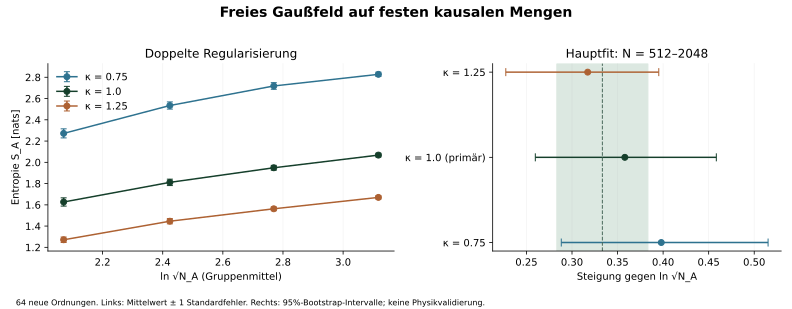

# Befund: Feldkern geprüft, Skalierungsreferenz noch offen

**Status: REFERENCE_NOT_ESTABLISHED.** Der erste vollständige Referenzlauf
liefert gültige doppelt regularisierte Entropien für alle 64 neuen Ordnungen.
Die Hauptsteigung ist 0,358003 mit 95%-Bootstrap-Intervall [0,259737; 0,458413].
Die bekannte Referenz 1/3 liegt darin. Das vorab verlangte Präzisionskriterium
und die Cutoff-Sensitivitätsbedingung sind jedoch nicht erfüllt.
Das ist weder eine Bestätigung des Kontinuumsgesetzes noch seine Widerlegung.

## Was abgeschlossen ist

- Der [Zustandsvertrag](MODEL.md) legt das masselose Gaußfeld, die Zweipunktfunktion,
  äußere Region, Normierung und Nullmodenbehandlung eindeutig fest.
- 13 analytische und strukturelle Prüfungen bestehen. Die bekannte Teilentropie
  der zwei gekoppelten Oszillatoren beträgt 0,094392465944417084… nats;
  die numerische Abweichung beträgt 1,67e-16 nats. Produktzustand, thermischer
  Oszillator, gemeinsamer Kern, unzulässiger zentraler Modus, Positivität,
  Umnummerierung, Umkehr und Normierung werden getrennt geprüft.
- Die Eingaben aller 64 Ordnungen und die vollständige statistische Auswertung
  wurden aus den gespeicherten Seeds und dem unveränderten Vertrag rekonstruiert.
- Eine andere hermitesche Kovarianzformel bestätigt die erste registrierte
  Ordnung jeder Größe. Der größte Unterschied beträgt 2,16e-13 nats.
  Das ist eine interne algorithmische Gegenprüfung mit derselben NumPy/SciPy-
  Umgebung, keine personell unabhängige Replikation aller Feldrechnungen.

## Prospektiver Umfang

Quellfixierung: [bfdaae666978ffeb0ef92980d15df1aa07271d7e](https://github.com/thomasmgfeller/x6-spectral-astrolabium/commit/bfdaae666978ffeb0ef92980d15df1aa07271d7e),
öffentlich vor der Zielerzeugung. [Vertrag](contract.json) und [Quellhashes](freeze.json)
sind seitdem unverändert. Der zuvor bekannte kleine Pilot ist im Vertrag
als explorativ genannt und geht in keine Schätzung dieses Berichts ein.

Pro N=256,512,1024,2048 wurden 16 unabhängige, auf N konditionierte
Volumen-Sprinklings gezogen. Äußerer Diamant L=1, innerer Diamant l=1/2,
Masse null, ungewichtete Kernelmatrizen. Primär ist die doppelte
Regularisierung mit kappa=1. Keine Ausfälle, Ersatzseeds, nachträglichen
Cutoffs oder veränderten Fitbereiche.

| Äußeres N | Mittleres N_A | Mittlere Entropie [nats] | Stichproben-SD |
| ---: | ---: | ---: | ---: |
| 256 | 63,19 | 1,626837 | 0,155749 |
| 512 | 127,69 | 1,811436 | 0,119888 |
| 1024 | 254,63 | 1,948721 | 0,090011 |
| 2048 | 510,69 | 2,067876 | 0,070987 |

## Hauptkriterium und Empfindlichkeit

Die OLS-Steigung gegen ln(sqrt(N_A)) wird über alle 48 Ordnungen bei
N=512,1024,2048 geschätzt. 4.000 Bootstrap-Wiederholungen ziehen jeweils
**ganze Ordnungen innerhalb ihrer N-Gruppe**, keine vermeintlich unabhängigen
Feldpunkte. Das vorab erklärte technische Toleranzband ist 1/3 ± 0,05,
also [0,283333; 0,383333]. Es ist keine physikalische Signifikanzschwelle.

| Cutoff-Faktor | Steigung | 95%-Bootstrap-Intervall |
| ---: | ---: | ---: |
| 0,75 | 0,397967 | [0,288244; 0,515221] |
| **1,00 (primär)** | **0,358003** | **[0,259737; 0,458413]** |
| 1,25 | 0,317223 | [0,227329; 0,395244] |

Die primäre Unsicherheit passt nicht vollständig in das Toleranzband. Außerdem
liegt die Punktschätzung für kappa=0,75 außerhalb dieses Bandes. Damit sind
beide vorab verlangten Abnahmebedingungen verfehlt. Die Sensitivitätsintervalle
sind deskriptiv, keine zusätzlichen unabhängigen Bestätigungen.



Der ebenfalls vorab deklarierte Fit über alle vier Größen hat bei kappa=1
die Steigung 0,404540. Die aufeinanderfolgenden Steigungen der Gruppenmittel
sind 0,522569, 0,397176 und 0,342384. Das weist auf relevante endliche
Größeneffekte hin; der letzte Wert wird ausdrücklich nicht nachträglich
zum Hauptfit erklärt. Die asymptotische Steigung ist damit nicht identifiziert.

## Warum die Nullmodenregel notwendig bleibt

Alle 64 ungekürzten Regionalfälle melden unter der festgelegten numerischen
Toleranz KERNEL_MISMATCH: W_A verschwindet nicht auf dem diagnostizierten
Kern von H_A. Es wird keine scheinbar endliche Entropie durch eine
stillschweigende Pseudoinverse ausgegeben. Diese Statuszählung ist ein
numerischer Befund des konkreten Korpus, kein Satz über alle kausalen Mengen.

Bei nur globaler Regularisierung und kappa=1 sind 61 Fälle numerisch gültig,
3 melden KERNEL_MISMATCH. Bei kappa=0,75 entstehen zusätzlich vier
NUMERICAL_FAILURE-Fälle. Alle drei doppelt regularisierten Varianten sind
in allen 64 Fällen gültig. Sämtliche Statuswerte, Nullitäten, behaltenen Ränge,
Residuen und Kommutatoränderungen bleiben im [Ledger](results/records.jsonl).

Die doppelte Projektion verändert die Algebra. Ihre Ergebnisse dürfen nicht
als bloß präzisere Auswertung derselben ungekürzten lokalen Algebra verkauft
werden. Insbesondere sind noch keine Holografie, Quantengravitation oder
industrielle Überlegenheit gezeigt.

## Reproduktion, Aufwand und nächstes Gate

```sh
python3 -m pip install -r research/free_field_entropy/requirements.txt
OPENBLAS_NUM_THREADS=1 python3 -B research/free_field_entropy/test_core.py -v
OPENBLAS_NUM_THREADS=1 python3 -B research/free_field_entropy/check.py research/free_field_entropy/results --audit
python3 -B research/free_field_entropy/run.py \
  --source-ref bfdaae666978ffeb0ef92980d15df1aa07271d7e \
  --output /tmp/x6-field-reference-new
```

Der Zielarbeiter benötigte etwa 387 Sekunden und maximal 288,4 MiB residenten
Speicher; Grenzen waren 1.800 Sekunden, 2 GiB virtueller Adressraum und ein
BLAS-Thread. Die gleichzeitig durchgeführte interne Gegenrechnung kann
Laufzeiten beeinflusst haben. Diese Zeiten sind eine Budgetkontrolle und
kein fairer Leistungsvergleich mit anderen Verfahren. Die Grafik wurde erst
nach dem Lauf erstellt (`render_results.py`, zusätzlich Matplotlib 3.10.8);
sie ändert keine eingefrorene Auswertung.

**Nächster sachlicher Schritt:** Ein neuer, vorab veröffentlichter Vertrag
muss größere N und/oder mehr unabhängige Ordnungen gegen das vorhandene
Rechenbudget abwägen und Präzision sowie Größen-/Cutoff-Effekte getrennt
adressieren. Diese Daten dürfen die Planung informieren, zählen dann aber
nicht nochmals als neue Bestätigung. Es wurde kein automatischer Erweiterungs-
oder Optimierungslauf gestartet.

Erst ein gesonderter Folgeversuch untersucht kontrollierte Geometrieantworten
und den Zusatznutzen regionaler Korrelationen/Entropien gegenüber vorhandenen
Ordnungs- und Spektralmerkmalen bei gleichem Budget. Dieser Mehrwert bleibt
**nicht nachgewiesen**. Die bestehende reproduzierbare Labor-Maschinenreferenz
behält ihren bereits abgeschlossenen, davon getrennten Umfang.

Maschinenlesbare Nachweise: [Zusammenfassung](results/summary.json),
[Umgebung](results/environment.json), [Ausführungsstatus](results/execution.json),
[analytische Prüfung](analytic-validation.json), [Kovarianz-Gegenprüfung](independent-audit.json).
