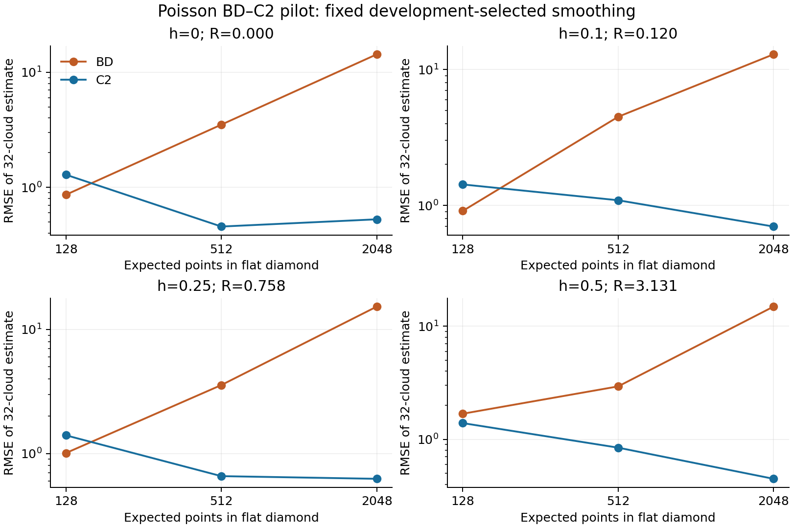

# Eigenzeit: geglätteter BD-Operator gegen C2

**Entscheid: NO_GO für den Ausbau auf variable Krümmung innerhalb dieses Pilotbudgets.**

Die Referenz ist implementiert, alle 6.528 Wolken wurden vollständig wiederholt,
und 102 davon zusätzlich mit einem getrennten Kausalitätstest gegengeprüft.
384 flache Entwicklungswolken wählten die Glättung; 6.144 Testwolken blieben
davon getrennt. Die zwölf Testzellen umfassen Minkowski und drei de-Sitter-Stärken.

Der Quellen- und Vertragsstand wurde vor den Läufen lokal eingefroren:
`2d2539123162ddc032b85ba51af56255ca36a906`. Eine öffentliche Vorregistrierung fand nicht statt,
weil die automatische Freigabeprüfung den GitHub-Push blockierte.

## Hauptvergleich

Bekannte physische Dichte, bekannte Eigenzeit T=1, h=0,5; Zielwert
R=q=3.13131381. Je Schätzung 32 unabhängige Poisson-Wolken;
16 unabhängige Schätzungen pro Testzelle. Die Dichte entspricht im flachen
Fall 2.048 erwarteten Punkten pro Wolke. Gewählt wurde epsilon=0,025.

| Kennzahl | BD | C2 |
|---|---:|---:|
| Empirischer Bias | -6.295689 | -0.309606 |
| Streuung der Gruppenschätzungen (SD) | 13.975225 | 0.333954 |
| RMSE | 14.924340 | 0.447673 |
| Mediane Intervallhalbbreite | 25.790888 | 0.905669 |
| Beobachtete Überdeckung nominaler 95%-Intervalle | 14/16 | 16/16 |

Das RMSE-Verhältnis BD/C2 beträgt 33.34.
Das deskriptive gepaarte Bootstrap-Intervall beträgt [20,24; 58,96].
Die vorab geforderten Grenzen für RMSE, Bias, Intervallbreite und flachen
Bias werden verfehlt. Die Mindestüberdeckung und Kostengrenze bestehen.

**Bias und Streuung trennen:** Das 95%-Monte-Carlo-Intervall des empirischen
BD-Bias reicht von −13,74 bis +1,15. Sein Punktschätzer allein belegt daher
keinen systematischen Fehler dieser Grösse. Die unabhängige Kontinuumsquadratur
liefert bei derselben Glättung und demselben endlichen Diamanten E[Rhat]=2.378733,
also einen endlichen Skalen-/Randfehler von -0.752581 gegenüber dem Ziel.
Die simulierten Mittelwerte sind in allen zwölf Zellen mit der unabhängigen
Quadratur innerhalb der vorab gewählten Kontrolltoleranz vereinbar.

## Alle Testzellen

| Flache erwartete Punktzahl | h | Wahrer R-Wert | RMSE BD | RMSE C2 | Überdeckung BD | Überdeckung C2 |
|---:|---:|---:|---:|---:|---:|---:|
| 128 | 0.00 | 0.0000 | 0.8619 | 1.2860 | 15/16 | 15/16 |
| 128 | 0.10 | 0.1202 | 0.9105 | 1.4264 | 15/16 | 16/16 |
| 128 | 0.25 | 0.7579 | 1.0113 | 1.4037 | 13/16 | 13/16 |
| 128 | 0.50 | 3.1313 | 1.6842 | 1.3919 | 10/16 | 16/16 |
| 512 | 0.00 | 0.0000 | 3.5033 | 0.4559 | 15/16 | 13/16 |
| 512 | 0.10 | 0.1202 | 4.4868 | 1.0912 | 13/16 | 16/16 |
| 512 | 0.25 | 0.7579 | 3.5672 | 0.6586 | 16/16 | 15/16 |
| 512 | 0.50 | 3.1313 | 2.9395 | 0.8442 | 16/16 | 16/16 |
| 2048 | 0.00 | 0.0000 | 14.3090 | 0.5269 | 15/16 | 15/16 |
| 2048 | 0.10 | 0.1202 | 12.9223 | 0.6992 | 16/16 | 15/16 |
| 2048 | 0.25 | 0.7579 | 15.2843 | 0.6268 | 15/16 | 16/16 |
| 2048 | 0.50 | 3.1313 | 14.9243 | 0.4477 | 14/16 | 16/16 |



Bei der kleinsten Dichte hat BD in drei Zellen einen kleineren beobachteten
RMSE. Der Hauptvergleich verfehlt dennoch den vorab verlangten Nutzen.
Es wird deshalb kein allgemeines Überlegenheitsurteil für C2 und keine
Widerlegung der BD-Kontinuumsgrenze abgeleitet.

## Aussagegrenzen

- Die vier epsilon-Werte waren vorab festgelegt. Alle Dichten wählten den kleinsten Wert.
  Eine breitere Glättungssuche könnte das Ergebnis ändern und benötigt neue Testdaten.
- Bei festem epsilon schrumpft l_k mit steigender Dichte. Das ist kein Nachweis
  eines Grenzübergangs mit hinreichend unterdrückter Varianz. Im Hauptfall ist
  l=0.0894, l_k=0.2249; die Skalen sind nur mässig getrennt.
- C2 nutzt die bekannte de-Sitter-Familie und den Bereich 0≤h≤0,5. Im Hauptfall
  werden 6/16 Punktschätzungen an der oberen Modellgrenze begrenzt. BD wird
  nicht entsprechend begrenzt. Das ist ein Vergleich der deklarierten Verfahren,
  keine allgemeine Rangordnung modellfreier Schätzer.
- Die Student-Intervalle sind nominal. 14/16 oder 16/16 beobachtete Treffer
  belegen keine garantierte 95%-Überdeckung. Die konservativen zusätzlichen
  C2-Hoeffding-Intervalle umfassen im Hauptfall den gesamten Modellbereich.
- Auch C2 erreicht dort mit einer medianen Halbbreite von rund 29% des Zielwerts
  die hier verwendete 20%-Breitenvorgabe nicht. Eine generische Krümmungsuhr
  ist damit weiterhin nicht nachgewiesen.
- Bei einer flachen Zelle entstehen einzelne unendliche Bootstrap-Verhältnisse,
  wenn alle gezogenen C2-Schätzungen auf null begrenzt sind. Die archivierten
  2,5%- und 97,5%-Quantile bleiben endlich; die Warnung wird nicht verschwiegen.

## Aufwand und Wiederholung

Der Ziellauf benötigte 24.43 s Wandzeit, 24.37 s CPU-Zeit
und maximal 135.4 MiB RAM; feste Grenzen: 600 s und 2 GiB.
Diese Zeiten betreffen den Benchmark, nicht Entwicklung und Gegenprüfung.
Zusätzliche kostenpflichtige Rechenressourcen wurden nicht verwendet.
Im Hauptfall lagen die Extraktionszeiten für 512 Wolken bei 3.209 s für C2
und höchstens 3.759 s für BD (alle vier Glättungen berechnet).
Beide enthalten dieselbe Erzeugungs- und Relationsarbeit. Die Gruppenanalyse
und einmalige Einrichtung sind gesondert in den JSON-Daten ausgewiesen.

```sh
OPENBLAS_NUM_THREADS=1 OMP_NUM_THREADS=1 python3 -B research/lorentz_bd_reference/verify.py --archive research/lorentz_bd_reference/results --replay
```

Erwartet: `PASS_FULL_REPLAY`, 6.528 Wolken und 102 unabhängige Relationsprüfungen.
Ein C++17-Compiler, Python, NumPy und SciPy werden benötigt. Der Nachbau ist
eine interne unabhängige Gegenrechnung von Teilkomponenten, keine externe Replikation.

## Neuer lokaler Operator

[Boguñá–Krioukov-Zweig](../lorentz_local_dalembert/README.md): Quellenprüfung,
Akzeptanzfolge und getestete Koeffizientenzusammensetzung sind vorbereitet.
Eine intrinsische Reproduktion fehlt noch. Der konstante Feldtest ergibt dort
identisch null; die BD-Krümmungsregel −2B(1) darf nicht übernommen werden.

[Methoden und Primärquelle](METHODS.md) · [Vertrag](contract.json) ·
[Kontrollprotokoll](VERIFICATION.json) · [vollständige Rohdaten](results/)

English: Implemented and internally replayed 4D Poisson smoothed BD reference.
The preregistered-in-local-git finite-budget gate fails; variable curvature is stopped.
The restricted C2 comparator benefits from known model boundaries. No universal
dominance, certified Student coverage or curved-clock claim. The local-operator
track is a preflight, not an intrinsic reproduction.
