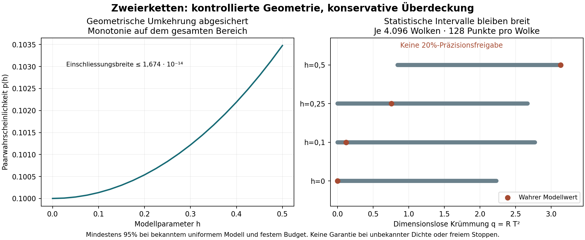

# Eigenzeit: konservative Krümmungsintervalle aus Zweierketten

**Abgeschlossen:** Für die bekannte vierdimensionale de-Sitter-Familie mit
uniformer physischer Volumendichte liegt jetzt eine Rechnung mit kontrolliertem
Geometriefehler und mindestens **95% Überdeckung bei festem Datenbudget** vor.
Sie berücksichtigt die Abhängigkeit der Paare innerhalb einer Punktwolke.
Die Aussage betrifft q=R T² auf dem festgelegten Bereich 0≤h≤0,5.

**Die Präzision bleibt offen:** 16.384 neue unabhängige Punktwolken wurden
gerechnet und vollständig reproduziert. Alle geprüften Intervalle enthalten
den Modellwert; kein Intervall erreicht die verlangte relative 20%-Präzision.
Die mathematische Absicherung ist konservativ und benötigt viele Daten.
Keine allgemeine Raumzeituhr oder Identifikation bei unbekannter Dichte.

[Ergebnisse und Budgetgrenzen](RESULTS.md) · [vollständige Herleitung](DERIVATION.md) ·
[vorab veröffentlichter Prüfvertrag](contract.json) · [Gegenprüfung](VERIFICATION.json) ·
[Rohdaten und exakte Zertifikate](results/) · [Vorgängerstudie](../lorentz_de_sitter_information/README.md)



## Reproduzieren

Python 3.12, POSIX, vollständige Git-Historie, vom Repository-Stamm:

```sh
python3 -m pip install -r research/lorentz_de_sitter_c2/requirements.txt
python3 -B research/lorentz_de_sitter_c2/verify.py
```

Erwartet: `PASS_FULL_C2_CONFIDENCE_REPLAY`. Der Prüfer wiederholt alle
16.384 Punktwolken mit einem getrennten Kausalitätstest, alle Intervallentscheide
und die Budgetplanung. SymPy prüft die geometrische Integralidentität und
24 Monomialintegrale exakt nach. Die Zertifikate verwenden Brüche und ganze
Zahlen; Gleitkommazahlen dienen nur zur Anzeige und zur getrennten Quadratur.
`--archive-only` überspringt allein die Wiederholung der Punktwolken.

Der öffentliche Quellenstand vor dem ersten Ziellauf lautet
`c2f165953b846c69f1a23f641639cc0a3c4cdf25`. Alle acht Forschungsdateien und
beide Geometrieabhängigkeiten werden dagegen geprüft. Ein neuer Lauf benötigt
einen noch nicht vorhandenen Ausgabeordner:

```sh
python3 -B research/lorentz_de_sitter_c2/run.py --source-ref c2f165953b846c69f1a23f641639cc0a3c4cdf25 --output /tmp/de-sitter-c2-new
```

Die vier NPZ-Dateien speichern sämtliche C2-Zählungen und Relationshashes.
Die komprimierten Gruppenprotokolle enthalten jeden Intervallentscheid;
Koordinaten und Relationen werden aus den festgelegten Zufallsstarts
rekonstruiert. Die Abbildung entsteht mit `python3 research/lorentz_de_sitter_c2/draw.py`.

Das Verfahren gibt bei zu breiten Intervallen `ABSTAIN_PRECISION` und bei
einem ausgeschlossenen Modellbereich `MODEL_DOMAIN_INCOMPATIBLE` aus. Eine
Präzisionsfreigabe betrifft den harmonischen Mittelpunkt des q-Intervalls.
Die 95%-Aussage gilt für jedes vorab feste Budget, nicht für wiederholtes
Nachschauen mit frei gewähltem Stoppzeitpunkt. Eine externe Replikation und
eine unabhängige Prüfung des Beweises stehen aus.

English: Rationally enclosed geometric forward function, uniform monotonicity
certificate and conservative Hoeffding U-statistic inversion for a restricted
known-density de Sitter family. Fixed-budget, finite-sample model-conditional
coverage; all fresh tests abstain from 20% precision. No generic curved clock,
optional-stopping guarantee or unknown-density identification. Apache-2.0.
