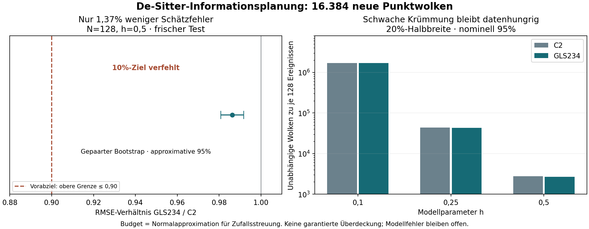

# Eigenzeit: Informationsbedarf der de-Sitter-Krümmung

**Abgeschlossen:** kovarianzbewusste Einparameter-Planung und ein vorab
festgelegter neuer Test mit **16.384 unabhängigen Punktwolken** zu je 128
Ereignissen. Die Gewichte stammen ausschliesslich aus veröffentlichten
Pilotdaten; der neue Test verändert sie nicht.

Im Hauptvergleich verringern Zweier-, Dreier- und Viererketten gemeinsam den
RMSE gegenüber Zweierketten allein um **1,37%**. Das vorab gesetzte Ziel von
mindestens 10% wird verfehlt. Die eingeschränkte Rekonstruktion bleibt bei
schwacher Krümmung datenhungrig. **Keine Freigabe von Krümmungsintervallen.**

[Ergebnisse und nächste Entscheidung](RESULTS.md) · [Prüfvertrag](contract.json) ·
[Herleitung](DERIVATION.md) · [vollständige Gegenprüfung](VERIFICATION.json) ·
[numerische Ausgaben](results/) · [Eigenzeit v0.2](../lorentz_proper_time_validity/README.md)



## Nachrechnen

Python 3.12, vollständige Git-Historie, vom Repository-Stamm:

```sh
python3 -m pip install -r research/lorentz_de_sitter_information/requirements.txt
python3 -B research/lorentz_de_sitter_information/verify.py
```

Erwartet: `PASS_FULL_INFORMATION_REPLAY`, 16.384 nachgerechnete Punktwolken.
Geprüft werden alle Quellen gegen den öffentlichen Vorabstand
`746efa4a74e78dadc9c49e4e26ea65957d64f3aa`, sämtliche Datenprüfsummen,
Gewichte mit einer getrennten Optimierungsrechnung, alle Relationen mit
einem zweiten Kausalitätstest und alle Kettenzahlen mit einer getrennten
Zerlegung. `--archive-only` überspringt die Wiederholung der Punktwolken.
Die Softwareprüfung ist eine interne Reproduktion, keine externe Replikation.

Ein neuer vollständiger Lauf benötigt einen noch nicht vorhandenen Ordner:

```sh
python3 -B research/lorentz_de_sitter_information/run.py --source-ref 746efa4a74e78dadc9c49e4e26ea65957d64f3aa --output /tmp/de-sitter-information-new
```

Die Rohdateien enthalten sämtliche C2/C3/C4-Zählungen und Relationsprüfsummen.
Koordinaten und Relationen werden aus den eingefrorenen Zufallsstarts exakt
rekonstruiert; sie sind nicht als vollständige Matrizen gespeichert.
Die Abbildung lässt sich mit `python3 research/lorentz_de_sitter_information/draw.py`
aus diesen Ergebnissen erzeugen.

English: Covariance-aware planning for a restricted local one-parameter
de Sitter model and prospective internal fresh-seed validation. The 10% RMSE
improvement gate fails. Noise-only budgets do not establish coverage, control
model bias or identify curvature under unknown density. Apache-2.0.
