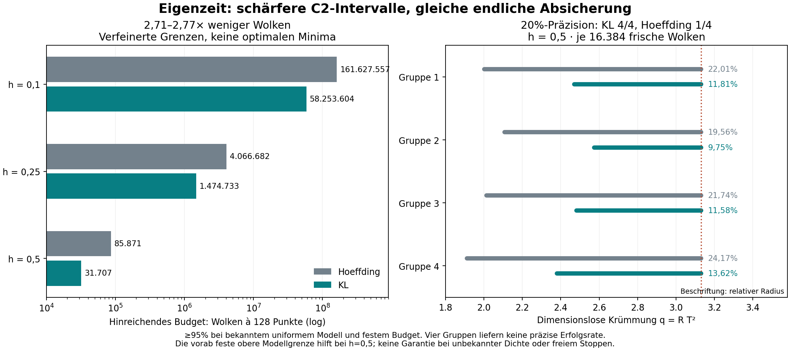

# Eigenzeit: schärfere C2-Intervalle mit endlicher Absicherung

**Der festgelegte Effizienzschritt ist bestanden.** Die Bernoulli-KL-Schranke
für den abhängigen binären Paarkern senkt die hinreichenden Entwurfsbudgets
gegenüber der bisherigen Hoeffding-Referenz um den Faktor **2,71 bis 2,77**.
Die modellbedingte Überdeckung von mindestens **95% bei festem Budget** bleibt
erhalten. Jedes ausgegebene KL-Intervall liegt im bisherigen Intervall.

**77.824 neue Punktwolken** mit jeweils 128 Punkten wurden gerechnet und
vollständig reproduziert. Bei h=0,5 und je 16.384 Wolken erreichen vier von
vier KL-Intervallen die relative 20%-Präzision, gegenüber einem von vier mit
der bisherigen Schranke. Bei h=0; 0,1; 0,25 reichen die ausgeführten Budgets
weiterhin nicht. Vier Gruppen sind keine präzise Schätzung einer Erfolgsrate.

[Ergebnisse und Grenzen](RESULTS.md) · [Herleitung](DERIVATION.md) ·
[vorab veröffentlichter Prüfvertrag](contract.json) · [Gegenprüfung](VERIFICATION.json) ·
[vollständige Daten](results/) · [unveränderte Referenz](../lorentz_de_sitter_c2/README.md)



Die Aussage gilt für die bekannte uniforme physische Volumendichte der
vierdimensionalen de-Sitter-Familie auf 0≤h≤0,5, unabhängige gleichartige
Wolken und vorher feste Budgets. Zielgrösse ist q=R T². Die obere Modellgrenze
hilft bei h=0,5. Unbekannte Dichte, freie Stoppregeln und eine absolute
Krümmung ohne unabhängige Zeitskala werden dadurch nicht identifizierbar.

## Reproduzieren

Python 3.12, POSIX, vollständige Git-Historie, vom Repository-Stamm:

```sh
python3 -m pip install -r research/lorentz_de_sitter_kl/requirements.txt
python3 -B research/lorentz_de_sitter_kl/verify.py
```

Erwartet: `PASS_FULL_KL_REPLAY`. Der Prüfer kontrolliert Quellenbindungen,
Dateihashes, die rationale Rechnung gegen hochpräzise Logarithmen, zwei
exakte Kontrollen abhängiger Paare, sämtliche Budget- und Intervallentscheide
und alle 77.824 Punktwolken mit einem getrennten Kausalitätstest.
`--archive-only` überspringt allein die erneute Erzeugung der Punktwolken.
Die analytische Überdeckung folgt aus der Herleitung, nicht aus beobachteten
Simulationsquoten. Eine externe Beweisprüfung und Replikation stehen aus.

Der Quellenstand **09e0cf0802b3ab52ae18bd0e1a132befc914a42d** wurde vor dem
ersten Zielgitterlauf und vor den neuen Punktwolken öffentlich fixiert:

```sh
python3 -B research/lorentz_de_sitter_kl/run.py --source-ref 09e0cf0802b3ab52ae18bd0e1a132befc914a42d --output /tmp/de-sitter-kl-new
```

Der Ausgabeordner muss neu sein. Elf NPZ-Blöcke enthalten alle C2-Zählungen
und Relationshashes; vier komprimierte Gruppenprotokolle jeden Intervallentscheid.
Die Abbildung lässt sich mit `python3 research/lorentz_de_sitter_kl/draw.py`
erzeugen. Keine historischen Forschungsergebnisse wurden überschrieben.

English: Binary-kernel Chernoff-KL inversion for dependent C2 U-statistics;
finite-sample, fixed-budget coverage under the known uniform 4D de Sitter
model. Refined sufficient budgets improve 2.71–2.77 fold against the unchanged
Hoeffding design rule. Full replay of 77,824 fresh clouds; precision remains
limited at small curvature. No new general concentration theorem, generic
spacetime clock, optional-stopping or unknown-density guarantee. Apache-2.0.
