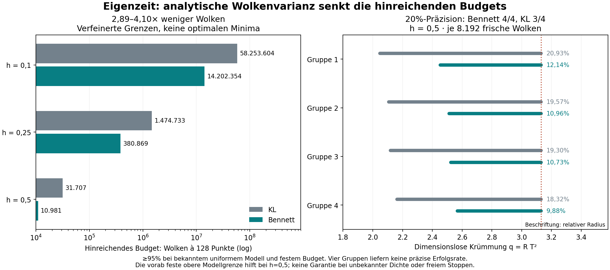

# Eigenzeit: analytische Wolkenvarianz und Bennett-Intervalle

**Der nächste Effizienztest ist bestanden.** Eine analytische Varianzgrenze
für vollständige C2-Punktwolken senkt die hinreichenden Datenbudgets gegenüber
der eingefrorenen KL-Referenz nochmals um **Faktor 2,89 bis 4,10**. Die
modellbedingte Überdeckung von mindestens **95% bei festem Budget** bleibt
erhalten. Die neue Methode verwendet keine ungesicherte empirische Varianz.

**45.056 neue Wolken mit je 128 Punkten** wurden gerechnet und vollständig
reproduziert. Bei h=0,5 und M=4.096 erreichen fünf von acht Bennett-Intervallen
die relative 20%-Vorgabe, gegenüber null von acht mit KL. Bei kleineren
Krümmungen reichen die ausgeführten Budgets weiterhin nicht. In einer
kleinen Gruppe mit M=256 ist Bennett breiter: keine allgemeine Dominanz.

[Ergebnisse](RESULTS.md) · [vollständige Herleitung](DERIVATION.md) ·
[Prüfpaket für externe Begutachtung](REVIEW.md) · [Prüfvertrag](contract.json) ·
[Gegenprüfung](VERIFICATION.json) · [Rohdaten und Zertifikate](results/) ·
[unveränderte KL-Referenz](../lorentz_de_sitter_kl/README.md)



Die Berechnung berücksichtigt Paare mit gemeinsamem Punkt über ein exakt
eingeschlossenes Dreipunktmoment. Eine rationale Zellrechnung ergibt auf
dem gesamten Modellbereich Var(C2/choose(128,2))≤0,000338822592. Ein
klassisches Bennett-Argument nutzt diese Varianz auf Ebene unabhängiger
Wolken. Eine getrennte Kugelschnitt-Quadratur prüft die Geometrie gegen.

Voraussetzungen: bekannte uniforme physische Volumendichte, 4D de Sitter,
0≤h≤0,5, unabhängige gleichartige Wolken und vorher festes Budget. Die
Zielgrösse ist q=R T². Die obere Modellgrenze hilft bei h=0,5. Unbekannte
Dichte, frei gewähltes Stoppen und absolute R-Werte ohne unabhängiges T
bleiben ausserhalb der Aussage. Externe Beweisprüfung und Replikation stehen aus.

## Reproduzieren

Python 3.12, POSIX, vollständige Git-Historie, vom Repository-Stamm:

```sh
python3 -m pip install -r research/lorentz_de_sitter_variance/requirements.txt
python3 -B research/lorentz_de_sitter_variance/verify.py
```

Erwartet: `PASS_FULL_VARIANCE_REPLAY`. Der Prüfer rekonstruiert alle 45.056
Wolken mit einem getrennten Kausalitätstest, alle Intervall- und Budgetentscheide,
die rationale Varianzgrenze, symbolische Momente, Kugelschnitt-Quadraturen und
exakte Negativkontrollen. `--archive-only` überspringt allein die Wiederholung
der Punktwolken. Die interne Gegenrechnung ersetzt keine externe Begutachtung.

Quellen und Vertrag wurden vor dem ersten Zielbudgetlauf unter
`b51933763dd414c160b05042fd32e9976d8fa47a` veröffentlicht. Ein neuer Lauf:

```sh
python3 -B research/lorentz_de_sitter_variance/run.py --source-ref b51933763dd414c160b05042fd32e9976d8fa47a --output /tmp/de-sitter-variance-new
```

Der Ausgabeordner muss neu sein. Sieben NPZ-Blöcke enthalten alle Zählungen
und Relationshashes; vier komprimierte Protokolle alle Gruppenentscheidungen.
Die Abbildung entsteht mit `python3 research/lorentz_de_sitter_variance/draw.py`.

English: Analytically certified whole-cloud variance and classical Bennett
inversion for dependent C2 statistics in a known uniform de Sitter family.
Refined sufficient budgets improve 2.89–4.10 fold against KL. Full replay of
45,056 fresh clouds and a separate sphere-lens geometry audit. No universal
interval dominance, unknown-density identification, optional-stopping
protection or generic spacetime clock. Apache-2.0.
