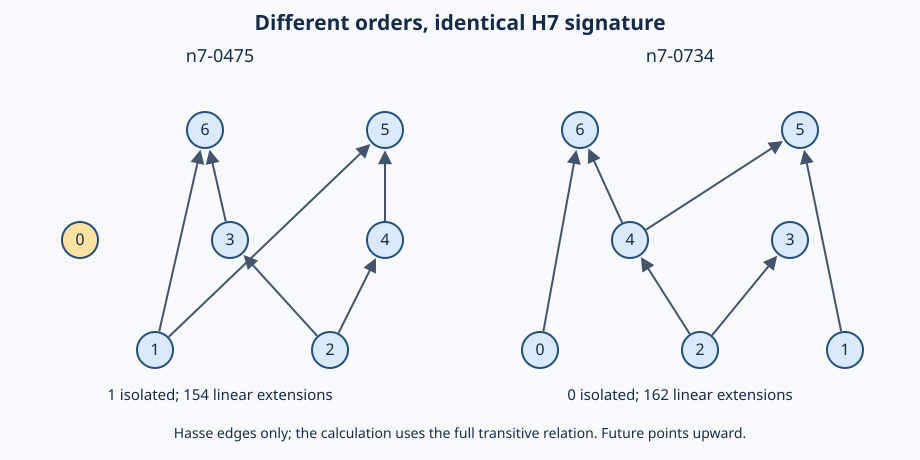

# Warum H7 scheitert: exakte Struktur der Gegenbeispiele

**16. Oktober 2026 · Nachträgliche mathematische Erklärung mit reproduzierbaren
Zertifikaten.** Beide minimalen H7-Kollisionspaare werden durch dieselbe Art einer
regulären orthogonalen Transformation erklärt. Daraus folgt eine explizite Familie
zusammenhängender H7-Gegenbeispiele für **jedes n≥8**. Eine präzise begrenzte Klasse
zusätzlicher Matrixspektren kann diese Paare grundsätzlich nicht trennen.

Das ist ein Ergebnis über endliche Ordnungen und ihre Invarianten. Es bestätigt
keine Raumzeitdynamik und beansprucht weder Neuheit noch externe Begutachtung.
Die Entdeckung erfolgte explorativ an bereits bekannten Gegenbeispielen; der
[Vertrag](contract.json) ist ausdrücklich **keine Vorregistrierung**.



Die Pfeile zeigen die Ordnungsrichtung; eine physikalische Zeit wird damit nicht
definiert. Die Zeichnung enthält nur Hasse-Kanten. Alle Rechnungen verwenden die
**volle strikte transitive Relation**, einschließlich der daraus folgenden Kanten.

## 1. Welche Information die Signatur verliert

Wie im [unveränderten H7-Vertrag](../lorentz_n7_complete/contract.json) seien

$$
S=C+C^T,\quad A=C-C^T,\quad K=SA-AS=2(C^TC-CC^T),
$$

$$
\sigma_{H7}(C)=(n,\chi_S,\chi_A,\chi_K,n_{\min},n_{\max},W_f,W_p).
$$

Hier bezeichnet $\chi_M(t)=\det(tI-M)$ das vollständige charakteristische
Polynom. Mit $d^+=C\mathbf1$, $d^-=C^T\mathbf1$ und
$E=\mathbf1^TC\mathbf1$ gilt

$$
W_f=\frac{\|d^+\|^2-E}{2},\qquad
W_p=\frac{\|d^-\|^2-E}{2}.
$$

Die Gabelzahlen messen somit zwei aggregierte zweite Gradmomente. Sie bewahren
weder die einzelnen Gradpaare noch, welche Elemente gemeinsame Nachbarn besitzen.

| Exakter Befund | n7-0475 | n7-0734 | n7-0588 | n7-1112 |
|---|---:|---:|---:|---:|
| Elemente / volle Relationen / Höhe | 7 / 8 / 3 | 7 / 8 / 3 | 7 / 8 / 3 | 7 / 8 / 3 |
| Minimale / maximale Elemente | 3 / 3 | 3 / 3 | 3 / 3 | 3 / 3 |
| W_future / W_past | 7 / 6 | 7 / 6 | 6 / 7 | 6 / 7 |
| Isolierte Elemente | 1 | 0 | 1 | 0 |
| Lineare Erweiterungen | 154 | 162 | 154 | 162 |

Innerhalb jedes Paars sind auch alle drei charakteristischen Polynome gleich.
Die Minimal- und Maximalzahlen erfassen die Größen zweier Mengen, aber nicht
deren Schnitt: Ein Element ist genau dann isoliert, wenn es gleichzeitig minimal
und maximal ist. Dieser Schnitt hat hier die Größen 1 und 0. Schon das beweist
Nichtisomorphie. Die getrennt nachgezählten linearen Erweiterungen bestätigen sie.

## 2. Zwei explizite Ähnlichkeitszertifikate

Alle Indizes beginnen bei null und entsprechen den veröffentlichten Matrizen.
Auf einer viergliedrigen Teilmenge X setzen wir

$$
Q_X=\tfrac12J_4-I_4,
$$

auf ihrem Komplement die Identität; alle übrigen Blöcke sind null. Dabei ist
$J_4$ die Matrix mit ausschließlich Einsen. Es gilt exakt $Q^TQ=I$ und
$Q\mathbf1=\mathbf1$. Wegen der Einträge −1/2 ist Q keine Permutation.

| Paar | X im linken C | Umbenennung p vom transformierten C zum rechten C |
|---|---|---|
| n7-0475 → n7-0734 | (0, 1, 3, 4) | (4, 3, 2, 0, 1, 6, 5) |
| n7-0588 → n7-1112 | (0, 3, 4, 5) | (5, 1, 2, 4, 3, 0, 6) |

Die unmittelbar nachprüfbare Identität lautet jeweils

$$
(Q^TC_{\rm links}Q)_{ij}=(C_{\rm rechts})_{p(i),p(j)}.
$$

Für das erste Paar sind innerhalb von X keine Relationen vorhanden. Der externe
Punkt 2 hat genau die beiden Nachfolger 3 und 4 in X; die externen Punkte 5 und 6
haben dort jeweils zwei Vorgänger. Die Transformation ersetzt diese Zweiermengen
durch ihre Komplemente in X. Die Relationen zwischen externen Punkten bleiben
erhalten. Die resultierende Matrix ist wieder binär, irreflexiv und transitiv;
das wird explizit geprüft. Allgemeines Graph-Switching erhält Transitivität
**nicht automatisch**.

Dies verwendet die bekannte Reflexionsmatrix des Godsil–McKay-Switchings [1].
Der zusätzliche Nachweis hier ist die konkrete Identität für die **gerichtete
volle Relationsmatrix** beider archivierten Paare. Eine orthogonale Basisänderung
ist dabei keine zulässige Umbenennung der Ereignisse und kein physikalischer
Eichnachweis.

## 3. Begrenzter Satz: welche Erweiterungen sicher nicht helfen

**Satz.** Seien C und D volle Relationsmatrizen gleicher Größe und
$D=U^TCU$, wobei U reell orthogonal ist und $U\mathbf1=\mathbf1$.
Dann bleiben E, W_future und W_past gleich. Für jedes nichtkommutative
Matrixpolynom f mit denselben skalaren Koeffizienten auf beiden Seiten gilt

$$
f(D,D^T,I,J)=U^Tf(C,C^T,I,J)U,
\quad J=\mathbf1\mathbf1^T.
$$

Damit sind die charakteristischen Polynome und Spuren solcher f gleich;
auch die Skalare $\mathbf1^Tf\mathbf1$ stimmen überein.

**Beweis.** Orthogonalität und die Einsvektoreigenschaft liefern
$D\mathbf1=U^TC\mathbf1$,
$D^T\mathbf1=U^TC^T\mathbf1$,
$\mathbf1^TD\mathbf1=\mathbf1^TC\mathbf1$ und $U^TJU=J$.
Normerhaltung beweist die beiden Gabelgleichheiten. Bei Produkten kürzen sich
benachbarte Faktoren $UU^T$; bei Summen gilt Linearität. Induktion über die
Wörter eines Polynoms beweist die behauptete Äquivarianz. Ähnlichkeit erhält das
charakteristische Polynom und die Spur. Die Einsvektoreigenschaft beweist die
letzte Skalaraussage. □

Die Zertifikate aus Abschnitt 2, kombiniert mit ihrer Permutation, erfüllen
diese Voraussetzungen. **Weitere Spektren ausschließlich aus dieser
Polynomklasse können die beiden Paare nicht trennen**, auch nicht durch weitere
Produkte, Potenzen, Kommutatoren oder Antikommutatoren.

Der Satz behauptet keine Erhaltung von n_min, n_max, isolierten Elementen oder D
für beliebige C und U. Die ersten beiden Zahlen werden für unsere Paare separat
geprüft. Komponentenweise Operationen wie `diag(C 1)`, Gradverteilungen,
Nachbarschaftsmotive oder gezielte Eingriffe gehören nicht automatisch zur
genannten Klasse. Für diese zusätzlichen Informationen folgt kein generelles
Unmöglichkeitsergebnis.

## 4. Zusammenhängende Gegenbeispiele für jedes n≥8

Seien P und P′ das erste n=7-Paar. Stelle eine Kette mit k≥1 Elementen vollständig
vor P beziehungsweise P′. Das ist die ordinale Summe

$$
P_k=L_k\oplus P,\qquad P'_k=L_k\oplus P',\qquad
C_k=\begin{pmatrix}T_k&J_{k,7}\\0&C\end{pmatrix}.
$$

Hier enthält T_k alle strikten Kettenrelationen, nicht nur aufeinanderfolgende
Kanten. Die Konstruktion ist offensichtlich eine strikte Ordnung. Ihr
ungerichteter Vergleichbarkeitsgraph ist zusammenhängend: Jeder neue Punkt ist
mit jedem alten vergleichbar. Das bedeutet keine starke Zusammenhangseigenschaft
des gerichteten azyklischen Graphen.

**Beweis der H7-Kollision.** Aus dem Satz folgt mit
$U_k=\operatorname{diag}(I_k,U)$ und
$J_{k,7}U=J_{k,7}$ die gleiche reguläre orthogonale Ähnlichkeit der Blockmatrizen.
Folglich stimmen die drei Spektren und beide Gabelzahlen überein. Beide Ordnungen
haben genau ein minimales und drei maximale Elemente. Sie sind nicht isomorph:
Die jeweils eindeutigen kleinsten Elemente lassen sich k-mal nacheinander
entfernen; ein Isomorphismus würde danach P auf P′ abbilden, im Widerspruch zu
Abschnitt 1. Alternativ bleiben die Anzahlen linearer Erweiterungen 154 und 162.
Damit existiert für jedes n=k+7≥8 ein zusammenhängendes H7-Gegenbeispielpaar. □

Kontrollformeln für diese Familie:

$$
E_k=8+7k+\binom{k}{2},\quad h_k=k+3,
$$
$$
W_{f,k}=7+\sum_{j=0}^{k-1}\binom{7+j}{2},\qquad
W_{p,k}=6+8k+7\binom{k}{2}+\binom{k}{3}.
$$

Dabei ist $\binom{k}{3}=0$ für k<3. Die Implementierung prüft k=1,2,5, also
n=8,9,12, exakt. Die Aussage für alle k beruht auf dem Blockmatrixbeweis, nicht
auf Hochrechnung aus diesen drei Fällen. Beide Seiten besitzen nun **keine**
isolierten Elemente; das Hinzufügen ihrer Anzahl repariert H7 deshalb nicht.
Die Gradmultimengen D bleiben bei dieser Familie unterschiedlich.

## 5. Kontrolle: auch D und lineare Erweiterungen reichen nicht allgemein

Das bereits bekannte verbundene Paar `n8-degree-a/b` bleibt als Gegenkontrolle
erhalten. Hier sind H7, D, die Zahl isolierter Elemente (0) und sogar die Zahl
linearer Erweiterungen (je 1.688) gleich. Die beiden minimalen Elemente mit genau
einem Nachfolger teilen sich links denselben Nachfolger, rechts nicht. Daher ist
der isomorphieinvariante Wert

$$
M_{11}=\sum_{\substack{i<j\\d^-(i)=d^-(j)=0\\d^+(i)=d^+(j)=1}}
\sum_v C_{iv}C_{jv}
$$

links 1 und rechts 0. Das liefert einen direkten strukturellen
Nichtisomorphienachweis; zusätzlich prüft der Checker alle möglichen Bijektionen.
M_11 ist ein **nachträgliches Diagnosemerkmal**, kein neuer universeller Schlüssel.

Bei diesem Höhe-2-Paar ist $C=\left(\begin{smallmatrix}0&B\\0&0\end{smallmatrix}\right)$
mit B der Größe 4×4. Beide Gram-Matrizen haben das Polynom

$$
\chi_{BB^T}(t)=t^4-7t^3+13t^2-6t.
$$

Für positive Singulärwerte s von B bestehen die nichtverschwindenden Spektren
von S, A und K aus $\pm s$, $\pm is$ beziehungsweise $\pm2s^2$.
Dies folgt aus $K=\operatorname{diag}(-2BB^T,2B^TB)$ und der
Singulärwertzerlegung der beiden anderen Blöcke. Die entsprechenden Nullwerte
werden durch die Ränge festgelegt. In dieser Höhe-2-Situation liefern die drei
Spektren somit keine drei unabhängigen Quellen von Nachbarschaftsinformation.
Für dieses Paar wird **kein** einsvektorerhaltendes Switching-Zertifikat behauptet.

## 6. Reproduktion und Grenzen

Die [Eingaben](inputs.json) binden sechs unveränderte Matrizen an Quellhashes aus
Commit `9c9c67023e484c5704516f6931fb41d1a3208939`. Die historischen
Verträge, Rechenkerne und Resultate werden nicht geändert.

```sh
python3 -B -O research/lorentz_h7_structure/analyze.py --output /tmp/h7-structure.json
cmp research/lorentz_h7_structure/results.json /tmp/h7-structure.json
python3 -B -O research/lorentz_h7_structure/verify.py /tmp/h7-structure.json
python3 research/lorentz_h7_structure/draw.py --output /tmp/h7-counterexample.svg
cmp research/lorentz_h7_structure/counterexample.svg /tmp/h7-counterexample.svg
```

Python 3.12 und Git mit dem genannten Quellcommit genügen; keine Drittbibliothek
und kein Netzwerk während der Rechnung. Die CI wiederholt die Rechnungen in
einem Netzwerk-Namespace ohne Netzverbindung.

Der Produzent berechnet Polynome durch Faddeev–LeVerrier mit
Cayley–Hamilton-Restprüfung und lineare Erweiterungen durch Teilmengenrekursion.
Der separat implementierte Checker importiert keinen Produzentencode: Er nutzt
Bareiss-Determinanten mit rationaler Interpolation und vollständige
Permutationszählungen nach Entfernung eindeutig erzwungener Präfixe. Geprüft
werden 12 Matrizen, 38 Polynome, zwei Ähnlichkeitszertifikate und sechs Paare.
Fünf absichtlich verfälschte Fälle werden verworfen: Transformationsmatrix,
Umbenennung, Zielrelation, Polynom und Transitivität.

[results.json](results.json) enthält die exakten Werte;
[verification.json](verification.json) den erfolgreichen Gegenprüfstatus.
Algorithmisch getrennte Rechnungen sind keine externe unabhängige Begutachtung.
Es gibt keine neue vollständige Enumeration bei n≥8 und keinen allgemeinen
Rekonstruktionsnachweis. Die Sätze sind elementare handprüfbare Argumente mit
Rechenzertifikaten, keine formalisierten Beweise in einem Beweisassistenten.

## 7. Bedeutung für das Forschungsprogramm

Der [Abhängigkeitsbefund](../lorentz_h7_dependency_audit/README.md) bleibt bestehen.
Spektren sind weiter brauchbare Observablen; ihre Grenzen werden jetzt durch
eine konkrete Symmetrie der Auswertung erklärt. Eine bloße Erweiterung um weitere
Spektren derselben Polynomklasse ist für diese Paare kein sinnvoller nächster
Rekonstruktionsversuch.

Eine begrenzte nächste Untersuchung sollte strukturabhängige Informationen
außerhalb dieser Klasse vergleichen, etwa registrierte Nachbarschaftsmotive oder
gezielte Einpunkt-Erweiterungen. Vollständige Relationsmatrizen bleiben dabei die
Referenz; Klassen gleicher Messwerte dürfen keine Historien stillschweigend
entfernen. Auswahl, Kosten und Trennungsziel müssen vor einem neuen Test feststehen.

## Literatur und Priorität

1. C. D. Godsil und B. D. McKay, *Constructing cospectral graphs*,
   Aequationes Mathematicae 25, 257–268, insbesondere Konstruktion 2.1 und
   Satz 2.2: [Originalarbeit beim Autor](https://users.cecs.anu.edu.au/~bdm/papers/GodsilMcKayCospectral.pdf),
   [DOI](https://doi.org/10.1007/BF02189621). Die Reflexion und der
   Spektralerhalt durch Switching sind etablierte Werkzeuge.
2. Y. K. Yazdi, M. Letizia und A. Kempf, *Lorentzian Spectral Geometry with
   Causal Sets*, Class. Quantum Grav. 38 (2021) 015011,
   [arXiv:2008.02291](https://arxiv.org/abs/2008.02291), insbesondere Abschnitte
   3–4: Kombination spektraler und nichtspektraler Invarianten sowie
   Einpunkt-Erweiterungen als etablierte Forschungsrichtung. Die dortigen
   Gradkonventionen werden nicht stillschweigend mit unseren gleichgesetzt.

Der Beitrag dieses Repositorys ist die nachvollziehbare Zuordnung, Herleitung
und exakte Überprüfung der konkreten archivierten Beispiele. Eine Aussage über
Neuheit oder Priorität dieser Beispiele oder Folgerungen erfordert zusätzliche
Literaturarbeit und externe fachliche Prüfung.
