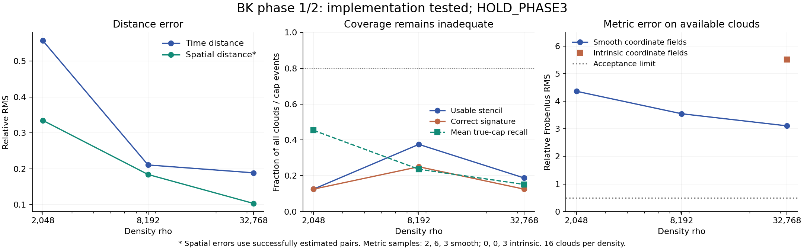

# BK Phase 1/2 — Ergebnisse des flachen Piloten

**Entscheid: `HOLD_PHASE3`.** Die intrinsische Implementierung und der
Produktidentitäts-Test sind ausgeführt; die wissenschaftliche Abnahme ist
nicht bestanden. Das betrifft diesen begrenzten 2+1-Piloten und seine
Nachbarschafts-/Ankersuche. Es widerlegt weder den BK-Kontinuumsgrenzwert noch
belegt es ein grundsätzliches Scheitern intrinsischer Metrikrekonstruktion.

## Vor den Daten fixiert

- Öffentlicher Protokollcommit: `032024b2369a42e52538ec97466831623b1b47f5`.
- Öffentlicher Implementierungs- und Analysecommit: `a4ff90306827f6df99048bd2fce61ef96a758f19`.
- 48 unabhängige Testwolken, 16 je Dichte; sechs separate Entwicklungswolken.
- 2+1 Minkowski, bekannte konstante Poisson-Intensität; externe Koordinaten
  ausschliesslich im Sampler und im unabhängigen Prüfer.
- [Vertrag](phase12/contract.json), [Protokoll](phase12/PROTOCOL.md),
  [Implementierungsentscheidungen](phase12/IMPLEMENTATION.md),
  [Rohdaten und Quellhashes](phase12/results/execution.json),
  [vollständige Kennzahlen](phase12/results/summary.json).

## Quantitative Ergebnisse

| Dichte rho | Mittlere Punktzahl | Zeitfehler RMS | Raumfehler RMS* | Operator verfügbar | Metrikfehler, glatte Felder** | Intrinsische Karte | Metrikfehler, intrinsische Felder** |
| --- | --- | --- | --- | --- | --- | --- | --- |
| 2048 | 533.062 | 0.557 | 0.335 | 2/16 | 4.366 | 0/16 | — |
| 8192 | 2159.562 | 0.211 | 0.184 | 6/16 | 3.549 | 0/16 | — |
| 32768 | 8597.125 | 0.189 | 0.104 | 3/16 | 3.110 | 3/16 | 5.524 |

Fehler sind relativ und dimensionslos. Zeit-/Raumwerte aggregieren zuerst
innerhalb einer Wolke und dann gleichgewichtet über Wolken. *Raumfehler sind
bedingt auf eine erfolgreiche Ankersuche. **Metrikfehler sind relative
Frobeniusnormen, als RMS über verfügbare Fälle; die festgelegte Grenze ist 0,5.
Nicht verfügbare Fälle bleiben im Nenner der Verfügbarkeits- und Signaturquoten.

Bei rho=32768 beträgt der mittlere Rangkorrelationswert der verfügbaren
Abstandsschätzungen 0.9843 (15 auswertbare Wolken).
Gleichzeitig fehlen im Wolkenmittel 87.8% der räumlichen
Abstandsschätzungen. Die intrinsische Auswahl erfasst nur
15.1% der im Prüfer bekannten wahren Kappenpunkte. Diese beiden
Quoten sind keine austauschbaren Grössen: die erste umfasst auch entfernte
Schalenpunkte, die zweite nur die tatsächlich gewünschte lokale Kappe.
Gute Rangwerte der verbleibenden Paare begründen daher keine zuverlässige
Nachbarschaftsrekonstruktion.

Die nachträgliche geometrische Randprüfung findet bei 15/16, 5/16 und 1/16
Wolken (aufsteigende Dichte) Kappenpunkte ausserhalb des Diamanten. Kausale
Intervalle bleiben vollständig; die gewünschte räumliche Schale kann dennoch
abgeschnitten sein. Der Dichtevergleich enthält somit auch einen abnehmenden
Randeffekt. Null Randzeugen in einem Einzelfall sind kein Einschlussbeweis.

Nur 3/16 der dichtesten Wolken haben mindestens vier verwendbare
Punkte auf beiden Zeitseiten. Nur 2/16 liefern die richtige Signatur
in der glatten Testkarte; dasselbe gilt für die intrinsische Karte. Unter den
drei verfügbaren Fällen sind das jeweils 2/3. Der Wilson-95%-Bereich der
Gesamtquote 2/16 liegt bei 3,5–36,0%; 16 Wolken erlauben keine präzise
Erfolgswahrscheinlichkeit. Die intrinsischen Felder selbst haben einen
bedingten relativen RMS-Fehler von 0.077; ihre abgeleitete Metrik ist
wesentlich ungenauer. Bereits mit glatten vorgegebenen Feldern verfehlt der
Operator die Metrikvorgabe. Das Problem liegt deshalb nicht allein in den
rauschenden künstlichen Koordinaten.

Die Darstellung verbindet nur drei endliche Dichten; sie belegt keine
asymptotische Konvergenz. Mittelwerte, Standardfehler, Wilson-Intervalle und
alle einzelnen Feldantworten sind in der maschinenlesbaren Auswertung.

## Software und fachliche Abnahme

Konstanten werden exakt annihiliert. Die Produktformel stimmt mit der separat
akkumulierten gewichteten äusseren Produktform überein. Affine Kartenwechsel
einschliesslich Translation bestehen. Drei Umnummerierungsprüfungen, eine je
Dichte, transportieren die unabhängigen Zufallsmarken mit den Ereignissen.
2.272 längste Pfade wurden gegen erschöpfende Pfadsuche geprüft; fünf
Überlappungswerte gegen unabhängige adaptive Quadratur. Eine künstliche
symmetrische Referenzschablone prüft Komponenten und Vorzeichen und verwirft
Nullausgabe bzw. ein unverändert fest vorgegebenes eta nach Kartenwechsel.
Diese Kontrollen bestätigen Softwareeigenschaften, keine Forschungsfreigabe.

| Stufe | Festgelegtes Kriterium | Befund |
| --- | --- | --- |
| phase1_gates | time_accuracy | PASS |
| phase1_gates | space_accuracy_conditional | PASS |
| phase1_gates | space_ranking_conditional | PASS |
| phase1_gates | neighborhood_availability | FAIL |
| phase1_gates | time_improvement | PASS |
| phase1_gates | space_improvement | PASS |
| phase2_gates | operator_accuracy | FAIL |
| phase2_gates | oracle_metric_accuracy | FAIL |
| phase2_gates | oracle_signature | FAIL |
| phase2_gates | metric_improvement | PASS |
| phase2_gates | chart_availability | FAIL |
| phase2_gates | chart_accuracy | FAIL |
| phase2_gates | chart_fields | PASS |
| phase2_gates | chart_signature | FAIL |

Der vollständige Testlauf dauerte 68.91 Sekunden und erreichte
419.0 MiB gemessenen Spitzen-RSS; die Grenzen waren 600 Sekunden
und 2 GiB. Kein Testseed wurde ersetzt. Die ursprünglichen Kriterien wurden
nach Sichtung der Testdaten nicht verändert. Ein vollständiger numerischer
Replay ist mit `phase12/verify.py` vorgesehen; sein konkretes Ergebnis steht
in [VERIFICATION.json](phase12/VERIFICATION.json).

## Einordnung und nächster sachlicher Schritt

Der begrenzte Ankersuchraum (64 tiefste gemeinsame Anker), die harte
Balancierungsregel und kleine Schalenpopulationen sind konkrete Engpässe
dieser Implementierung. Dass der Ankerdeckel die Ursache sämtlicher Ausfälle
ist, wurde nicht isoliert nachgewiesen. Die absolute Skala nutzt bekannte
Dichte und den festen Literaturwert alpha2=1/sqrt(2), keine Anpassung an
Simulationskoordinaten. Unmarkierte kanonische Rahmen, unbekannte Intensitäten,
3+1 Dimensionen und gekrümmte Raumzeiten sind nicht validiert.

Ein nächster Vertrag sollte zuerst auf unabhängigen Entwicklungsdaten
Ankersuchabdeckung, Skalierung der Populationen und Randrobustheit verbessern,
bevor er auf frischen Testseeds erneut Metrikgenauigkeit beansprucht. Die
vorliegenden 48 Testwolken sind dafür ab jetzt bekannte Daten. Es folgt keine
Krümmungsberechnung und keine neue Behauptung über ein minimales Punktebudget.
Der frühere BD–C2-Entscheid `NO_GO_VARIABLE_CURVATURE_IN_THIS_BUDGET` und seine
Quelldaten bleiben unverändert.
