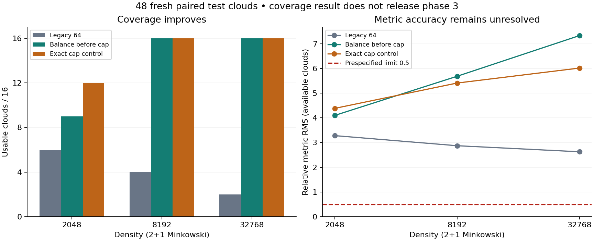

# Eigenzeit / BK: Ankersuche isoliert geprüft

**Ergebnis: `ANCHOR_COVERAGE_IMPROVED`; weiterhin `HOLD_PHASE3`.** Die neue Suche
schliesst einen nachgewiesenen Abdeckungsfehler. Die Genauigkeit der Metrik
erfüllt weiterhin nicht die ursprüngliche Fehlergrenze. Es gibt keine neue
Krümmungsfreigabe und keine allgemeine Widerlegung des BK-Verfahrens.

## Was wurde geändert?

Der ursprüngliche Code wählt die 64 tiefsten gemeinsamen Anker aus und prüft
erst danach, ob diese geeignet sind. Der neue Kandidat prüft die unveränderten
Eignungskriterien zuerst und begrenzt erst die gültigen Anker auf 64. Dichte,
Skalen, Balancierungsregel, Median, Operator und Grenzwerte bleiben identisch.
Ein explizites 85-Ereignis-Gegenbeispiel zeigt einen gültigen Anker auf Rang 66,
den die alte Suche verpasst. Zeitumkehr und Umnummerierung ändern dies nicht.

Für jede Wolke wird zusätzlich die exakte räumliche Abstandskappe auf denselben
diskreten Schalen ausgewählt. Diese *Kontrolle* nutzt Simulationskoordinaten;
sie ist kein intrinsisches Verfahren und keine theoretische Fehleruntergrenze.
Zeitpunkte, Kettenskala und diskrete Schalen bleiben dabei unverändert.

## Vorab festgelegt und vollständig ausgeführt

- Öffentlicher Vertrag: `4b7e7aea9ba935295dd0d21963080c31f8ffc9a9`.
- Öffentlicher Quellen- und Analysefreeze: `6f61cf0b525b9ce4e5fa81bf91be185014b7dfd7`.
- Sechs separate Entwicklungswolken; danach 48 neue Testwolken, 16 je Dichte.
- Alle drei Verfahren arbeiten je Wolke auf derselben kausalen Ordnung.
- Keine nachträgliche Parameterauswahl, keine ersetzten Seeds.
- Laufzeit 141.58 Sekunden; Spitzen-RSS 549.6 MiB.
  Vorgaben: 600 Sekunden / 2048 MiB. Einzelarmzeiten nutzen gemeinsame Caches
  und begründen keinen belastbaren Geschwindigkeitsvergleich.

[Protokoll](PROTOCOL.md), [Vertrag](contract.json), [Umsetzung](IMPLEMENTATION.md),
[Entwicklung](development/execution.json), [Testquellen und Rohdaten](results/execution.json),
[vollständige Auswertung](results/summary.json), [Replay](VERIFICATION.json).

## Vergleich auf den neuen Daten

| Dichte | Verfahren | Verwendbar | Wahre Kappenpunkte erfasst | Metrik-RMS, glatte Felder | Intrinsische Karte | Metrik-RMS, intrinsische Felder |
| --- | --- | --- | --- | --- | --- | --- |
| 2048 | Bisherige Suche | 6/16 | 0.434 | 3.279 | 0/16 | — |
| 2048 | Eignung vor Begrenzung | 9/16 | 0.518 | 4.097 | 0/16 | — |
| 2048 | Exakte Abstandskappe* | 12/16 | 1.000 | 4.382 | 0/16 | — |
| 8192 | Bisherige Suche | 4/16 | 0.193 | 2.870 | 0/16 | — |
| 8192 | Eignung vor Begrenzung | 16/16 | 0.815 | 5.681 | 0/16 | — |
| 8192 | Exakte Abstandskappe* | 16/16 | 1.000 | 5.406 | 0/16 | — |
| 32768 | Bisherige Suche | 2/16 | 0.115 | 2.626 | 2/16 | 3.031 |
| 32768 | Eignung vor Begrenzung | 16/16 | 0.949 | 7.326 | 7/16 | 13.263 |
| 32768 | Exakte Abstandskappe* | 16/16 | 1.000 | 6.012 | 10/16 | 9.199 |

Erfasste Kappenpunkte: Mittel der wolkenweisen Recall-Anteile, ohne Referenzpunkt.
Metrikfehler: relative Frobeniusnorm, als RMS über verfügbare Wolken; Grenze
**0,5**. Fehlende Fälle bleiben im Nenner der Verfügbarkeit und Signatur.
*Exakte Abstandskappe ist ausschliesslich die oben beschriebene Kontrolle.

Bei höchster Dichte gewinnt die neue Suche 14 verwendbare Wolken und
verliert 0. Die Verfügbarkeit steigt von 2/16
auf 16/16. Der Wilson-95%-Bereich der neuen Quote ist
80.6–100.0%;
16 Wolken begründen noch keine präzise Erfolgswahrscheinlichkeit.
Der exakte zweiseitige McNemar-Test ergibt p=0.00012207
als deskriptive Ergänzung des gepaarten Vergleichs. Die drei primären Kriterien
werden gemeinsam berichtet; es wird keine korrigierte Mehrfachtest-Aussage
oder allgemeine Überlegenheit daraus abgeleitet.

Die zusätzliche Abdeckung bringt auch Fehlselektionen mit sich: Nur
68.3% der ausgewählten Nichtreferenzpunkte liegen
im Mittel tatsächlich in der gewünschten Kappe. Der bedingte räumliche RMS-Fehler
liegt bei 0.203 statt 0.126;
dabei werden unterschiedliche Mengen bestimmbarer Paare verglichen. Der
Kandidat ist deshalb als Abdeckungsverbesserung, nicht als allgemein genaueres
Verfahren einzustufen.

Der mittlere gepaarte Recall-Gewinn beträgt 0.834
(Standardfehler 0.020, 16 Wolken).
Von 2292 zuvor fehlenden Abständen werden
2265 zusätzlich bestimmbar. Diese Paarzahlen sind keine
unabhängigen Replikate; die statistische Einheit bleibt die ganze Wolke.

| Vorab festgelegtes Abdeckungskriterium | Befund |
| --- | --- |
| availability_gain | PASS |
| candidate_availability | PASS |
| cap_recall_gain | PASS |

## Warum dies noch keine genaue Metrik ergibt

Die Mengen verfügbarer Wolken unterscheiden sich. Auf den 2
gemeinsam verfügbaren hochdichten Wolken beträgt der Metrik-RMS
2.626 für die alte und
5.938 für die neue Suche. Dieser kleine
gemeinsame Ausschnitt darf nicht als alleinige Leistungsbewertung dienen.
Auf sämtlichen verfügbaren Kandidatenwolken ist der Fehler
7.326; bei exakt ausgewählter Abstandskappe
6.012. Beide werden an derselben Grenze geprüft.

Auch die Kontrolle mit korrekter räumlicher Auswahl verfehlt damit die Vorgabe.
Fehlende Anker sind also ein realer Engpass, aber ihre Behebung reicht in diesem
Pilot nicht aus. Die Kontrolle isoliert keinen einzelnen verbleibenden Fehler:
Kettenskala, schwankende Schalen, Geodätenrichtung, Winkelverteilung und Ränder
können beitragen. Es ist kein Beleg, dass einer davon allein verantwortlich ist.

Die Produktidentität berechnet für beliebige Felder exakt die gewichteten
zweiten Differenzmomente der jeweiligen diskreten Schablone. Ihr algebraisches
Bestehen allein garantiert daher keine geometrisch richtigen Momente.
Konstanten-, Produkt- und affine Kartenkontrollen bestehen im gesamten Lauf;
beide intrinsischen Arme bestehen Umnummerierungen auf je einer Wolke jeder
Dichte. Der vollständige numerische Replay ist in VERIFICATION.json dokumentiert.
Das ist interne Reproduzierbarkeit, keine unabhängige externe Replikation.

## Nächster begrenzter Schritt

Vor weiteren Dichteerhöhungen sollten die zeitlichen und räumlichen Beiträge
zur Metrik getrennt als Momentenbilanz geprüft werden. Dazu zuerst auf bekannten
Entwicklungsdaten Kettenskala, Schalenstreuung und Richtungsschwankungen messen,
mit explizit gekennzeichneten Kontrollen jeweils einen Beitrag ersetzen und
die Auswirkung bestimmen. Eine darauf beruhende neue intrinsische Korrektur
braucht wieder einen eingefrorenen Vertrag und frische Testdaten.

Die bisherigen 48 Phase-1/2-Wolken und alle BD-C2-Ergebnisse bleiben unverändert.
Bekannte Intensität, transportierte Zufallsmarken und 2+1 Minkowski sind weiterhin
Voraussetzungen. 3+1, unbekannte Dichte, Konvergenz und Krümmung sind nicht validiert.
Die zeitlich beendeten Hintergrundagenten werden durch diesen Einzelauftrag
nicht neu gestartet.
