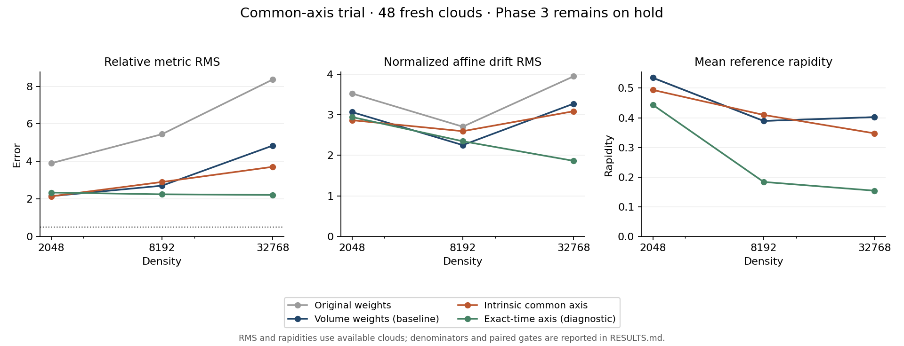

# Eigenzeit / BK: gemeinsame Referenzrichtungen aus Intervallzählungen

**Ergebnis: `COMMON_AXIS_HOLD`; weiterhin `HOLD_PHASE3`.**
Der vorab festgelegte primäre Kandidat wird auf 48 neuen Testwolken mit den
bisherigen intrinsischen Schalengewichten verglichen. Bei höchster Dichte
verändert sich der relative Metrik-RMS **4.840 → 3.709**,
die normierte affine Drift **3.271 → 3.085**.
Die Entscheidung verlangt Verbesserungen beider Momente auf denselben Wolken.
Die tatsächlichen Reduktionen betragen 23.4 % und
5.7 %; verlangt waren jeweils mindestens 25 %.

## Auswahlregel und klare Koordinatengrenze

Zwei vorhandene Zeitstützpunkte a≺r≺b definieren eine gemeinsame Bezugsrichtung.
Für jeden Schalenpunkt x innerhalb ihres Intervalls werden sechs Eigenzeiten
aus strikten Intervallzählungen geschätzt: q(u,v)=[12N/(pi rho)]^(1/3).
Die Auswahl verwendet

    dt = [q(a,x)² - q(x,b)² - q(a,r)² + q(r,b)²] / [2q(a,b)]
    h = dt² / q(r,x)² - 1.

Mit exakten Eigenzeiten ist dt die Zeitverschiebung gegenüber r im Ruhesystem
von b−a, auch wenn r ausserhalb dieser Achse liegt. h ist dann sinh² der
Rapidität gegenüber dieser Richtung. Auf jeder Schale wird der Punkt mit
kleinstem |h| gewählt, mit transportierter Zufallsmarke als eindeutiger
Tie-Break-Regel. Falsches Zeitvorzeichen oder nichtpositive erforderliche
Intervallzählungen verwerfen einen Kandidaten. Negative geschätzte h werden
unverändert über ihren Betrag bewertet. Es gibt keine Pseudozählung, nachträglich
angepasste Schwelle oder Rückkehr zur alten Referenz bei fehlender Auswahl.

Der intrinsische Kandidat erhält keine Einbettungskoordinaten oder Testfelder.
Kappen werden mit dem unveränderten balanced64-Überlappungsschätzer neu gewählt;
die zuvor geprüften inversen quadratischen Intervallgewichte bleiben erhalten.
Zeitstützpunkte und deren Kettenzeitgewichte ändern sich nicht. Die Auswahl
stellt keine exakte Momentenbalance her und der Zählschätzer ist durch die
vorherige Schalenauswahl bedingt; Unverzerrtheit wird nicht behauptet.

Der diagnostische Oracle-Arm ersetzt ausschliesslich die sechs Auswahlzeiten
durch exakte Eigenzeiten. Er behält dieselbe positive-Zählungs-Zulässigkeit,
intrinsische Kappenabstände und intrinsische Schalengewichte. Seine Ergebnisse
sind weder ein neuer intrinsischer Operator noch eine theoretische Fehlergrenze.

## Vorab festgelegt, ausgeführt und wiederholt

- Öffentliches Protokoll: `5f05a0a3374e7337138f851d5fde8761da8438a1`.
- Quellen und Auswertung vor allen Zielwolken: `2afc821419fcefff6cd7da41928f3bb54b2f8976`.
- Sechs Entwicklungswolken, danach 48 separate Zielwolken, je 16 pro Dichte.
- Keine Parameteränderung nach Entwicklung, keine Ersatz-Seeds oder Oracle-Auswahl.
- Laufzeit 172.13 Sekunden, Spitzen-RSS 432.7 MiB;
  feste Grenzen 900 Sekunden und 2048 MiB.
- Vollständiger lokaler numerischer Replay: 48/48 bestanden;
  Koordinaten-Bytehashes separat 48/48 identisch.
  GitHub-Prüfergebnisse werden im PR ergänzt. Keine externe Replikation behauptet.

[Protokoll](PROTOCOL.md), [Vertrag](contract.json), [Implementierung und Grenzen](README.md),
[Entwicklung](development/summary.json), [Rohdatenverzeichnis](results/execution.json),
[vollständige Auswertung](results/summary.json), [Replay](VERIFICATION.json).

## Alle Arme und Dichten

| Dichte | Arm | Verfügbar | Metrik-RMS | Affine Drift-RMS | Richtige Signatur |
| --- | --- | --- | --- | --- | --- |
| 2048 | Ursprüngliche Gewichte | 9/16 | 3.900 | 3.523 | 6/16 |
| 2048 | Intervallgewichte, bisherige Referenzen | 9/16 | 2.146 | 3.066 | 6/16 |
| 2048 | Gemeinsame Achse (primär) | 10/16 | 2.136 | 2.865 | 8/16 |
| 2048 | Exakte Auswahlzeiten (Diagnose) | 9/16 | 2.338 | 2.942 | 7/16 |
| 8192 | Ursprüngliche Gewichte | 16/16 | 5.447 | 2.705 | 6/16 |
| 8192 | Intervallgewichte, bisherige Referenzen | 16/16 | 2.703 | 2.251 | 15/16 |
| 8192 | Gemeinsame Achse (primär) | 16/16 | 2.900 | 2.594 | 13/16 |
| 8192 | Exakte Auswahlzeiten (Diagnose) | 16/16 | 2.245 | 2.346 | 15/16 |
| 32768 | Ursprüngliche Gewichte | 16/16 | 8.361 | 3.945 | 6/16 |
| 32768 | Intervallgewichte, bisherige Referenzen | 16/16 | 4.840 | 3.271 | 10/16 |
| 32768 | Gemeinsame Achse (primär) | 16/16 | 3.709 | 3.085 | 14/16 |
| 32768 | Exakte Auswahlzeiten (Diagnose) | 16/16 | 2.211 | 1.864 | 14/16 |

RMS ist auf verfügbare Schablonen bedingt. Verfügbarkeit und Signatur verwenden
alle 16 Wolken als Nenner. Die Entscheidung benutzt die Schnittmenge von
Kandidat und Basis, bei höchster Dichte 16 Wolken. Untere Dichten
können unterschiedliche Verfügbarkeitsmengen haben; deren unpaarige RMS sind
kein kontrollierter Paarvergleich. Alle gepaarten Zahlen stehen in summary.json.

Metrikfehler ist ||M−diag(−1,1,1)||/sqrt(3), mit M=½ΣwΔXΔXᵀ. Die normierte
affine Drift ist tm·||B(t,x,y)||/sqrt(3), Ziel null. Ihre dimensionale Norm und
der volle Vektor stehen ebenfalls in den Rohdaten; die Normierung beweist keine
Operator-Konvergenz. Fehlernormen beziehen sich auf den ursprünglichen
Diamantrahmen und sind nicht Lorentz-invariant. Die absolute Metrikgrenze bleibt 0,5.

## Vorab festgelegter Primärentscheid bei Dichte 32768

| Kriterium | Gemessen | Grenze | Ergebnis |
| --- | --- | --- | --- |
| Verfügbarkeit | 1.000 | ≥ 0.800 | PASS |
| Gepaarter Metrik-RMS / Basis | 0.766 | ≤ 0.750 | FAIL |
| Gepaarte affine Drift / Basis | 0.943 | ≤ 0.750 | FAIL |

Vollständigkeit, Ressourcen und Softwarekontrollen bestehen. Gesamtentscheid:
`COMMON_AXIS_HOLD`. Diese Schwellen sind deskriptive Budgetkriterien, keine
konfidenzgesicherte Überlegenheit und kein Nachweis eines Kontinuumslimits.

Gepaarte Reduktion der quadrierten Fehler (Basis minus Kandidat):

| Grösse | Mittlere Reduktion | Standardfehler über Wolken | Paare |
| --- | --- | --- | --- |
| Metrikfehler² | 9.669 | 3.937 | 16 |
| Affine Drift² | 1.182 | 2.851 | 16 |

Eine negative Reduktion bedeutet Verschlechterung. Keine Punkt- oder
Schalenpseudoreplikation; die Wolke ist die unabhängige Auswertungseinheit.

## Richtungsdiagnose und verbleibende Momente

Tatsächliche Rapidität gegenüber dem gemeinsamen Anker-Ruhesystem, jeweils
zuerst über beide Referenzen pro Wolke gemittelt, dann über verfügbare Wolken:

| Arm | Mittlere Rapidität ± Standardfehler | Mittlere Kappenpopulation |
| --- | --- | --- |
| Ursprüngliche Gewichte | 0.402 ± 0.028 | 26.188 |
| Intervallgewichte, bisherige Referenzen | 0.402 ± 0.028 | 26.188 |
| Gemeinsame Achse (primär) | 0.348 ± 0.026 | 22.375 |
| Exakte Auswahlzeiten (Diagnose) | 0.154 ± 0.013 | 23.531 |

Beim primären Kandidaten beträgt der mittlere Anteil negativer h-Schätzungen
unter zulässigen Kandidaten 26.0 %;
unter den gewählten Referenzen 43.8 %.
Der mittlere Fehler h_geschätzt−h_exakt für die gewählten Referenzen ist
-0.162. Die Minimierung eines verrauschten
Betrags ist damit nicht mit einer exakt rekonstruierten Achse gleichzusetzen.

Für B(t²) erhält der primäre Arm im Mittel
**2.751** statt **−2**. Die dimensionale Norm
von B(t,x,y) hat RMS **48.365**. Richtige
Lorentz-Signatur: **14/16**. Der Oracle-Arm erreicht
Metrik-RMS 2.211 und normierte affine Drift 1.864;
auch diese Diagnose ersetzt keine gemeinsame Operatorqualifikation.
Dass die exakte Auswahl deutlich besser abschneidet, ist ein Hinweis auf den
Einfluss des Zählrauschens bei der Referenzwahl, keine vollständige Zerlegung
aller Fehlerursachen. Auch ihr Metrikfehler überschreitet weiterhin 0,5.

## Softwarekontrollen und Folgerung

Die exakte Zeitformel wurde unabhängig mit ausserhalb der Achse liegender
Wurzel, Translation, Lorentz-Boost und Zeitumkehr geprüft. Handzählungen,
Nullzählungen, falsches Vorzeichen, negative h und Markengleichstände sind
abgedeckt. Auf je einer Entwicklungs- und Zielwolke pro Dichte wurden
Umnummerierung, transportierte Zeitumkehr, Dichteskalierung und exakte
Wiederherstellung des bisherigen Stencils geprüft. Die Zeitumkehr transportiert
die vorhandene Wurzel; sie behauptet keine zusätzliche Symmetrie der alten
Kettenmittelpunktwahl. Jede verwendbare Wolke besteht Konstantentest,
Produktidentität und allgemeines affines Transformationsgesetz der Metrik.

Der vollständige Replay vergleicht diskrete Entscheidungen, Relationen und
Marken exakt sowie numerische Ergebnisse mit atol=1e−10 und rtol=1e−9.
Koordinaten-Byteidentität wird separat berichtet. Frühere wissenschaftliche
Quellen und Daten bleiben unverändert.

Gemeinsame Referenzrichtungen alleine erzwingen weder verschwindende erste
Momente noch korrekte zweite Momente. Dieser Kandidat endet am festgelegten
Budget; keine Nachoptimierung oder nachträgliche Oracle-Promotion. Ein nächster
separater Versuch müsste explizite gemeinsame Momentenbedingungen sowie
Winkelbesetzung und Randbeiträge untersuchen. **HOLD_PHASE3** und der unabhängige
**BD-C2 NO_GO** bleiben bestehen. Die Untersuchung betrifft bekannte Dichte
und flaches 2+1 Minkowski, keine 3+1- oder Krümmungsqualifikation.
