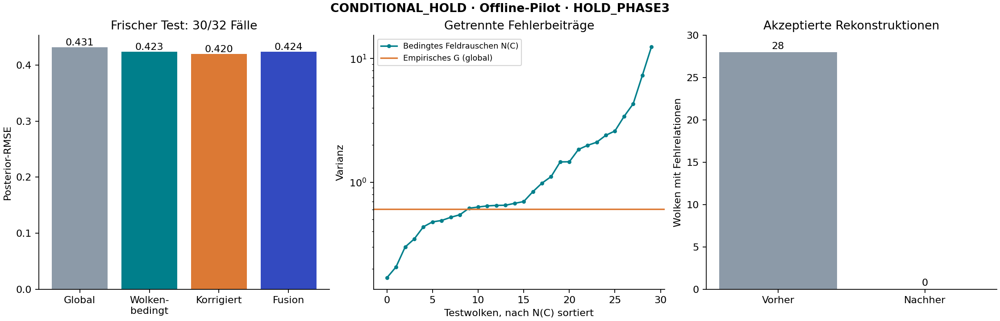

# Eigenzeit: getrennte Rauschkovarianz und Relationskorrektur

**Entscheid: CONDITIONAL_HOLD; HOLD_PHASE3.**

Die getrennte Fehlerrechnung und die Relationskorrektur sind implementiert und nachgeprüft. Die wolkenbedingte Rauschbehandlung verbessert den Posterior-RMSE in diesem Test um 1.82%, verfehlt aber die vorab geforderten 5%. Das gepaarte Unsicherheitsintervall schließt Gleichstand und Verschlechterung ein. Die gemeinsame Fusion liefert keinen zusätzlichen Gewinn. Das ist ein überprüfter technischer Fortschritt bei Fehlertrennung und Relationskonsistenz, keine Filter- oder Geometriequalifikation.

Quellcode, Prüfvertrag und Kalibrierung wurden unter `b5f8abc48fb74f426247ef77b4b265a77e63b72c` öffentlich eingefroren, bevor die 32 neuen Zielwolken erzeugt wurden. Die bisherigen 64 Wolken aus PR #69 dienen vollständig als Entwicklung/Kalibrierung; deren frühere Testrolle gilt hier nicht mehr.

Kalibrierung: **60/64** vollständige gemeinsame Fälle. Frischer Test: **30/32**. Keine Ersatzseeds. Genauigkeit und Überdeckung unten gelten für die gemeinsame vollständige Teilmenge; die zusätzliche Rückfallkennzahl umfasst alle Wolken und verwendet bei fehlender Messung nur die Prädiktion.

## Getrennte Fehlerrechnung

`R(C) = G + G/n_cal + N(C)` mit `N(C) = sigma² B(C) B(C)^T`. Die volle Koeffizientenmatrix enthält den gemeinsamen Rootwert und beide Operatorarme. Damit werden gemeinsam genutzte Ereignisse nicht als unabhängige Messungen gezählt. `G` stammt ausschließlich aus rauschfreien Operatorfehlern der Kalibrierwolken; eine bereits verrauschte Gesamtstreuung wird nicht nochmals addiert.

**Grenze:** `N(C)` ist unter dem bekannten IID-Feldrauschmodell exakt. `G` ist eine empirische Streuung über Wolken, keine bewiesene bedingte Geometriekovarianz jeder einzelnen Wolke. Rekonstruktions-, Diskretisierungs-, Auswahl- und Feldfehler sind darin gemeinsam enthalten. Der saubere Feldwert steht nur in dieser Simulation zur Kalibrierung bereit. Die Kalibrierungsunsicherheit wird durch `G/n_cal` nicht vollständig erfasst.

| Originale bedingte Feldrauschvarianz im neuen Test | Minimum | Median | Maximum |
|---|---:|---:|---:|
| N00(C) | 0.168885 | 0.686126 | 12.407427 |

## Relationsverträglichkeit

Vor Korrektur: **28/30** vollständige Testrekonstruktionen mit mindestens einem Fehlpaar; 33 fehlende und 33 zusätzliche gerichtete Relationen unter 13244 geprüften Nichtdiagonalpaaren. Nach akzeptierter Korrektur: **0** betroffene Rekonstruktionen.

Die Korrektur verändert rekonstruierte Koordinaten unter expliziten Kegel-/Trennbedingungen. Die beobachteten Relationslabels bleiben erhalten. Anschließend werden die Momentgewichte neu gelöst und geprüft. Eine exakte Relationserhaltung ist hier eine Konstruktionsbedingung; sie beweist keine richtigen Abstände oder Krümmung. Die Aussage betrifft Root und ausgewählte Stützen, nicht sämtliche Wolkenpunkte oder Landmarken.

Rauschfreier Operator-RMSE vor/nach Korrektur: **0.763166 / 0.792367** (Quotient 1.038262; vorab erlaubt höchstens 1,05).

## Eingefrorener Filtervergleich

Skalare Operatorantwort im bekannten flachen 2+1-Modell, Testfeld `exp(t/2) cos(x/2) cos(y/2)` mit Operatorwert −0,75. Synthetische unabhängige Prädiktion mit Standardabweichung 0,5. Es wird noch kein räumlicher Einbettungszustand durch den Kalman-Filter geschätzt.

| Verfahren | Posterior-RMSE | Nominelle 95%-Überdeckung | Exaktes 95%-Intervall der Überdeckungsquote | RMSE mit Prädiktionsrückfall |
|---|---:|---:|---:|---:|
| Global, Original | 0.431305 | 29/30 | 82.8–99.9% | 0.438037 |
| Wolkenbedingt, Original | 0.423442 | 29/30 | 82.8–99.9% | 0.430784 |
| Wolkenbedingt, korrigiert | 0.419893 | 29/30 | 82.8–99.9% | 0.427515 |
| Gemeinsame Fusion | 0.423509 | 29/30 | 82.8–99.9% | 0.430846 |
| Nur Rauschen (Negativkontrolle) | 0.452449 | 28/30 | 77.9–99.2% | 0.457596 |
| Prädiktion allein | 0.454615 | 30/30 | 88.4–100.0% | — |

| Gepaarter Vergleich | RMSE-Quotient | Bootstrap-95% |
|---|---:|---:|
| conditional_vs_global | 0.981768 | 0.909176–1.047942 |
| joint_vs_original | 1.000159 | 1.000000–1.000582 |
| projected_vs_original | 0.991618 | 0.969594–1.016148 |

Die Bootstrapintervalle konditionieren auf die Kalibrierung. Nominelle Gaussian-Intervalle und die kleine Testzahl liefern keine Überdeckungsgarantie. Die rauschabhängigen Strata in `summary.json` zeigen zusätzlich, ob rauschfreie Fehler mit der Wolkenqualität variieren.

| Vorab festgelegtes Kriterium | Ergebnis |
|---|---|
| execution_complete | PASS |
| budgets | PASS |
| availability | PASS |
| accepted_relations_exact | PASS |
| clean_accuracy_preserved | PASS |
| conditional_improvement | FAIL |
| joint_improvement | FAIL |
| nominal_coverage | PASS |

## Nachprüfung und Reproduktion

**PASS_ORDER_CERTIFICATES_FIELD_AND_ANALYSIS_REPLAY**: 32 Koordinatenhashes, 2768 unabhängig über Koordinaten gezählte Intervalle, 60 QP-Zertifikate, sämtliche Feld-/Rauschantworten und die eingefrorene Auswertung. Die Relationsprojektion wird erneut gerechnet. Die vollständige teure Rahmensuche ist nicht Teil dieses Replay. Fünf Testgruppen decken Fehlrelationen, ungültige Ordnungen, Jacobian/Transport, gemeinsames Rootrauschen und exakte Kovarianzzerlegung ab.

| Testshard | Wolken | Laufzeit (s) | Peak-RSS (MiB) | Status |
|---|---:|---:|---:|---|
| 0 | 16 | 744.3 | 1371.1 | COMPLETE |
| 1 | 16 | 723.3 | 1342.8 | COMPLETE |

Vom Repository-Root (Python 3.12, NumPy 2.3.5, SciPy 1.17.0):

```sh
python -m zipfile -e research/lorentz_local_dalembert/conditional_geometry/test_clouds.zip research/lorentz_local_dalembert/conditional_geometry
OPENBLAS_NUM_THREADS=1 python -B research/lorentz_local_dalembert/conditional_geometry/test_controls.py
OPENBLAS_NUM_THREADS=1 python -B research/lorentz_local_dalembert/conditional_geometry/verify.py
```

Für eine vollständige Neuberechnung einen separaten Checkout des öffentlichen Freeze verwenden und dort `cg_run.py --shard 0` sowie `cg_run.py --shard 1` ausführen, danach `cg_analyze.py`. Bestehende Testordner werden nicht überschrieben. Rohdaten und Ausführungsprotokolle liegen in `test_clouds.zip` mit `test_manifest.json`; alle Entwicklungsergebnisse in `development_records.zip`.

## Weiterhin offen

- Bedingte Geometriefehler und Bias als Funktion beobachtbarer Wolkenmerkmale; bisher nur globale empirische Kalibrierung.
- Andere Felder, Dichten und Modellabweichungen auf neuen unabhängigen Daten.
- Vollständige Einbettungskovarianz und sequenzieller Filter einschließlich gemeinsamer Vergangenheit.
- Unsichere oder unvollständige beobachtete Relationslabels. Die derzeitige Projektion verlangt eine vollständige exakte Ordnung.
- Vergangenheitsbasierte Konstruktion oder deklarierte Verzögerung: die heutigen Stützen verwenden Zukunftsdaten.

Keine Online-, Krümmungs- oder Gerätefreigabe. Keine externe Replikation oder Neuheitsbehauptung. Die konvexe Kegelformulierung verwendet Standardmethoden: [Lobo et al. (1998)](https://stanford.edu/~boyd/papers/socp.html).


