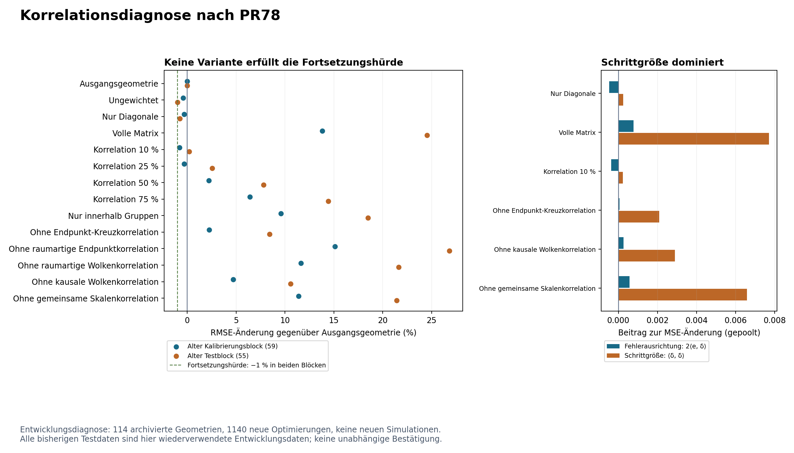

# Korrelationsdiagnose nach dem negativen Geometriekorrekturtest

**STOP_CORRELATION_CORRECTION_SCREEN**. Keiner der zehn vorab festgelegten Kandidaten erfüllt die Fortsetzungsbedingungen in beiden historischen Datenblöcken.

Alle 128 archivierten PR78-Versuche wurden übernommen: 114 vollständige Geometrien und 14 Abstentionen. Auf den vollständigen Geometrien wurden 1140 neue lokale Optimierungen gerechnet. **Keine neuen Simulationen, keine unabhängige statistische Bestätigung.** Der frühere Testblock wird hier ausdrücklich zu Entwicklungsdaten.

Der deskriptiv beste Kandidat ist **Korrelation 10 %** mit einer gepoolten RMSE-Änderung von **-0.35 %**. Die geforderte Verbesserung von mindestens 1 % in beiden Blöcken wird verfehlt. Deshalb startet diese Korrekturfamilie keinen neuen Bestätigungslauf.



## Vergleich bei gleichen Einzelvarianzen

| Variante | Alter Kalibrierungsblock | Alter Testblock | Gepoolter RMSE | Fortsetzung |
|---|---:|---:|---:|---|
| Ausgangsgeometrie | +0.000 % | +0.000 % | 0.143823 | Referenz |
| Ungewichtet | -0.421 % | -0.991 % | 0.142848 | Referenz |
| Nur Diagonale | -0.314 % | -0.782 % | 0.143069 | Referenz |
| Volle Matrix | +13.803 % | +24.519 % | 0.170788 | Referenz |
| Korrelation 10 % | -0.791 % | +0.187 % | 0.143320 | FAIL |
| Korrelation 25 % | -0.332 % | +2.559 % | 0.145233 | FAIL |
| Korrelation 50 % | +2.216 % | +7.818 % | 0.150691 | FAIL |
| Korrelation 75 % | +6.394 % | +14.430 % | 0.158328 | FAIL |
| Nur innerhalb Gruppen | +9.569 % | +18.484 % | 0.163484 | FAIL |
| Ohne Endpunkt-Kreuzkorrelation | +2.245 % | +8.424 % | 0.151118 | FAIL |
| Ohne raumartige Endpunktkorrelation | +15.091 % | +26.805 % | 0.173316 | FAIL |
| Ohne raumartige Wolkenkorrelation | +11.618 % | +21.632 % | 0.167172 | FAIL |
| Ohne kausale Wolkenkorrelation | +4.683 % | +10.564 % | 0.154424 | FAIL |
| Ohne gemeinsame Skalenkorrelation | +11.382 % | +21.430 % | 0.166855 | FAIL |

Prozentwerte sind RMSE-Änderungen gegenüber der jeweiligen Ausgangsgeometrie; negative Werte sind besser. Alle Varianten erhalten die beobachtete Kausalordnung exakt. Es gab keine Solver-Rückfälle. Die vier Referenzen werden aus PR78 wiederverwendet und sind keine nachträglich auswählbaren Kandidaten.

## Was den Schaden erklärt

Die volle Matrix verschlechtert den gepoolten RMSE um 18.75 %. Im Mittel entfallen **92.32 %** der gewichteten quadratischen Korrekturbewegung auf die Richtung einer gemeinsamen Intervallskalierung. Dies ist ein Mittel der wolkenweisen Projektionsanteile, kein Anteil an der Gesamtfehlervarianz.

Die exakte MSE-Zerlegung ergibt für die volle Matrix: Fehlerausrichtung 0.000773428, quadratische Schrittgröße 0.007710019, Summe 0.008483447. Der positive Schrittbeitrag dominiert. Die Korrektur bewegt sich stark, ohne dies durch eine entsprechend günstige Fehlerausrichtung auszugleichen.

Das Entfernen der Endpunkt-Kreuzkorrelation reduziert die gepoolte Verschlechterung auf 5.07 %, das Entfernen der kausalen Wolkenkorrelation auf 7.37 %. Das isolierte Entfernen der gemeinsamen Skalenkorrelation lässt noch 16.01 % Verschlechterung übrig. **Ein einzelner Skalenterm erklärt den Schaden daher nicht vollständig.** Die Eingriffe verändern nur Korrelationen, keine Einzelvarianzen; ihre Wirkungen sind wegen der nichtlinearen Korrektur nicht additiv.

Die Rang-eins-Identität für den Skalenterm ist mit maximalem numerischem Fehler 5.6e-17 erfüllt. Der Median des rohen Präzisionsverhältnisses in Skalenrichtung beträgt 0.0316. Diese algebraische Abschwächung allein beweist keine Ursache der beobachteten Fehlerverschlechterung.

| Spektralbereich der vollen Korrelationsmatrix | Mittel der wolkenweisen quadrierten standardisierten Residuen |
|---|---:|
| Unteres Viertel | 1.9290 |
| Mittlere Hälfte | 2.4499 |
| Oberes Viertel | 1.0161 |

Diese unskalierten Spektraldiagnosen deuten auf eine unzureichende Form der Arbeitskovarianz für die Korrektur hin. Sie sind keine neuen Freigabeschwellen und keine erneute Conformal-Kalibrierung.

## Entscheidung und Grenzen

Jeder Kandidat verfehlt die 1%-Verbesserung in beiden alten Blöcken. Der Stopp folgt der vor Ausführung öffentlich eingefrorenen Regel; es gibt keine nachträgliche Lockerung oder Auswahl einer Referenz. Das widerlegt nicht jede mögliche Geometriekorrektur, sondern beendet diese festgelegte Familie mit unverändertem Modell, Ziel und lokalem Solver.

Für einen späteren Ansatz wäre zunächst auf expliziten Entwicklungsdaten die Form des gemeinsamen Fehlermodells beziehungsweise die Skalierungsrichtung neu zu begründen. Erst ein vorab qualifizierter Kandidat rechtfertigt einen getrennten neuen Bestätigungstest. Das ist eine Forschungsrichtung, kein bereits ausgeführter oder validierter Folgeversuch.

**HOLD_BATCH_CORRECTION**, **HOLD_EMBEDDING_COVARIANCE**, **HOLD_KALMAN**, **HOLD_PHASE3** und **METADATA_HOLD** bleiben. Die Untersuchung betrifft flaches 2+1 bei rho=32768; sie qualifiziert keine radiale 4D-Geometrie, Koordinatenkovarianz oder neue Trennung physikalischer Fehlerquellen.

## Reproduktion

- Öffentlicher Quellen- und Kriterien-Freeze: `27a404f3dfbb3f76d3c7e6f44f827bed67c1c0a7`.
- 423 unveränderte Quell- und Eingabedateien, alle 128 Versuchsausgänge und Vorhersagesiegel.
- Analytische Kontrollen prüfen positive Definitheit, gleiche Einzelvarianzen, Spektrum, einzelne Komponenten, Verlustidentität, Skalenprojektion und negative Kontrollen sämtlicher Fortsetzungsbedingungen.
- Numerischer Replay berechnet die 1140 Optimierungen erneut, erzeugt die 114 Wahrheitspunktmengen neu und prüft Auswertung, Herkunft und Entscheidung. Auswahl und ursprüngliche Rekonstruktion bleiben archivierte Eingaben.
- Replay ist eine Reproduzierbarkeitsprüfung, keine unabhängige statistische Stichprobe. Ergebnisse stehen in `results/verification.json`; die GitHub-Prüfung wiederholt den Replay.

```sh
OPENBLAS_NUM_THREADS=1 OMP_NUM_THREADS=1 python -B research/lorentz_local_dalembert/correlation_audit/ca_controls.py
OPENBLAS_NUM_THREADS=1 OMP_NUM_THREADS=1 python -B research/lorentz_local_dalembert/correlation_audit/ca_verify.py
```

Details: [PROTOCOL.md](PROTOCOL.md), [contract.json](contract.json), [results/summary.json](results/summary.json). Dieser Bericht und die Grafik werden ausschließlich aus der eingefrorenen Auswertung erzeugt.
