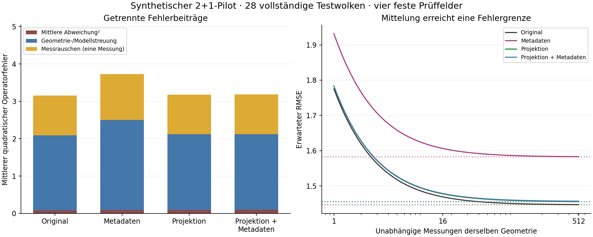

# Geometriefehler und Messunsicherheit getrennt kalibriert

**CALIBRATION_COMPONENTS_SUPPORTED — HOLD_PHASE3 und HOLD_EMBEDDING_COVARIANCE bleiben bestehen.**

32 neue Kalibrierwolken, davon 30 vollständig; 32 neue Testwolken, davon 28 vollständig. Vier feste neue Sinus-/Kosinusfelder und 512 synthetische Rauschwiederholungen je Feld und vollständiger Wolke. Eine zusätzliche verrauschte Messung pro Feld wurde für die Intervallprüfung zurückgehalten. Das bekannte Eingangsrauschen ist IID Gauß mit σ=0,001, einschließlich des gemeinsamen Rootwerts.

## Getrennte Beiträge

Alle Zahlen sind über die vier festen Felder und vollständigen Testwolken gemittelt. Der rauschfreie Operatorfehler enthält Rekonstruktion, Diskretisierung und Auswahl. Er ist keine isolierte Koordinatenkovarianz. Die geometrischen Abstands- und Relationsfehler stehen separat weiter unten.

| Variante | Mittlere Abweichung² | Streuung zwischen Wolken | Messvarianz | Rauschfreier RMSE | Geometrie-/Modellanteil am MSE |
|---|---:|---:|---:|---:|---:|
| Original | 0.0829127 | 2.0089 | 1.0601 | 1.44631 | 66.37 % |
| Metadaten | 0.0910388 | 2.41256 | 1.22834 | 1.58228 | 67.09 % |
| Projektion | 0.0960458 | 2.02124 | 1.06167 | 1.45509 | 66.60 % |
| Projektion + Metadaten | 0.0982591 | 2.02196 | 1.06181 | 1.4561 | 66.63 % |

`MSE = mittlere Abweichung² + Geometrie-/Modellstreuung + Messvarianz`. Bei R unabhängigen Wiederholungen derselben Wolke sinkt allein der letzte Term um 1/R. Die folgenden Werte sind Folgen dieses Modells, keine zusätzlichen Beobachtungen.

| Variante | RMSE, 1 Messung | RMSE, 16 Messungen | RMSE, 512 Messungen | Grenze ohne Messrauschen |
|---|---:|---:|---:|---:|
| Original | 1.77536 | 1.46904 | 1.44703 | 1.44631 |
| Metadaten | 1.93182 | 1.60635 | 1.58303 | 1.58228 |
| Projektion | 1.78296 | 1.47772 | 1.4558 | 1.45509 |
| Projektion + Metadaten | 1.78382 | 1.47871 | 1.45681 | 1.4561 |



Punktlinien markieren die Grenze ohne Messrauschen.

## Rauschmodell und Überdeckung

1792 Richtungsprüfungen: regulär mit Mittelwert- und Varianztest, bei algebraischer Entartung mit festen numerischen Grenzen; 0 Ablehnungen bei einem vorab geteilten Familienfehlerbudget von 0,05 (maximal 4096 statistische Tests; hier 3560 statistische Tests und 12 deterministische Prüfungen). Die absichtlich falschen Modelle wurden erkannt: Rootwert ausgelassen = ja, Kreuzkovarianzen ignoriert = ja.

Der eingefrorene Geometriefaktor ist q=4.96555, Rang 30 bei n=30. Die gemeinsame marginale Nominalüberdeckung aller 16 Ausgaben beträgt unter den deklarierten Annahmen mindestens 95.774 %. Sie gilt über unabhängige Kalibrier- und Testziehungen, nicht bedingt auf jede Wolke oder dieses eine Kalibrierergebnis.

| Anteil | Gemeinsame Testüberdeckung | Simultanes 95%-Binomialintervall | 95%-Populationsüberdeckung empirisch zertifiziert |
|---|---:|---:|---|
| Geometrie/Modell | 28/28 (100.00 %) | 84.28–100.00 % | Nein |
| Messrauschen | 28/28 (100.00 %) | 84.28–100.00 % | Nein |
| Gesamt | 28/28 (100.00 %) | 84.28–100.00 % | Nein |

Gesamte Intervallhalbbreiten über Wolken/Felder/Varianten: Median 12.4425, Minimum 5.29292, Maximum 27.3162. Breite Intervalle sind kein Nachweis hoher Operatorgenauigkeit.

## Geometrie unabhängig vom Feldrauschen

| Rekonstruktion | Wolken mit Relationsfehlern | Fehlende / zusätzliche Relationen | Relativer Gram-RMS | Eigenzeit-RMSE / T, alle kausalen Paare |
|---|---:|---:|---:|---:|
| Original | 25/28 | 35 / 30 | 0.0556344 | 0.00416031 |
| Projiziert | 0/28 | 0 / 0 | 0.0556547 | 0.0041463 |

Die Eigenzeitprüfung umfasst alle tatsächlich kausalen Paare, auch falsch raumartig rekonstruierte Paare (τ̂=0). Relationskorrektheit allein belegt keine Abstandsgenauigkeit. Die vollständigen Kovarianzmatrizen und feldweisen Biaswerte stehen in [summary.json](results/summary.json).

## Deskriptiver Variantenvergleich

| Vergleich | Rauschfreies RMSE-Verhältnis | 95%-Bootstrapintervall, ganze Wolken |
|---|---:|---:|
| metadata_vs_original | 1.09401 | 0.992216–1.18184 |
| projected_metadata_vs_projected | 1.00069 | 0.997686–1.00326 |
| projected_vs_original | 1.00607 | 0.976619–1.03504 |

Diese Vergleiche sind deskriptiv. Sie ersetzen weder den historischen Metadaten-Test noch sein METADATA_HOLD. Keine Gewichte, Projektionsmetrik oder Kalman-Verstärkung wurden angepasst.

## Durchführung und Nachweise

Quell-/Seed-Freeze: `c56dd5b18ef4451b2f6e968f4ca8ab859d6474f5`. Kalibrier-Freeze vor Testbeginn: `57f5017822ae6b37da9f7f350b2253ba0ebbe16b`. Alle acht Prozesse mit vollständiger Laufzeit-/RSS-Telemetrie; Testbudget eingehalten: ja. Ausfälle werden behalten, nicht ersetzt. Die früheren 29 Wolken wurden ausdrücklich nur für Entwicklungsskalen wiederverwendet.

- [Vorabplan und Geltungsgrenzen](PROTOCOL.md)
- [Vertrag](contract.json), [Seeds](seed_schedule.json), [eingefrorene Kalibrierung](frozen_calibration.json)
- [Ergebnisdaten](results/summary.json), [Rauschprüfungen](results/noise_checks.json), [lokaler Replay](results/verification.json)
- Rohprotokolle: `results/calibration/worker-*` und `results/test/worker-*`.

```sh
OPENBLAS_NUM_THREADS=1 OMP_NUM_THREADS=1 python -B research/lorentz_local_dalembert/error_calibration/ec_controls.py
OPENBLAS_NUM_THREADS=1 OMP_NUM_THREADS=1 python -B research/lorentz_local_dalembert/error_calibration/portable_verify.py
```

Der [Portabilitätsadapter](REPLAY_PORTABILITY.md) berichtet die historischen Entwicklungs-Bytehashes separat; der unveränderte Originalverifier bleibt als `ec_verify.py` verfügbar. Replay prüft dieselben Beobachtungen numerisch mit eingefrorenen Toleranzen; Bytehashes werden separat berichtet. Keine vollständige Rahmensuche und keine externe Replikation. Dieser synthetische Flachraum-Pilot in 2+1 Dimensionen qualifiziert weder beliebige Felder und Dichten noch den 4D-Sampler, reale Geräte, Krümmung oder Onlinebetrieb.
