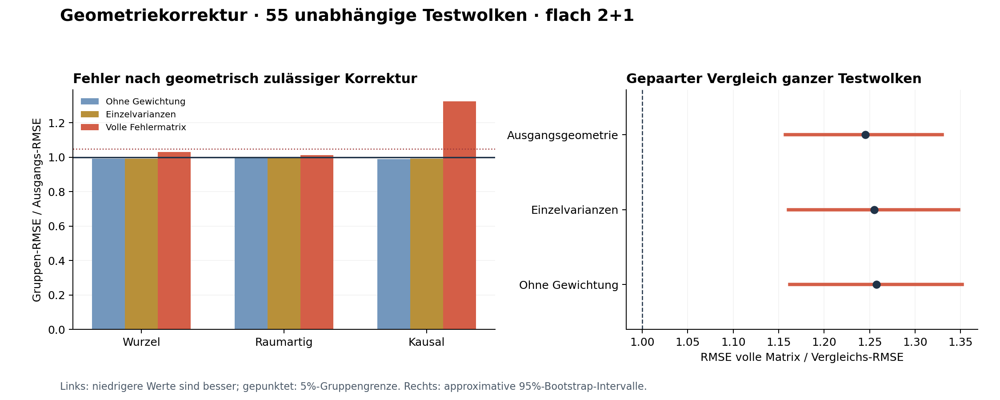

# Kontrollierte Geometriekorrektur mit gemeinsamem Fehlermodell

**HOLD_BATCH_CORRECTION**. Die vorab festgelegten Pilotkriterien sind nicht vollständig erfüllt.

128 neue Simulationsversuche im bestehenden **flachen 2+1-Modell bei rho=32768**: 59 auswertbare Kalibrierungswolken, 55 unabhängige Testwolken und 14 dokumentierte Abstentionen. Keine Ersatzwolken, keine Änderung der Kriterien nach Testbeginn.

Die volle Fehlermatrix verändert den primären Geometrie-RMSE gegenüber der Ausgangsgeometrie um **+24.5%**. Bei kausalen Stützpunktpaaren beträgt die Änderung **+32.5%**. Positive Änderungen bedeuten größere Fehler. Der frühere Kalibrierungserfolg aus PR77 belegt damit keinen Nutzen dieser konkreten Korrektur.

Die gemeinsame Testabdeckung der vollen Matrix ist **52/55 = 94.55%**, mit exaktem 95%-Binomialintervall [84.88%, 98.86%]. Alle vier Varianten verfehlen die vorab verlangte beobachtete 95%-Rate knapp. Das allein widerlegt keine marginale Conformal-Garantie; die Fehlerzunahme ist ein separater und deutlich größerer Befund.

Das eingefrorene Gruppenmodell aus PR77 liefert dieselben biaszentrierten Intervallziele für drei Korrekturen. Verglichen werden die unveränderte relationstreue Ausgangsgeometrie, ungewichtete Anpassung, Diagonalgewichtung und die volle gemeinsame Fehlermatrix. Der Vergleich volle Matrix/Diagonal isoliert die Nutzung der Kreuzterme innerhalb dieses Algorithmus.

Jede übernommene Lösung ist eine realisierbare 2+1-Geometrie mit exakt derselben beobachteten Kausalordnung. Ein kanonischer Gram-Rahmen, eine feste Vertrauensregion und eine konvexe innere Kausalregion begrenzen den lokalen SLSQP-Schritt. Die Zielfunktion ist nichtkonvex; ein globales Optimum wird nicht behauptet. Gescheiterte Korrekturen liefern die Ausgangsgeometrie und bleiben in allen Vergleichen enthalten.



## Unabhängiger Test

| Variante | Gruppenbalancierter RMSE | Ungewichteter Intervall-RMSE | Gemeinsame Abdeckung | Rückfall auf Ausgangsgeometrie | Ordnungsverletzungen |
|---|---:|---:|---:|---:|---:|
| Ausgangsgeometrie | 0.138950 | 0.153370 | 94.55% | 0 | 0 |
| Ohne Gewichtung | 0.137573 | 0.151815 | 94.55% | 0 | 0 |
| Einzelvarianzen | 0.137863 | 0.152186 | 94.55% | 0 | 0 |
| Volle Fehlermatrix | 0.173020 | 0.196911 | 94.55% | 0 | 0 |

Die direkt biaszentrierten, nicht zwingend geometrisch realisierbaren Intervalle haben einen gruppenbalancierten RMSE von 0.137824. Dies ist nur eine Diagnose und kein fünfter freigegebener Kandidat.

| Vergleich volle Matrix / Referenz | RMSE-Verhältnis | Gepaarter 95%-Bootstrap-Bereich |
|---|---:|---:|
| Ausgangsgeometrie | 1.245195 | [1.157438, 1.329718] |
| Ohne Gewichtung | 1.257660 | [1.162090, 1.351519] |
| Einzelvarianzen | 1.255006 | [1.160859, 1.347848] |

Kleinere Verhältnisse sind besser. Resampling-Einheit ist die ganze Wolke, einschließlich aller Paare und Varianten; 4000 gepaarte Bootstrap-Ziehungen. Die Bereiche sind approximative Pilot-Evidenz.

| Fehlergruppe | Ausgangs-RMSE | RMSE volle Matrix | Verhältnis |
|---|---:|---:|---:|
| Wurzelpaare | 0.101837 | 0.104939 | 1.030458 |
| Raumartige Stützpunktpaare | 0.080496 | 0.081537 | 1.012935 |
| Kausale Stützpunktpaare | 0.202659 | 0.268601 | 1.325386 |

## Vorab festgelegter Entscheid

| Kriterium | Ergebnis |
|---|---|
| Mindestens 48 vollständige Wolken pro Phase | PASS |
| Alle gelieferten Geometrien erhalten die Ordnung exakt | PASS |
| Höchstens 10% Rückfälle je Phase | PASS |
| Mindestens 95% beobachtete gemeinsame Testabdeckung | FAIL |
| Mindestens 1% RMSE-Verbesserung gegenüber Ausgangsgeometrie | FAIL |
| Bootstrap-Obergrenze gegenüber Ausgangsgeometrie unter 1 | FAIL |
| Bootstrap-Obergrenze gegenüber Diagonalgewichtung unter 1 | FAIL |
| Keine Gruppe mehr als 5% schlechter | FAIL |

## Unsicherheit und Grenzen

Die Unsicherheitsradien aller vier Varianten wurden separat auf denselben neuen Kalibrierungswolken festgeschrieben. Die alte Fehlermatrix dient nach der Korrektur nur als Residuenskalierung; sie wird nicht als fortgepflanzte Koordinatenkovarianz ausgegeben. Die gemeinsame Abdeckung umfasst sämtliche Intervalle, Wurzel-Gram-Einträge und nichtleeren Blockmittel einer Wolke. Exakte Binomialintervalle, Familienabdeckungen und Bandbreiten stehen in `results/summary.json`.

Die marginale Split-Conformal-Untergrenze je fester Variante beträgt 95.000% unter den festgelegten Austauschbarkeits- und Akzeptanzannahmen. Sie ist keine bedingte Zusage für jede Ordnung und keine gemeinsame Garantie über alle Varianten.

**HOLD_EMBEDDING_COVARIANCE**, **HOLD_KALMAN**, **HOLD_PHASE3** und **METADATA_HOLD** bleiben bestehen. Dieses Experiment qualifiziert weder eine konditionale Koordinatenkovarianz noch einen Online-Filter, einen Operatorvorteil, Krümmung oder radiale 4D-Geometrie. Ein anderer Kandidat wird bei einem negativen Primärentscheid nicht nachträglich ausgewählt.

## Reproduktion und öffentliche Reihenfolge

- Quell-, Kriterien- und Seed-Freeze: `c13499ce969272524f3bec329e48dbab8eb38a19`.
- Kalibrierungs-Freeze vor Testbeginn: `7c1f621639523d7f08cdd14f868e249e9c6ff61d`.
- `source_freeze.json`: 277 unveränderte Quell- und Eingabedateien.
- `results/calibration` und `results/test`: alle 128 Versuche, Vorhersagesiegel und Ressourcenprotokolle.
- `gc_controls.py`: 14 analytische Kontrollgruppen einschließlich negativer Kontrollen für sämtliche acht Entscheidungskriterien.
- `gc_verify.py`: Quellen/Abstammung, Vorhersagesiegel, neu erzeugte wahre Koordinaten, erneute Optimierungen, Auswertung, Kalibrierung und Bootstrap. Gespeicherte Auswahl/Rekonstruktion werden wiederverwendet. Optimierer-Ausgaben werden auf invarianten Intervallen mit absoluter und relativer Toleranz 2e-5 verglichen; Iterationszahlen und Koordinatengauges müssen nicht bytegleich sein.

```sh
OPENBLAS_NUM_THREADS=1 OMP_NUM_THREADS=1 python research/lorentz_local_dalembert/geometry_correction/gc_controls.py
OPENBLAS_NUM_THREADS=1 OMP_NUM_THREADS=1 python research/lorentz_local_dalembert/geometry_correction/gc_verify.py
```

Methoden, genaue Grenzen und Quellen: [PROTOCOL.md](PROTOCOL.md). Die Grafik und dieser Bericht werden ausschließlich aus der eingefrorenen Auswertung erzeugt.
