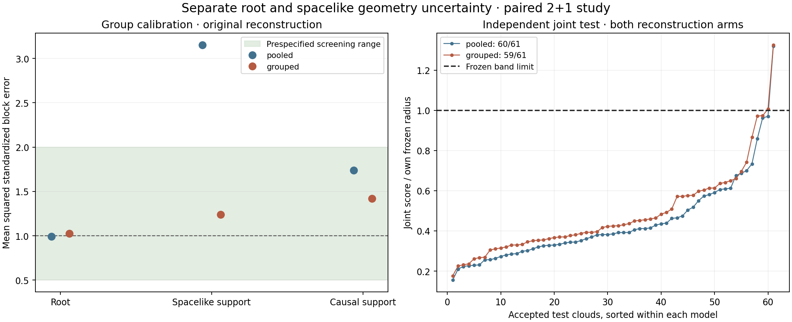

# Wurzel- und raumartige Geometriefehler getrennt prüfen

**GROUP_MODEL_PILOT_SUPPORTED**. Die vorab festgelegten Pilotkriterien sind erfüllt.

Im bestehenden **flachen 2+1-Modell bei rho=32768** wurden 128 vollständig neue Wolken erzeugt. 62 Kalibrierungswolken und 61 unabhängige Testwolken sind auswertbar; 5 Abstentionen bleiben dokumentiert. Die 117 früheren vollständigen Wolken dienen ausschließlich als Entwicklungsdaten.

Die gemeinsame Testabdeckung beträgt **59/61 = 96.72%** für das gruppierte Modell und **60/61 = 98.36%** für den neu angepassten gemeinsamen Vergleich. Das exakte 95%-Binomialintervall der gruppierten Abdeckung ist [88.65%, 99.60%]. Es umfasst jeweils beide Rekonstruktionsarme, alle Paarintervalle, Wurzel-Gram-Einträge und nichtleeren Gruppenmittel. Die Modelle besitzen eigene, vor dem Test eingefrorene Radien.



## Was getrennt modelliert wurde

- **Wurzelpaare:** alle Paare mit dem gewählten Ursprung als Endpunkt.
- **Raumartige Stützpunktpaare:** zwei Stützpunkte ohne beobachtete Kausalrelation.
- **Kausale Stützpunktpaare:** die restlichen Stützpunktpaare, damit alle Abstände erfasst bleiben.

Die Gruppenzuordnung verwendet nur Wurzelidentität und beobachtete Ordnung. Das gruppierte Modell besitzt getrennte Bias- und Varianzanteile, erhält Abhängigkeiten über gemeinsame Punkte und ergänzt einen vorzeichenabhängigen gemeinsamen Skalenfehler. Dieser kann negative Kreuzkovarianzen zwischen zeit- und raumartigen Intervallquadraten darstellen. Alle Arbeitsmatrizen sind positiv definit. Sie sind keine identifizierte konditionale Koordinatenkovarianz.

Der Vergleich wurde auf genau denselben Entwicklungswolken neu angepasst; er ist nicht das unveränderte historische PR76-Modell. Beide Modelle verwenden dieselben Wolken- und Gruppengewichte sowie dieselbe interne Auswahl einer gedämpften Bias-Korrektur. Der Vergleich bewertet das gesamte neue Modellpaket; er isoliert nicht allein den Effekt einer Gruppentrennung.

## Vorab festgelegte Entscheidung

| Kriterium | Ergebnis |
|---|---|
| Mindestens 48 vollständige Wolken je neuer Phase | PASS |
| Beobachtete gemeinsame Testabdeckung mindestens 95% | PASS |
| Alle Gruppen- und Blockprüfungen in beiden Armen bestanden | PASS |
| Gepaarte Verbesserung der Fokusgruppen im Bootstrap-Intervall | PASS |

Fokus-Verzerrungsmaß: gemeinsam 0.564146, gruppiert 0.110936. Differenz gruppiert minus gemeinsam: -0.453210; gepaartes 95%-Bootstrap-Intervall [-0.503026, -0.205940]. Kleinere Werte sind besser. Das Maß mittelt |log(E[z²])| der Wurzel- und raumartigen Gruppenmittel über beide Rekonstruktionsarme. Der Bootstrap resampelt ganze Wolken und liefert approximative Pilot-Evidenz.

## Gruppen im unabhängigen Test

Für standardisierte Fehler gilt als vorab festgelegter Prüfbereich: |Mittel z| ≤ 0,5 und Mittel z² in [0,5; 2]. Gruppenmittel und einzelne Paarfehler werden separat geprüft. Alle Aggregate gewichten Wolken gleich.

| Arm / Gruppe | z² Gruppenmittel: gemeinsam | z² Gruppenmittel: getrennt | z² Paarfehler: getrennt | Halbe Bandbreite: gemeinsam | Halbe Bandbreite: getrennt |
|---|---:|---:|---:|---:|---:|
| original / root | 0.9939 | 1.0267 | 1.1244 | 0.89227 | 0.76615 |
| original / support_spacelike | 3.1516 | 1.2404 | 1.1191 | 0.57440 | 0.57386 |
| original / support_causal | 1.7403 | 1.4205 | 1.2368 | 3.02887 | 1.62153 |
| projected / root | 0.9999 | 1.0272 | 1.1278 | 0.88769 | 0.76379 |
| projected / support_spacelike | 3.0116 | 1.1915 | 1.1041 | 0.57289 | 0.56796 |
| projected / support_causal | 1.7638 | 1.4227 | 1.2336 | 3.02092 | 1.62295 |

Bandbreiten sind Mediane der wolkenweisen Mediane in normierten Intervallquadrat-Einheiten q=(−dt²+dx²+dy²)/s². Multiplikation mit s² ergibt die physische Quadrat-Einheit. Diese Größen sind keine symmetrischen Eigenzeitfehler.

| Modell / Arm | Intervall-RMSE roh | Nach Bias-Zentrierung | Gewählter Bias-Faktor | Kovarianz-Kondition, Maximum |
|---|---:|---:|---:|---:|
| pooled / original | 0.179825 | 0.179825 | 0.00 | 1659.6 |
| pooled / projected | 0.179655 | 0.179655 | 0.00 | 1638.1 |
| grouped / original | 0.179825 | 0.179052 | 0.75 | 172139.3 |
| grouped / projected | 0.179655 | 0.178929 | 0.75 | 115375.9 |

Im Originalarm werden die medianen Halbbreiten für Wurzelpaare um 14.1% und für kausale Stützpunktpaare um 46.5% kleiner. Bei raumartigen Stützpunktpaaren bleiben sie praktisch gleich (Änderung −0.09%). Der gemeinsame Vergleich deckt eine zusätzliche Testwolke ab, verletzt aber die vorab festgelegten Formprüfungen. Es wird deshalb keine allgemeine Überlegenheit in der Abdeckungsrate behauptet. Ein Nutzen für eine spätere Geometriekorrektur muss separat geprüft werden.

## Abweichungen und Grenzen

Keine gruppierte Block- oder Paargruppenprüfung verletzt den vorab festgelegten Prüfbereich.

Nachträgliche Diagnose der verbleibenden Bandverletzungen; keine Änderung von Modell oder Kriterien:

| Testindex | Seed | Größte Fehlergruppe/-familie | Score / Radius | Außerhalb Entwicklungsbereich |
|---|---:|---|---:|---|
| 11 | 679505474 | projected: support_spacelike | 1.3250 | False |
| 14 | 1683046987 | original: support_causal | 1.0067 | False |

1 auswertbare Testwolken liegen außerhalb des Entwicklungsbereichs von Stützpunktzahl oder Designkondition. Untergruppen, alle Familienabdeckungen und gemeinsame gegenüber diagonalen Varianzen sind in `results/summary.json` dokumentiert.

Die marginale Split-Conformal-Untergrenze beträgt 95.238% je Modell unter den festgehaltenen Austauschbarkeitsannahmen, gemittelt über Kalibrierungs- und Testziehungen. Sie gilt für neue akzeptierte Wolken und ist keine Zusage für jede einzelne Ordnung, feste Kalibrierungsrealisierung oder beide Modelle zugleich. Ausfälle werden nicht durch Ersatzwolken entfernt.

**HOLD_EMBEDDING_COVARIANCE**, **HOLD_PHASE3** und historisches **METADATA_HOLD** bleiben bestehen. Ein bestandener Pilot wäre keine empirische Zertifizierung populationsweiter 95%-Abdeckung. Dieses Experiment aktiviert weder eine Geometriekorrektur noch einen Kalman-Schritt und qualifiziert keine radiale 4D-Geometrie.

## Reproduktion und öffentliche Reihenfolge

- Quell-, Modell- und Seed-Freeze: `fe33ca299e6752cb475f50f16913204ae18890bd`.
- Kalibrierungs-Freeze vor Testbeginn: `73b68412e92cd3c6ee1fd816353d02f94071118c`.
- `source_freeze.json`: 265 unveränderte Quell- und Eingabedateien.
- `results/calibration` und `results/test`: alle 128 Versuche, Vorhersagesiegel und Ressourcenprotokolle.
- `gg_verify.py`: erneute Entwicklungsanpassung, Quellen/Abstammung, Vorhersagen, aus Seeds regenerierte wahre Stützpunktkoordinaten, Kalibrierung, Auswertung und gepaarter Bootstrap. Die gespeicherte Auswahl/Rekonstruktion wird wiederverwendet.
- `gg_controls.py`: acht geerbte und vierzehn neue analytische Kontrollgruppen einschließlich negativer Kontrollen für falsche Modellfreigaben.

```sh
OPENBLAS_NUM_THREADS=1 OMP_NUM_THREADS=1 python research/lorentz_local_dalembert/geometry_groups/gg_controls.py
OPENBLAS_NUM_THREADS=1 OMP_NUM_THREADS=1 python research/lorentz_local_dalembert/geometry_groups/gg_verify.py
```

Methodische Quelle: [Lei et al., Distribution-Free Predictive Inference for Regression, JASA 2018](https://www.stat.cmu.edu/~ryantibs/papers/conformal.pdf), Abschnitt 2.2. Die Gruppenmodelle und Pilotkriterien sind hier vorab festgelegte Hypothesen.
