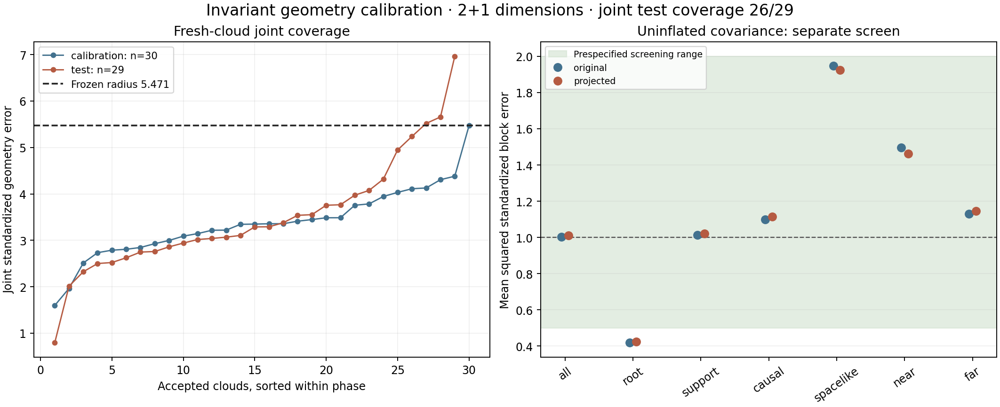

# Unsicherheit der Geometrie: Kalibrierung an neuen Wolken

**Prüfung abgeschlossen; Arbeitskovarianz nicht freigegeben.** Der technische Status **INVARIANT_CALIBRATION_COMPLETED** bezeichnet den Abschluss der vorab festgelegten Kalibrierung, keinen bestandenen Modelltest. Untersucht werden gemeinsame Vorhersagebänder für Lorentz-invariante Geometriegrößen im bestehenden **flachen 2+1-Modell bei rho=32768**.

Im unabhängigen Test liegen **26 von 29** auswertbaren Wolken vollständig innerhalb der Bänder: gleichzeitig für beide Rekonstruktionen, alle Paarintervalle, alle Wurzel-Gram-Einträge und alle nichtleeren Gruppenmittel. Die beobachtete Rate beträgt 89.66%; ihr exaktes 95%-Binomialintervall ist [72.65%, 97.81%]. Diese kleine Stichprobe zertifiziert keine populationsweite 95%-Deckung empirisch.

Das unskalierte Kovarianzmodell erhält für Original und Projektion jeweils **WORKING_COVARIANCE_SCREEN_FAILED** beziehungsweise **WORKING_COVARIANCE_SCREEN_FAILED**. Die Bandkalibrierung und diese Modellprüfung sind getrennte Ergebnisse. Eine konditionale Kovarianz der eingebetteten Koordinaten ist damit weiterhin nicht validiert.



## Drei ausgeführte Schritte

1. **Geometrische Fehler direkt modelliert.** Für alle Paare wird das vorzeichenbehaftete Intervallquadrat q = (−Δt² + Δx² + Δy²)/s² untersucht. Die systematische Verzerrung wird separat geschätzt; positive Varianzanteile modellieren unabhängige Fehler, gemeinsame Endpunkte und gemeinsame Wolkenfehler. Die letzten beiden bilden Abhängigkeiten ab, identifizieren aber keine einzelnen Landmarkenstörungen.
2. **Unsicherheitsradius unabhängig kalibriert.** 58 frühere vollständige Wolken dienen ausschließlich zur Modellentwicklung. Von 32 neuen Kalibrierungsversuchen sind 30 auswertbar. Der gemeinsame Radius q*=5.471358 ist Rang 30 von 30 und wurde vor dem Test öffentlich fixiert.
3. **Auf neuen Wolken geprüft.** 32 weitere Versuche ergeben 29 auswertbare Wolken und 3 dokumentierte Abstentionen. Alle Versuche bleiben erhalten; es gibt keine Ersatzwolken oder Anpassung an Testresultate.

## Unabhängiger Test

| Größe | Original | Relationsprojektion |
|---|---:|---:|
| RMSE der normierten Intervallquadrate, roh | 0.150281 | 0.150067 |
| RMSE nach Bias-Zentrierung | 0.152825 | 0.152610 |
| Mittlerer Fehler, roh | -0.004602 | -0.004752 |
| Mittlerer Fehler nach Zentrierung | -0.015605 | -0.015463 |
| Mediane Intervall-Halbbreite, normiert | 0.587382 | 0.582383 |
| Mediane Intervall-Halbbreite, physische Quadrat-Einheit | 0.00889997 | 0.00882422 |
| Mediane Gram-Halbbreite, normiert | 0.577305 | 0.573578 |
| Punktweises standardisiertes zweites Moment, wolkengewichtet | 0.7658 | 0.7622 |
| Größte Kovarianz-Konditionszahl | 1733.2 | 1732.0 |

Alle Fehleraggregate gewichten Wolken gleich. Halbbreiten sind Mediane der wolkenweisen Mediane. Ein Intervallquadrat ist keine Eigenzeit; nahe dem Lichtkegel darf daraus keine symmetrische Eigenzeit-Fehlerangabe abgelesen werden.

**Das 95%-Ziel ist empirisch nicht bestätigt.** Das breite Binomialintervall enthält 95%; die kleine Testserie widerlegt daher auch keine solche populationsweite Rate. Alle drei Bandverletzungen betreffen die Paarintervalle (Testindizes 15, 23, 25); Gram-Einträge und Gruppenmittel liegen in sämtlichen 29 Testwolken innerhalb ihrer Bänder. Die Bias-Zentrierung erhöht den Original-RMSE von 0,15028 auf 0,15282 und wird nicht als Geometriekorrektur übernommen.

Nachträgliche Eingrenzung ohne Modelländerung: Die größte Verletzung jeder dieser drei Wolken liegt jeweils bei einem raumartigen Paar zwischen zwei Stützpunkten. Die standardisierten Beträge sind 5,519, 5,657 und 6,963. Diese Beobachtung bestimmt eine mögliche nächste Hypothese, keinen nachträglich bestandenen Test.

## Abhängigkeiten und Modellprüfung

Die Arbeitskovarianz lautet K = D [v_ind I + v_endpoint A Aᵀ + v_cloud 11ᵀ] D, mit D_aa=√(1+q_hat,a²) und zwei Einträgen 1/√2 pro Zeile der Endpunkt-Inzidenzmatrix A. Die Gram-Unsicherheit wird mit allen Kreuztermen linear fortgepflanzt. Gemeinsame Abdeckung wird auf Wolkenebene kalibriert; Paare werden nicht als unabhängige Stichproben gezählt.

| Varianzkomponente, Entwicklung | Original | Relationsprojektion |
|---|---:|---:|
| Unabhängig | 0.00231894 | 0.00228834 |
| Gemeinsamer Endpunkt | 0.00134862 | 0.00131671 |
| Gemeinsame Wolke | 0.00047685 | 0.00046912 |

| Gruppe, Original | Wolken | Mittel z | Mittel z² | Varianz K / diagonale Näherung, Median |
|---|---:|---:|---:|---:|
| all | 29 | -0.1863 | 1.0022 | 21.45 |
| root | 29 | -0.0791 | 0.4180 | 6.39 |
| support | 29 | -0.1890 | 1.0142 | 19.97 |
| causal | 29 | -0.2335 | 1.0993 | 16.27 |
| spacelike | 29 | 0.1429 | 1.9480 | 15.14 |
| near | 29 | 0.0922 | 1.4971 | 15.45 |
| far | 29 | -0.2325 | 1.1313 | 16.28 |

Vorab festgelegte Modellprüfung: |Mittel z| ≤ 0,5 und Mittel z² in [0,5; 2], zusätzlich das punktweise zweite Moment in [0,5; 2]. Das ist ein beschreibender Mindesttest, kein statistischer Nachweis einer konditionalen Kovarianz. Alle Gruppen beider Arme stehen in `results/summary.json`.

## Reichweite und Grenzen

Der Split-Conformal-Satz ergibt unter den festgehaltenen Austauschbarkeitsannahmen mindestens 96.774% marginale gemeinsame Abdeckung für eine neue akzeptierte Wolke, gemittelt über Kalibrierungs- und Testziehungen. Er behauptet keine Abdeckung für jede einzelne beobachtete Ordnung oder jedes Teilgebiet. Die ausgeschlossenen historischen Seeds und alle neuen Seeds stehen im Protokollarchiv.

0 Testwolken liegen außerhalb des Entwicklungsbereichs von Stützpunktzahl oder Designkondition. Die vorab festgelegten Untergruppen werden nachfolgend deskriptiv ausgewiesen.

| Untergruppe | Vollständig gedeckt / auswertbar |
|---|---:|
| support_stratum: low | 17/18 |
| support_stratum: high | 9/11 |
| condition_stratum: low | 9/10 |
| condition_stratum: high | 17/19 |

**HOLD_EMBEDDING_COVARIANCE**, **HOLD_PHASE3** und historisches **METADATA_HOLD** bleiben bestehen. Die zentrierten Intervallwerte müssen keine realisierbare Einbettung bilden. Dieses Ergebnis aktiviert weder eine anisotrope Geometriekorrektur noch einen Kalman-Schritt und qualifiziert nicht die radiale 4D-Geometrie.

## Nächster gezielter Versuch

Die Form gemeinsamer Fehler benötigt eine bessere Prüfung: Wurzelabstände, Abstände zwischen Stützpunkten und die Randbereiche der Fehlerverteilung sind getrennt zu modellieren. Das Wurzel-Gruppenmittel hat ein standardisiertes zweites Moment von 0,418 statt des Zielwerts nahe 1; zugleich treten drei große Paarfehler auf. Eine bloße gemeinsame Vergrößerung aller Varianzen behebt diese unterschiedliche Skalierung nicht. Ein Nachfolgemodell muss auf Entwicklungsdaten festgelegt und wiederum an vollständig neuen Kalibrierungs- und Testwolken geprüft werden. Die hier veröffentlichten Grenzwerte bleiben unverändert.

## Reproduktion und öffentliche Reihenfolge

- Quell-/Modell-/Seed-Freeze vor neuen Wolken: `4ef1fa42515abb7fc00a85957affed9967155d67`.
- Kalibrierungs-Freeze vor Testwolken: `908a446d29343222dfd94f6747f5c98b658e529c`.
- Unveränderte Quell-Pins: `source_freeze.json`; vollständige Versuche und Ressourcenprotokolle: `results/calibration` und `results/test`.
- `gu_verify.py` prüft Commit-Abstammung, eingefrorene Quellen, das Entwicklungsmodell, alle neuen Datensätze, aus Seeds neu erzeugte wahre Stützpunktkoordinaten, Kalibrierung und Auswertung. Die gespeicherte Auswahl/Rekonstruktion wird dabei wiederverwendet.
- `gu_controls.py` prüft acht Gruppen analytischer Kontrollfälle einschließlich Lorentz-Invarianz, Gram-Kreuztermen und einer falschen diagonalen Kovarianznäherung.

```sh
OPENBLAS_NUM_THREADS=1 OMP_NUM_THREADS=1 python research/lorentz_local_dalembert/geometry_uncertainty/gu_controls.py
OPENBLAS_NUM_THREADS=1 OMP_NUM_THREADS=1 python research/lorentz_local_dalembert/geometry_uncertainty/gu_verify.py
```

Methodische Quelle: [Lei et al., Distribution-Free Predictive Inference for Regression, JASA 2018](https://www.stat.cmu.edu/~ryantibs/papers/conformal.pdf), Abschnitt 2.2. Das konkrete Geometriemodell und die Gruppenprüfung sind hier festgelegte Arbeitsmodelle.
