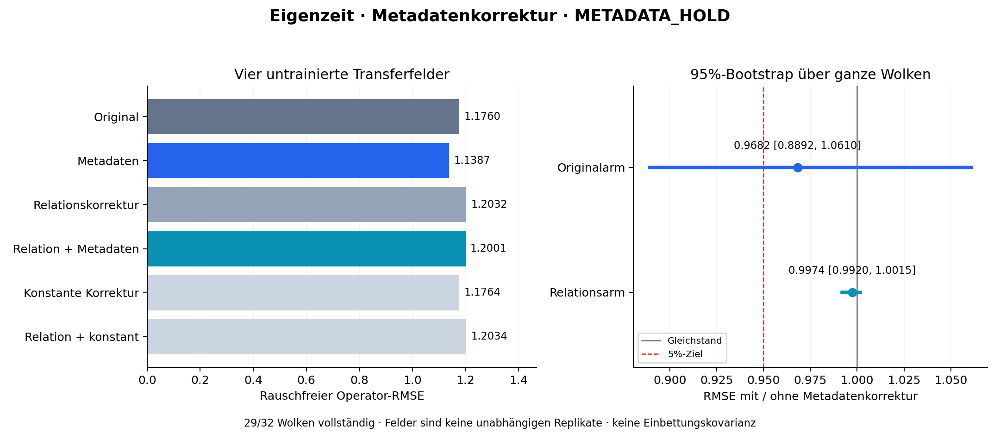

# Eigenzeit: Metadatenkorrektur auf neuen Feldern

**Entscheid: METADATA_HOLD; HOLD_PHASE3.**

Die vorab geforderte Verbesserung von mindestens 5 % wird in beiden Metadatenarmen verfehlt. Beide primären 95%-Wolken-Bootstrapintervalle schließen den Quotienten 1 ein. Der wissenschaftliche HOLD besteht damit unabhängig von der unterbrochenen Prozessmessung.

Der Pilot prüft eine feldlineare, metadatenabhängige Korrektur der Operatorgewichte. Konstanten und rekonstruierte lineare/quadratische Momente bleiben erhalten. Die Geometrie selbst wird durch diese neue Korrektur nicht geändert. Die vorhandene Relationsprojektion ist weiterhin euklidisch, keine kovarianzgewichtete Einbettungskorrektur.

Code, Protokoll und Kalibrierung wurden vor den neuen Testwolken öffentlich unter `3f6109f4bfb9424352893406e0ba92ddfe6ef858` eingefroren. Training: 60/64 alte Wolken. Residualkalibrierung: 30/32 weitere alte Wolken. Neuer Test: **29/32**. Keine Ersatzseeds, kein Nachjustieren auf Testdaten.

## Fortsetzung und Datenintegrität

Die ursprünglichen Prozesse wurden nach 27 Datensätzen operativ unterbrochen. Diese 27 Datensätze bleiben byteidentisch erhalten, einschließlich der drei Fälle ohne geeignete Stützmenge (Seeds 70210003, 70210009, 70210013). Ausschließlich die fünf fehlenden Seeds 70210027–70210031 wurden ergänzt. Alle 32 geplanten Datensätze liegen vor; 29 liefern vollständige Messungen. Die numerischen Quellen und die Kalibrierung sind unverändert.

Die [Fortsetzungsregeln](RESUMPTION.md) wurden vorab unter `69f989dc19172c938ce0e2afc7ff6c6e808eea4c` veröffentlicht. `interrupted_clouds.zip` enthält den unveränderten Zwischenstand, `continuation_clouds.zip` die Ergänzung und `test_clouds.zip` die verlustfreie Zusammenführung. Der Auswertungsadapter ändert ausschließlich Ressourcenbericht und Ressourcenfreigaben konservativ.

**Gesamtlaufzeit und Spitzen-RSS der ursprünglichen Prozesse sind unbekannt.** Die vollständigen Ausführungs-/Budgetkriterien sind deshalb UNVERIFIED, nicht PASS. Die booleschen Freigaben bleiben in `summary.json` false; gemessene Fortsetzungswerte und ausdrücklich bezeichnete Untergrenzen werden getrennt ausgewiesen.

Sechs Trainingsfelder und vier zuvor untrainierte Parameterkombinationen derselben analytischen Feldfamilie `exp(a t) cos(b x + px) cos(c y + py)`. Der wahre Operatorwert variiert. Dies prüft einen begrenzten Feldtransfer, keine beliebigen Feldfamilien oder Dichten. Die Ablationen verwenden konstante Korrekturkoeffizienten ohne Metadaten im Regressionsmodell, aber denselben metadatenbasierten OOD-Schutz.

## Primärer Vergleich: vier Transferfelder

| Verfahren | Sauberer RMSE | Mittlerer Fehler | Zentrierte RMS | Posterior-RMSE | Nominelle 95%-Überdeckung |
|---|---:|---:|---:|---:|---:|
| Original | 1.176004 | 0.005954 | 1.175989 | 0.471965 | 111/116 |
| Metadaten | 1.138655 | -0.009192 | 1.138618 | 0.478130 | 110/116 |
| Relationskorrektur | 1.203239 | 0.003459 | 1.203234 | 0.472461 | 111/116 |
| Relation + Metadaten | 1.200119 | 0.003093 | 1.200115 | 0.472582 | 111/116 |
| Konstante Korrektur | 1.176365 | 0.005902 | 1.176351 | 0.471982 | 111/116 |
| Relation + konstant | 1.203393 | 0.003433 | 1.203388 | 0.472471 | 111/116 |

Feldantworten innerhalb einer Wolke sind abhängig. Die Überdeckungszahlen sind beschreibend; alle Unsicherheitsintervalle werden über ganze Wolken gebootstrapt. Der Bootstrap konditioniert auf die eingefrorene Kalibrierung und ist keine Überdeckungsgarantie.

| Vergleich | Sauberer RMSE-Quotient | Wolken-Bootstrap 95% | Größter Einzel-Feld-Quotient |
|---|---:|---:|---:|
| metadata_vs_original | 0.968241 | [0.889164, 1.060974] | 1.016159 |
| projected_metadata_vs_projected | 0.997407 | [0.992017, 1.001522] | 1.000839 |

## Vorab festgelegte Kriterien

| Kriterium | Ergebnis |
|---|---|
| execution_complete | UNVERIFIED — ursprüngliche Prozessmessung fehlt |
| budgets | UNVERIFIED — ursprüngliche Prozessmessung fehlt |
| availability | PASS |
| accepted_relations_exact | PASS |
| noise_cap | PASS |
| metadata_improvement | FAIL |
| metadata_bootstrap | FAIL |
| metadata_field_guard | PASS |
| metadata_posterior_guard | PASS |
| metadata_coverage | PASS |
| metadata_ablation | PASS |
| projected_metadata_improvement | FAIL |
| projected_metadata_bootstrap | FAIL |
| projected_metadata_field_guard | PASS |
| projected_metadata_posterior_guard | PASS |
| projected_metadata_coverage | PASS |
| projected_metadata_ablation | PASS |

## Relationsverträglichkeit und Einsatzbereich

Vor der bisherigen Relationsprojektion: 25/29 Rekonstruktionen mit Fehlpaaren. Danach: 0/29, bei 13508 geprüften gerichteten Paaren. Das betrifft Root/Stützen und ist eine Konstruktionsbedingung, kein Nachweis korrekter Abstände.

| Korrektur | Außerhalb Trainingsbereich | Normbegrenzung aktiv | Max. Rauschvarianzfaktor |
|---|---:|---:|---:|
| metadata | 0 | 6 | 1.250000 |
| projected_metadata | 0 | 0 | 1.000484 |
| constant_ablation | 0 | 0 | 1.000009 |
| projected_constant_ablation | 0 | 0 | 1.000006 |

Alle OOD-Fälle verbleiben in der Auswertung und verwenden unveränderte Gewichte. Geometrisch nicht verfügbare Fälle werden nicht ersetzt; die ergänzende Kennzahl `all_clouds_with_prior_fallback_rmse` umfasst alle 32 Wolken.

## Fehlertrennung

Die sechs tatsächlichen Gewichtsvektoren liefern `N(C)=sigma² B Bᵀ`, einschließlich gemeinsamen Rootwerts und aller Kreuzterme. Die saubere Residualkovarianz und ihr Mittelwert werden separat kalibriert. Der Filter verwendet `R=G+mu muᵀ+N(C)` als zweites Fehlermoment. Das ist keine validierte bedingte Geometriekovarianz. Modell-/Kalibrierunsicherheit ist nicht vollständig erfasst. Keine zusätzliche globale Bias-Subtraktion; deshalb sind diese Posteriorwerte nicht unmittelbar mit dem früheren Ein-Feld-Piloten vergleichbar.

Im Originalarm steigt die mittlere bedingte Rauschvarianz durch die Metadatenkorrektur um 19.22 %. Der Transfer-Posterior-RMSE steigt um 1.31 %. Der kleine Rückgang des rauschfreien Fehlers ergibt daher keinen nachgewiesenen Gesamtvorteil.

## Passive Matrixdiagnostik

Die Diagnose liest gespeicherte Geometrien, Gewichte und Solverausgaben. Sie verändert keine Entscheidung und ist keine neue Abnahmeschwelle. Die ursprüngliche Konditionsgrenze 100000 bleibt unverändert. Alle 58 Momentmatrizen haben numerischen Zeilenrang 9; größter Momentrest: 2.132e-13. Der erwartete Gewichtsnullraum mit Dimension n−9 ist beabsichtigt.

| Momentmatrix | Kleinste Kondition | Median | Größte Kondition |
|---|---:|---:|---:|
| Original | 25.633 | 37.148 | 210.281 |
| Relationskorrigiert | 25.714 | 37.337 | 214.300 |

Alle 29 Relationssolver melden Erfolg. Bei den gespeicherten Endpunkten sind die als aktiv erfassten Constraint-Zeilen linear unabhängig (Aktivschwelle 1e-7, relative Rangschwelle 1e-10). Ohne aktive Constraints ist der Rang 0. Die vollständigen Singulärwerte, auch für die mit H^(-1/2) gewichteten Momentmatrizen, stehen in [matrix_diagnostics.json](matrix_diagnostics.json).

**Das ist kein Jacobi-Modell der stochastischen Geometriemessung.** Ein solches Modell samt Eichfixierung ist weiterhin nicht definiert. Die geprüften Endpunktmatrizen zeigen keinen Rangverlust; sie schließen Probleme auf dem gesamten Optimierungspfad nicht aus und liefern keine validierte Einbettungskovarianz.

## Reproduktion und offene Grenze

Fünf Kontrollgruppen prüfen Moment-/Konstantenerhaltung und Linearität, Umnummerierung, OOD-Rückfall/Informationsgrenze, gemeinsames Rootrauschen und analytische Feldwahrheit. Der numerische Replay prüft Residualkalibrierung, erneute Relationsprojektion, Momentzertifikate, gemeinsame Rauschkovarianz, Feldantworten und Auswertung. Die teure vollständige Rahmensuche wird dabei nicht wiederholt; keine externe Replikation.

Lokaler strikter Replay: **PASS_STRICT_REPLAY**, 32/32 Koordinaten-Hashes identisch, 2868 unabhängige Intervallzählungen, 58 QP-Zertifikate und 174 Momentprüfungen. Maximale Feldabweichung 0.0; maximale Abweichung erneut berechneter Gewichte 1.190e-13. Der Replay prüft zusätzlich die verlustfreie Zusammenführung aller 27 alten und fünf neuen Datensätze.

Siehe [Prüfvertrag](PROTOCOL.md), [vollständige Kennzahlen](summary.json), [Reproduktion](README.md) und [Audit zur Einbettungskovarianz](EMBEDDING_COVARIANCE_AUDIT.md). Ansatz 2 bleibt bis zur eigenständigen Einbettungskovarianz-Validierung offen; Ansatz 3 bis zum Identifizierbarkeitsnachweis. Keine Online-, Geräte- oder Krümmungsfreigabe.
