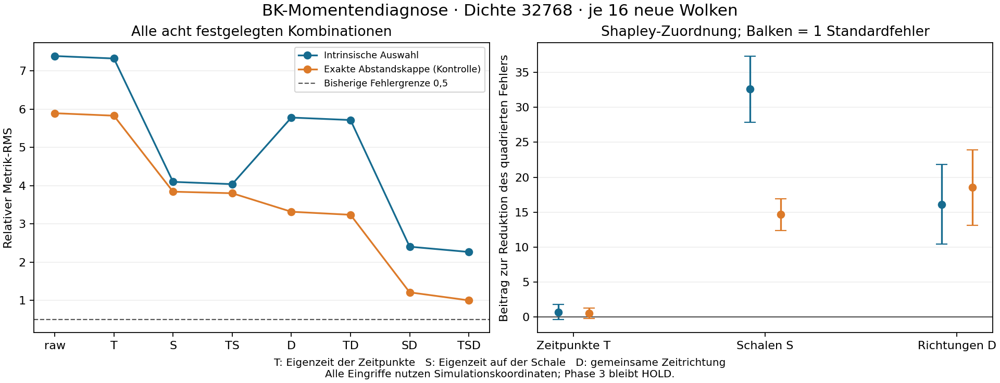

# Eigenzeit / BK: Zeit-, Schalen- und Richtungsmomente

**Ergebnis: `MOMENT_CONTROLS_INFORMATIVE`; weiterhin `HOLD_PHASE3`.**
48 neue Testwolken vergleichen alle acht vorab festgelegten Kombinationen von
drei geometrischen Kontrollen. Bei höchster Dichte sinkt der relative Metrik-RMS
mit allen Kontrollen von **7.387 auf 2.267**
für die intrinsisch gewählten Nachbarn und von
**5.893 auf 1.002**
bei exakter Abstandskappe. Die Kontrollen nutzen bekannte Simulationskoordinaten.
Sie sind keine neue intrinsische Rekonstruktion und erlauben keine Krümmungsfreigabe.
Beide Restfehler bleiben deutlich über der bisherigen Grenze 0,5.

## Was genau wurde geprüft?

Die Nachbarschaftsauswahl, Skalen, Gewichte und Zufallsmarken des vorherigen
Ankersuchaudits bleiben unverändert. Für jede verfügbare Wolke wird der
Metriktensor exakt in den negativen Zeitanteil und den positiven Schalenanteil
zerlegt. Beide beziehen sich auf dieselben glatten Koordinatenfelder.

| Faktor | Kontrollierter Eingriff | Was erhalten bleibt |
| --- | --- | --- |
| T | Zeitstützpunkte auf die nominelle Eigenzeit normieren | Ihre Zeitrichtungen |
| S | Alle ausgewählten Schalenpunkte auf die nominelle Eigenzeit normieren | Ihre Richtungen; die ursprüngliche Auswahl |
| D | Endpunkt- und Schalenreferenzachsen auf eine gemeinsame Zeitrichtung ausrichten | Eigenzeiten und interne Winkelstruktur jeder Schale |

S entfernt gemeinsam mittlere Fehlkalibrierung und Streuung der Schaleneigenzeit.
Diese beiden Effekte werden gemessen, aber nicht getrennt interveniert.
D korrigiert Achsenabweichungen; Winkelbesetzung innerhalb der Kappe bleibt bestehen.
Alle Kombinationen wurden vor den Testdaten festgelegt. Der gemeinsame Beobachter
ist die normierte Summe der zukunftsorientierten Einheitsvektoren beider
Zeitstützpunkte. Der Fehler wird stets im ursprünglichen Diamant-Koordinatensystem
gemessen; seine Frobeniusnorm ist nicht Lorentz-invariant.

## Öffentlicher Freeze und vollständige Ausführung

- Protokoll: `54012b288b4cccbc5215f91d87d8193b38874a15`.
- Quellen und Auswertung vor Testdaten: `fe7dcd1dbf9c5844459fa138def6ef6fca7294ee`.
- Sechs separate Entwicklungswolken; danach 48 frische Testwolken, 16 je Dichte.
- Keine Parameteranpassung, ersetzten Seeds oder selektiven Varianten.
- Zielausführung: 120.71 Sekunden, 342.8 MiB Spitzen-RSS;
  Vorgaben 600 Sekunden und 2048 MiB.
- Alle 48 Zielwolken samt Auswertung vollständig wiederholt; Details in
  [VERIFICATION.json](VERIFICATION.json). Dies ist numerischer Replay, keine
  unabhängige externe Replikation.

[Protokoll](PROTOCOL.md), [Vertrag](contract.json), [Umsetzung](IMPLEMENTATION.md),
[Entwicklung](development/summary.json), [Quellen und Rohdaten](results/execution.json),
[vollständige Auswertung](results/summary.json).

## Ergebnis über die drei Dichten

| Dichte | Auswahl | Verwendbar | Unverändert: RMS | Alle Kontrollen TSD: RMS | TSD / unverändert |
| --- | --- | --- | --- | --- | --- |
| 2048 | Intrinsische Auswahl | 12/16 | 3.353 | 4.976 | 1.484 |
| 2048 | Exakte Abstandskappe* | 12/16 | 3.575 | 3.151 | 0.881 |
| 8192 | Intrinsische Auswahl | 16/16 | 5.195 | 3.229 | 0.621 |
| 8192 | Exakte Abstandskappe* | 16/16 | 4.783 | 2.160 | 0.452 |
| 32768 | Intrinsische Auswahl | 16/16 | 7.387 | 2.267 | 0.307 |
| 32768 | Exakte Abstandskappe* | 16/16 | 5.893 | 1.002 | 0.170 |

*Die exakte Abstandskappe verwendet Simulationskoordinaten auf den vorhandenen
diskreten Schalen. Sie ist weder eine ideale Kontinuumskappe noch eine
Fehleruntergrenze. Innerhalb jedes Arms vergleichen alle Varianten exakt dieselben
verfügbaren Wolken; zwischen den Armen können sich diese Mengen unterscheiden.
Ausfälle bleiben im Nenner der Verfügbarkeit. Die RMS-Werte sind bedingt auf
verfügbare Schablonen. Die ursprüngliche flache Fehlergrenze beträgt **0,5**.

## Alle Varianten bei Dichte 32768

| Kontrolle | Intrinsische Auswahl: RMS | Richtige Signatur | Exakte Kappe: RMS | Richtige Signatur |
| --- | --- | --- | --- | --- |
| raw | 7.387 | 3/16 | 5.893 | 9/16 |
| T | 7.323 | 2/16 | 5.828 | 9/16 |
| S | 4.099 | 14/16 | 3.842 | 15/16 |
| TS | 4.039 | 14/16 | 3.801 | 15/16 |
| D | 5.779 | 0/16 | 3.318 | 2/16 |
| TD | 5.715 | 0/16 | 3.239 | 2/16 |
| SD | 2.405 | 9/16 | 1.212 | 14/16 |
| TSD | 2.267 | 10/16 | 1.002 | 15/16 |

## Fehlerbeiträge und Wechselwirkungen

Die folgende Zuordnung mittelt die marginale Reduktion des **quadrierten**
relativen Fehlers über alle Reihenfolgen der drei Eingriffe (Shapley-Werte).
Positive Werte bedeuten eine Fehlerreduktion, negative eine Verschlechterung.
Die drei Beiträge summieren sich genau zu Rohfehler² minus TSD-Fehler².
Die Standardfehler verwenden 16 unabhängige Wolken, keine einzelnen Punktpaare.
Dies sind deskriptive Zuordnungen der festgelegten Kontrollen; sie identifizieren
keine eindeutigen, voneinander unabhängigen physikalischen Ursachen.

| Auswahl | Faktor | Mittlere Fehlerreduktion | Standardfehler |
| --- | --- | --- | --- |
| Intrinsische Auswahl | T | 0.734 | 1.081 |
| Intrinsische Auswahl | S | 32.583 | 4.737 |
| Intrinsische Auswahl | D | 16.113 | 5.692 |
| Exakte Abstandskappe* | T | 0.546 | 0.726 |
| Exakte Abstandskappe* | S | 14.658 | 2.261 |
| Exakte Abstandskappe* | D | 18.517 | 5.382 |

| Geometrische Messung, Dichte 32768 | Intrinsische Auswahl: Mittel ± SE | Exakte Kappe: Mittel ± SE |
| --- | --- | --- |
| Eigenzeit Zeitstützpunkt / Kettenschätzung | 0.994 ± 0.012 | 0.994 ± 0.012 |
| Mittlere Schaleneigenzeit / Kettenschätzung | 1.179 ± 0.017 | 1.147 ± 0.019 |
| Streuung innerhalb einer Schalenseite / Kettenschätzung | 0.161 ± 0.007 | 0.149 ± 0.007 |
| Endpunkt-Rapidität relativ zur gemeinsamen Achse | 0.135 ± 0.024 | 0.135 ± 0.024 |
| Referenz-Rapidität relativ zur gemeinsamen Achse | 0.335 ± 0.028 | 0.335 ± 0.028 |
| Punkte je Schalenseite | 26.531 ± 0.851 | 18.344 ± 0.602 |

Rapiditäten sind dimensionslos. Eine Eigenzeitquote über 1 bedeutet, dass die
Kettenschätzung die tatsächliche Eigenzeit im betreffenden Mittel unterschätzt.
Die Schalenstreuung ist zunächst innerhalb jeder Seite berechnet; die Tabelle
mittelt anschließend über Seiten und Wolken.

Die rohe Momentenbilanz zeigt, warum einzelne Fehlergrössen nicht addiert
werden dürfen. Normen sind durch ||eta||²=3 geteilt:

| Auswahl | Zeitfehler² | Schalenfehler² | Signierter Kreuzterm | Gesamtfehler² |
| --- | --- | --- | --- | --- |
| Intrinsische Auswahl | 0.486 | 56.971 | -2.888 | 54.569 |
| Exakte Abstandskappe* | 0.486 | 36.278 | -2.039 | 34.725 |

Der Kreuzterm erfasst Aufhebung oder Verstärkung. Selbst stark schwankende
Achsen können im idealen Fall gemeinsam einen richtigen Tensor ergeben;
entscheidend ist die Abstimmung der Zeit- und Schalenbeiträge.

## Entscheidung und nächster begrenzter Schritt

Das vorab festgelegte Diagnosekriterium verlangt bei höchster Dichte in **beiden**
Armen mindestens 80% Verfügbarkeit und mindestens eine Halbierung des RMS durch
TSD, zusätzlich vollständige Ausführung, Budget- und Algebra-PASS. Es liefert
`MOMENT_CONTROLS_INFORMATIVE`. Es ist kein Ersatz für die ursprünglichen wissenschaftlichen
Abnahmekriterien. Auch eine erfolgreiche Koordinatenkontrolle qualifiziert
keinen intrinsischen Operator.

Bei höchster Dichte tragen S und D wesentlich mehr zur Fehlerreduktion bei als T.
Die Zeitstützpunkte sind im Mittel bereits passend kalibriert (Eigenzeitquote
0,994 ± 0,012); die ausgewählten Schalen liegen dagegen im Mittel bei 1,179 bzw.
1,147 der nominellen Eigenzeit. Ein gemeinsamer globaler Kalibrierfaktor für
beide Skalen ist deshalb durch diese Daten nicht gestützt.

Der nächste begrenzte Entwicklungsschritt ist eine **intrinsische
Schalenkalibrierung aus Intervallzählungen**: die Eigenzeit jedes Schalenpunkts
aus dem kausalen Intervallvolumen schätzen und die entsprechenden quadratischen
Gewichte prüfen. Das ist hier nur ein neuer Kandidatenvorschlag, noch keine
getestete Korrektur. Parallel dazu muss eine gemeinsame Referenzrichtung aus
der Ordnung definiert und auf Entwicklungsdaten geprüft werden; die hier
benutzte Lorentz-Ausrichtung setzt Einbettungskoordinaten voraus.

Die niedrige Dichte mahnt zur Vorsicht: TSD verschlechtert dort die intrinsische
Auswahl von 3,353 auf 4,976. Der positive Hauptbefund gilt für die vorab gewählte
hohe Dichte und ist keine allgemeine Überlegenheit der Eingriffe. Jede neue
intrinsische Korrektur benötigt eigenständige Entwicklung, einen öffentlichen
Quellenfreeze und frische Testdaten. Winkelbesetzung, unveränderte Kappenmitgliedschaft und
endliche Ränder bleiben mögliche Restmechanismen; dieser Lauf isoliert sie
nicht. Die drei Dichten belegen keinen Kontinuumsgrenzwert.

Die analytischen Kontrollen bestehen: acht ideale Kappenmomente, vier separat
injizierte Defekte, ein kombinierter Defekt, acht Lorentz-Kovarianzprüfungen,
Shapley-Erhaltung und drei ungültige Eingaben. Die rohe Produktidentität stimmt
auf jeder verfügbaren Schablone mit der ursprünglichen Implementierung überein.
Alle früheren Phase-1/2-, Ankersuch- und BD-C2-Dateien bleiben unverändert.
`HOLD_PHASE3` und BD-C2 `NO_GO` gelten weiter; keine Hintergrundagenten wurden
neu gestartet.
