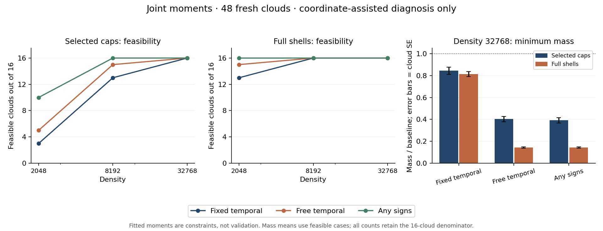

# Eigenzeit / BK: gemeinsame erste und zweite Momente

**Diagnose: `CAP_MOMENT_FEASIBILITY_SUPPORTED`; weiterhin `HOLD_PHASE3`.**
Bei höchster Dichte erlauben **16/16** der bisherigen
Kappen eine gemeinsame Momentenlösung mit unveränderten negativen Zeitgewichten
und nichtnegativen Schalengewichten. In **16/16** Fällen
liegt die minimale absolute Gewichtssumme höchstens beim Doppelten der Basis.
Das mittlere Verhältnis beträgt **0.845**
(Standardfehler 0.032, über 16 lösbare Wolken).

Diese Gewichte werden mit bekannten Einbettungskoordinaten und vorgegebener
Minkowski-Metrik bestimmt. Die angepassten linearen und quadratischen Antworten
sind **Nebenbedingungen, keine unabhängige Validierung**. Es wird kein neuer
intrinsischer Operator und keine Freigabe für Phase 3 behauptet.

## Was genau geprüft wurde

Die bisher akzeptierte Intervallgewichtung bildet die Basis; die zuletzt
abgelehnte gemeinsame Referenzwahl wird nicht zum neuen Standard erklärt.
Wurzel, Kettenschalen und zeitliche Stützpunkte bleiben unverändert. Zwei feste
Punktmengen werden verglichen: bisherige räumliche Kappen und die vollständigen
Schalen vor dem Kappenschnitt. Letztere dienen nur der Diagnose grösserer
Abdeckung und können weit entfernte oder randgeprägte Punkte enthalten.

Je Punktmenge werden drei feste Regeln geprüft: unveränderte negative
Zeitgewichte und nichtnegative Schalen; variable nichtpositive Zeitgewichte
und nichtnegative Schalen; oder vollständig freie Vorzeichen. Fehlende Kappen
bleiben in der primären Auswertung unverfügbar und werden nicht ersetzt.

Mit z=(X−X_Wurzel)/tm und a=tm²w lauten die neun Bedingungen

    Σ a z = 0,
    Σ a z zᵀ = 2 diag(−1,1,1).

Konstanten verschwinden durch Bf=Σw(f−f_Wurzel). Minimiert wird Σ|a|, mit
sqrt(2)-Skalierung der drei gemischten quadratischen Bedingungen. Das Verfahren
liefert einen Mindestwert und einen numerischen Zeugen; mehrere verschiedene
Gewichtsvektoren können denselben Mindestwert erreichen.

Eine lösbare Aufgabe benötigt geprüfte Gleichungen, Vorzeichen, duale
Ungleichungen und eine kleine primär-duale Lücke. Eine Unlösbarkeitsaussage
benötigt einen separat berechneten trennenden Zeugen mit Aᵀy≥0 und bᵀy<0.
Alle Prüfungen verwenden die vorab festgelegten Gleitkommatoleranzen. Es handelt
sich nicht um einen formalen Beweis mit Intervallarithmetik. Ohne gültigen
Zeugen bleibt der Fall UNRESOLVED.

## Öffentlich festgelegt und vollständig ausgeführt

- Protokoll vor Entwicklung: `4855dc84ff307e3b85bfc6887de5ae8e060ac90c`.
- Quellen und Analyse vor Zielwolken: `2d8c436d20864e7a49228a1625ac658667c4a19a`.
- Sechs Entwicklungswolken, danach 48 neue Zielwolken, je 16 bei drei Dichten.
- Keine Parameteränderung, Ersatzwolken oder nachträgliche Auswahl eines Arms.
- Laufzeit 133.61 Sekunden, Spitzen-RSS 357.4 MiB;
  Grenzen 900 Sekunden und 2048 MiB.
- 270 verfügbare LP-Aufgaben mit geprüftem Zeugen, davon 20 mit
  Unlösbarkeitszeugnis; alle fehlenden Eingaben stehen separat in der Tabelle.
- Vollständiger lokaler Replay: 48/48 Wolken, 270 LP-Aufgaben;
  Koordinaten-Bytehashes separat 48/48 identisch.
  GitHub-Ergebnisse werden im Pull Request festgehalten.

[Protokoll](PROTOCOL.md), [Vertrag](contract.json), [Implementierungsgrenzen](README.md),
[Entwicklungsdaten](development/summary.json), [Testquellen und Rohdaten](results/execution.json),
[vollständige Auswertung](results/summary.json), [Replay](VERIFICATION.json).

## Alle sechs Arme und drei Dichten

| Dichte | Punktmenge | Gewichtungsregel | Lösbar | Unlösbar mit Zeuge | Ungeklärt | Eingabe fehlt | Lösbar und Masse ≤ 2×Basis | Mittleres Massenverhältnis ± SE |
| --- | --- | --- | --- | --- | --- | --- | --- | --- |
| 2048 | Bisherige Kappen | Zeitgewichte fest, Schalen ≥ 0 | 3/16 | 7 | 0 | 6 | 3/16 | 0.967 ± 0.110 |
| 2048 | Bisherige Kappen | Zeitgewichte ≤ 0, Schalen ≥ 0 | 5/16 | 5 | 0 | 6 | 5/16 | 0.697 ± 0.094 |
| 2048 | Bisherige Kappen | Alle Vorzeichen frei | 10/16 | 0 | 0 | 6 | 10/16 | 0.749 ± 0.078 |
| 2048 | Vollständige Schalen | Zeitgewichte fest, Schalen ≥ 0 | 13/16 | 3 | 0 | 0 | 13/16 | 0.945 ± 0.034 |
| 2048 | Vollständige Schalen | Zeitgewichte ≤ 0, Schalen ≥ 0 | 15/16 | 1 | 0 | 0 | 15/16 | 0.437 ± 0.025 |
| 2048 | Vollständige Schalen | Alle Vorzeichen frei | 16/16 | 0 | 0 | 0 | 16/16 | 0.403 ± 0.020 |
| 8192 | Bisherige Kappen | Zeitgewichte fest, Schalen ≥ 0 | 13/16 | 3 | 0 | 0 | 13/16 | 0.917 ± 0.037 |
| 8192 | Bisherige Kappen | Zeitgewichte ≤ 0, Schalen ≥ 0 | 15/16 | 1 | 0 | 0 | 15/16 | 0.529 ± 0.053 |
| 8192 | Bisherige Kappen | Alle Vorzeichen frei | 16/16 | 0 | 0 | 0 | 16/16 | 0.503 ± 0.038 |
| 8192 | Vollständige Schalen | Zeitgewichte fest, Schalen ≥ 0 | 16/16 | 0 | 0 | 0 | 16/16 | 0.864 ± 0.034 |
| 8192 | Vollständige Schalen | Zeitgewichte ≤ 0, Schalen ≥ 0 | 16/16 | 0 | 0 | 0 | 16/16 | 0.246 ± 0.012 |
| 8192 | Vollständige Schalen | Alle Vorzeichen frei | 16/16 | 0 | 0 | 0 | 16/16 | 0.241 ± 0.010 |
| 32768 | Bisherige Kappen | Zeitgewichte fest, Schalen ≥ 0 | 16/16 | 0 | 0 | 0 | 16/16 | 0.845 ± 0.032 |
| 32768 | Bisherige Kappen | Zeitgewichte ≤ 0, Schalen ≥ 0 | 16/16 | 0 | 0 | 0 | 16/16 | 0.403 ± 0.024 |
| 32768 | Bisherige Kappen | Alle Vorzeichen frei | 16/16 | 0 | 0 | 0 | 16/16 | 0.392 ± 0.024 |
| 32768 | Vollständige Schalen | Zeitgewichte fest, Schalen ≥ 0 | 16/16 | 0 | 0 | 0 | 16/16 | 0.814 ± 0.024 |
| 32768 | Vollständige Schalen | Zeitgewichte ≤ 0, Schalen ≥ 0 | 16/16 | 0 | 0 | 0 | 16/16 | 0.143 ± 0.005 |
| 32768 | Vollständige Schalen | Alle Vorzeichen frei | 16/16 | 0 | 0 | 0 | 16/16 | 0.143 ± 0.005 |

Alle Erfolgsquoten verwenden 16 Wolken als Nenner. Mittelwerte und
Standardfehler beziehen sich nur auf lösbare Fälle; die Wolke bleibt die
Auswertungseinheit. Unterschiedliche Verfügbarkeiten bei kleiner Dichte dürfen
nicht als kontrollierter Paarvergleich interpretiert werden.

## Primärentscheidung bei Dichte 32768

| Vorab festgelegtes Kriterium | Gemessen | Grenze | Ergebnis |
| --- | --- | --- | --- |
| Lösbare bisherige Kappen, Zeitgewichte fest | 16/16 | ≥ 80 % | PASS |
| Lösbar mit Masse ≤ 2×Basis | 16/16 | ≥ 80 % | PASS |
| Alle verfügbaren Aufgaben mit gültigem Zeugen klassifiziert | 270 | keine ungeklärten Fälle | PASS |

Gesamtentscheid **CAP_MOMENT_FEASIBILITY_SUPPORTED**. Vollständigkeit, Ressourcen und
Softwarekontrollen bestehen. Die 80-%- und Massenfaktor-2-Grenzen sind
vorab festgelegte deskriptive Kriterien, keine Konfidenzaussage oder
Konvergenzgarantie. Die frühere absolute Metrikgrenze 0,5 wird nicht durch
perfekt angepasste Momente ersetzt.

Gepaarte Statuswechsel auf denselben 16 Wolken:

| Fester Vergleich | Statuswechsel | Wolken |
| --- | --- | --- |
| caps/fixed_time to caps/free_time | FEASIBLE -> FEASIBLE | 16 |
| caps/fixed_time to caps/unrestricted | FEASIBLE -> FEASIBLE | 16 |
| caps/fixed_time to full_shells/fixed_time | FEASIBLE -> FEASIBLE | 16 |

## Gewichtsmassen, Abdeckung und Aussagegrenzen

Die bisherige Basis hat bei höchster Dichte auf den Kappen Metrik-RMS
4.116 und normierte affine Drift
2.323. Diese ungefitten Werte sind
vom Ergebnis des linearen Gleichungssystems strikt getrennt. Positive und
negative Gewichtsmassen, Rang, Singulärwerte, vollständige Matrizen und alle
Zeugen stehen pro Wolke in den Rohdaten.

Mittlere Zahl der Stützpunkte: Kappen 54.562,
vollständige Schalen 171.250.
Mittlerer maximaler Abstand in Einheiten tm, im ursprünglichen Diamantrahmen:
Kappen 3.102, vollständige
Schalen 3.695.
Eine bessere Lösbarkeit auf grösseren Schalen wäre kein Nachweis von Lokalität
oder Randunabhängigkeit.

Σ|a| begrenzt die Verstärkung beschränkter Fehler in den Felddifferenzen.
Bei getrennt verrauschten Werten an Stützpunkten und Wurzel ist einschliesslich
des Wurzelkoeffizienten höchstens 2Σ|a| erforderlich. Das Massenverhältnis
vergleicht solche Schranken; es misst weder tatsächliche Varianz noch Fehler
auf unabhängigen Feldern. Die ausgewählten optimalen LP-Zeugen sind keine
bevorzugten Operatoren und können dünn besetzt oder nicht eindeutig sein.

## Kontrollen und Wiederholbarkeit

Eine symmetrische zeitartige Handkonstruktion hat die analytisch bekannte
minimale Masse 14,3888888889. Eine Punktmenge ohne zweite Raumrichtung besitzt
geprüfte Unlösbarkeitszeugen für alle drei Regeln. Ein weiterer Fall trennt
Vorzeichenbeschränkung von Rangmangel: positive Gewichte sind unmöglich,
freie Vorzeichen ermöglichen eine Lösung. Manipulierte primäre und duale
Zeugen werden verworfen. Skalierung sowie Umnummerierung und transportierte
Zeitumkehr werden geprüft. Konstanten- und Produktidentität bestehen für jeden
rekonstruierten lösbaren Zeugen.

Der Replay prüft jede archivierte und neu berechnete LP-Lösung unabhängig.
Relationen, Marken, Stützpunktreihenfolge und logische Klassen stimmen exakt;
Basiskoordinaten und ursprüngliche Antworten verwenden atol=1e−10, rtol=1e−9.
Minimale LP-Zielwerte und ihre Zusammenfassungen verwenden die vorher festgelegten
atol=1e−8, rtol=1e−7. Nicht eindeutige Zeugen und Iterationszahlen dürfen sich
unterscheiden. Byteidentität der Koordinaten wird separat berichtet. Frühere
wissenschaftliche Quellen, Daten und Replay-Grenzen bleiben unverändert.

In den archivierten Zeugen beträgt der grösste Momentenrest 1,135e−12,
die grösste absolute primär-duale Lücke 3,269e−13. Der kleinste
Trennabstand der 20 Unlösbarkeitszeugen beträgt 0,05165. Diese Zahlen
prüfen die numerischen Zeugen und sind keine unabhängigen Feldfehler.

Eine vorhandene Momentenlösung zeigt nur, dass die feste Punktmenge die
Bedingungen unter der jeweiligen Gewichtsregel zulässt. Sie zeigt nicht, wie
diese Gewichte ohne Einbettungskoordinaten gefunden werden, und prüft keine
nicht angepassten Felder. Der nächste eigenständige Versuch muss daraus eine
intrinsische, gegen Zählrauschen kontrollierte Konstruktion entwickeln und
auf unabhängigen Feldantworten prüfen. **HOLD_PHASE3** und **BD-C2 NO_GO**
bleiben bestehen; der Rahmen ist weiterhin bekannte Dichte und flaches 2+1.

Softwarequelle: [offizielle SciPy-Dokumentation zu linprog/HiGHS](https://docs.scipy.org/doc/scipy/reference/optimize.linprog-highs.html).
Die tatsächlich verwendeten NumPy-/SciPy-Versionen sind im Ausführungsprotokoll
und in den unveränderten Replay-Abhängigkeiten festgehalten.
