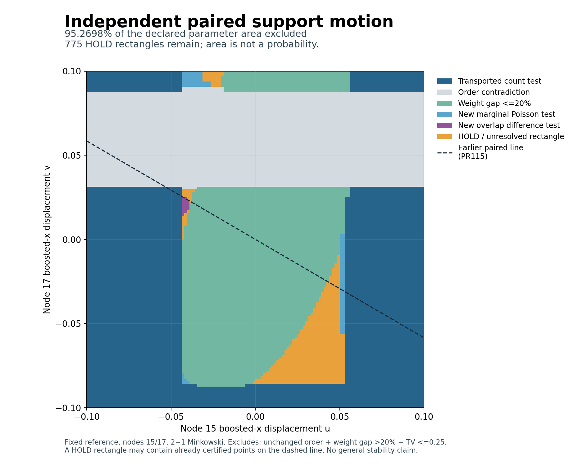

# Eigenzeit: independent paired motion on a two-parameter square

**95.269775390625% of the declared parameter square is excluded as a strong
close-law counterexample. The remaining 775 rectangles are explicitly HOLD.**
This is the first continuous two-parameter extension of the frozen paired-line
study: nodes 15 and 17 now move independently in boosted x, with
(u,v) in [-0.1,0.1]^2. The velocity ratio is no longer fixed.

An exclusion rules out the conjunction of unchanged selected-node order,
symmetric physical operator-weight gap >20%, and full conditional labelled
count/overlap-law TV <=0.25. The area percentage is a fraction of this chosen
parameter square, not a probability, physical frequency, or fraction of
admissible geometries. A general stability theorem remains open.



The dashed line is the earlier fully excluded node-15/node-17 family from
PR115. Its result remains valid inside the larger square. A HOLD rectangle
can contain already excluded points on that line: HOLD means the entire
rectangle has not been settled, not that all its points are unknown.

## Fixed-budget result

| Terminal classification | Rectangles | Fraction of total parameter area |
|---|---:|---:|
| Earlier count-law certificate transported to a strip | 480 | 40.209960937500% |
| Order contradiction | 302 | 28.356933593750% |
| Joint operator-weight gap at most 20% | 450 | 25.762939453125% |
| New exact marginal Poisson test | 80 | 0.836181640625% |
| New overlap-dependent difference test | 17 | 0.103759765625% |
| HOLD | 775 | 4.730224609375% |
| Total | 2,104 | 100% |

The square has exact area 1/25. The remaining area is 31/16384, hence the
excluded fraction is exactly 15609/16384. Rectangle counts are not area
weights: refinement creates differently sized certified rectangles.

The frozen run started with 1,024 rectangles and evaluated 2,464 geometric
rectangles, including parents, over three permitted refinement rounds.
It then tested 128 HOLD rectangles using 176 marginal events, closing 80.
The final overlap stage tested 32 remaining rectangles with one common-anchor
event each, closing 17. Its five reference-law enclosures were reused.
No extra subdivision or event search followed the declared stopping rule.
All successful, unsuccessful and untested cases remain in the archive.

## What is new mathematically

The two-moving-endpoint squared interval contains the interaction term 2uv.
Its exact rectangle extrema follow by ranging the relative displacement v-u.
The joint minimum-norm moment operator uses a rank-four update with bivariate
polynomials, including mixed monomials, and a centered interval Neumann
certificate on each rectangle. It does not add two single-support gap bounds.

Earlier law tests transfer only when their observed intervals contain the
relevant moving support and fixed anchors; motion of the other support then
leaves that marginal law unchanged. Earlier one-support operator-gap bounds
do not transfer this way. The new cover uses 145 certified source strips.

For overlapping counts, the shared Poisson atom cancels in N(A)-N(B), leaving
two independent exclusive atoms. Their means still depend on the unknown
common intensity. Every possible common intensity is retained in a 64-slice
cover; directed Poisson event bounds are combined over all slices. Original
overlapping counts are never treated as independent. The proof and all claim
boundaries are in [THEOREM.md](THEOREM.md).

## Independent validation

The audit reports PASS:

- 1,785 exact comparisons with independent direct nine-moment weight solves,
  including 1,778 point checks of reported rectangle gap enclosures.
- 12,320 independently formulated quadratic rectangle ranges and a negative
  control detecting omission of the 2uv mixed term.
- 294 transported-event geometry identities.
- 704 independent 100-digit marginal PMF evaluations and 4,736 independent
  110-digit difference-law PMF evaluations.
- 2,368 exclusive-rate rectangles, 64 whole-rectangle virtual-subset checks
  and 320 direct subset checks at reconstructed points.
- Complete reconstruction of the initial grid, all quadtree splits, both
  probability-stage selections and the final 2,104-rectangle cover. Missing
  rectangles are rejected. All 775 HOLD rectangles are retained.

Point checks and decimal PMFs audit the implementation independently. Continuous
claims come from exact polynomial identities, directed whole-rectangle bounds,
explicit infinite Poisson tails and the complete quadtree, not from sampling
or an area sum alone. The scientific freeze was not amended during execution.

## What remains and the next bounded step

All 775 remaining rectangles have certified finite operator enclosures; their
gap upper bounds do not exclude the >20% condition. This does not prove their
actual gaps exceed 20%. Each remaining rectangle has side length 1/640 and
area 1/409600. They are listed exactly in `summary.json`.

Of these, 744 did not receive a new exact Poisson event in this pass, 16 retain
only unsuccessful new marginal tests, and 15 retain unsuccessful overlap
stage tests as well. Earlier tests may still exclude individual points or
subregions. A useful next bounded pass is therefore to extend exact event
coverage to the 744 remaining untested rectangles before increasing geometric
resolution. It should freeze selection, event budgets and stopping rules
again, and retain any new HOLDs.

No close-law counterexample has been certified. This package does not settle
the whole square, arbitrary axes or more supports, other reference geometries,
the full A-selection/B-graph likelihood, physical continuum accuracy or general
finite-error operator stability.

## Source and reproduction

Parent PR115: `0e016fa058f916480a36d3efade415785089de37`, source tree
`eff5dd771890b05ffa5cbc3d50b2866ef5caf3d6`. All five parent workflow runs passed.
The contract, scientific code, proof and sources were internally hashed before
the first rectangle classification. Historical results and three exact algebra
control points were known; this is not external preregistration. Predecessor
scientific evidence is unchanged.

From the repository root with Python 3.12 and the existing
`finite_poisson_bounds/requirements.txt` dependencies:

```sh
python3 -B research/lorentz_local_dalembert/paired_surface/ps_run.py --verify
python3 -B research/lorentz_local_dalembert/paired_surface/ps_audit.py --verify
sha256sum -c research/lorentz_local_dalembert/paired_surface/SHA256SUMS
python3 tests/python/verify_manifest.py
```

A dedicated CI job runs these checks. `certificates.json.gz` contains the source
strip inventory, all geometric decisions, split history and both probability
stages. `summary.json` lists every unresolved rectangle; `audit.json` records
independent checks. The illustrative map can be regenerated with `ps_plot.py`
and Matplotlib 3.10.8; the plot is not part of the proof computation.
