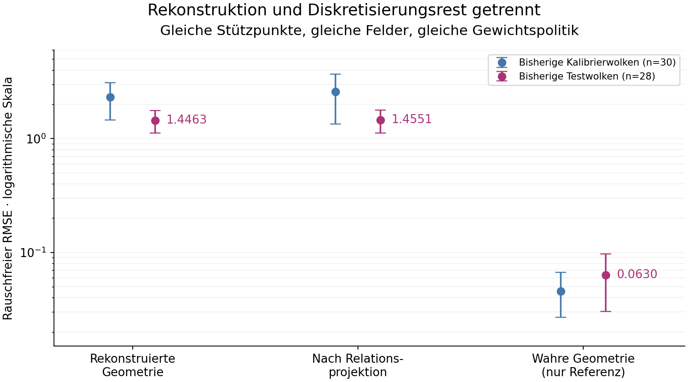

# Rekonstruktionsfehler und Diskretisierungsrest

**DECOMPOSITION_VERIFIED — retrospektive Diagnose, keine Produktionsfreigabe.**

Auf den 28 bisher vollständigen Testwolken sinkt der rauschfreie RMSE bei unverändertem Support und gleicher Gewichtspolitik von **1.446311 auf 0.063032**, wenn ausschließlich die rekonstruierte durch die wahre Simulationsgeometrie ersetzt wird. Das weist in diesem Versuch auf die Rekonstruktion als Hauptengpass hin. Die analytische Taylor-Zerlegung lokalisiert den größten Fehlerbeitrag in der Antwort auf den linearen Feldanteil.

64 veröffentlichte Datensätze wurden behalten: 30 vollständige Kalibrierwolken, 28 vollständige Testwolken und sechs bereits bekannte Supportausfälle. Alle 58 verfügbaren Supports besitzen einen zertifizierten Oracle. Es gab keine neuen Wolken, Ersatzfälle, Supportsuche oder Feldanpassung. Die Bezeichnungen Kalibrierung/Test stammen aus dem vorigen Versuch; beide Gruppen werden hier retrospektiv verwendet.

## Vergleich auf denselben Punktwolken

| Geometrie | RMSE: bisheriger Testteil | Deskriptives 95%-Bootstrapintervall | RMSE: bisheriger Kalibrierteil |
|---|---:|---:|---:|
| Original | 1.446311 | 1.117168–1.766017 | 2.322140 |
| Relationsprojektion | 1.455090 | 1.115324–1.784044 | 2.579613 |
| Wahre Geometrie (Oracle) | 0.063032 | 0.030299–0.097238 | 0.045773 |

Oracle/Original-RMSE = **0.043581**, gepaartes Bootstrapintervall 0.021610–0.076511. Resampling erfolgte mit ganzen Wolken; vier Felder zählen nicht als vier unabhängige Wolken. Diese Intervalle sind deskriptiv, nicht simultan und keine neue unabhängige Bestätigung.



Fehlerbalken zeigen die deskriptiven Bootstrapintervalle. Die y-Achse ist logarithmisch.

## Exakte Fehlerbilanz des Originaloperators

`e = d + r`, wobei d der Fehler mit wahrer Geometrie und r die Antwortänderung durch die Rekonstruktion ist. Damit gilt `MSE(e) = E[d²] + E[r²] + 2 E[d r]`.

| Beitrag | Mittlerer quadratischer Fehlerterm, bisheriger Testteil |
|---|---:|
| Diskretisierungsrest bei wahrer Geometrie, E[d²] | 0.003973027 |
| Rekonstruktionsunterschied, E[r²] | 2.074648518 |
| Vorzeichenbehaftete Wechselwirkung, 2 E[d r] | +0.013195071 |
| Summe = bisheriger rauschfreier MSE | **2.091816616** |

Der Wechselwirkungsterm wird ausdrücklich mitgeführt. Eine allgemeine Aufteilung in zwei unabhängige positive Prozentanteile ist nicht zulässig. Der Diskretisierungsrest ist bedingt auf diesen Support, diese Felder und diese Dichte; er ist weder ein universelles Fehlerminimum noch ein Konvergenzbeweis.

Die bisherige Trennung vom Messrauschen bleibt konsistent: Zum rauschfreien MSE 2.091816616 kommt beim Original unter dem alten IID-Modell die Messvarianz 1.060099023. Wiederholtes Messen reduziert nur diesen zusätzlichen Rauschterm.

## Wo der Rekonstruktionsfehler auftritt

Für jede Sinus-/Kosinuswelle wird der Feldkontrast exakt in linearen Tayloranteil, quadratischen Anteil und vollständigen Rest zerlegt. Die folgende Tabelle zeigt Quadrate einzelner Beiträge; ihre Summe allein ist wegen der Kreuzterme noch nicht der Gesamtfehler.

| Beitrag zum Feldfehler | Original: mittleres Quadrat | Oracle: mittleres Quadrat |
|---|---:|---:|
| Linearer Anteil | 2.095088 | 4.59468042e-26 |
| Quadratischer Anteil minus Sollwert | 0.0369042331 | 4.88191807e-29 |
| Vollständiger höherer Rest | 0.00171226534 | 0.0039730274 |

Beim Original summieren sich die drei Taylor-Kreuzterme zu -0.041887882. Die vollständige Bilanz stimmt mit dem direkt gemessenen rauschfreien Fehler überein.

Die Momentbedingungen werden in den rekonstruierten Koordinaten erfüllt, aber dadurch noch nicht in den wahren physischen Koordinaten. Der größte lineare physische Momentfehler beträgt im Testteil 15.8665 beim Original und 1.16e-12 beim Oracle. Das ist der konkrete nächste Diagnosepunkt: Warum bewahrt die intrinsische Rekonstruktion die physische Auslöschung linearer Felder nicht ausreichend? Dieser Versuch lokalisiert den Fehler; er entscheidet noch nicht zwischen Ursachen wie Skala, Rahmenrekonstruktion oder Landmarkenabhängigkeit.

## Metadatenzusatz und Rauschkosten

Metadatenänderungen werden als eigener Term c erfasst: `e_meta = d + r_basis + c`. Die sechs quadratischen und gekreuzten Beiträge stehen vollständig in [summary.json](results/summary.json). Eine Metadatenänderung wird dadurch nicht als reine Geometrieänderung bezeichnet.

| Variante | Rauschfreier RMSE | Hypothetische IID-Messvarianz bei σ=0,001 |
|---|---:|---:|
| Original | 1.446311 | 1.060099 |
| Metadaten | 1.582276 | 1.228337 |
| Relationsprojektion | 1.455090 | 1.061673 |
| Projektion + Metadaten | 1.456096 | 1.061806 |
| Wahre Geometrie (Oracle) | 0.063032 | 1.557246 |

Die Oracle-Messvarianz ist im Testteil höher als beim Original. Die geringe rauschfreie Abweichung ist daher keine pauschale Aussage über optimale Rauschrobustheit. Diese Varianzen sind analytische Folgen des früher deklarierten Rauschmodells; es wurden hier keine neuen Rauschmessungen erzeugt.

## Reproduzierbarkeit und Grenzen

Auswertungsfreeze vor Oracle-Berechnung: `7f6c6b021817f9dc5adff25a6c9b44cd94b8a12f`. 177 Quell-/Eingabedateien fixiert; 64 Datensätze numerisch wiederholt; sieben analytische Kontrollgruppen bestanden. Auswertung: 0.367 s, maximal 89.65 MiB (Budget 120 s / 512 MiB). Die ursprünglichen Rohdaten und wissenschaftlichen Entscheidungen bleiben unverändert.

- [Vertrag](contract.json) und [mathematische Definitionen](PROTOCOL.md)
- [Vollständige Auswertung](results/summary.json), [Einzelresultate](results/records.json.gz), [Replay](results/verification.json)
- Oracle-Gewichte: vorhandenes QP plus unabhängiger SVD-Weg; Polynome, Lorentz-/Skaleninvarianz, kontrollierte Verzerrung, Kreuzterme und Rangfehler geprüft.

```sh
OPENBLAS_NUM_THREADS=1 OMP_NUM_THREADS=1 python -B research/lorentz_local_dalembert/reconstruction_ablation/ra_controls.py
OPENBLAS_NUM_THREADS=1 OMP_NUM_THREADS=1 python -B research/lorentz_local_dalembert/reconstruction_ablation/ra_verify.py
```

**HOLD_PHASE3, HOLD_EMBEDDING_COVARIANCE und METADATA_HOLD bleiben bestehen.** Wahre Simulatorgeometrie ist ausschließlich eine diagnostische Referenz. Keine nutzbare Geometriekorrektur, keine Einbettungskovarianz, keine 4D-/Krümmungs-/Gerätefreigabe und keine asymptotische Genauigkeitsgarantie.
