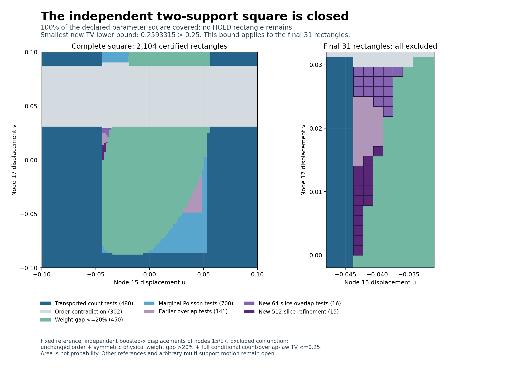

# Eigenzeit: complete independent two-support square exclusion

SPDX-License-Identifier: Apache-2.0

**All 31 remaining rectangles are excluded. No HOLD remains in the declared
node-15/node-17 independent boosted-x square [-0.1,0.1]^2.** The combined
certificate covers the same 2,104 closed rectangles as PR116, including their
shared boundaries. It is a result at one fixed rational reference in 2+1
Minkowski space, not a general stability theorem.

For admissible configurations in this square that preserve the selected-node
order, the result can be stated as the implication

$$
\operatorname{TV}(P_{u,v},P_{0,0})\le\tfrac14
\quad\Longrightarrow\quad
g(w_{u,v},w_{0,0})\le\tfrac15,
\qquad (u,v)\in[-\tfrac1{10},\tfrac1{10}]^2,
$$

where g is the inherited symmetric physical operator-weight gap and P is the
full conditional labelled count/overlap law. This does not assert that TV is
large at every point: the cover also includes order and small-gap exclusions,
and the origin has zero gap and zero TV.



## What closes the remaining region

| Frozen stage | Input rectangles | Overlap slices per law | Excluded | Remaining HOLD |
| --- | ---: | ---: | ---: | ---: |
| Complete the missing overlap tests | 16 | 64 | 16 | 0 |
| Refine the 15 prior unsuccessful events | 15 | 512 | 15 | 0 |

All new events use the same observed statistic
D=N(I(15,1))-N(I(17,1)), with its integer threshold determined by the inherited
geometry rule. The first stage uses thresholds 201, 202 and 203; the refinement
stage retains the earlier thresholds 198, 199 and 200. No threshold sweep or
anchor replacement is performed.

The smallest new full-law TV lower bound is
**0.25933153367707424545 > 0.25**, on rectangle `304/0/0`:
u in [-7/160,-27/640], v in [0,1/640]. Its earlier 64-slice bound was only
0.16958177833826598095. The smallest bound among the sixteen missing tests is
0.27037570876047471907. These minima apply to the newly excluded rectangles,
not to the entire square.

The fifteen old certificates had common-intensity slice widths around 3.4.
Subdividing each into eight narrows the artificial exclusive-rate rectangles.
The true unknown overlap remains fully covered; no midpoint estimate replaces
it. Original overlapping counts remain dependent. Only the disjoint exclusive
Poisson atoms are factored.

This adds exactly 31/409600 of excluded parameter area. Combined coverage is
**1/25 out of 1/25**, with excluded fraction **1** and HOLD area **0**. Area is
not a probability or a proportion of physically admissible configurations.

| Combined exclusion | Terminal rectangles |
| --- | ---: |
| Transported count-law tests | 480 |
| Order contradictions | 302 |
| Uniform weight gap <=20% | 450 |
| Marginal Poisson events | 700 |
| Overlap-dependent difference events | 172 |
| HOLD | 0 |
| **Total** | **2,104** |

## Scope and evidence

The exact experiment, reference geometry, observed labels and admissibility
gates are inherited from [the paired-surface proof](../paired_surface/THEOREM.md).
The [refinement proof](THEOREM.md), [contract](contract.json),
[pre-evaluation hashes](freeze.json) and [prior diagnosis](prior_diagnosis.json)
document the bounded change. The internal freeze was made after seeing the
parent results, before evaluating any new event probabilities; it is not an
external preregistration.

The archive contains 31 moved laws and six reference laws, covering 10,432
closed overlap-intensity slices. Reused reference laws require the same stage,
anchor and threshold; they are certificate reuse, not independent replicates.
All 2,073 previous exclusions are retained. There is no geometric subdivision,
new operator solve, additional marginal test or post-result budget extension.

**Validation passed:** full identical replay; 20,864 independent direct PMF
checks; 10,432 exclusive-rate rectangles; 37 complete overlap covers; 9,216
fine-rate containment checks across 18 refined laws; 32 whole-rectangle
virtual-subset checks and 160 direct reconstructed-point checks.

The independent audit checks complete source-tree coverage, exact quadratic
geometry, whole-rectangle virtual-subset bounds, exclusive-rate endpoints,
probability bounds by direct 110-digit exponential/factorial PMFs, complete
slice covers and containment of every fine rate rectangle in its coarse
parent. It also checks cache resolution and unchanged event selection, rejects
missing rectangles/slices, and exercises small-rate exact controls, zero rates
and a dependence counterexample. The rational geometry and directed integer
probability enclosures carry the proof; direct decimal PMFs are cross-checks.
Results are in [audit.json](audit.json) and [summary.json](summary.json).

## Reproduction

From the repository root, with the existing finite-Poisson requirements:

```bash
python -B research/lorentz_local_dalembert/surface_overlap_refinement/sor_run.py --verify
python -B research/lorentz_local_dalembert/surface_overlap_refinement/sor_audit.py --verify
sha256sum -c research/lorentz_local_dalembert/surface_overlap_refinement/SHA256SUMS
python tests/python/verify_manifest.py
```

`sor_plot.py` regenerates the derived coverage figure. A dedicated CI job
replays the certificates and independent audit. Frozen predecessor packages
remain unchanged; root navigation and manifests identify the latest result.

The next research extension requires a new declared family, for example a
third independently moving support with exact mixed geometry and a new
operator enclosure. This square does not establish arbitrary multi-support
stability, other-reference stability, a full A-selection/B-graph likelihood
claim or physical continuum accuracy. No strong close-law counterexample
has been constructed.
