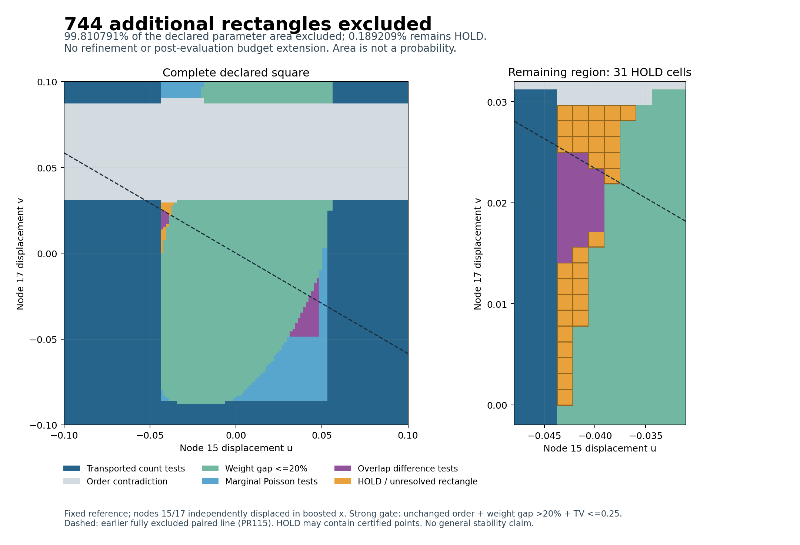

# Eigenzeit: all 744 previously untested surface rectangles excluded

**The excluded fraction of the fixed two-support parameter square rises from
95.269775390625% to 99.810791015625%. Exactly 31 previously tested rectangles
remain HOLD, occupying 0.189208984375% of the declared area.**

This extends the exact event coverage of PR116 without refining its geometry.
Node 15 and node 17 still move independently in boosted x with
(u,v) in [-0.1,0.1]^2 from the same reference. An exclusion rules out the
conjunction of unchanged selected-node order, symmetric physical operator-weight
gap >20%, and full conditional labelled count/overlap-law TV <=0.25.
These area fractions are parameter-space measures, not probabilities or
fractions of admissible geometries. General stability remains open.



The dashed line is the previously excluded fixed-ratio paired family. Its
result remains valid even within a HOLD rectangle. HOLD means no whole-rectangle
conclusion, not that every point in the rectangle is unclassified.

## Result of the frozen pass

| New test stage | Input rectangles | Newly excluded | Remaining from this stage |
|---|---:|---:|---:|
| Exact marginal Poisson events | 744 | 620 | 124 |
| Overlap-dependent count differences | 124 | 124 | 0 |

The marginal stage made 868 fixed-rule event attempts, using 60 distinct exact
certificates. Repeated identical mean enclosures share one certificate; these
are not independent statistical replicates. The overlap stage used eight
reference-law enclosures and 124 moved-law enclosures. Every law covers its
entire common-intensity range with 64 closed rational slices.

The weakest newly certified marginal TV lower bound is
**0.25033638866810490097 > 0.25**. The weakest new overlap lower bound is
**0.29187415338819837374 > 0.25**. These minima apply only to their newly
excluded rectangles, not the whole parameter square.

All 124 overlap events use the observed statistic

    D=N(I(15,1))-N(I(17,1)), D<=k,

with one integer k per rectangle selected by the frozen mean-based rule.
The common Poisson atom cancels exactly, but its unknown intensity still
changes the exclusive-atom laws. Full overlap slicing preserves this dependence;
the original interval counts are never assumed independent.

The contract allowed at most 128 overlap rectangles. Only 124 marginal failures
existed, so every one was tested. No post-result budget extension, threshold
search, extra anchor or geometric subdivision occurred. The other 31 parent
HOLD rectangles and all earlier exclusions were preserved byte-for-byte as
input evidence and unchanged as decisions.

## Combined status of the same 2,104 rectangles

| Classification | Rectangles |
|---|---:|
| Transported earlier count-law test | 480 |
| Order contradiction | 302 |
| Operator-weight gap at most 20% | 450 |
| Exact marginal Poisson test | 700 |
| Overlap-dependent difference test | 141 |
| HOLD | 31 |

The exact square area is 1/25; the remaining area is 31/409600. Thus the excluded
fraction is 16353/16384. The previous unresolved area decreases by 96%, from
775 to 31 equal-area HOLD rectangles. Full coverage is proved by reconstructing
the inherited quadtree and checking exact replacement paths, not by area sums
alone.

## Exact remaining region

Here u is node 15's displacement and v is node 17's. Each listed product uses
closed intervals; shared boundary points may already be excluded by adjacent
certificates. This table combines only adjacent remaining rectangles and does
not introduce a new classification.

| u interval | v intervals in the remaining region | Cells |
|---|---|---:|
| [-7/160, -27/640] | [0, 9/640] union [1/40, 19/640] | 12 |
| [-27/640, -13/320] | [1/128, 1/64] union [1/40, 19/640] | 8 |
| [-13/320, -5/128] | [1/64, 11/640] union [3/128, 19/640] | 5 |
| [-5/128, -3/80] | [7/320, 19/640] | 5 |
| [-3/80, -23/640] | [9/320, 19/640] | 1 |

Every remaining cell has side length 1/640. Sixteen have prior unsuccessful
marginal tests but no overlap event; fifteen also have a prior unsuccessful
overlap event. No remaining cell lacks an actual exact marginal event.
A useful next bounded step is to test the sixteen missing overlap events,
then separately freeze sharper tests or geometric refinement for any survivors.
The fifteen previously tested cases require a changed, explicitly declared
certificate strategy, not a claim that repetition alone resolves them.

## Independent audit and proof

The complete deterministic replay is identical. The independent audit reports
PASS with:

- 868 independently reconstructed event mean rectangles.
- 240 independent 100-digit marginal PMF checks for the 60 distinct certificates.
- 16,896 distinct independent 110-digit difference-law PMF checks.
- 8,448 exclusive-rate rectangles and 132 complete common-intensity covers.
- 125 whole-rectangle virtual-subset checks and 625 reconstructed-point checks.
- All 744 input paths accounted for, 1,360 other rectangles preserved, and the
  complete 2,104-rectangle square cover reconstructed.
- Rejection of a missing input rectangle, an incorrect cached-certificate
  identifier and a missing overlap slice in each of 132 law enclosures.
- Three exact small-mean factorial-series controls, a deterministic zero-rate
  check and a counterexample to independence of overlapping identical counts.

Certificates use exact rational geometry, directed 80-digit integer PMF bounds
and explicit infinite tails. Independent decimal PMFs are implementation
checks, not the proof. Their direct-sum cutoff is 4,096 for Poisson X with mean
at most 2,048; Markov applied to 2^X bounds omitted mass by
exp(2048)/2^4097 < 1e-330. This is negligible for the 110-digit audit and does
not modify the rigorous probability routine. See [THEOREM.md](THEOREM.md).

No close-law counterexample, general stability theorem, full A-selection/B-graph
likelihood or physical continuum-accuracy claim is established.

## Source, freeze and reproduction

Parent PR116: `c2af48b6210b24809959a2ffe6e50503308b9f85`, source tree
`571856c674370564a18c1c027b17b7023db69845`. All five parent CI workflows passed.
The scientific code, contract, proof and source inputs were internally hashed
before the first new event evaluation. Parent results were known; this is not
external preregistration. No scientific freeze amendment was needed.

From the repository root with Python 3.12 and the existing
`finite_poisson_bounds/requirements.txt` dependencies:

```sh
python3 -B research/lorentz_local_dalembert/surface_tail/sft_run.py --verify
python3 -B research/lorentz_local_dalembert/surface_tail/sft_audit.py --verify
sha256sum -c research/lorentz_local_dalembert/surface_tail/SHA256SUMS
python3 tests/python/verify_manifest.py
```

`certificates.json.gz` holds the shared marginal events, all 744 marginal-stage
rows, shared reference overlap laws and all 124 overlap-stage rows.
`summary.json` contains the combined classification and every remaining path
and rectangle. A dedicated CI job replays the package. `sft_plot.py` regenerates
the illustrative map with Matplotlib 3.10.8; the figure is not part of the proof.
