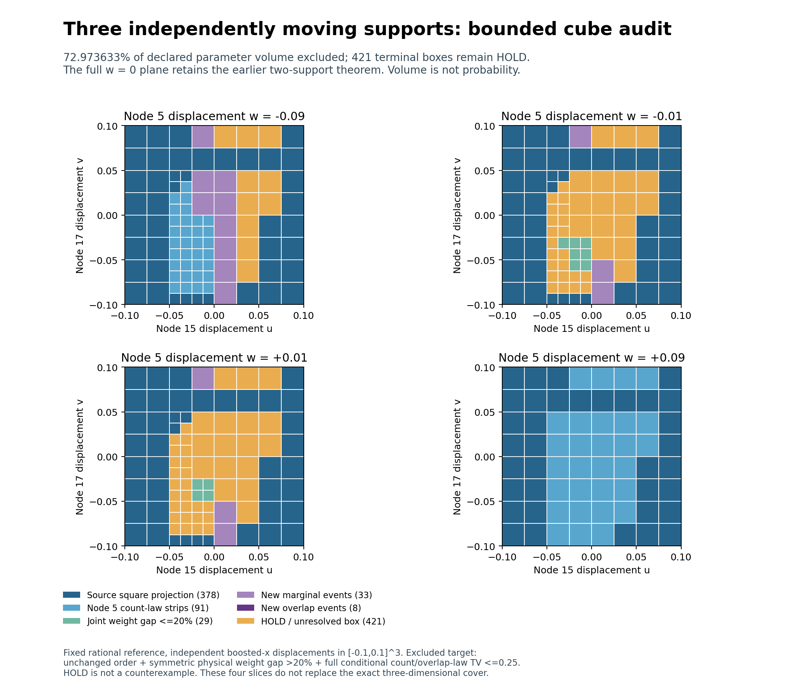

# Eigenzeit: first independent three-support cube certificate

SPDX-License-Identifier: Apache-2.0

**72.9736328125% of the declared three-parameter cube is excluded as a strong
close-law counterexample. 421 terminal boxes remain HOLD.** This first bounded
extension moves nodes 15, 17 and 5 independently in boosted x over [-0.1,0.1]^3,
at the same fixed rational reference in 2+1 Minkowski space. It does not close
the cube or establish general stability.

The target is unchanged selected-node order, inherited admissibility gates,
symmetric physical operator-weight gap >20%, and full conditional labelled
count/overlap-law TV<=0.25 simultaneously. An exclusion rules out this
conjunction on the certified box. HOLD does not establish a counterexample.



## New mathematical step

The two-support operator certificate has been extended to a **joint
rank-at-most-six update** with three independent variables. The 6x6 polynomial
system retains all mixed terms, including the coupling introduced by its
inverse. Exact algebra controls compare it with the direct nine-moment solve,
the full Gram expansion and exact polynomial shifts. A negative control shows
that adding three single-support weight changes gives a different answer.
All three moving-pair geometry cross terms are also verified exactly.

The new operator enclosure succeeds on all 555 evaluated boxes that reach
that stage. **29 terminal boxes have a certified symmetric weight gap <=20%.**
The other finite upper bounds do not exclude the strong-gap condition; an
upper bound above 20% is not proof of an actual gap above 20%.

Only source count-law events and order witnesses whose endpoints avoid node 5
are projected from the completed square. All 450 old square GAP exclusions
are omitted from this transport inventory. They remain valid on w=0, where
the complete PR118 square theorem still applies. A HOLD box can therefore
contain already excluded points.

## Frozen run and results

Node 5 was chosen as the smallest support index not in the previous pair;
there was no third-node optimization. The run uses 512 initial boxes, two
rounds of at most 32 eight-way splits, then at most 64 marginal-stage boxes
with two candidate events each and 16 overlap-stage boxes with one best
pair/anchor event each. The declared box budgets were used without extension; marginal attempts stop
at the first success.
There are 1,024 evaluated geometric boxes and 960 terminal boxes.

| Terminal decision | Boxes | Fraction of declared cube volume |
| --- | ---: | ---: |
| Safe projection from the completed square | 378 | 1169/2048 |
| Transported node 5 count-law strips | 91 | 147/2048 |
| Joint three-support weight gap <=20% | 29 | 29/4096 |
| New marginal Poisson events | 33 | 33/512 |
| New overlap-dependent difference events | 8 | 1/64 |
| HOLD | 421 | 1107/4096 |
| **Total** | **960** | **1** |

The excluded volume fraction is exactly **2989/4096**. Absolute HOLD volume
is **1107/512000**, out of total volume **1/125**. These are parameter volumes,
not probabilities or fractions of admissible physical configurations.

The marginal stage uses 95 attempts and 15 distinct cached certificates.
The overlap stage evaluates 16 moved laws and 9 shared reference laws, retaining
the dependence of original overlapping counts. Eight succeed and eight remain
HOLD. Smallest new exclusion bounds are **0.25476583621778221273** for marginal
events and **0.29309326011029208816** for overlap events. They apply only to
the corresponding newly excluded boxes.

## Remaining work

The [remaining-case inventory](remaining_diagnosis.json) separates:

- **398** HOLD boxes without a new exact count-event test;
- **15** with marginal tests only;
- **8** with an unsuccessful overlap test.

All 421 retain finite joint operator enclosures. Their gap upper bounds range
from 0.20108457126285764612 to 1.03089966480873599558; these are bounds, not
measured gaps. The next bounded stage should complete missing exact events,
then choose a separately declared refinement strategy for the tested failures.
The current budget is not extended after seeing these results.

## Proof, audit and reproduction

[THEOREM.md](THEOREM.md) derives the three-variable geometry, joint operator
formula, uniform Neumann bound, safe projection, correlation-preserving event
bounds and complete closed octree coverage. The [contract](contract.json),
[pre-evaluation hashes](freeze.json), [algebra controls](algebra.json),
[raw archive](certificates.json.gz), [summary](summary.json) and
[independent audit](audit.json) preserve the calculation and every HOLD.
The internal freeze occurred after the six declared algebra controls and
before the first cube classification or new event probability. Parent results
were known; this is not external preregistration.

**Validation passed:** complete identical replay; 215,040 independently
reconstructed q ranges; 619 direct weight-enclosure checks; 60 independent
100-digit marginal PMF checks; 2,560 independent 110-digit difference PMF
checks; 20 distinct complete overlap laws; and 42 closed projection covers.
All 421 HOLD boxes are retained.

The audit independently checks all 210 pairwise q ranges per evaluated box,
source dependencies and projection coverage by rational slabs, direct
nine-moment weights at every finite-enclosure center and corners of the first
eight such boxes, direct 100/110-digit Poisson PMFs, complete overlap covers,
wrong-cache and missing-cell/slice controls, and exact volume/state bookkeeping.
Point checks are diagnostics; exact uniform interval and integer bounds carry
the proof. Predecessor files remain unchanged.

From the repository root, with the existing finite-Poisson requirements:

```bash
python -B research/lorentz_local_dalembert/triple_cube/tc_algebra.py --verify
python -B research/lorentz_local_dalembert/triple_cube/tc_run.py --verify
python -B research/lorentz_local_dalembert/triple_cube/tc_audit.py --verify
sha256sum -c research/lorentz_local_dalembert/triple_cube/SHA256SUMS
python tests/python/verify_manifest.py
```

`tc_plot.py` regenerates four exact parameter slices of the final cover.
A dedicated CI job replays the package. The completed w=0 square is retained,
while the larger cube, arbitrary multi-support motion, other references and
general stability remain open. No full A-selection/B-graph likelihood,
physical continuum-accuracy or strong close-law-pair claim is made.
