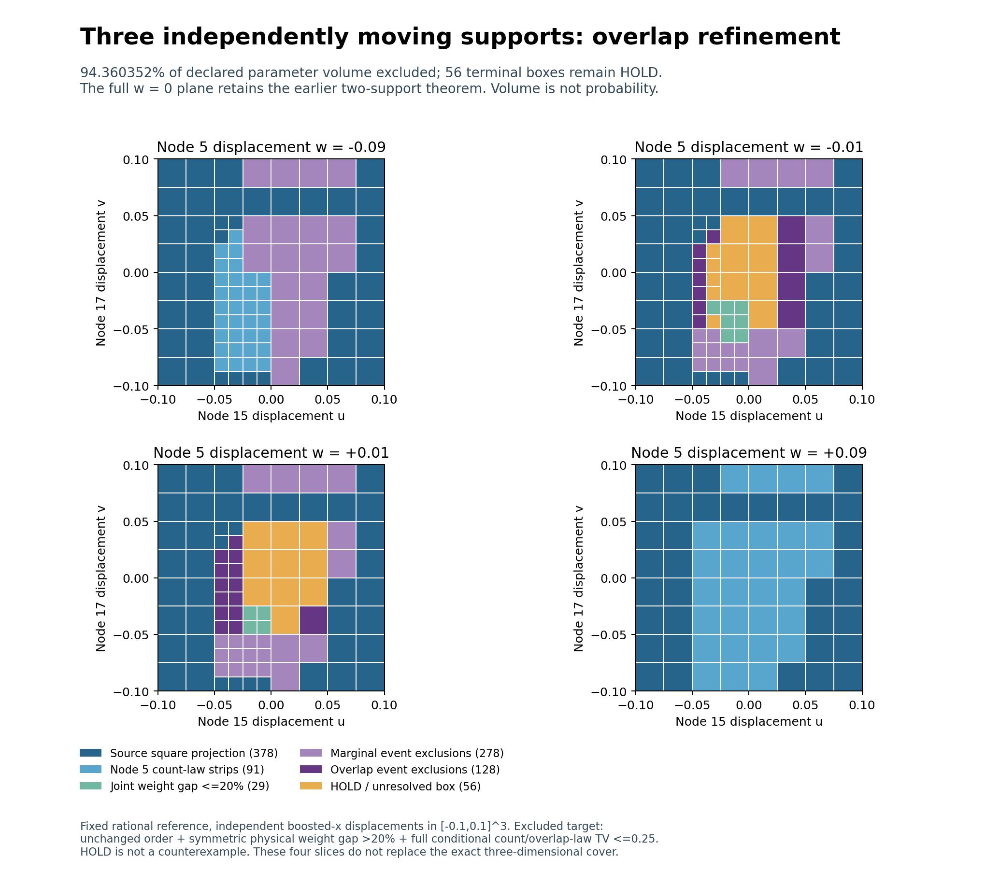

# Eigenzeit: fixed overlap refinement on the three-support cube

SPDX-License-Identifier: Apache-2.0

**22 more boxes are excluded; 56 remain HOLD.** Completing the missing
overlap tests and refining the unsuccessful tests from 64 to 512 intervals
raises the excluded fraction of the declared cube from 3787/4096 to
**3865/4096 = 94.3603515625%**. This closes the frozen two-stage pass.
The cube and general stability remain open.

Nodes 15, 17 and 5 move independently in boosted x over [-0.1,0.1]^3 at one
fixed rational reference in 2+1 Minkowski space. The excluded target is
unchanged selected-node order, inherited admissibility, symmetric physical
operator-weight gap >20%, and full conditional labelled count/overlap-law
TV<=0.25 simultaneously. Parameter volume is not probability. The complete
w=0 two-support theorem remains valid, including points inside HOLD boxes.



## Fixed selection and results

The [source pass](../triple_tail/README.md) left 78 HOLD boxes: 15 without an
overlap attempt and 63 with unsuccessful 64-slice tests. The first stage gives
all 15 missing cases one inherited highest-ranked pair/common-anchor event
with 64 closed overlap intervals. Seven succeed and eight remain HOLD.
The second stage refines all **71 remaining cases** once to 512 intervals,
within the predeclared maximum of 78. It excludes another 15.

Pair, anchor, event threshold, geometric box and operator bounds remain
unchanged during refinement. No additional event search, geometric split,
operator solve or post-result budget extension occurred. The original 960
closed terminal boxes and all 882 source exclusions are retained.

| Terminal decision | Boxes | Fraction of declared cube volume |
| --- | ---: | ---: |
| Safe projection from completed square | 378 | 1169/2048 |
| Transported node 5 count-law strips | 91 | 147/2048 |
| Joint physical weight gap <=20% | 29 | 29/4096 |
| Marginal Poisson events, including source | 278 | 433/2048 |
| Overlap-dependent events, including source | 128 | 169/2048 |
| HOLD | 56 | 231/4096 |
| **Total** | **960** | **1** |

The absolute HOLD volume falls from 309/512000 to **231/512000**, out of
total volume 1/125. Newly excluded volume is **39/256000**. The smallest new
full-law TV lower bound is **0.25191133982206410304**, strictly above 0.25.
It applies to the corresponding new exclusions, not uniformly to the cube.

All 86 comparisons enclose both reference and moved event probabilities.
The shared table contains 88 distinct laws: 17 at 64 slices and 71 at 512.
There are no probability-budget failures. Cache keys include stage, resolution,
pair, anchor, threshold and complete statistics; reuse is not independent
evidence. Original overlapping counts remain dependent. Only the disjoint
Poisson atoms used to compute their difference are independent.

## What the refinement establishes

Each refined interval is one of eight exact subintervals of a coarse one;
its exclusive-mean rectangle lies inside the coarse parent rectangle. The
71 distinct refined probability intervals are all narrower, with no endpoint
widening. Among the 71 event comparisons, **54 TV lower bounds improve and
17 remain equal**. Fifteen cross the exclusion threshold. These comparisons
use raw archived bounds; the new results were not silently intersected with
previous certificates.

The [remaining-case inventory](remaining_diagnosis.json) retains all 56 HOLD
paths, boxes, old/new TV bounds and inherited operator bounds. Every remaining
box has an enclosed 512-slice overlap test; no missing overlap tests remain.
Their event TV lower bounds range from 0 to 0.24184397298458467805. Their finite
operator gap upper bounds range from 0.20108457126285764612 to
0.62434265043254642603. Neither range establishes a strong close-law pair:
low TV lower bounds do not prove close laws, and high operator upper bounds
do not prove a strong actual gap.

The remaining fraction is **231/4096 = 5.6396484375%** of parameter volume.
Refining the overlap partition leaves the geometric marginal-mean rectangles
unchanged. The next separate stage should use a bounded subdivision of these
56 boxes and recompute joint operator and count-law enclosures on the smaller
boxes. One octree split per remaining box would produce 448 children while
preserving all 904 existing exclusions; its event and refinement budgets
must be frozen before evaluation. This is not included in the present result;
every unresolved box is retained and HOLD is not a counterexample.

## Proof, audit and reproduction

[THEOREM.md](THEOREM.md) gives the uniform dependent-count event bound, nested
slice argument and safe replacement rule. The [contract](contract.json),
[pre-evaluation hashes](freeze.json), [archive-part inventory](archive_parts.json),
[summary](summary.json) and [independent audit](audit.json) retain the evidence.
The internal freeze contains 58 files and predates new event evaluation.
Source results were known; this is not external preregistration.

The 15,861,651-byte gzip certificate archive is stored in three transport
parts. `assemble.py` verifies each part and the complete SHA-256 digest before
recreating `certificates.json.gz` byte for byte. This post-run packaging change
does not alter the frozen scientific implementation, data or results. The
assembled file is a local derived copy; all parts and assembly instructions
are versioned. Package checksum verification follows assembly.

**Validation passed:** full deterministic replay with identical results;
**74,862 independent 110-digit difference PMF checks**; 37,440 exclusive-rate
rectangles; 88 complete overlap laws; 71 exact fine/coarse law nesting checks
covering 36,352 refined rectangles; 71 unchanged-event checks; 86 uniform
virtual-subset checks and 774 point checks. The complete 960-box closed cover,
all 882 source exclusions and all 56 final HOLD boxes are retained.

The audit verifies all closed overlap slices, uniform virtual subsets,
unchanged event identities, both cache lookups, fine/coarse rectangle nesting,
source coverage and exact volume bookkeeping. Missing-input, missing-slice,
wrong-cache and wrong-resolution controls are included, together with
small-mean, zero-rate and dependence checks. Direct decimal and point checks
are diagnostics; exact uniform interval and integer certificates carry the
exclusions. The source operator proof remains unchanged.

From the repository root, with the existing finite-Poisson requirements:

```bash
python -B research/lorentz_local_dalembert/triple_overlap_refinement/assemble.py
python -B research/lorentz_local_dalembert/triple_overlap_refinement/tor_run.py --verify
python -B research/lorentz_local_dalembert/triple_overlap_refinement/tor_audit.py --verify
sha256sum -c research/lorentz_local_dalembert/triple_overlap_refinement/SHA256SUMS
python tests/python/verify_manifest.py
```

`tor_plot.py` regenerates four exact parameter slices. A dedicated CI job
replays this package. Parent PR120 completed all five workflow runs
successfully. All predecessor scientific files remain unchanged.

This is a conditional count/overlap experiment, not the full A-selection/
B-graph likelihood. There is no general stability theorem, physical
continuum-accuracy claim or strong close-law-pair claim.
