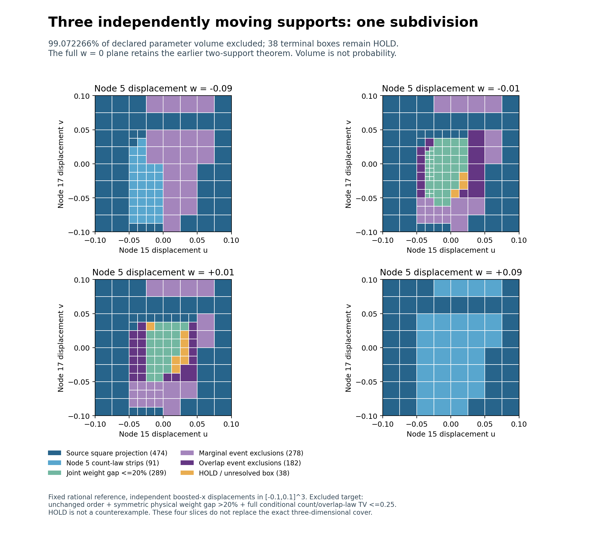

# Eigenzeit: one subdivision of the remaining three-support region

SPDX-License-Identifier: Apache-2.0

**410 of 448 new children are excluded; 38 remain HOLD.** One predeclared
octree subdivision of all 56 source HOLD boxes increases certified coverage
from 3865/4096 to **2029/2048 = 99.072265625% of the declared parameter volume**.
The final closed cover has 1,352 terminal boxes. The cube and general stability
remain open.

The experiment moves nodes 15, 17 and 5 independently in boosted x over
[-0.1,0.1]^3 at one fixed rational reference in 2+1 Minkowski space. The excluded
target is unchanged selected-node order, inherited admissibility, symmetric
physical operator-weight gap >20%, and full conditional labelled count/overlap-law
TV<=0.25 simultaneously. Volume is not probability. The completed w=0 square
theorem remains valid, including points inside currently HOLD boxes.



## Frozen subdivision and result

The [source overlap refinement](../triple_overlap_refinement/README.md) left
56 HOLD boxes and 904 exclusions. All 56 HOLD boxes are split once at their
three rational midpoints; all 448 closed children are evaluated. The 904 source
exclusion records remain unchanged. There is no second subdivision round.

The inherited gate sequence first checks safe source-square projections,
node 5 count-law strips, whole-box order contradictions and the joint operator
bound. It excludes **96 children by projection** and **260 by weight gap<=20%**.
Every one of the 92 remaining children receives two geometry-ranked marginal
events, then one highest-ranked pair/common-anchor event at the inherited
512-slice overlap resolution. The marginal stage excludes none; the overlap
stage excludes **54**. All stage cell budgets are 448, so no pending child is
truncated. There is no post-result event retuning or budget extension.

| Terminal decision | Boxes | Fraction of declared cube volume |
| --- | ---: | ---: |
| Safe projection from completed square | 474 | 4749/8192 |
| Transported node 5 count-law strips | 91 | 147/2048 |
| Joint physical weight gap <=20% | 289 | 277/8192 |
| Marginal Poisson events, inherited | 278 | 433/2048 |
| Overlap-dependent events, including source | 182 | 385/4096 |
| HOLD | 38 | 19/2048 |
| **Total** | **1352** | **1** |

Absolute HOLD volume falls from 231/512000 to **19/256000**, out of total
volume 1/125. Newly excluded volume is **193/512000**. Parent and child counts
have different granularity; exact parameter volume measures the coverage gain.
**43 of the 56 source parents close completely**; the remaining 38 children
belong to 13 parents.

All 352 children reaching the joint operator stage have finite enclosures;
none fail the rank or Neumann-bound check. Every new gap upper bound is tighter
than its corresponding source-parent bound. All three moving columns and their
mixed terms are handled jointly, using the inherited rank-at-most-six formula.

There are 184 marginal attempts with 27 distinct certificates and 92 overlap
comparisons with 71 distinct laws. Every event probability is enclosed, without
precondition or probability-budget failures. The smallest new overlap exclusion
bound is **0.25191133982206410304 >0.25**, applying only to the corresponding new
exclusions, not uniformly to the cube. The original overlapping counts remain
dependent; only their disjoint Poisson atoms are independent. Cache reuse is
not independent evidence.

## Remaining region

The [per-box inventory](remaining_diagnosis.json) preserves all 38 open paths,
their parent paths, exact boxes, old/new operator bounds and event lower bounds.
Each open box has volume 1/512000, a finite joint operator enclosure and both
marginal and 512-slice overlap tests. Their operator gap upper bounds range
from 0.20327649515486319458 to 0.34625211965442395001; their overlap-event TV
lower bounds range from 0 to 0.24774070608103893000.

These values do not establish a strong close-law pair. A gap upper bound above
20% does not prove a strong actual gap, and a TV lower bound below 0.25 does
not prove that the full laws are close. HOLD is unresolved. The remaining
volume fraction is **19/2048 = 0.927734375%**, not a probability.

A next separately frozen subdivision of all 38 current HOLD boxes would yield
304 children while retaining the 1,314 existing exclusions. Joint operator and
count-law bounds would then need re-evaluation on those children. No such
additional evaluations are included here.

## Proof, audit and reproduction

[THEOREM.md](THEOREM.md) states the geometry, joint operator, event and closed
coverage arguments. The [contract](contract.json), [pre-evaluation hashes](freeze.json),
[archive-part inventory](archive_parts.json), [summary](summary.json) and
[independent audit](audit.json) preserve the evidence. The internal freeze
contains 66 files and predates the first new child classification or event
evaluation. Source results were known; this is not external preregistration.

The independent audit passes: **94,080 exact pairwise ranges**, **416 direct
weight-enclosure checks**, **108 marginal PMF checks** and **72,704 difference
PMF checks** across 36,352 exclusive-rate rectangles. All negative controls
pass. A complete deterministic replay reproduces the archive and summary
exactly. These are independent diagnostic checks plus reproducibility, not
independent scientific replications.

The audit reconstructs the source closed cover and every child box independently,
checks all 210 pairwise interval ranges per child, direct nine-moment weight
solves at every finite-enclosure center and the eight corners of the first
eight such children, rational projection covers, event identities and complete
overlap slices. Missing-child, wrong-boundary, missing-stage-input/slice and
wrong-cache controls are included, together with small-mean, zero-rate and
dependence checks. Decimal and point checks are diagnostics; uniform exact
interval and integer certificates carry the exclusions.

The 15,516,610-byte gzip archive is versioned in three transport parts.
`assemble.py` verifies part and whole SHA-256 digests and recreates the original
archive byte for byte. A fresh-output assembly round trip is checked. The
source PR121 archive is likewise reconstructed and verified automatically by
the scientific entry points. Packaging does not alter the scientific freeze.

From the repository root, with the existing finite-Poisson requirements:

```bash
python -B research/lorentz_local_dalembert/triple_subdivision/assemble.py
python -B research/lorentz_local_dalembert/triple_subdivision/tsd_run.py --verify
python -B research/lorentz_local_dalembert/triple_subdivision/tsd_audit.py --verify
sha256sum -c research/lorentz_local_dalembert/triple_subdivision/SHA256SUMS
python tests/python/verify_manifest.py
```

`tsd_plot.py` regenerates four exact parameter slices. A dedicated CI job
assembles, replays and audits this package. All predecessor scientific files
remain unchanged.

This is a conditional count/overlap experiment, not the full A-selection/
B-graph likelihood. No claim of arbitrary-motion stability, physical continuum
accuracy or a strong close-law pair is made.
