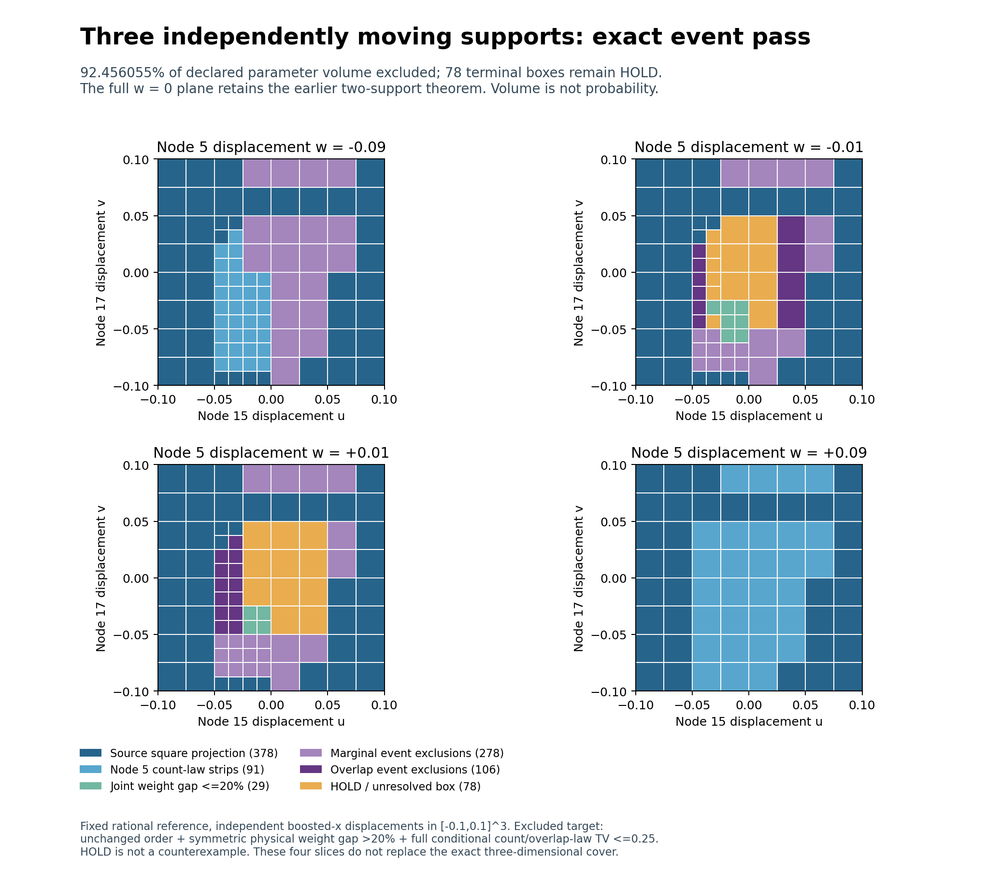

# Eigenzeit: complete missing-event pass on the three-support cube

SPDX-License-Identifier: Apache-2.0

**343 more boxes are excluded; 78 remain HOLD.** All 398 previously untested
source HOLD boxes received enclosed marginal probabilities. The excluded
fraction of the declared three-parameter cube rises from **2989/4096** to
**3787/4096 = 92.4560546875%**. This completes the frozen missing-event pass,
not the cube or a general stability proof.

The experiment moves nodes 15, 17 and 5 independently in boosted x over
[-0.1,0.1]^3 at the same fixed rational reference in 2+1 Minkowski space.
The excluded target is unchanged selected-node order, inherited admissibility,
symmetric physical operator-weight gap >20%, and full conditional labelled
count/overlap-law TV<=0.25 simultaneously. The full w=0 two-support theorem
remains valid. Parameter volume is not probability.



## Frozen run and result

The source [three-support certificate](../triple_cube/README.md) has 960
terminal boxes, 539 exclusions and 421 HOLD boxes. This pass preserves every
source box, all 539 exclusions and the 23 HOLD records already tested there.
It evaluates the remaining 398 in numeric octree-path order, with at most
two inherited geometry-ranked marginal events each. It stops each marginal
sequence at its first exclusion. Every remaining input receives one inherited
highest-ranked pair/common-anchor event with 64 closed overlap slices.
The predeclared overlap budget is 398; all 153 actual remaining inputs fit.
No geometry splitting, new operator solve, event retuning or budget extension
occurred after results.

| Terminal decision | Boxes | Fraction of declared cube volume |
| --- | ---: | ---: |
| Safe projection from completed square | 378 | 1169/2048 |
| Transported node 5 count-law strips | 91 | 147/2048 |
| Joint physical weight gap <=20% | 29 | 29/4096 |
| Marginal Poisson events, including source | 278 | 433/2048 |
| Overlap-dependent events, including source | 106 | 65/1024 |
| HOLD | 78 | 309/4096 |
| **Total** | **960** | **1** |

This pass adds **245 marginal exclusions** and **98 overlap exclusions**.
The absolute HOLD volume falls from 1107/512000 to **309/512000**, out of a
total cube volume of 1/125. The smallest new exclusion bounds are
**0.25476583621778221273** for marginal events and
**0.29875683212172098597** for overlap events. These bounds apply only to their
corresponding newly excluded boxes, not uniformly to the whole cube.

There are 551 marginal attempts, 35 distinct cached marginal certificates,
and 153 overlap comparisons using 106 distinct cached laws. Every input has
an enclosed marginal event; both laws are enclosed in every overlap comparison.
There are no precondition skips or probability-budget failures in this run.
Reference and moved laws share an exact cache keyed by pair, anchor, threshold
and the complete statistics record. Cache reuse is not independent replication.
Original overlapping counts remain dependent; independence is used only for
the disjoint Poisson atoms in the count difference.

## The 78 remaining boxes

The [remaining-case inventory](remaining_diagnosis.json) lists every path,
box, inherited gap upper bound and attempted-event lower bound:

- **15 preserved source boxes** have marginal tests but no overlap attempt.
- **8 preserved source boxes** have unsuccessful 64-slice overlap tests.
- **55 newly tested boxes** remain unresolved after both stages.

All 78 retain finite joint operator enclosures, with gap upper bounds ranging
from 0.20108457126285764612 to 0.62434265043254642603. A bound above 20% does
not prove an actual gap above 20%. The 63 attempted overlap-event lower bounds
range from 0 to 0.24683135235983283291; being below 0.25 does not prove that
the full laws are close. HOLD is unresolved, not a counterexample.

The next separately frozen pass can give the 15 missing cases their overlap
test and refine the 63 failed overlap enclosures. If probability refinement
does not suffice, a later geometric subdivision can tighten the joint
operator and intensity ranges. No such additional evaluations are included
in this result. The remaining region is 7.5439453125% of parameter volume;
its boxes can contain already certified points, including the w=0 plane.

## Proof, audit and reproduction

[THEOREM.md](THEOREM.md) states the uniform event bounds and safe replacement
argument. The [contract](contract.json), [pre-evaluation hashes](freeze.json),
[raw certificates](certificates.json.gz), [summary](summary.json) and
[independent audit](audit.json) preserve the calculation. The internal freeze
contains 54 files and predates the first new event evaluation. Source outcomes
were already known; this is not external preregistration.

**Validation passed:** full deterministic replay with identical results;
independent reconstruction of the inherited 960-box closed cover; 551 event
mean rectangles; 140 direct 100-digit marginal PMF checks; **13,568 direct
110-digit difference PMF checks**; 6,784 exclusive-rate rectangles; 106 complete
overlap laws; 161 uniform virtual-subset checks and 1,449 point checks.
Missing-input, missing-slice, wrong-cache, small-mean, zero-rate and dependence
controls pass. All 539 source exclusions, 23 previously tested HOLD records
and 78 final HOLD boxes are retained. Independent decimal and point checks
are diagnostics; exact uniform interval and integer certificates carry the
exclusions. The source operator audit is inherited unchanged, not rerun here.

From the repository root, with the existing finite-Poisson requirements:

```bash
python -B research/lorentz_local_dalembert/triple_tail/tt_run.py --verify
python -B research/lorentz_local_dalembert/triple_tail/tt_audit.py --verify
sha256sum -c research/lorentz_local_dalembert/triple_tail/SHA256SUMS
python tests/python/verify_manifest.py
```

`tt_plot.py` regenerates four exact slices of the final cover. A dedicated CI
job replays and audits this package. Parent PR119 completed all five workflow
runs successfully. Predecessor scientific files remain unchanged.

The cube, arbitrary multi-support motion, other references and general
stability remain open. This is a conditional count/overlap experiment, not
the full A-selection/B-graph likelihood. No physical continuum-accuracy or
strong close-law-pair claim is made.
