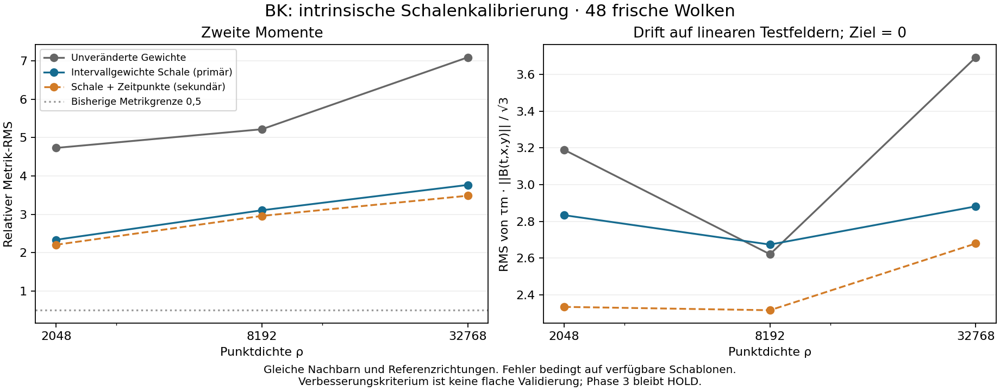

# Eigenzeit / BK: intrinsische Intervallgewichte für die Schalen

**Ergebnis: `INTRINSIC_SHELL_WEIGHTING_IMPROVED`; weiterhin `HOLD_PHASE3`.**
Der primäre Kandidat benutzt ausschliesslich die Kausalordnung und bekannte
Dichte. Auf 48 neuen Testwolken werden fünf festgelegte Arme verglichen.
Bei höchster Dichte verändert die reine Schalengewichtung den relativen
Metrik-RMS von **7.089 auf 3.765** und die normierte
affine Drift von **3.692 auf 2.882**.
Die fachliche Bewertung folgt allen vorab festgelegten Kriterien gemeinsam.

## Vom Koordinatenexperiment zum intrinsischen Kandidaten

Für jeden ausgewählten Nachbarn b wird die Zahl N der Ereignisse im strikten
kausalen Intervall zwischen Wurzel und b gezählt. Die Eigenzeitschätzung lautet

    qhat_b = [12 N / (pi rho)]^(1/3).

Der primäre Arm ersetzt das gemeinsame Schalengewicht C/(N_Seite tm²) durch
C/(N_Seite qhat_b²). Die beiden Zeitstützpunkte behalten ihre bisherigen Gewichte.
Ein sekundärer Arm verwendet auch für diese Punkte Intervallzeiten. Zwei
Koordinatenkontrollen setzen stattdessen exakte Eigenzeiten ein.

Nachbarn, Referenzrichtungen, Wurzel, Kettenskalen und C bleiben unverändert.
Die Kandidaten erhalten keine Koordinaten oder Testfelder; diese dienen nur
Bewertung und ausdrücklich bezeichneten Oracle-Armen. Die Intervalle stammen
aus bereits ausgewählten Kettenschalen. Der Volumenschätzer ist deshalb nicht
als unverzerrt für diese bedingte Auswahl ausgewiesen. Nullzählungen führen zu
nicht verfügbaren Schablonen; es gibt keine Pseudozählung oder Untergrenze.

Die Oracle-Metriken stimmen mit den S/TS-Momentenkontrollen des vorherigen
Audits überein. Für allgemeine Felder sind das hier jedoch regewichtete
Operatoren auf den ursprünglichen Punkten; die früheren künstlich verschobenen
Koordinatenvektoren waren nur Momentendiagnostik.

## Vorab festgelegt und vollständig ausgeführt

- Öffentliches Protokoll: `ad952930c1251750127505cc6939fdaf0aef9158`.
- Öffentlicher Quellen- und Analysefreeze: `457ec4a3275d91117d9f771cf8f3bbe781a19eca`.
- Sechs Entwicklungswolken; danach 48 separate neue Wolken, je 16 bei drei Dichten.
- Keine nachträgliche Parameterauswahl, Seed-Ersetzung oder Auswahl des Sekundärarms.
- Laufzeit 126.12 Sekunden, Spitzen-RSS 389.2 MiB;
  Grenzen 600 Sekunden und 2048 MiB.
- Vollständiger lokaler Replay aller 48 Wolken, dokumentiert in
  [VERIFICATION.json](VERIFICATION.json). Numerischer Replay und Koordinaten-
  Bytehashgleichheit werden getrennt berichtet. GitHub-Ergebnisse stehen im PR;
  plattformübergreifende Bitidentität wird nicht vorausgesetzt.

[Protokoll](PROTOCOL.md), [Vertrag](contract.json), [Umsetzung](IMPLEMENTATION.md),
[Entwicklungsdaten](development/summary.json), [Testquellen und Rohdaten](results/execution.json),
[vollständige Auswertung](results/summary.json).

## Alle Vergleichsarme und Dichten

| Dichte | Gewichtung | Verwendbar | Metrik-RMS | Affine Drift-RMS | Richtige Signatur |
| --- | --- | --- | --- | --- | --- |
| 2048 | Unveränderte Gewichte | 8/16 | 4.729 | 3.189 | 4/16 |
| 2048 | Intervallgewichte Schale (primär) | 8/16 | 2.336 | 2.834 | 6/16 |
| 2048 | Intervallgewichte Schale + Zeitpunkte | 8/16 | 2.206 | 2.335 | 6/16 |
| 2048 | Exakte Eigenzeiten Schale* | 8/16 | 2.753 | 3.629 | 6/16 |
| 2048 | Exakte Eigenzeiten Schale + Zeitpunkte* | 8/16 | 2.673 | 2.710 | 8/16 |
| 8192 | Unveränderte Gewichte | 16/16 | 5.216 | 2.621 | 7/16 |
| 8192 | Intervallgewichte Schale (primär) | 16/16 | 3.105 | 2.674 | 12/16 |
| 8192 | Intervallgewichte Schale + Zeitpunkte | 16/16 | 2.958 | 2.317 | 13/16 |
| 8192 | Exakte Eigenzeiten Schale* | 16/16 | 3.994 | 4.093 | 12/16 |
| 8192 | Exakte Eigenzeiten Schale + Zeitpunkte* | 16/16 | 3.642 | 3.307 | 12/16 |
| 32768 | Unveränderte Gewichte | 16/16 | 7.089 | 3.692 | 1/16 |
| 32768 | Intervallgewichte Schale (primär) | 16/16 | 3.765 | 2.882 | 8/16 |
| 32768 | Intervallgewichte Schale + Zeitpunkte | 16/16 | 3.483 | 2.680 | 8/16 |
| 32768 | Exakte Eigenzeiten Schale* | 16/16 | 3.951 | 3.169 | 9/16 |
| 32768 | Exakte Eigenzeiten Schale + Zeitpunkte* | 16/16 | 3.589 | 2.918 | 11/16 |

*Die Koordinatenkontrollen verwenden exakte **Eigenzeiten**, keine exakte
Nachbarauswahl. Alle fünf Arme behalten dieselbe intrinsische Nachbarauswahl.
Sie sind keine theoretischen Fehleruntergrenzen. RMS-Werte sind bedingt auf
verfügbare Schablonen; Verfügbarkeit und Signatur verwenden alle 16 Wolken
als Nenner. Paarvergleiche verwenden die Schnittmenge verfügbarer Fälle.

Die affine Drift ist tm · ||B(t,x,y)|| / sqrt(3), ihr Zielwert ist null.
Zusätzlich stehen der dimensionale Vektor B(t,x,y) und seine Norm in den
Rohdaten. Ein kleiner normierter Wert allein wäre kein Konvergenzbeweis.
Die Fehlernormen beziehen sich auf das ursprüngliche Diamant-Koordinatensystem.
Die unveränderte absolute Metrikgrenze beträgt 0,5.

## Primärentscheid bei Dichte 32768

| Vorab festgelegtes Kriterium | Gemessen | Grenze | Ergebnis |
| --- | --- | --- | --- |
| Verfügbarkeit | 1.000 | ≥ 0,8 | PASS |
| Metrik-RMS / Roh-RMS | 0.531 | ≤ 0,75 | PASS |
| Affine Drift / Roh-Drift | 0.780 | ≤ 1,10 | PASS |

Vollständigkeit, Ressourcen und Softwarekontrollen bestehen. Der gemeinsame
Entscheid lautet `INTRINSIC_SHELL_WEIGHTING_IMPROVED`. Die Schwellen sind deskriptive
Pilotkriterien, keine statistisch zertifizierte Nichtunterlegenheit.

Die gepaarte Reduktion des quadrierten Fehlers (positiv = Verbesserung):

| Messgrösse | Mittel | Standardfehler | Unabhängige Wolken |
| --- | --- | --- | --- |
| Metrik | 36.076 | 4.027 | 16 |
| Affine Drift | 5.329 | 2.113 | 16 |

Die geschätzte Schaleneigenzeit relativ zur exakten Eigenzeit beträgt bei hoher
Dichte im Mittel **1.011 ± 0.008**
(Standardfehler über Wolken). Der mittlere relative quadratische Zeitfehler
beträgt 0.008. Pro ausgewähltem Intervall liegen im
Wolkenmittel 20.160 innere Ereignisse vor. Diese Statistiken
behandeln einzelne Punkte innerhalb derselben Wolke nicht als unabhängig.

## Feldantworten bei höchster Dichte

| Feld | Sollwert von B am Zentrum | Rohgewichte: Fehler-RMS | Schale: Fehler-RMS | Schale + Zeit: Fehler-RMS |
| --- | --- | --- | --- | --- |
| constant | 0.0 | 0.000 | 0.000 | 0.000 |
| t | 0.0 | 10.724 | 20.573 | 14.364 |
| x | 0.0 | 36.316 | 25.578 | 25.273 |
| y | 0.0 | 43.781 | 31.041 | 30.334 |
| tt | -2.0 | 19.297 | 7.794 | 6.399 |
| xx | 2.0 | 5.672 | 3.176 | 3.142 |
| yy | 2.0 | 5.884 | 3.629 | 3.578 |
| tx | 0.0 | 6.041 | 4.305 | 4.171 |
| ty | 0.0 | 6.417 | 4.756 | 4.655 |
| xy | 0.0 | 2.056 | 1.372 | 1.388 |
| exp | 1.0 | 64.947 | 54.037 | 46.397 |

Hier ist exp = exp(t+x+y) mit Sollwert 1. Konstante Felder liefern konstruktiv
null; dieser Test allein ist kein geometrischer Qualitätsnachweis. Die linearen
Felder prüfen den ersten Moment, die quadratischen den zweiten. Alle Oracle-
Feldantworten und die übrigen Dichten stehen ebenfalls in summary.json.

## Grenzen und nächste Entscheidung

Eine kleinere Metrikabweichung genügt nicht zur Abnahme des gesamten Operators.
Die ursprünglichen Feld-, Signatur-, Karten- und Dichtekriterien werden durch
diesen Versuch nicht ersetzt. Keine Krümmungsauswertung wird begonnen.

Bei höchster Dichte verbessert sich die richtige Lorentz-Signatur von 1/16 auf
8/16; verlangt waren im ursprünglichen Pilot mindestens 90%. Die mittlere
Antwort auf t² beträgt weiterhin +5,152 statt −2. Der verbleibende Fehler ist
somit geometrisch erheblich. Der Kandidaten-Metrik-RMS steigt über die drei
Dichten 2,336 → 3,105 → 3,765; wegen der unterschiedlichen Verfügbarkeit sind
auch diese bedingten Werte vorsichtig zu vergleichen. Eine Konvergenz ist nicht
belegt. Bekannte Dichte und flache 2+1-Geometrie bleiben Voraussetzungen.

Der primäre Kandidat besteht den begrenzten Verbesserungsvergleich. Er bleibt
ein Entwicklungskandidat. Als nächster eigenständiger Versuch sind gemeinsame
Referenzrichtungen aus der Kausalordnung und die verbleibenden Winkel- und
Randbeiträge zu untersuchen. Dafür braucht es erneut einen öffentlichen Vertrag
und frische Testdaten. Der sekundäre Arm wird vollständig berichtet, aber nicht
nachträglich zum Sieger dieses Primärvergleichs erklärt.

Die Softwarekontrollen umfassen Handzählungen, explizite Gewichtformeln,
Dichteskalierung, Zeitumkehr, Umnummerierung, Nullzählung und mehrfache
Stützpunktbeiträge. Jede verfügbare Schablone besteht Konstanten-, Produkt- und
affine Tensorprüfungen. Frühere Phase-1/2-, Ankersuch-, Momenten- und BD-C2-Dateien
sind unverändert; BD-C2 `NO_GO` gilt weiter. Keine beendeten Hintergrundläufe
wurden neu gestartet.
