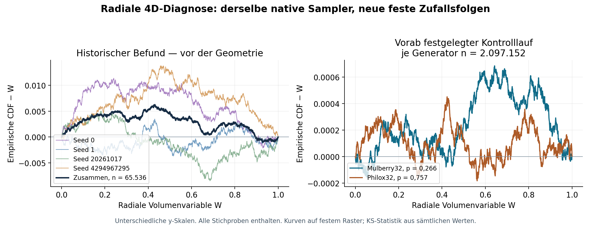

# Radiale 4D-Auffälligkeit: Diagnose und fester Kontrollversuch

**21.10.2026 — Diagnose abgeschlossen; im festgelegten Kontrollversuch keine erneute systematische Auffälligkeit festgestellt.**

**Der historische V1b-Status bleibt `NOT_PASSED`.** Der alte radiale Test bleibt
`FAIL`; weder seine Daten noch seine Schwelle wurden geändert. Der neue Status
`NO_DISCREPANCY_DETECTED_IN_FIXED_FOLLOWUP` bezeichnet ausschließlich diesen
Folgeversuch. Er ist keine nachträgliche V1b-Freigabe und kein Beweis der
Zufallsqualität aller Seeds.

## 1. Wo entsteht der alte Befund?

Untersucht wurde der veröffentlichte Quellstand
`305a882d7c307a0f8e17ce3e18c23609376bd202`. Alle 18 Prüfsummen des ursprünglichen
Browser-/Exportarchivs wurden vor der Untersuchung bestätigt. Seine 65.536
4D-Punkte wurden mit der unveränderten nativen `samplePoint()`-Funktion exakt
reproduziert; zusätzlich wurden die tatsächlich verbrauchten radialen
Zufallswerte aufgezeichnet.

Für den Sampler gilt im idealen Modell mit drei Raumdimensionen:

\[
r=A U_r^{1/3},\qquad W=(r/A)^3=U_r.
\]

Die Richtungsnormierung kann den Radius im exakten Rechnen nicht verändern.
Der entscheidende Vergleich ist deshalb zwischen dem radialen Eingabewert
und dem aus den fertigen Koordinaten rekonstruierten W.

| Historischer Vergleich | KS-Abstand D | p-Wert |
|---|---:|---:|
| Radiale Zufallswerte vor der Geometrie | 0,006294515682384372 | 0,01106164503413279 |
| W aus den gespeicherten Koordinaten | 0,006294515682384372 | 0,01106164503413279 |

Beide Ergebnisse stimmen exakt überein. Der größte punktweise Unterschied
zwischen Eingabe und rekonstruiertem W beträgt lediglich
`3.774758283725532e-15`. Eine separate 80-stellige Decimal-Auswertung der
größten Abweichungen und ausgewählter Rand-/KS-Punkte bestätigt die
Rundungsgrößenordnung. Außerdem wurde die KS-Statistik direkt aus der
geordneten empirischen Verteilungsfunktion nachgerechnet.

**Damit liegt die beobachtete Abweichung bereits in der endlichen radialen
Teilstichprobe des PRNG.** Geometrische Transformation, Normalrichtung,
Portierung, Randverwerfung und Rundung erzeugen diesen Befund nicht. Im alten
Datensatz fanden keine Verwerfungen statt. Das beweist allein noch keinen
systematischen Fehler des PRNG.

Die nachträgliche Aufteilung der bekannten Daten ist rein diagnostisch:

| Alter Seed | n | Radialer p-Wert |
|---|---:|---:|
| 0 | 16.384 | 0,0272340 |
| 1 | 16.384 | 0,9667184 |
| 20261017 | 16.384 | 0,1825197 |
| 4294967295 | 16.384 | 0,0034720 |

Insbesondere die Seeds 0 und 4294967295 tragen zur Häufung kleiner radialer
Werte bei. Diese Aufteilung wurde erst nach Kenntnis des Befunds untersucht;
ihre p-Werte sind keine unabhängigen Bestätigungstests.

## 2. Vorab festgelegter neuer Vergleich

[Protokoll](protocol.json), [nativer Beobachter](trace.cjs) und
[Kontrollrunner](run_control.py) wurden vor der Erzeugung neuer Stichproben
öffentlich als Commit
[`cfcea64a376d66f080130e29ecc04a0fe8d05c07`](https://github.com/thomasmgfeller/x6-spectral-astrolabium/commit/cfcea64a376d66f080130e29ecc04a0fe8d05c07)
festgeschrieben.

- Zwei Arme: unverändertes Mulberry32 und NumPy Philox, jeweils injiziert in
  dieselbe unveränderte JavaScript-`samplePoint()`-Funktion.
- Philox liefert die oberen 32 Bits seiner 64-Bit-Ausgabe, geteilt durch
  2^32. Beide Arme verwenden damit dasselbe endliche Uniformraster.
- Je Arm 32 feste Batches mit vier Streams zu je 16.384 Punkten:
  **2.097.152 Punkte je Arm, 4.194.304 insgesamt**.
- SHA-256-abgeleitete Seeds und unterschiedliche Philox-Schlüssel. Native
  Zustandsfenster werden auf Überlappung untereinander und mit den alten
  Seeds geprüft, ohne Ausgaben zu betrachten. Kein Kandidat musste verworfen
  werden; es gab keine Seed-Auswahl anhand von Ergebnissen.
- Vier primäre Tests: gepoolter radialer KS-Test und obere Binomialschranke
  für ungewöhnlich viele Batch-Ablehnungen, jeweils in beiden Armen.
  Familienniveau 0,05, Einzelgrenze 0,0125. Diese Regel gilt ausschließlich
  für den neuen Versuch und ändert die alte Einzeltestgrenze 0,05 nicht.
- Alle Batches einmal ausführen; keine Zusatzläufe bis zum gewünschten Ergebnis.

## 3. Ergebnisse des Kontrollversuchs

| Kennzahl | Mulberry32 | Philox32 |
|---|---:|---:|
| Anzahl Punkte | 2.097.152 | 2.097.152 |
| Gepoolter radialer KS-Abstand D | 0,000692971 | 0,000463923 |
| Gepoolter radialer p-Wert | 0,266114 | 0,757283 |
| Batches mit p < 0,05 | 0 / 32 | 2 / 32 |
| p für überhöhte Zahl solcher Batches | 1,000000 | 0,480038 |
| Größter Fehler zwischen U_r und W | 2,89e-15 | 4,66e-15 |
| Verworfene Kandidaten | 0 | 0 |

Alle vier primären Tests und die technischen Prüfungen bestehen ihre neuen,
vorher festgelegten Kriterien. Die eingebaute Fehlerkontrolle mit dem falschen
Radialexponenten (`W=U^3`) wird deutlich erkannt: D=0,3843, p unter 10^-6
(numerische Ausgabe 0 wegen Unterlauf).

Am bereits historisch bekannten Maximum x=0,4309308261 beträgt der alte
CDF-Überschuss 0,00629452. In den neuen Daten sind es 0,00004556 für
Mulberry32 und 0,00041845 für Philox32. Dieser im Protokoll als sekundär
deklarierte Vergleich zeigt keine Wiederholung derselben Größenordnung.
Der sekundäre direkte Vergleich beider Generatoren liefert p=0,4776.



**Einordnung:** Die Befunde sind mit einer Stichprobenschwankung des alten
festen Seed-Satzes vereinbar. Ein wiederkehrender radialer Bias wurde im
festgelegten neuen Versuch nicht nachgewiesen. Daraus folgt weder, dass der
alte Test falsch war, noch ein mathematischer Nachweis uneingeschränkter
PRNG-Qualität. Eine Änderung des Samplers oder ein Generatorwechsel ist durch
diese Untersuchung nicht begründet.

## 4. Evidenz und technische Zwischenkorrektur

[Historische Diagnose](results/diagnosis.json),
[neuer vollständiger Bericht](results/control/control_report.json) und
[Prüfsummen](results/control/SHA256SUMS) enthalten alle Ergebnisse.
64 komprimierte Binärdateien bewahren **sämtliche** neuen radialen Eingaben
und rekonstruierten W-Werte, ohne Auswahl. Jeder Datensatz enthält pro Punkt
12 Bytes: `uint32 U_r*2^32`, dann `float64 W`, little-endian ohne Padding.
Die vier Streams eines Batches stehen in Protokollreihenfolge hintereinander.
Seeds/Schlüssel, vollständige Koordinatenhashes, Uniform-Eingabehashes des
Kontrollgenerators, Zählwerte und Laufzeitversionen sind ebenfalls gespeichert.
Volle Punktkoordinaten der neuen Batches werden aus den festen Quellen
regeneriert; sie werden hier nicht zusätzlich als Rohdateien abgelegt.

Nach vollständiger Erzeugung aller 64 Batches scheiterte der letzte JSON-Export
an einem NumPy-Boolean. Die bereits gespeicherten Rohdaten wurden nicht neu
erzeugt. [Die ausgeführte Korrektur](finalize_executed.py) wandelt ausschließlich
NumPy-Skalare für JSON um und wertet die unveränderten eingefrorenen Tests
erneut aus. Vorher-/Nachher-Hashes und Fehler sind im Ergebnisbericht erhalten.
Der eingefrorene Runner bleibt unverändert. [finalize.py](finalize.py) ergänzt
lediglich die Wahl eines separaten Reproduktionsordners.

## 5. Reproduktion

Python 3.12, NumPy 2.3.5, SciPy 1.17.0; Node/V8-Versionen stehen in den
maschinenlesbaren Berichten. Matplotlib wird nur für die Abbildung benötigt.

Vorhandene Evidenz und alle primären Statistiken überprüfen:

```sh
python research/lorentz_proper_time_lab/v1b_radial_audit/verify.py
```

Erwartetes Ergebnis: `PASS_EVIDENCE_AND_NUMERIC_REANALYSIS`, 4.194.304 Punkte;
`overall_V1b=NOT_PASSED`. Der historische Datensatz bleibt unverändert.
Der externe Prüflauf verlangte zunächst auch für neu berechnete
SciPy-Gleitkommazahlen Bitidentität. Für diesen numerischen Replay-Vergleich
gilt nun `1e-12 + 1e-12*abs(Archivwert)`; jede abweichende Zahl wird mit ihrer
Differenz ausgegeben. Rohdatenhashes, Zählwerte, Entscheidungen und alle
statistischen Schwellen müssen weiterhin exakt übereinstimmen. Dies ändert
weder den eingefrorenen Auswerter noch seine wissenschaftlichen Kriterien.
Für flache Git-Checkouts muss der Vorregistrierungscommit zuvor verfügbar
gemacht werden:

```sh
git fetch origin cfcea64a376d66f080130e29ecc04a0fe8d05c07
```

Für eine vollständige deterministische Regeneration einen neuen Ordner nutzen:

```sh
python research/lorentz_proper_time_lab/v1b_radial_audit/run_control.py \
  --freeze-commit cfcea64a376d66f080130e29ecc04a0fe8d05c07 \
  --output /tmp/x6-radial-replay
# Der dokumentierte JSON-Boolean-Fehler tritt erst nach der Erzeugung auf.
python research/lorentz_proper_time_lab/v1b_radial_audit/finalize.py \
  --output /tmp/x6-radial-replay
```

Dies ist ein Replay derselben Daten, keine weitere unabhängige Stichprobe.
Das alte Archiv und den veröffentlichten Kontrollordner nicht überschreiben.

## 6. Aussagegrenzen und nächste Entscheidung

KS-, Binomial- und die ergänzend gespeicherten DKW-Wahrscheinlichkeiten
beziehen sich auf das deklarierte ideale iid-Modell. Endliche deterministische
Streams beweisen dessen Voraussetzungen nicht. Das 32-Bit-Uniformraster weicht
von der kontinuierlichen Uniform-CDF um höchstens 2^-32 ab; dieser Rastereffekt
kann den historischen Abstand von rund 0,0063 nicht erklären. Nicht überlappende
Zustände beweisen keine Unabhängigkeit.

Die Diagnose ist abgeschlossen. Der nächste Freigabeschritt wäre ein separat
definierter neuer V1b-Qualifikationsvertrag, der historische Regression,
Fehlerkontrollen und statistische Testfamilie konsistent behandelt. Dieser
Bericht erteilt diese Freigabe nicht und hebt `HOLD_PHASE3` nicht auf.

Methodenreferenzen:
[SciPy KS-Test](https://docs.scipy.org/doc/scipy/reference/generated/scipy.stats.kstest.html),
[NumPy Philox](https://numpy.org/doc/stable/reference/random/bit_generators/philox.html).
Die Projektzahlen stammen ausschließlich aus den beigefügten eigenen Läufen.

English: The historical radial discrepancy is already present in the consumed
PRNG inputs; the geometry transform reproduces it to rounding precision.
A publicly frozen two-generator follow-up over 4,194,304 points found no
repeated systematic radial discrepancy. Historical V1b remains NOT_PASSED.
Original code: Apache-2.0.
