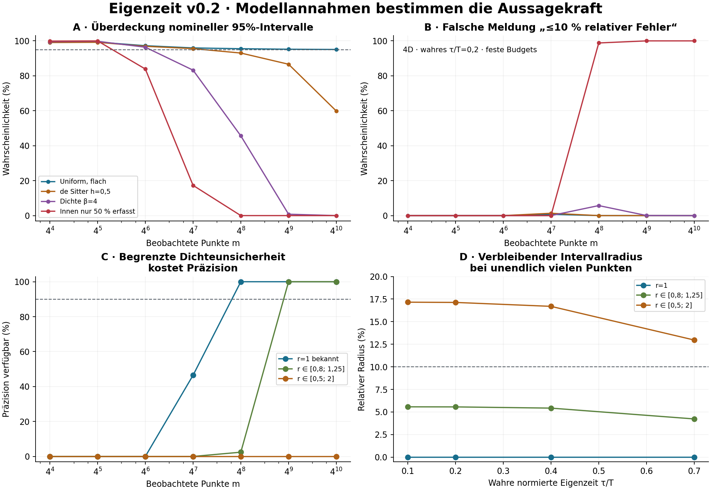

# Eigenzeit v0.2 — Gültigkeitsbereich und Informationsbedarf

Vorab festgelegte, deterministische Untersuchung: Wann liefern Ereigniszahlen
eine ausreichend präzise Eigenzeitschätzung, und wann verdecken enge Intervalle
eine falsche Modellannahme? Die vorhandene flache Referenz bleibt unverändert.

**Abgeschlossen:** 1.176 festgelegte Modell-/Budget-/Intervallkombinationen
berechnet und vollständig reproduziert. Alle 714 Kombinationen innerhalb
ihrer deklarierten Modellklasse erreichen mindestens 95% Überdeckung;
192 erfüllen zusätzlich das Präzisionsziel. 522 bleiben zu unpräzise,
462 liegen ausserhalb der jeweils vorausgesetzten Modellklasse.

**Mehr Daten beheben keinen unbekannten Dichtefehler.** Vorab begrenzte
Dichteunsicherheit lässt sich konservativ absichern, kann aber die gewünschte
10%-Präzision dauerhaft verhindern. Keine allgemeine Krümmungsfreigabe.

[Ergebnisse](RESULTS.md) · [Prüfvertrag](contract.json) · [Herleitung und Grenzen](DERIVATION.md) ·
[Bestehende Eigenzeitreferenz](../lorentz_proper_time_publication/README.md)



[Alle numerischen Ergebnisse (ZIP)](results.zip) · [Prüfsumme](ARCHIVE.json) ·
[Gegenprüfung](VERIFICATION.json) · [Ausgewählte Tabellen](summary.json)

Geprüft werden flache Modelle in d=2,3,4, eine bekannte de-Sitter-Familie,
veränderte Dichte, unabhängiges Ausdünnen und konforme Dichtezwillinge.
Zusätzliche konservative Intervalle erlauben vorab begrenzte Dichtefehler
im flachen Modell. Diese Grenzen müssen von aussen begründet sein.

Die Auswertung berechnet endliche Binomialwahrscheinlichkeiten direkt.
Es sind keine neuen Monte-Carlo-Punktwolken oder physischen Messungen.
Alle Budgets sind beobachtete Punktzahlen; fehlende Messungen können den
Akquisitionsaufwand zusätzlich erhöhen. Keine allgemeine Krümmungsdiagnose.

## Ausführen

Python 3.12, POSIX, vom Repository-Stamm:

```sh
python3 -m pip install -r research/lorentz_proper_time_validity/requirements.txt
OPENBLAS_NUM_THREADS=1 OMP_NUM_THREADS=1 MKL_NUM_THREADS=1 python3 -B research/lorentz_proper_time_validity/verify.py --selftest
OPENBLAS_NUM_THREADS=1 OMP_NUM_THREADS=1 MKL_NUM_THREADS=1 python3 -B research/lorentz_proper_time_validity/reproduce.py
```

Erwartet: `PASS_FULL_PROPER_TIME_VALIDITY_REPLAY`. Der Replay entpackt das
Archiv temporär, prüft alle eingefrorenen Quellen gegen den öffentlichen
Commit `67dc77089af09063e0f0069ad71e08aa622fef44`, rechnet die Geometrie und
Intervallüberdeckung getrennt nach und wiederholt alle 1.176 Auswertungen.
`--archive-only` überspringt nur den vollständigen Neulauf.
Die sechs eingefrorenen Forschungsdateien sind unverändert. Die ergänzte
Hülle `reproduce.py` dient allein zum Lesen des komprimierten Archivs.

Ein neuer Ziellauf braucht einen neuen Ausgabeordner:

```sh
OPENBLAS_NUM_THREADS=1 OMP_NUM_THREADS=1 MKL_NUM_THREADS=1 python3 -B research/lorentz_proper_time_validity/run.py --source-ref 67dc77089af09063e0f0069ad71e08aa622fef44 --output /tmp/eigenzeit-v02-new
```

Die Grafik wird mit `python3 research/lorentz_proper_time_validity/draw.py`
aus dem Archiv neu erzeugt. Vollständige Git-Historie ist für Quellpins nötig.
Eine erfolgreiche Softwareprüfung ist keine unabhängige wissenschaftliche
Replikation und bestätigt nicht automatisch die Modellannahmen realer Daten.

English: A prospective deterministic validity map for the existing proper-time
reference, including known geometry, density and observation deviations.
Pointwise fixed-budget confidence only; no universal curvature or physical
clock claim. Code and original documentation: Apache-2.0.
