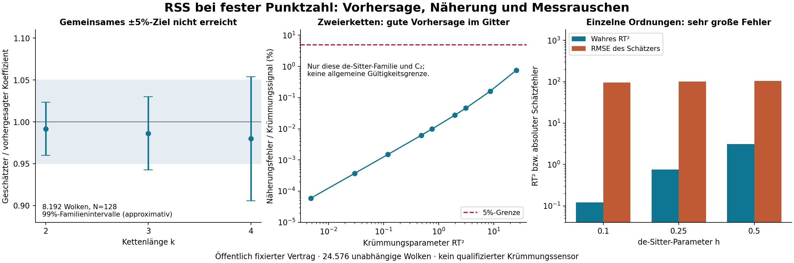

# Bedingte RSS-Momente: Ergebnis und verbleibende Grenzen

**Die mathematische Anpassung ist abgeschlossen. Das gemeinsame numerische
±5%-Präzisionsziel ist nicht erreicht. Eine brauchbare allgemeine
Krümmungsrekonstruktion aus einzelnen Ordnungen mit N=64/128 ist durch diesen
Versuch nicht belegt.**

Die exakte Konditionierung und die Volumennormierung ergeben
A_k=alpha_k-k*alpha_1 und B_k=beta_k-k*beta_1. Die
[Herleitung](DERIVATION.md) enthält außerdem die exakte Kovarianzidentität
über Teilmengenüberlappungen. Der alte Krümmungsbenchmark verwendete bereits
die richtige kombinatorische Normierung; sein Negativbefund bleibt gültig.

## Quellenfixierung und Budget

- Öffentlicher Quellencommit vor dem ersten Zielversuch:
  [`485d8663391966458965b6c282ef4add4eafdd46`](https://github.com/thomasmgfeller/x6-spectral-astrolabium/commit/485d8663391966458965b6c282ef4add4eafdd46).
- Erster Lauf: **17. Oktober 2026, 22:39:33 UTC**, entsprechend
  **18. Oktober 2026, 00:39:33 Europe/Zurich**.
- 8.192 unabhängige flache Wolken mit N=128 für die gewichteten,
  zeitgespiegelten Vorwärtsintegrale. Mehrere h-Werte derselben Wolke
  sind gekoppelt und zählen nicht als unabhängige Wiederholungen.
- 16.384 weitere unabhängige direkte Volumenbeprobungen:
  N=64/128, h=0/0,1/0,25/0,5, jeweils 2.048 Ordnungen.
- Insgesamt **24.576 unabhängige Wolken**. Kein Nachziehen weiterer Seeds,
  keine Anpassung der eingefrorenen Kriterien nach Einsicht in Ergebnisse.
- Beobachtete Laufzeit rund 16,8 Sekunden, Spitzen-RSS rund 89 MiB in dieser
  Umgebung. Kein vergleichender Leistungsbenchmark. Grenze: 600 Sekunden,
  2 GiB Adressraum pro Ziellauf.

Dies ist eine öffentliche Quellenfixierung innerhalb des Projekts, keine
unabhängige Präregistrierung oder externe wissenschaftliche Replikation.

## Führende Krümmungskoeffizienten

In vierdimensionalem de Sitter gilt R00=-R/4. Die vorhergesagten relativen
Antworten je RT² sind b2=1/90, b3=1/42 und b4=1/27. Der Primärtest benutzt
die analytische h²-Ableitung der Gewichtprodukte; kein nachträglich gewählter
Differenzenquotient und keine Anpassung einer Kurve an die Ergebnisse.

| Kettenlänge | RSS-Vorhersage | Simulierter Mittelwert | Approximatives 99%-Familienintervall | Intervall vollständig innerhalb ±5%? |
|---|---:|---:|---|---|
| 2 | 0,011111111 | 0,011018844 | [0,010664836; 0,011372851] | Ja |
| 3 | 0,023809524 | 0,023481007 | [0,022440909; 0,024521104] | Nein |
| 4 | 0,037037037 | 0,036290393 | [0,033549906; 0,039030881] | Nein |

Alle drei Vorhersagen liegen innerhalb der Intervalle. Die Punktwerte weichen
um etwa -0,83%, -1,38% und -2,02% ab; die Unsicherheit ist für den geforderten
gemeinsamen Äquivalenznachweis aber zu groß. Der eingefrorene Gesamtstatus
lautet daher **`FORWARD_SLOPE_NOT_RESOLVED`**.

Die Intervalle sind Student-t-Intervalle mit Bonferroni-Korrektur über alle
21 vereinbarten Einträge (drei Ableitungen und 18 endliche h-Antworten).
Sie sind große-Stichproben-Näherungen, keine exakten endlichen Garantien.
Die geringe Varianz dieser gekoppelten Integration ist nicht die Messvarianz
einer einzelnen gekrümmten Kausalordnung.

## Unabhängige Zweierketten-Integration

Die räumlichen Kugelschnittvolumina werden direkt integriert; RSS-Koeffizienten
gehen nicht in diese Referenz ein. Die festgelegten Quadraturordnungen
12,20,32 stimmen auf allen zehn ausgewerteten h-Werten bis höchstens
5,62e-13 absolut überein (Schwelle 1e-10). Die flache Referenz ist exakt
p2=1/10 und wird numerisch reproduziert.

Ausgewählte Werte; Fehler relativ zum Krümmungssignal p2(h)-p2(0):

| h | RT² | Numerisches p2(h) | Relativer Fehler der führenden RSS-Näherung |
|---|---:|---:|---:|
| 0,02 | 0,00480032 | 0,100005333686 | 0,00005955% |
| 0,10 | 0,12020038 | 0,100133553977 | 0,001501% |
| 0,25 | 0,75790730 | 0,100842036451 | 0,009830% |
| 0,50 | 3,13131381 | 0,103477634450 | 0,046098% |
| 0,80 | 8,61496397 | 0,109556872364 | 0,160197% |
| 1,25 | 25,80173279 | 0,128453001483 | 0,757707% |

Alle geprüften positiven h-Werte unterschreiten für **C2 in dieser Familie**
die festgelegte 5%-Fehlergrenze. Eine obere Gültigkeitsgrenze wurde damit
nicht gefunden. Die überraschend gute Übereinstimmung auch bei h=1,25
ist ein beobachteter Spezialfall dieser Größe; sie rechtfertigt weder eine
allgemeine Klein-Krümmungsbehauptung noch dieselbe Genauigkeit für C3/C4.
Quadraturkonvergenz ist keine zertifizierte Fehlerschranke. Aussagen zwischen
den Gitterpunkten oder außerhalb dieser Modellfamilie sind nicht geprüft.

Auch bei allen acht direkten Stichprobenzellen liegt die unabhängige
C2-Referenz innerhalb des dafür festgelegten approximativen Familienintervalls.
Das ist ein Konsistenzbefund und kein weiterer Äquivalenznachweis.

## Kovarianz und lineare Rekonstruktion

Die C2/C3-Korrelation beträgt in den direkten Zellen etwa **0,85 bis 0,90**.
Alle Kovarianzen einschließlich C4 stehen in `results/summary.json`. Eine
Behandlung als unabhängige Zählwerte würde die Unsicherheit falsch abbilden.

Die bedingte 2-mal-2-Matrix für die führenden Mittelwerte von C2/C3 hat
Determinante -4/99225 und ist algebraisch invertierbar. Ihre 2-Norm-
Konditionszahl in der gewählten dimensionslosen Parametrisierung beträgt
etwa 62,98. Die Inversion verstärkt die vorhandenen Schwankungen stark.

| N | h | Wahres RT² | Einzelordnungs-RMSE für RT² | Einzelordnungs-RMSE für R00T² |
|---|---|---:|---:|---:|
| 64 | 0 | 0 | 168,81 | 57,66 |
| 64 | 0,1 | 0,1202 | 163,33 | 55,27 |
| 64 | 0,25 | 0,7579 | 164,62 | 56,09 |
| 64 | 0,5 | 3,1313 | 169,54 | 58,80 |
| 128 | 0 | 0 | 97,51 | 33,57 |
| 128 | 0,1 | 0,1202 | 96,53 | 32,94 |
| 128 | 0,25 | 0,7579 | 101,45 | 34,72 |
| 128 | 0,5 | 3,1313 | 104,50 | 35,48 |

Diese explorative Inversion nutzt die analytischen Koeffizienten und keine
an den Testdaten angepassten Parameter. Negative Werte werden nicht
abgeschnitten. Empirische Mittelwerte und Bias stehen im Rohbericht; sie
sind keine separat nachgewiesenen systematischen Fehler. Für diese Inversion
wurde keine Unsicherheitsüberdeckung qualifiziert. De Sitter prüft nur eine
Ricci-Richtung, sodass auch ein präzises Ergebnis hier keine allgemeine
Trennung von R und R00 validieren würde.

## Reproduktion und offengelegte Reparatur

Der erste direkte Aufruf von `verify.py --replay` scheiterte vor dem Replay:
`run.py` hatte das ältere Krümmungspaket an den Anfang des Importpfads gestellt,
sodass dessen gleichnamiges `selftest.py` geladen wurde. Fehlermeldung:
`ImportError: cannot import name 'features' from 'core'`.

Die nachträgliche Hülle `reproduce.py` lädt gezielt das neue Prüfmodul vorab
und stellt dessen Importvorrang wieder her. **Kein eingefrorener Quelltext,
Zielversuch, Grenzwert oder Prüftoleranz wurde geändert.** Alle Originaldateien
werden gegen den öffentlichen Quellencommit geprüft. Ein vollständiger
erneuter Lauf reproduzierte 24.576 Relationshashes, 73.728 ganzzahlige
Kettenwerte, 172.032 gewichtete Ableitungs-/Antwortwerte und sämtliche
wissenschaftlichen Entscheidungen. Float-Toleranz: 1e-9 relativ + 1e-11 absolut.

Siehe [Replay-Protokoll](replay.log), [Prüfsummen](results/hashes.json),
[Verifikationsübersicht](VERIFICATION.json) und
[CI-Prüfweg](../../.github/workflows/lorentz-rss-fixed-n.yml).
Der Softwarestatus `PASS_FULL_RSS_FIXED_N_REPLAY` ändert den wissenschaftlichen
Status `FORWARD_SLOPE_NOT_RESOLVED` nicht.

## Nächste Abnahme

Vor größeren Simulationen den Informationsbedarf und die Zielgenauigkeit
festlegen. Insbesondere getrennt untersuchen: eine de-Sitter-Rekonstruktion
mit bekannter Beziehung R00=-R/4 und eine allgemeine Rekonstruktion zweier
Ricci-Größen. Für letztere sind unabhängige Geometriefamilien, eine Prüfung
der Restterme und kovarianzbewusste Unsicherheitsintervalle nötig. Ein neues
Budget braucht einen neuen Vertrag und frische Seeds; dieser Versuch bleibt
abgeschlossen. Absolute Krümmung benötigt eine unabhängige Skala, und die
Ununterscheidbarkeit bei frei variierender Beprobungsdichte bleibt bestehen.

## English summary

Conditioning RSS chain moments on a fixed count changes both the factorial
normalization and the curvature coefficients through the physical volume.
The exact conditional mean and overlap covariance identity are documented.
A public source freeze preceded 24,576 independent clouds. The joint ±5%
equivalence gate for three leading de Sitter coefficients was not met:
all predictions lie inside the approximate simultaneous intervals, but the
C3/C4 intervals are too wide. Independent geometric C2 quadrature agrees
closely with the corrected expansion at every tested grid value, including
some beyond the asymptotic regime; that observation is specific to C2 and
this family. The exploratory two-parameter inverse has very large
single-order error at N=64/128. A full replay passes after an explicitly
documented import-order wrapper repair, with all frozen sources unchanged.
There is no qualified general curvature sensor, no absolute scale recovery,
and no removal of the unrestricted sampling-density ambiguity.
