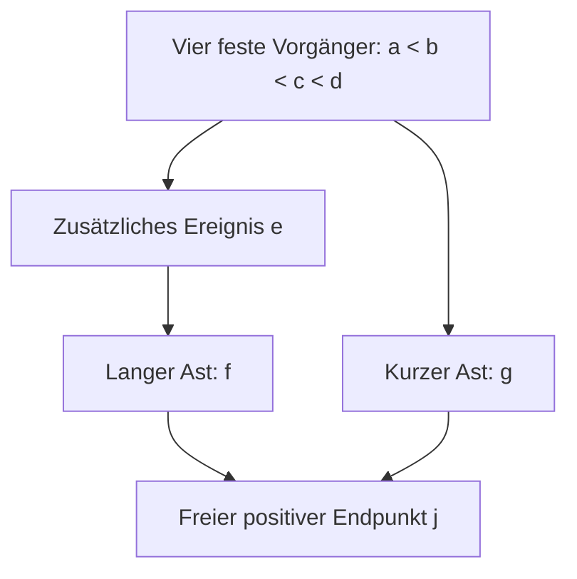

# CST-DUST: Asymmetrie und Endpunktkriterium v0.1

Die kleinste asymmetrische Erweiterung des Diamanten aus PR 271 fügt
in genau einen Ast ein Ereignis ein. Es entstehen die Astlängen (2,1):



Die globale Intervallzählung liefert einen strikten Ausschluss: Bei
positiver Endpunktdichte und frei variierter Endpunktuhr kann ihre
Wirkungsableitung nicht verschwinden. Mit H=U-d gilt scharf
**7 < 2q_j/(rH) < 17**. Keine Neuwahl der geordneten Randuhren oder der
übrigen Dichtegewichte beseitigt diese notwendige Verletzung.

Die vollständige Vorzeichenprüfung für 16 Astlängenklassen unterscheidet
sechs ausgeschlossene Klassen und zehn Klassen mit exakt erfüllbarer
Endpunkt-Uhrgleichung. Diese zehn Ergebnisse sind ausdrücklich keine
vollständigen stationären Lösungen. Beim dokumentierten (2,3)-Uhrzeugen
ist die Endpunktnormierung beispielsweise 2507/2500 statt null.

Der Ausschluss setzt einen frei variierten positiven Endpunkt ohne
Nachfolger voraus. Eine feste Zukunftsranduhr oder zusätzliche Nachfolger
ändern die Variationsaufgabe und erfordern eine neue Prüfung.

**Alle acht physikalischen Gates bleiben HOLD.** Keine vollständige
asymmetrische stationäre Lösung, kein physikalischer Außenraum, keine
Randpräparation, keine Rückwirkung, keine dynamische Stabilität und kein
Bounce hergeleitet. Kein allgemeines CST- oder Asymmetrieverbot.
Kein n=5-Produktionslauf und keine kostenpflichtige Rechnung.

Basis: [PR 271](https://github.com/thomasmgfeller/x6-spectral-astrolabium/pull/271),
Main `5b5907de8ab087183e9a6a0072336226ae0fa771`.
8. November 2026 (Zürich).

## Unterlagen und Reproduktion

- `CST_DUST_Asymmetrie_Endpunktkriterium_v0_1.pdf`: sechsseitiger Bericht.
- `DERIVATION.md`: Beweise, scharfe Schranke und vollständige Uhr-Vorzeichenmatrix.
- `endpoint_contract.json`: Annahmen, Resultate und Aussagegrenzen.
- `inputs/`, `provenance.json`: unveränderte Ausgangsquellen.

Python 3 und Standardbibliothek genügen:

```sh
python3 -O -B verify_package.py
python3 -O -B replay.py
```

Fünf symbolische Identitäten, 588 Uhrprofile samt unabhängigen
Wirkungsableitungen, 162 normierte Schrankenfälle, sechs scharfe
Grenzfolgenwerte, 26 Kontrollen langer Äste und sieben Negativkontrollen
bestehen exakt. Zehn rationale Uhrzeugen sind mit ihren Normierungsresten
gespeichert. Vier Ergebnisdateien werden isoliert bytegleich reproduziert.
`package.py` baut das deterministische ZIP. Nur die optionale PDF-Erzeugung
benötigt ReportLab und DejaVu.

Der lokale Plan wurde nach analytischem Entwurf vor dem endlichen
Kontrolllauf gehasht. Keine externe Präregistrierung oder Replikation.

Nächster Schritt: die vollständigen inneren Gleichungen eines vorab
gewählten asymmetrischen Kandidaten wie (2,3) prüfen. Das Bestehen der
Endpunkt-Uhrprüfung allein genügt dafür nicht.
