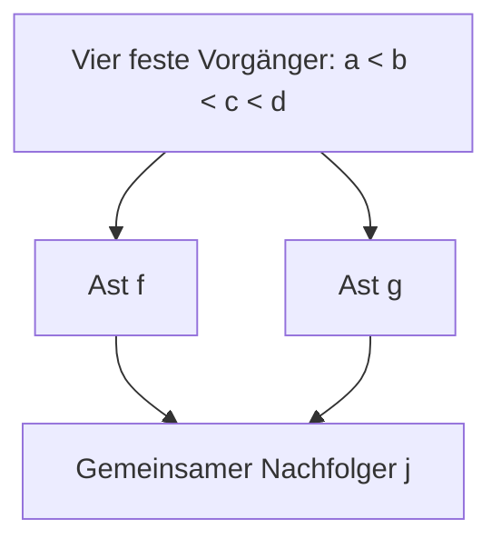

# CST-DUST: Verzweigung und Wiederanschluss v0.1

Die reine Kette wird durch eine Gabel und ihren gemeinsamen positiven
Zukunftsanschluss ergänzt. Vier feste Vorgänger bleiben geordnet, ihre
Dichtezeilen sind null. Die beiden Äste sind kausal unvergleichbar.



Das Bild fasst die vier Kragenelemente in einer Box zusammen. Die Relation
enthält auch alle transitiven Paare. Ohne j entsteht die offene Gabel.

Die offene Gabel ist genau bei A=P=0 innerlich stationär; ihre Astuhren
können unabhängig gewählt werden. Mit positivem Wiederanschluss gilt
stattdessen P<0. Beide Äste müssen denselben Skalaruhrwert und dasselbe
Dichtegewicht tragen. Ihre Ereignisse bleiben dennoch unvergleichbar.

Eine vollständige Familie zulässiger Diamantkragen ist hergeleitet.
Der äußere Randbereich hat eine unabhängige Gleichheitsbedingung und
Dimension drei; bei festem Kragen bleibt ein positives Dichtegewicht frei.
Die explizite äußere Reaktion verschwindet nicht.

Zwei Kettenarme lassen sich hier nicht ohne Intervallkorrektur addieren:
Die vier notwendigen Koeffizienten sind (-8,32,-49,35). Die fünf gemeinsamen
Elemente verhindern die Umklassifizierung interner Intervalle nicht.

**Alle acht physikalischen Gates bleiben HOLD.** Der zusätzliche Nachfolger
ist positive Materie, kein Vakuum-Außenraum. Keine physikalisch ausgewählte
Randpräparation, Geometrie-Rückwirkung, dynamische Stabilität oder
Bounce-Herleitung. Kein n=5-Produktionslauf und keine kostenpflichtige Rechnung.

Basis: [PR 270](https://github.com/thomasmgfeller/x6-spectral-astrolabium/pull/270),
Main `3ddc2a6a22f2cc084806b2917c036593912e3d43`.
8. November 2026 (Zürich).

## Unterlagen und Reproduktion

- `CST_DUST_Verzweigung_Wiederanschluss_v0_1.pdf`: sechsseitiger Bericht.
- `DERIVATION.md`: vollständige Beweise, Parametrisierung und Grenzen.
- `branched_contract.json`: maschinenlesbare Annahmen und Status.
- `inputs/`, `provenance.json`: unveränderte Ausgangsquellen.

Python 3 und Standardbibliothek genügen:

```sh
python3 -O -B verify_package.py
python3 -O -B replay.py
```

10 symbolische Identitäten, 32 Verklebungsfälle, 224 Reaktionskomponenten,
81 stationäre Gabeln, 54 stationäre Diamanten, 216 automatisch differenzierte
Randkomponenten, 108 Astuhrstörungen, 108 Restfehlerbudgets und acht
Negativkontrollen bestehen exakt. Sechs von zwölf Formen sind zulässig;
die sechs anderen ergeben mit drei Verschiebungen 18 Vorzeichenausschlüsse.

Vier Ergebnisdateien werden bytegleich reproduziert. Die Diamantwerte
speichern L², die skalierten Uhren Y=T/L und Reaktionen q/L explizit; alle
Normierungen rechnen L² mit. Es werden keine dimensionslosen Y als
unskalierte Uhren ausgegeben. `package.py` baut das deterministische ZIP.
Nur die optionale PDF-Erzeugung benötigt ReportLab und DejaVu.

Der lokale Plan wurde nach analytischem Entwurf vor dem ersten endlichen
Kontrolllauf gehasht. Keine externe Präregistrierung oder externe Replikation.

Nächster Schritt: eine vorab festgelegte asymmetrische Verzweigung prüfen.
Damit lässt sich klären, welche Astgleichheiten nur aus den identischen
Zeilen der jetzigen symmetrischen Ordnung folgen.
