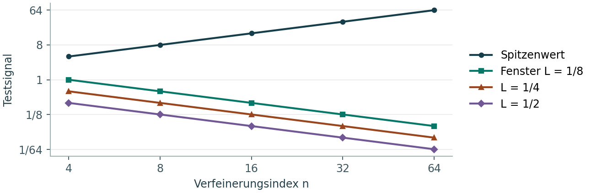

# CST-DUST · Prüfberichte zu den Etappen 8 und 9

**18. November 2026.** Die beiden internen Artefaktprüfungen setzen bei den [Etappen 4 bis 7](../stage_reviews_4_7/README.md) an. Sie untersuchen zwei Fragen. Kann dieselbe Dynamik den Zustand eines Staubballs über die klassische Singularitätszeit transportieren? Welche Messungen könnten zeigen, dass Materie, Geometrie und kausale Zukunft bei diesem Durchgang regulär bleiben?

**Physikalischer Status: `HOLD_NOT_ELIGIBLE / NOT_RUN` für 8A–8C und 9A–9D.** Der rückwirkende physikalische Transport und die 524 dynamischen P3-Vergleiche stehen aus. Die folgenden Rechnungen prüfen die Referenzen und die Aussagekraft der vorgeschlagenen Tests. Ausgangspunkt ist der [Stand nach PR #302](https://github.com/thomasmgfeller/x6-spectral-astrolabium/commit/d9aab823f32d69f45790027216f5469cbddb57ef).

| Originalbericht | Geprüfter Befund | Offene physikalische Entscheidung |
| --- | --- | --- |
| [8 · Dynamik durch den stark gekrümmten Bereich (PDF, 5 Seiten)](../reports/CST_DUST_Etappe_8_Artefaktpruefung.pdf) | Bei den Massen 1/4, 1 und 4 endet das gemeinsame P3-Fenster bei 1/8, 1/4 und 1/2 der jeweiligen klassischen Singularitätszeit. In einer exakt zusammensetzbaren Quantenreferenz interferieren die Zwischenwege. | Für dieselbe Präparation den ganzen Weg bis in den kritischen Bereich und hindurch auswerten. Die fünf vorgeschlagenen Uhrmarken ergeben acht Unterteilungen. Vier davon enthalten den kritischen Uhrwert als eigenen Schnitt. Die Abnahme des Transports und die einer Wahrscheinlichkeit für den Bounce sind getrennte Entscheidungen. |
| [9 · Regularität, Trapping und globale Anschlussfähigkeit (PDF, 6 Seiten)](../reports/CST_DUST_Etappe_9_Artefaktpruefung.pdf) | Im reduzierten Dirichlet-Modell beträgt das mittlere Minimalvolumen 77/79. Das zweite inverse Volumenmoment divergiert zu jeder positiven Zeit. Im bedingten effektiven Anschlussmodell gibt es für einen benannten Parametersatz einen Bounce ohne zuvor gefangene runde Symmetriesphäre. | Für die dynamischen CST-Historien fehlen uniforme Materie- und Geometrieschranken, der gemeinsame Innen-/Aussenraum und die kontrollierte kausale Zukunft. Ein globaler Ereignishorizont bleibt offen. |

## Was feste Messfenster übersehen können

Das Testsignal hat Höhe *n* und integrierte Fläche 1/*n*. Sein Mittel im Fenster [−*L*, *L*] beträgt 1/(2*Ln*), sobald die Spitze ganz im Fenster liegt. Bei *n* = 64 ergeben die drei Fenster die Mittel 1/16, 1/32 und 1/64. Für eine Aussage über punktweise Krümmung braucht es über die verschmierten Messwerte hinaus eine zusätzliche Schranke.



## Nachrechnen

Aus dem Repository-Stamm mit Python 3 ausführen. Die [Nachrechnung](verify.py) verwendet rationale Arithmetik und die Standardbibliothek. Sie kontrolliert die P3-Endzeiten, die vorgeschlagenen Unterteilungen, das Dekohärenzfunktional des Zweischritt-Beispiels, die Momentenbeispiele, die drei Glättungsfenster und die positive Untergrenze für die Metrikfunktion im effektiven Aussenraum.

```sh
python3 -B research/rax_cqg/dust_collapse/stage_reviews_8_9/verify.py
```

Für die [Abbildung](plot_windows.py) wird zusätzlich Matplotlib benötigt. Der Zielpfad ist frei wählbar.

```sh
python3 -B research/rax_cqg/dust_collapse/stage_reviews_8_9/plot_windows.py fenstermittel-replay.png
```

### Zugrunde liegende Rechnungen

- [Klassische Korrespondenz und P3-Vertrag](../correspondence_v0_1/README.md) und [Uhrintervalle mit variablem Ereignisbestand](../clock_intervals_v0_1/DERIVATION.md).
- [Dirichlet-Gegenbeispiel und uniforme Restschranke für kleine Volumina](../regularity_v0_2/DERIVATION.md).
- [Expansion und lokales Trapping](../expansion_trapping_v0_1/DERIVATION.md) und [klassischer Randanschluss und bedingte Aussenraumkonstruktion](../boundary_completion_v0_1/DERIVATION.md).
